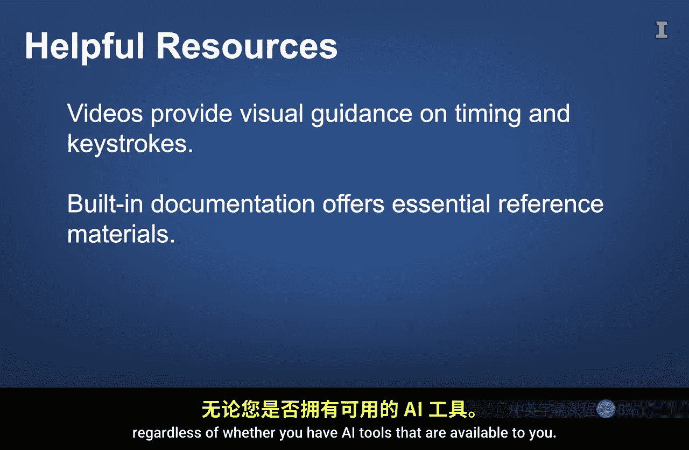
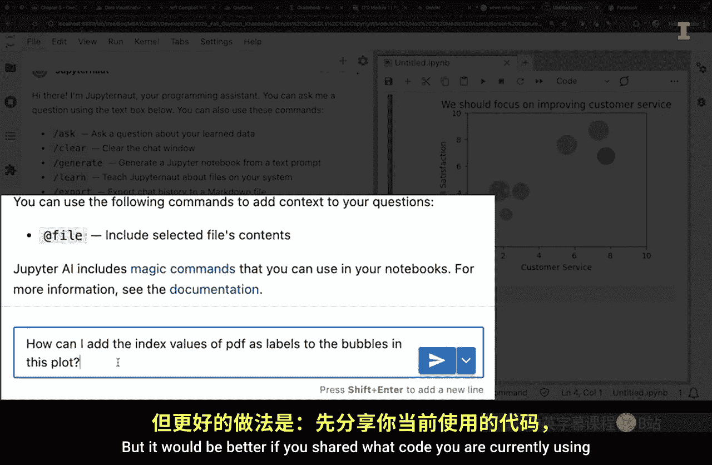
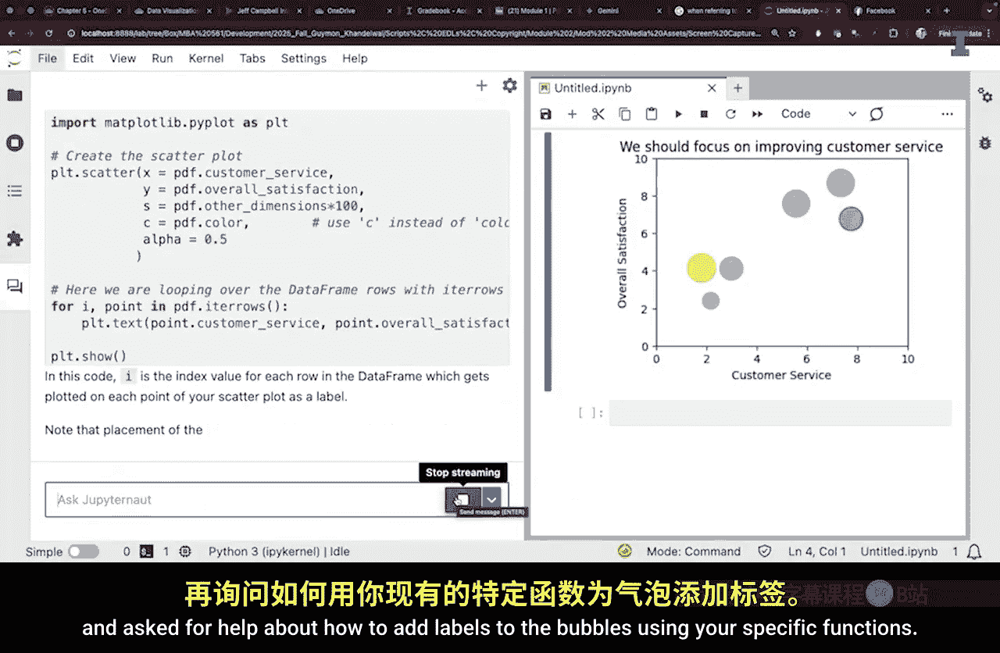
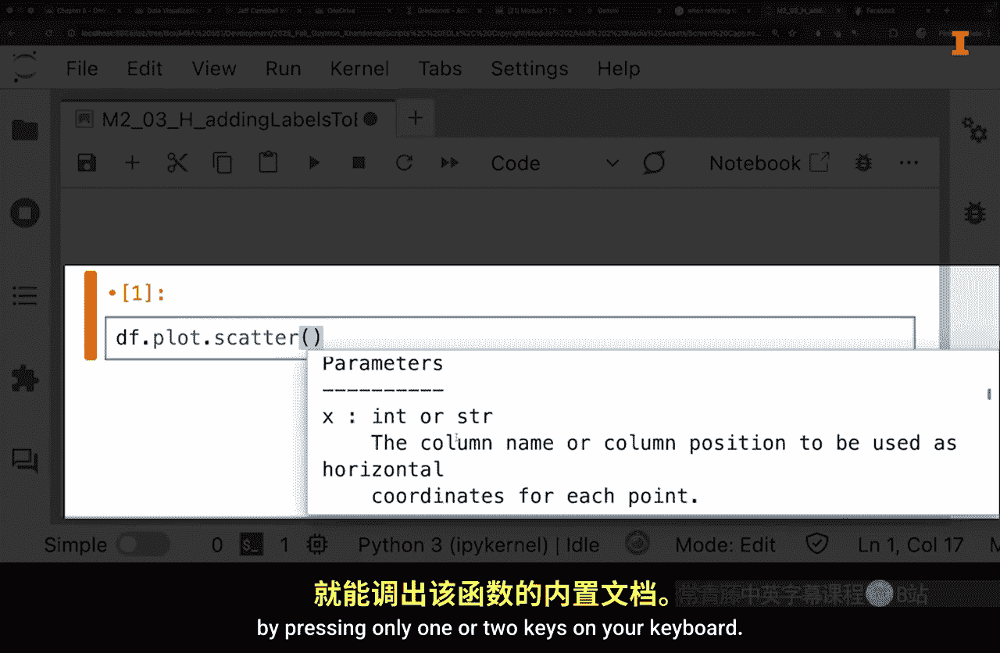
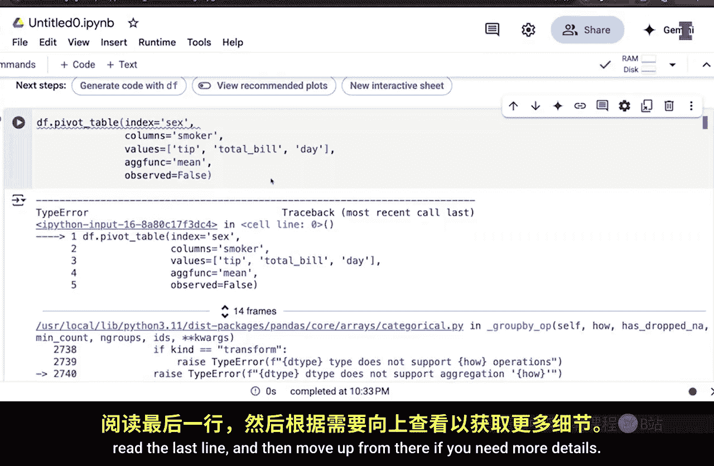
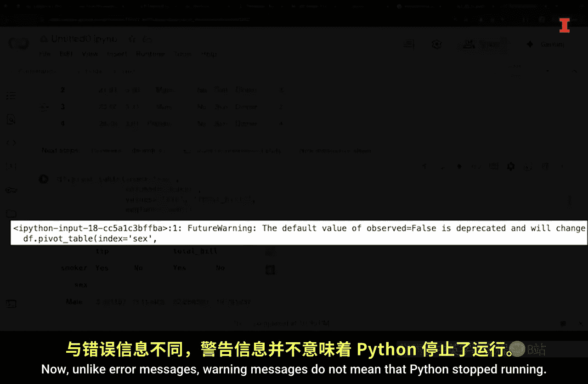

# 伊利诺伊大学【中英⚡商业分析｜Business Analytics Specialization】 p23 P23 02_构建 Python 问题 -BV1z86nB9EGz_p23-

嗯。Hello everyone and welcome， today we're surrounded by the stunning red rock formations of Bryce Canyon in southern Utah。

Take a look at the incredible canyons layers， it's a place that inspires questions like how did this come to be？

In this module， we're going to talk about framing questions， specifically about using Python。

I asked an experienced coder about how he gets his coding questions answered。

Let's listen to what he says。Will you start by telling us a little bit about yourself， your name。

 your position， who you work for and a little bit about your work history。 Sure。

 so my name is Jeff Campbell。 I've been。Working in the software engineering arena。

For probably 30 plus years now。I've I've currently worked for the Church of Jesus Christ of Latterity Saintts as the most senior software developer for the mobile team working on mobile apps。

Throughout my career， I've worked both nonprofit and for profit type of businesses。

 I've worked in Noelle， Ive worked at Intuit， working on Quickbooks。I've worked for the state。

 and I've worked for startups。've， I've kind of gone the rounds of。

Corporate type of business to startup type of business， to personal things and all the like。

What is it that you like like what kind of tools does it provide that help you code because I think a lot of people think they have to memorize code and while I'm sure that helps。

I'm， I've， I think over the years， I've learned that。

Most people don't remember the particular syntax， but they use built in tools is that is is there any true that0%。

 I mean， these languages are huge， and it's not just the languages。

 but the libraries you use with those languages to help you do the work that you're doing。

And so any tooling that the I D can help you with with code completion or helping to auto write sections of code or refactoring。

 Reffactoring is such a big one。 You know， I worked on a project where。They didn't have a good I D。

 We had to just use that I E， and it became almost impossible to fix or change or and you would add something new。

 And you didn't know what you busted。 So having a good I E goes， okay。

 I'm watching people who are calling this code I'm making And the things I'm consuming and it'll be able to help identify problems early and often for you。

 so you can go， oh， okay， and and of course， it does。 it's like a spell checker in some respect。

 right， Can imagine writing I used to in the days used to write on a typewriter And and going to a word document or something like that was groundbreaking because it's like。

 oh， a spell checker And and now you have things that auto fix your sentence structures。 Well。

 the same thing is with I E。 It's gonna provide you that tooling to make you able to focus on the task at hand instead of。

😊，You know， going， I can't remember how this is done。 And。

 and it's even getting better with the AI stuff that's now becoming a integrated piece to all the I Ds that I'm aware of that we use Also。

 I'm glad you brought that up， Because I was gonna ask you， what do you think about AI， Like。

 how much do you use it， do you use those integrated tools into the I D E。 Yeah。

 so the AI is an interesting thing because it's a love， hate situation。😊。

I like the AI because it does write more。 the code completion that the I D E came with on its own did simple tasks of doinging。

 I know all the functions。 I know all the variables。 I know this basic syntax of。

 of the language she would should write。😊，But looking further and saying， well。

 I see you have this set of functions and you're writing inside of this type of class。

And I can see you're starting to write this thing。 Maybe I can help you finish writing the thing you。

 you meant to write。And， and several times， I've gone， oh， wow， that's exactly what I was gonna do。

 And he saved me writing T 5，10 lines of code。 And most of the time where we use it。

 It's just simply finishing the line which I'm writing， filling in the rest of the blank。

 It's not typically that we take。Huge blocks of code。So that is the nice thing。

 is it goes way beyond the， the basic。Code completion where。You have to be very careful。Is that。

It produces code。That I always have to second guess。Because it put it down there。

 But I end up having to read through it。 And I'm like，Nice try。 It It's not quite what I wanted。

The the concepts right， but you're wrong。 Yeah， I'll give an example。

 I was doing this even last night。 I had to go through and do translations for in in the kind of job right now。

 I have， we support 1 14 languages。 And I had to go put in languages for a certain term。

 And as I was doing it， the AI was trying to fill it in。 I recognize， I'm in Cambodian。

 And I was trying to use the word learn more。 And I couldn't just go。😊，Well。

 I hope the autocomplete of what it filled in in Cambodian was actually the the word I was looking for。

And it would only get it， correct。60% of the time。 Oh interesting。 So it could be cat catastrophic。

If it used a word that then we just went ahead and shipped it。

 That was maybe offensive in the language to which Sha was targeting。 So in the in coding。

 it could be that it could cause。Data corruption， it could cause misinterpretation of the data。

 So you have to use these tools with。Care and let it do the。You could potentially take the。

The suggestion it has， as long as you really look through and make sure what you got， we。

 we almost have taken a mindset that we think maybe the future of software development may be。

U assisting the code， the AI as it's building it and confirming that it's getting the right track。

 So we become a set of code review engineers。 interesting。Instead of us right， because they， I mean。

 we've got tooling now that will take， you can take a picture of what the designer wants。

 and it will write the whole code for what that picture has。Yeah， but you have to look through it。

 And， there's just more likely we just have to go through and correct a bunch of things。

 It's I got the basics on there。 But so。Like it。But it its， it's， it's， it's， it's coming。

 I'm sure we'll get much， much better But it you take it with a grain salt salt Well， that's helpful。

 I， I those are some great gems in there。 I think that you shared about AI。 And yeah。

 that you have to。Kind of validate it。 you can't just。Blindly， let it do something。 And。

 but I can totally see， especially as a new software developer。 you might think， oh。

 that's how you do it。 And you just take it for what， what it suggested。 And you'll， you'll find， oh。

 it actually worked。 But what you may not see is that you're leaking memory。😊。

Or you're doing it in a way that's just gonna， it's gonna take double the time or triple the time to actually do it because。

Where did it come up with that idea of doing that， You know。

 and sometimes learning how to use the AI right where you， we find that you have to massage。The， you。

 you make a request to it。 and then you do it。 And they say， well。

 can you tune that with a focus of this， And then it does it again。 and。

 and you instead of just taking it at says value， the first try and what it presents you with。 Yeah。

 so you got a。Keep asking it questions in reading through it。 But the thing is， is。

 how would you know that， unless you， you've built a foundation of your own of going， okay。

 I have some basic， good principles of software development where I can recognize。Patterns。

And to make sure that those patterns are， are followed through。

Let's consider three typical scenarios in which you would want to frame a question about how to use Python。

These three scenarios are asking for help to create Python code when you're first starting a project。

Asking for help to augment your existing Python code and asking for help to fix errors in your code。

So let's start by considering the first scenario in which you ask for help to create Python code when you're first starting a project。

Let's say you want to make predictions about future sales using historical sales data。

One important tip is to make sure that you include information about the data。

Regardless of who you' are asking for help， humans or AI。

 try to include what each row in your data represents。

 as well as the column names and a sample of the data like the first five rows。

 This will provide some context that can be useful for identifying what analysis will work best。

 because not all analyses work on all types of data。

Another important detail is to keep in mind that you'll probably ask broad questions about a specific analysis before you start asking questions about the code to implement the analysis。

So plan on asking follow up questions to help you learn more about the suggested analysis。

You may find it easier to ask AI questions that you would be embarrassed to ask humans。

 like when you think you have a dumb question。Another thing to keep in mind when you are starting a project that you have never done before is that videos can be helpful。

Personally， whenever I need to do more than just implement code。

 I find videos to be really helpful because I can get a better idea of nuances like how long to wait and what keystrokes to use。

There is also built in documentation that we will show you how to access regardless of whether you have AI tools that are available to you。

Okay， now let's consider the second scenario when you want to augment your existing Python code。

An important thing to remember in this case is to provide your existing code。

This is important because there are often many ways to do things with code。

So it is more efficient to know what you are starting with so that you can build on that approach rather than using a totally different approach。

For example， assume that you have analyzed sales data and created a bubble plot of predictions。

You now want to add labels to the bubbles on your plot。

If you ask a generic question about how to add labels to a bubble plot。

You may get a response that leads you to create a different kind of bubble plot that requires different functions and different programming modules。

This is actually a benefit because there are many excellent programming modules that can be used to create bubble plots in Python。

But it would be better if you shared what code you are currently using and asked for help about how to add labels to the bubbles using your specific functions。

If you want quick access to the parameters for a specific function。

 most IDEs will allow you to access the built in documentation for a specific function by pressing only one or two keys on your keyboard。

How about when you're working in environments that have AI integrated into the environment？

You may be surprised at what you initially see and think that someone is reading your mind。

 Sometimes these AI tools infer what you want to do from your existing code。

 and they suggest large chunks of code that you can implement by simply pressing the tab key。

 It's pretty awesome。You may just have to highlight the code that you want help with and then enter your question。

 saving you time from needing to copy and paste your code in your IDE into the AI tool。Finally。

 let's now consider the third scenario when you're asking for help to fix errors in your code。First。

 don't be alarmed when you see an error message。 You will definitely see one or two of those along the way。

 and they may be very long。 However， it doesn't mean that you've broken anything。

 So don't worry too much。When Python encounters an error。

 it stops running and it prints a message that should help you identify the source of the error。

For our purposes， you just want to skip to the end of the error message， read the last line。

 and then move up from there if you need more details。

Python is a general programming language and the long parts of the error message will probably be useful to people who are creating new software。

 but not for you。You may also run into a warning message now unlike error messages。

 warning messages do not mean that Python stopped running。

The warning means that you might want to change your code to clarify what you are doing or to update your code to meet a new standard。

If you're using a programming language that has built in AI。

Then you may just need to click a button and that will explain the error message or the warning message that you get。

 and it may even suggest a way to fix your code。So whether you're exploring the intricacies of Python or the geological wonders of Bryce Canyon。

Remember that clear communication is key。 Consider the context of your project。

 Pro relevant details and be specific about your needs。Whether you're starting a new project。

 augmenting existing code or troubleshooting errors。

 clear communication and sharing pertinent information will help you get the most effective assistance。

