# 伊利诺伊大学【中英⚡商业分析｜Business Analytics Specialization】 p24 P24 03_利用外部资源构建问题 -BV1z86nB9EGz_p24-

An important thing that you should know。Is that there are a lot of tools to help you remember how to use code to perform various tasks。

 You do not need to， and you cannot memorize all the Python code。 It's impossible。In this video。

 I'll focus on getting help from external sources。 and in another video。

 I'll focus on getting help from built in documentation。

So I'm going to highlight how to get help with creating code from four different external sources。

 The first external source that I want to highlight is P P。org。

And this website is where you can find documentation for the third party modules that you can import and install using your package manager like PIip。

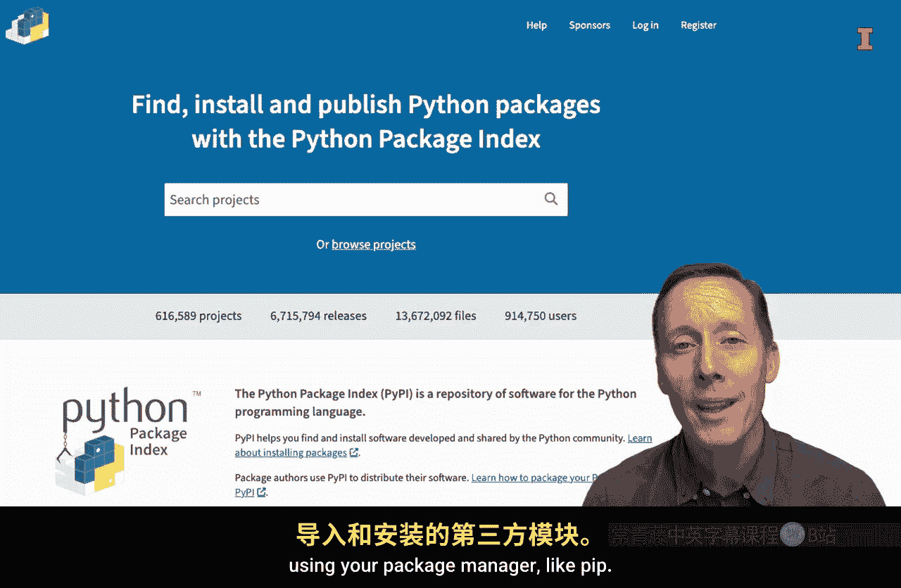

So when you go to this website， you'll notice that there are over 616，000 projects currently so。

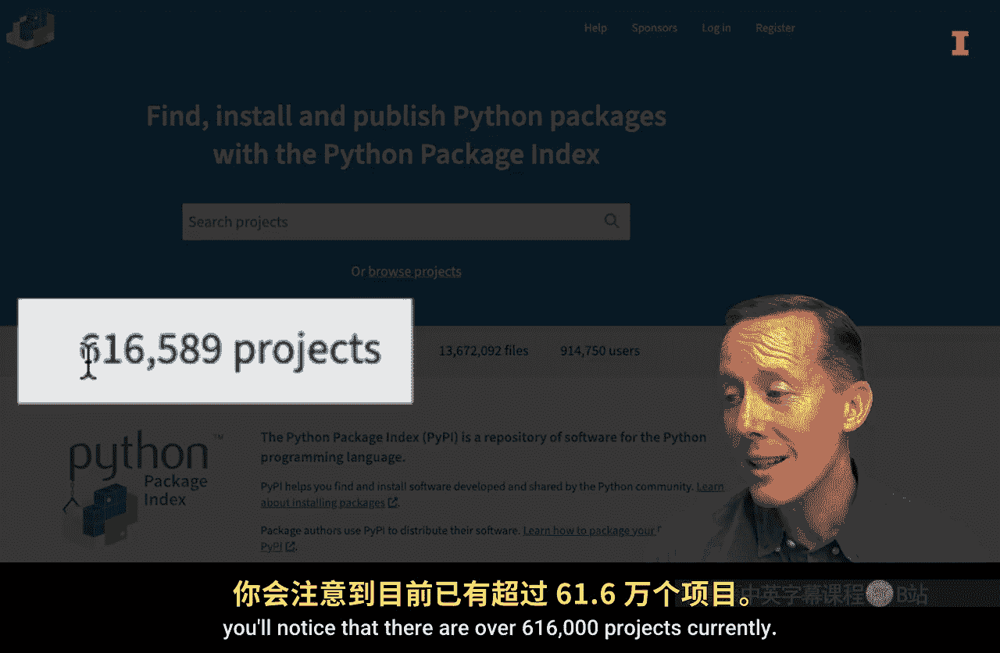

That's the number of modules that you could install and use within your Python environment。

So you can see why it's impossible to memorize all the Python code。All right。

 But this website is really good when you have questions about a module that you want to use。

 So let's go ahead and search for information about the pandas module。

 So I'll type that in and hit enter。 And you can see that there are over 10000 plus projects for pandas。

 So all of these have pandas in the name。 But there's really just one that we want to use。 and。😊。

You can sort by relevance or by date last updated， typically relevance for the things we are going to do We'll use very popular modules。

 So relevance will work fine。 But then if you click on pandas here。

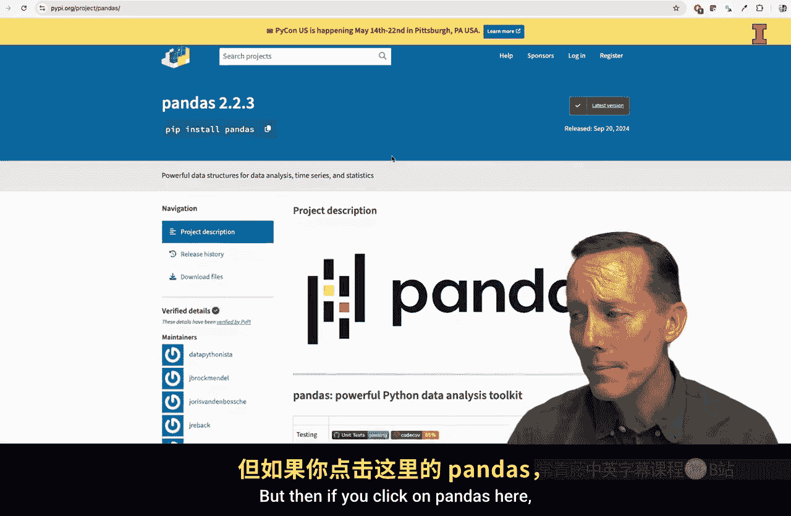

It will tell you information about the current version， how to install it using Pip。

 the Python installation package manager。And you can just copy and paste this code into terminal if you want。

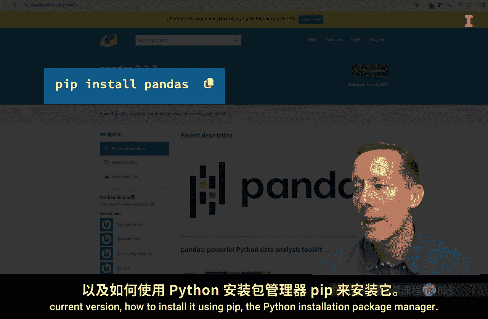

And if you scroll further down， there's information about how to install it using Conda。

 So if you're using an Ananaconda version of Python。

 then you would use this code right here instead of this code。Now。

 not all of the modules have extensive documentation， like Padas does。

 but because Padas is used so often， it's probably the most frequently used module for data analytics。

 There's a lot of people that are。Invested in making sure that this module works correctly。

 So this has extensive documentation。 And you can go in here and， for instance。

 click on in these main features here， like easy handling of missing data。 Click on that。

 and it takes you to another website。Where you've got all the information about how to use。

The different functions that you can use in pandas。So P P。

 org has a lot of information about the modules themselves。 Okay。

 a second resource that you can use is just your Internet search browser。

So let's look at a really simple scenario that I have here where I've read in data。

 I've created a new column， and I've created a histogram of that column。

Let's say I have this specific question right here。 I have app pandas data frame D F。

 and I want to aggregate the values in the total column for each value in the invoice date column and then create an interactive line chart。

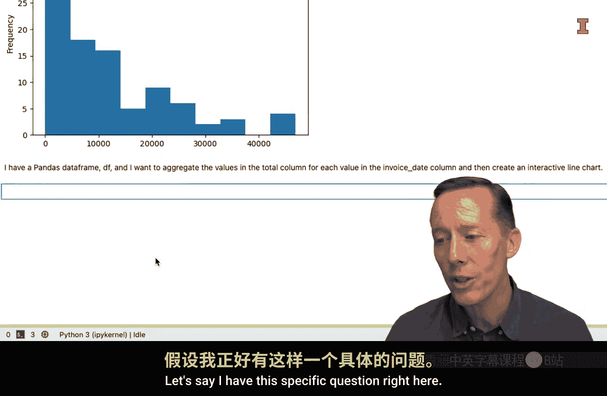

All right， I could type out。 how do I do that， But that's kind of implied here。 The key thing。

 though， that you can see， I've been very specific about the data frame name and the column names and what I want to do with it。

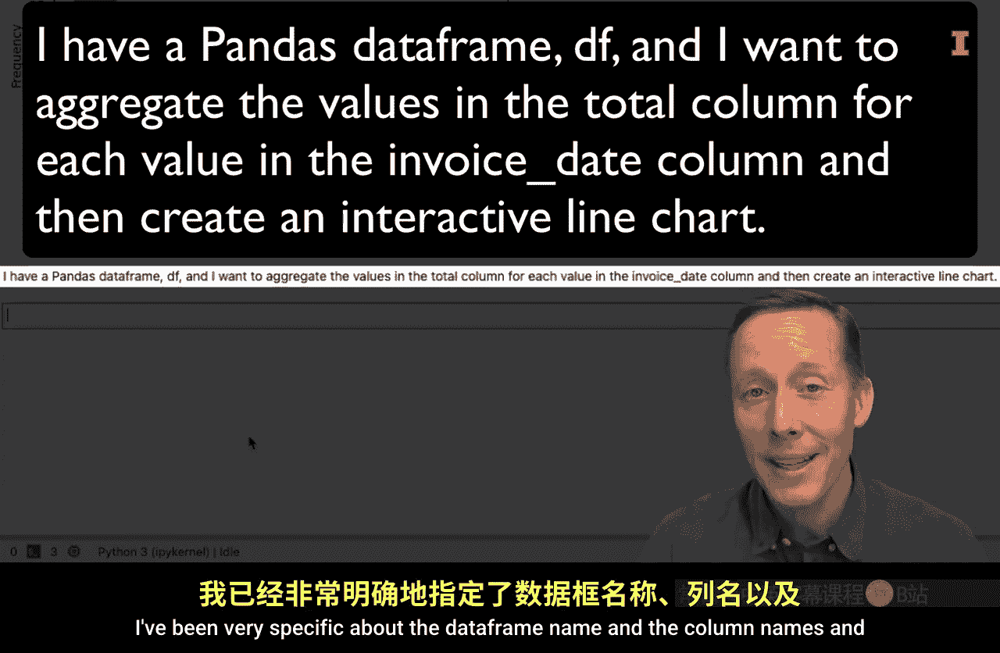

If you can put into words your question， that will improve the likelihood that you'll get specific help to accomplish your task。

So I took that specific question and just entered it into Google here and hit enter。

 And there's a variety of results that come up。 The first is specific Python code that I could copy and paste and try that out and see if it works。

 All right。 And so that can be very helpful。

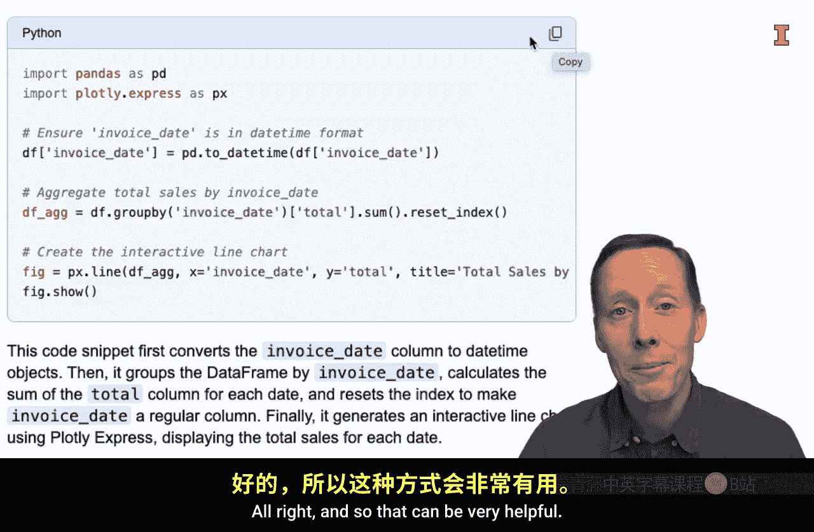

Oftentimes， you'll also get links to stack overflow。 This is。

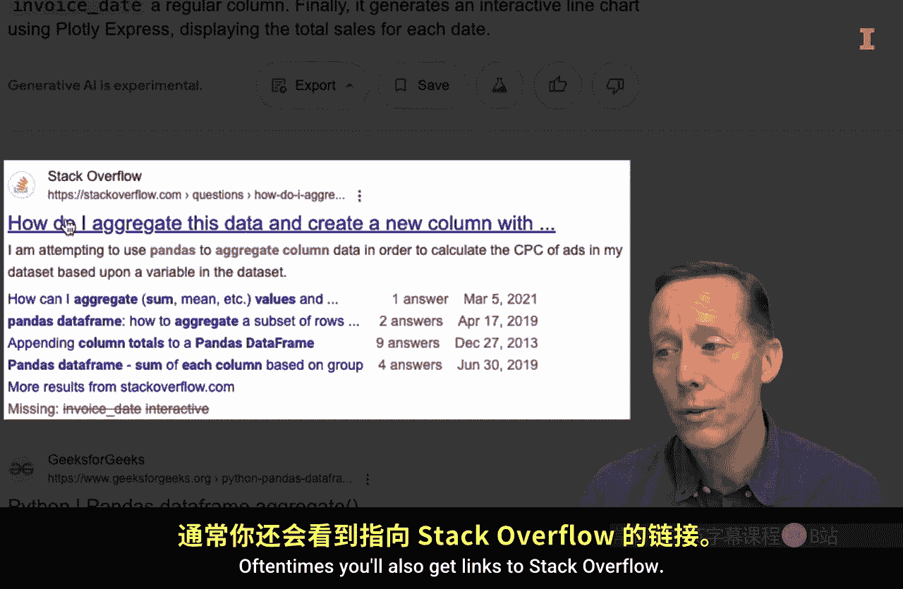

A website where people have entered questions and responses。 But this is really helpful。

 You won't get as specific of help， most likely， but you'll be able to go in here and see the question that is asked and the answer as well。

 And the one that has a check mark by it is the one that is the highest rated solution there。

 So when you look for answers on stack overflow。You'll probably need to read through the question and then take the solution and adapt it to your particular setting。

 Okay， a third external resource that you can use is just an AI tool like chat GT or perplexity or Gemini。

 So I went into chat GP。 and I pasted that same comment right here。 It's really an implied question。

And you can see that chat ET gave me a more lengthy response than what Google's AI results were。

 and it tells me details about what the code is doing。And it looks pretty similar。

 And the nice thing about these AI responses are that it also gives you comments that describe what each line of code under it is doing。

 So that's really helpful。 So you can just copy this by clicking the copy button and then pasting it into your IdeE。

 And it also tells you helpful things like make sure you've installed the required library。

 So it tells you how to install the libraries if you haven't already done So。

 So standalone AI tools are really helpful for Python。

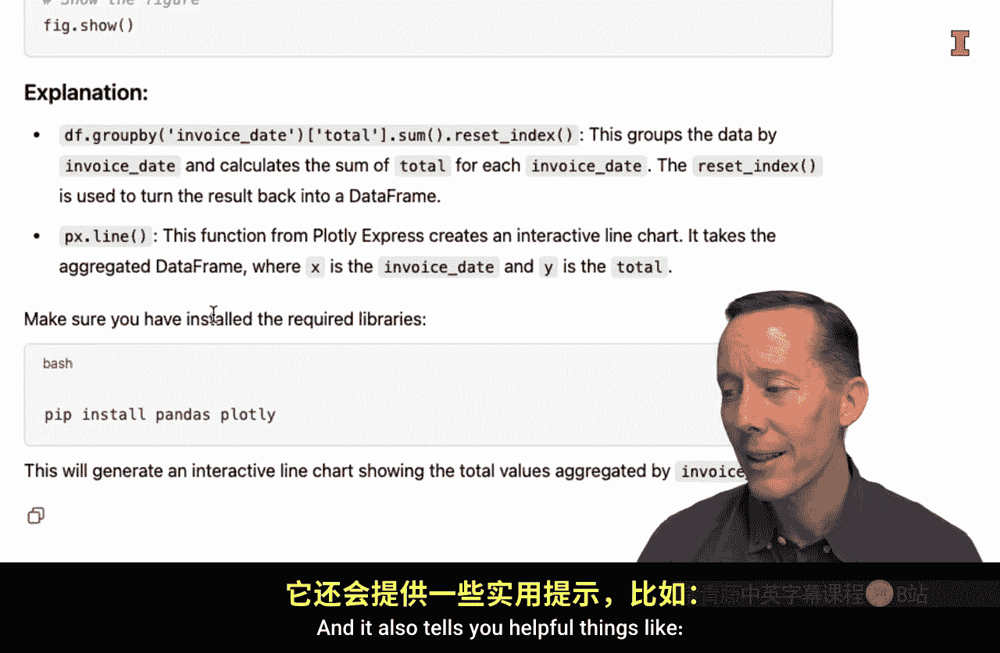

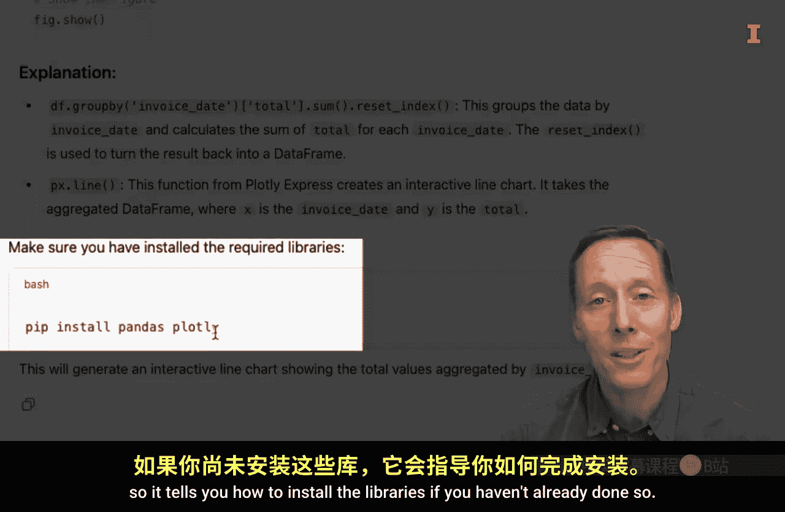

And the fourth and final type of external resource that you can use are those AI tools that are integrated into your IDE。

So most Ides now have AI integrated into it。 So here in Jupiter Lab。

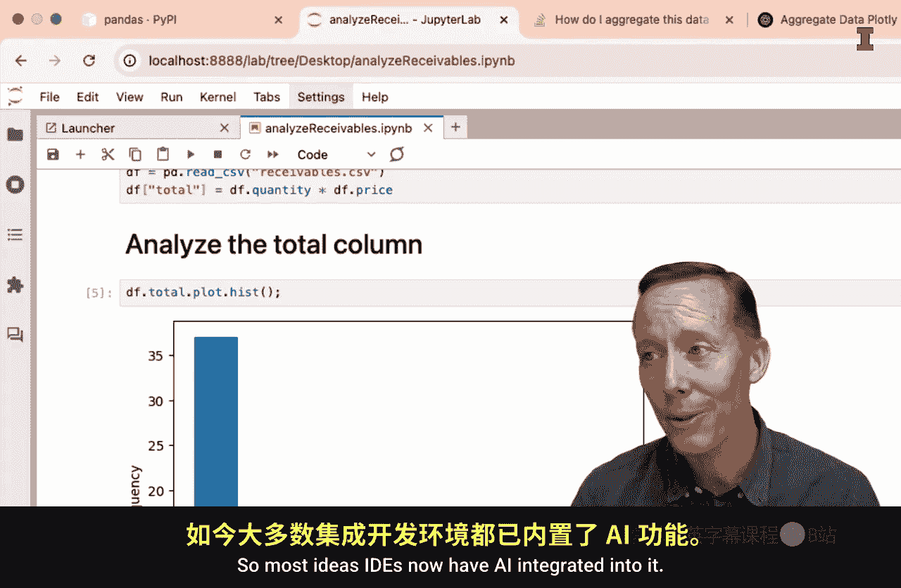

You have to install this on your own， but you can install Jupiter AI and connect it to an AI tool of your choice like Chat GBT。

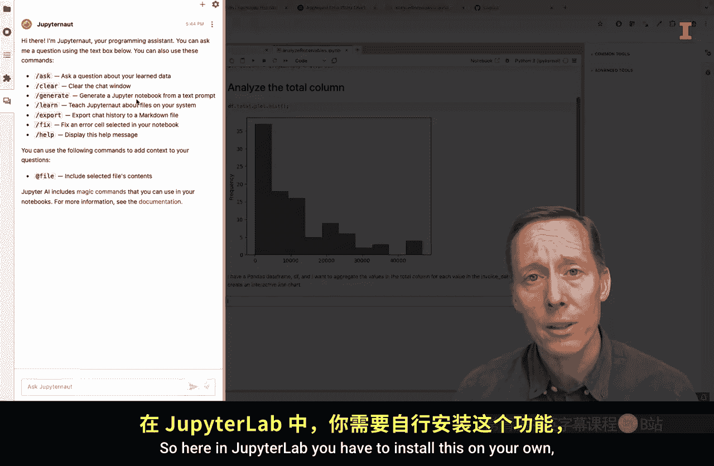

P so on。 And then you can。Paste your question in here。And it's。

Easier than having to go to a new tab on a browser and entering your question。

 And these integrated tools often make it easy to take the response and put it into your coding document here。

 So， for instance， here， I can just click this button right here。

 And it will add that code right there。 So this is how it works in Jupyter labb。

 But it also works in Google coabab， which is Google's integrated development environment。In here。

 you can access Gemini in a variety of ways so you could。

I'd click on that and then paste your question here and hit enter。

And it will give you a response that's also really helpful。

And you can see that it's got tools for just adding the code right into your。I code document itself。

And then also， V S code has some built in AI tools When you install V S code。

 you'll probably be prompted to。

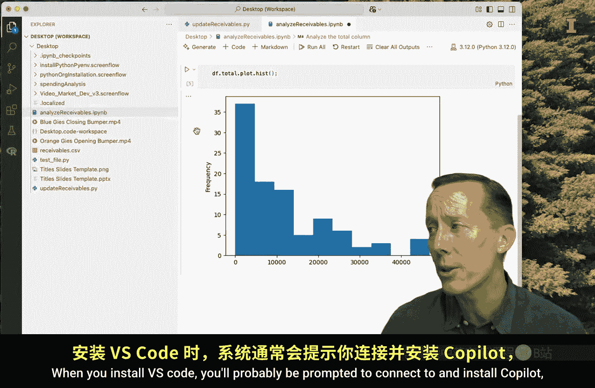

Connect to an install copit， which I find to be really helpful。 Now， Copit is free。

 but you only have a certain amount that you can use unless you upgrade to the pro version。

 and you can see that I haven't done that here。 But if you have upgraded to the pro version。

 then as you're typing， you'll get some autocomplete。 that completes a lot of code for you。

 And so that can be really helpful。 And then you can also access the AI tools by just opening up like editor in line chat and you can ask coil a question right here。

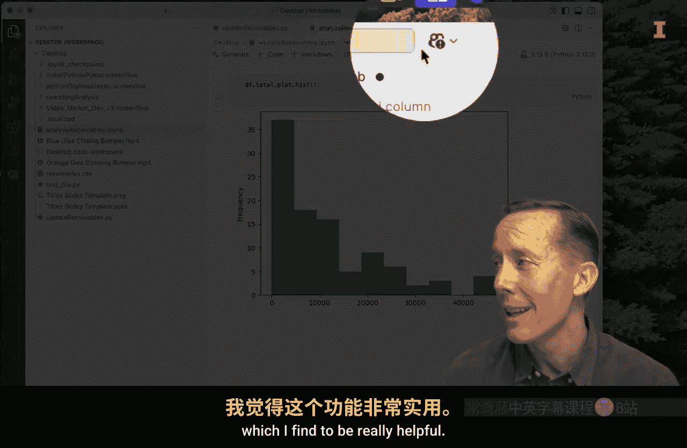

And it'll give you a response like that as well。 So anyway。

 theres a variety of ways that AI is being integrated into the Ides。 In short。

 there are many tools that will help you create code。 So you don't have to memorize it。

 While these external tools are really helpful and will save you a lot of time。

 I don't think they'll replace the importance of your foundational knowledge of how to use Python。

 you still need to be able to formulate a question。 That's super important。

 But once you have the foundation， These external tools are really great resources for helping you create code to complete your tasks with Python。

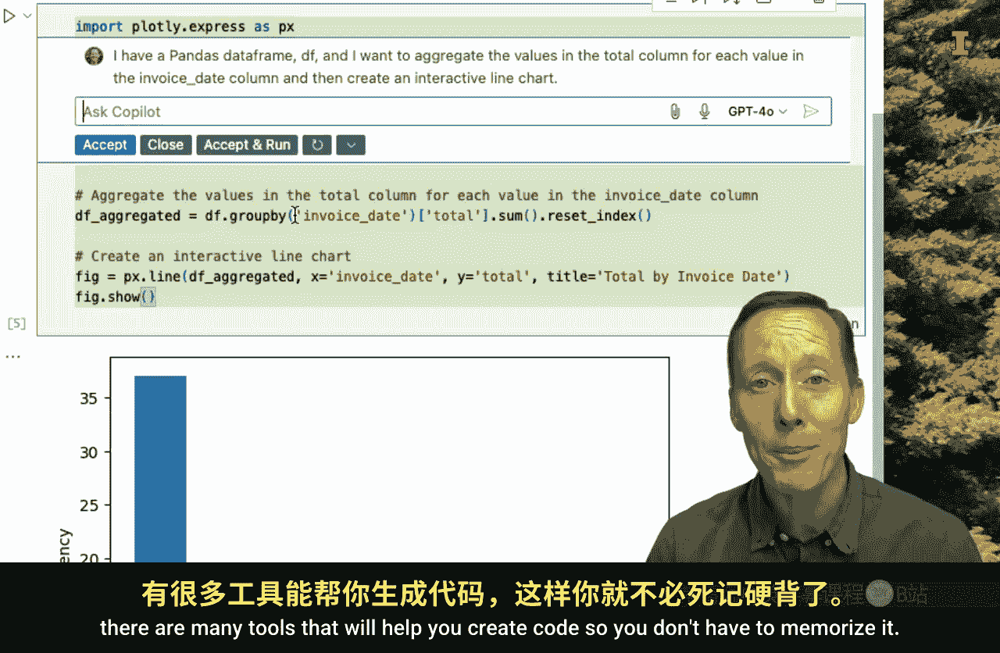

