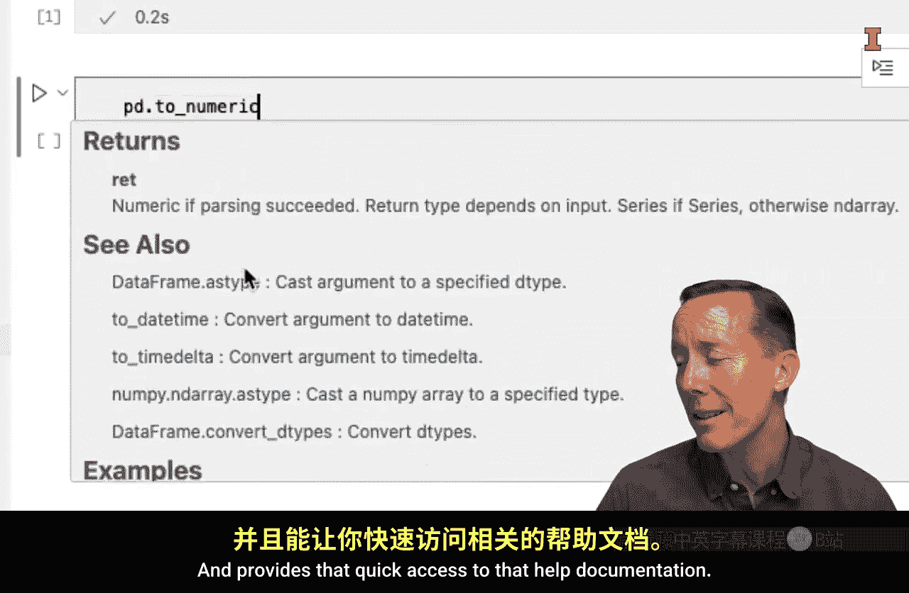

# 伊利诺伊大学【中英⚡商业分析｜Business Analytics Specialization】 p25 P25 04_利用问题框架解析Python内置文档 -BV1z86nB9EGz_p25-

In this video， we'll focus on asking questions from the help documentation that is built into Python。

You know how in Excel you've got the formula bar and you can click on this FX button to insert a function。

 When you do that on the right side， you'll see a list of all the different functions you can use。

 And if you click on one of those functions like this as function。

 It tells you information about what the function does and how to use the function。

 you can even click on more help on this function to bring up documentation and examples。

In addition， once you start typing a function's name in a cell of Excel， so A BS。

Excel will bring up some helpful tools to help you complete the function。

 and then once you type the open parentheses， it tells you the arguments right there and you can click on that to bring up the sidebar as well。

 Okay， so those tools that are really useful in Excel also exist in Python。

 but you access them in different ways。So let's switch over to a Python environment。

 this is in Jupiter Lab， but in Python， if you want to see a list of the functions that are available。

 then you can use the D for directory function。Now I'm going to use Dr on double underscore and then built in。

 you can see I'm already using this pop up menu to help type things out。

But if I select a built ends and run this code cell。

 you can see that it gives me a list of a bunch of different functions since Python is built for general programming purposes。

 we'll see a bunch of functions that we won't use。 So functions that have this approach of using capital letters and no spaces between each word are private functions。

 Now another set of functions that use double underscore are also private functions。

 So we don't really use those。 the ones that are snake case that are all lowercase and use underscore for spaces。

 Those are the ones that we will use。 Okay， so we can see a bunch of the built in functions in Python right here。

 and you'll see that there is an abs function that is also in Python。

 And then once we know that there is a function we want to use， we can use the help function。

And we can use that on like the abs function and run that。 and it gives us some help documentation。

 Now in Python， this is known as a dock string。 All right。

 so if you see the word doc string iss just referring to the built in help documentation。 Okay。

 so that's how you can get a list of functions and see how to use the functions。

 most of the time we will be using functions from third party modules that well need to import first。

So， for example， if we want to see what functions are available in the Padas module。

 we'll first need to import pandas， and we typically give it a shortened name， P。

 so I'll run that code cell， import pandas as P。And now I can use the directory function on P。

And I can see， again， a list of different categories of functions。

 And when I get to the all lowercase or snake case functions。

 these are the ones that well use most often。 So for instance， if there's a two numeric function。

 that's actually really handy function that we'll use later on。

 I can use help P D dot2 underscore numeric。And then run that code cell。

 And it gives me some pretty extensive documentation on how to use it。 Okay。

 and then there's also some help documentation。 And if you use the help and then。In quotation marks。

 lowercase topics。There is a list of more documentation that will be really helpful for you。

 So what's even more helpful is to look up the help documentation using the IDE shortcuts and every IDE will have its own way of providing quick access to this help documentation。

 for example， in Jupyter lab that I'm using right here if we want to use the directory function。

On the pandas module， I can type PDd dot and it will just bring up a list of the different functions that are available Okay。

 so that's a whole lot easier than using the directory function。

And so I can see it's in alphabetical order if I start typing out2。

 and then it shortens it down to just those functions start with two。 so here's the two numer。Okay。

 and then once I have that function， if I use shift tab。

 it brings up the help that I can find if I were to use the help function。

 but it formats it in a nicer way。All right， so Tab and Shi tab are really useful in Jupiter Lab。

If you are using visual Studio code or VS code， then。

The shortcuts to finding that help documentation are a little bit different。

 so import pandas as P I'll run that。And then if I start typing PD dot。

 it just automatically will bring up a list of those functions so to underscore just two and again shorts it to numeric and shift tab doesn't work here but if you hover over the name of a function。

 then it formats it really nicely even nicer than Jupipyter Lab and provides that quick access to that help documentation So in short being able to use the directory and the help function either directly。

 or by using the shortcut to access those within the IDE is going to increase your efficiency in writing code in Python。

