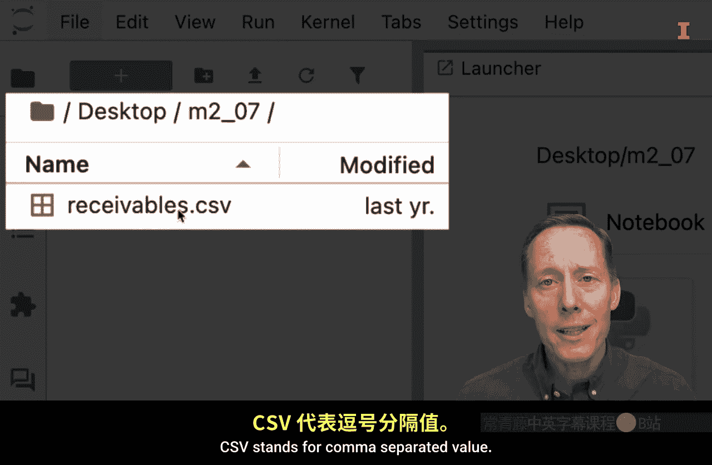
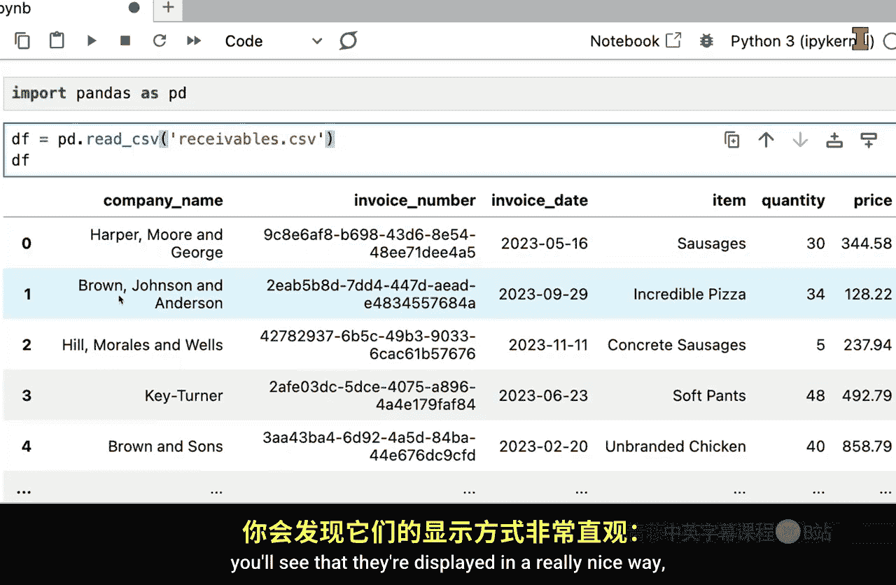
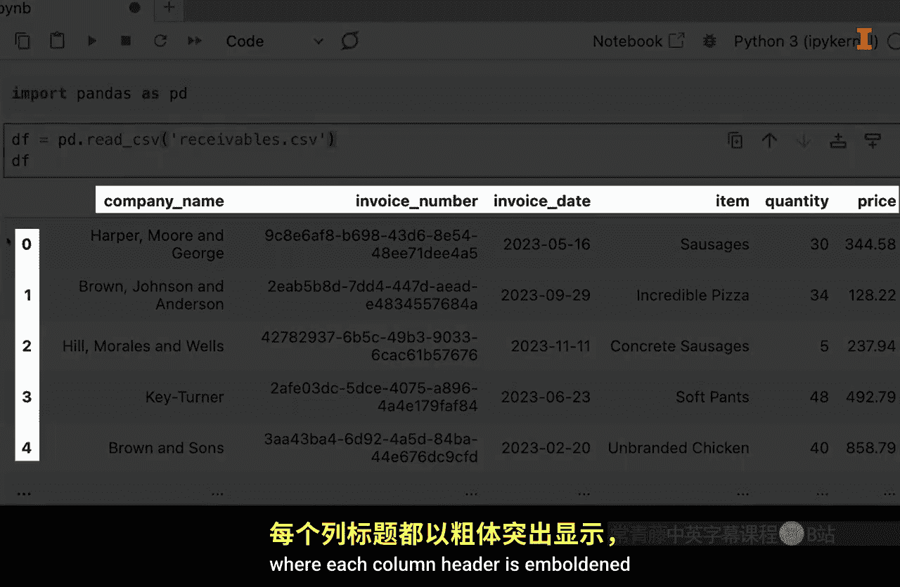
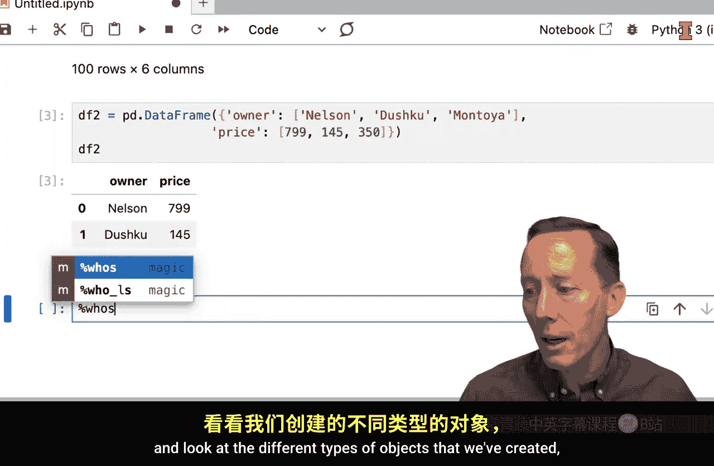
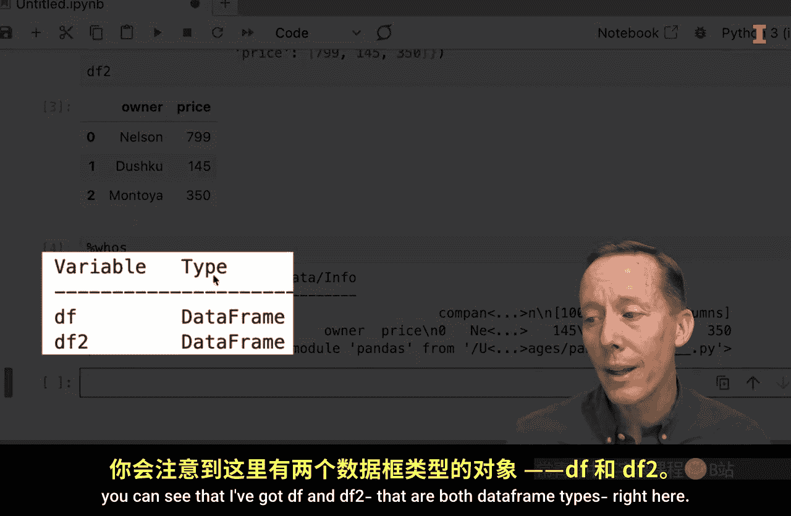

# 伊利诺伊大学【中英⚡商业分析｜Business Analytics Specialization】 p27 P27 06_关于熊猫数据框的框架问题 -BV1z86nB9EGz_p27-

Data can be stored in many different structures。In this video。

 we'll focus on one of the most important data structures， which is a pandas data frame。

 commonly known simply as a data frame。There's a lot that we can and will say about data frames。

 but in this video， we simply want to show you how to create a data frame so that you can then ask questions about how to use the data frame。

Now， a quick overview， data frames are like Excel worksheets in which the data is organized into rows and columns。

 Typically， each row represents an observation and each column represents a characteristic。

 So let's look at some hands on examples of panda's data frames。I've got Jupiter Lab open right here。

 and I've navigated to my desktop and a folder。 My desktop named M207。

 And you can see that I have this receivables dot CSV file。 CV stands for comma separated value。

 And if you open this。 in Jupiter Lab， you can see that it looks like an Excel worksheet。

 And if you open it in Excel。 it would be a pretty typical Excel worksheet。

And each row represents a receivable for the organization that is associated with a particular invoice。

 All right so。What we want to do first is demonstrate how you can read this CSV file into a Python environment as a pandas data frame。

So I'm going to close my file navigator and I'll create a new notebook file or IPY and B file interactive Python notebook file。

 and before I can create a panda's data frame I need to import functions from the pandas module。

All right， so we typically import functions from the pandas module and rename them as P。

 so we don't have to type out pandas every time。 and then I ran this code cell by pressing Shi enter。

 but you can also just press the play button up there。All right。

 so if I want to look up information about the functions in the pandas module in Jupiter La。

 I can type out P D dot and then see what comes next here。 And if I type a little more， lead。

 underscore。You'll see that Pandadas has a lot of different functions for reading in data from different file formats。

 So HTML Excel files， CSV files， clipboard。 All right。

 and we obviously want the CSV function because the data that we're reading in。Is in a CSV format。

So we're going to use Read_ CSv Now once we've typed that out。

 we can look up information about it by accessing the documentation or doc string using the shortcuts from Jupiter Lab I press shift tab or by hovering over it may be in VS code。

 whatever however you want to look at it up but we can do that and we can see that there's a lot of different arguments that we could use。

 but there's not a lot that we need to do at this point。

 we're just going to read in that file as receivables csv Now after reading in that data from the CSv file and converting it to a panda's data frame。

 I want to save it as a variable， so I'm going to type out Df and set that equal to the results of this。

And then I'm going to type out the name of the data frame so that I can get a preview of the data。

 And I'll run this code cell， and you can see that real quickly。

 it reads it in and displays the data。 The way it's formatted right here tells me real quickly that it's a pandas data frame as you become more familiar with data frames。

 you'll see that they're displayed in a really nice way where each column header is emboldened and each row also has an emboldened index value associated with it。

 Okay， so like I said， there's a lot more that we could say about data frames at this point。

 I want to highlight that you can create one by reading in data。

 And this is the way that will create data frames most of the time。😊。

But I also want to show you that you can create a data frame from scratch。

 and that will be important because you'll need to do that sometimes。

 but you'll see that it's also made up of other foundational data structures that we'll talk about later on。

So I'm going to create a new code cell。And I'm going to create a new data frame， I'll call it DF2。

And I'm going to create it by using the PD data frame function。And then in curlly braces。

 I'm going to type out some more information。Okay， so I finished typing out the information。

 Let me just go ahead and run this cell here。 and you can see that I've created a very simple data frame that has three rows and two columns。

All right， so again， we could talk more about data frames。

 but now that we have two data frames created， we can ask questions about them。

 So a really important idea in Python is this idea of creating objects。

 So an object is an instance of a particular type。 All right， And if we were to。

Look in our variable exploreer and look at the different types of objects that we've created。

 You can see that I've got Df and DF 2 that are both data frame types right here。 Okay。

 so data frame objects inherit particular functions by virtue of them being a pandas data frame。

And I can get a list of those either by using the directory function on one of these data frame objects like DF2。

 but that's not very easy to scroll through or read。

 So typically what you do is you use the built in help documentation。

 type out the data frame name in Jupyter lab， at least and then a period and I can see all the different functions that I can perform with this data frame object。

 So I'm going to type out to。

And I can see that I've got a lot of different two functions here。 Now。

 these functions that are inherited by objects are known as methods。 All right。

 so these are all methods right here。

And let's look at this two Excel method right here。

2 Excel allows me to write a data frame object to an Excel sheet。 All right。

 so this is something that will be very useful for us。

 And so if I want to write this simple data frame as an Excel file。

 I simply use the2 Excel method and then type out I'll give it a name test。

 underscore DF dot X L S X。

Okay， and then if I actually before I run it， I'm going to open my file Exper right there and then I'll run this code cell and you can see that I now have this test Df X LS X file in here。

 So what I want to highlight here is that in order to access these functions or methods that are inherited by panda's data frames。

 I first have to create one。All right， so once you know how to create a pandas data frame。

 you can look up help documentation about them by simply。Typing out the data frame name。

And then using the shortcuts in the IDE that you have。

 you can access these methods associated with them and then read about them Okay so that idea is really helpful。

 So this whole video on how to look up help on panda's data frames may seem like a lot but you're going to need to refer to the built-in documentation often and so it's really easy to do that as you can see there's a lot more to learn about panda's data frame we'll be talking more about them in later videos at this point。

 we hope you know how to create a panda's data frame by either reading in data or by creating one from scratch。

As well as how to look up help documentation on using the data frame methods。

