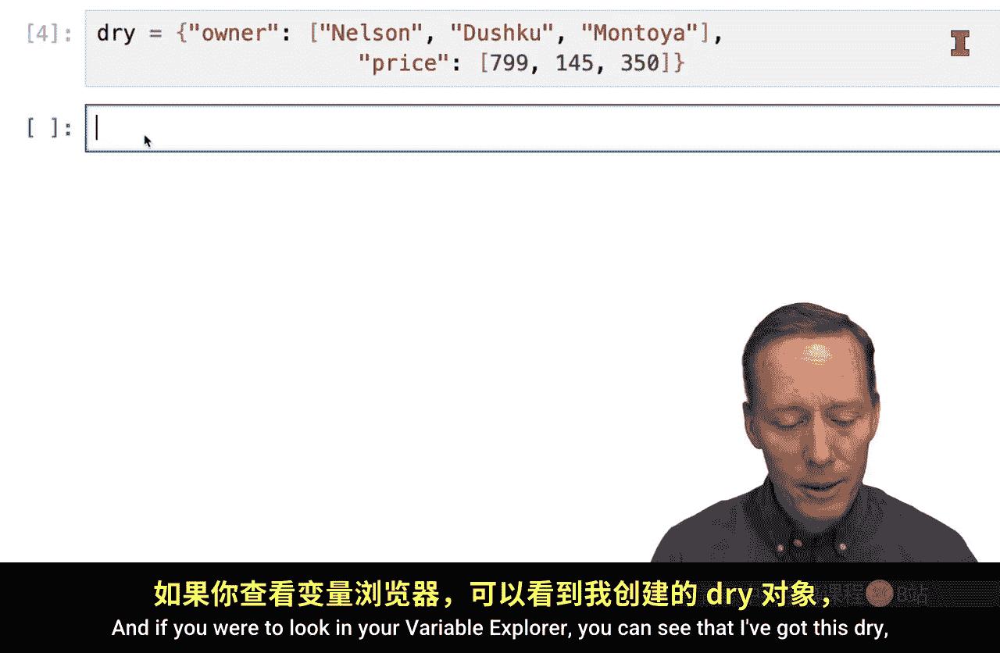
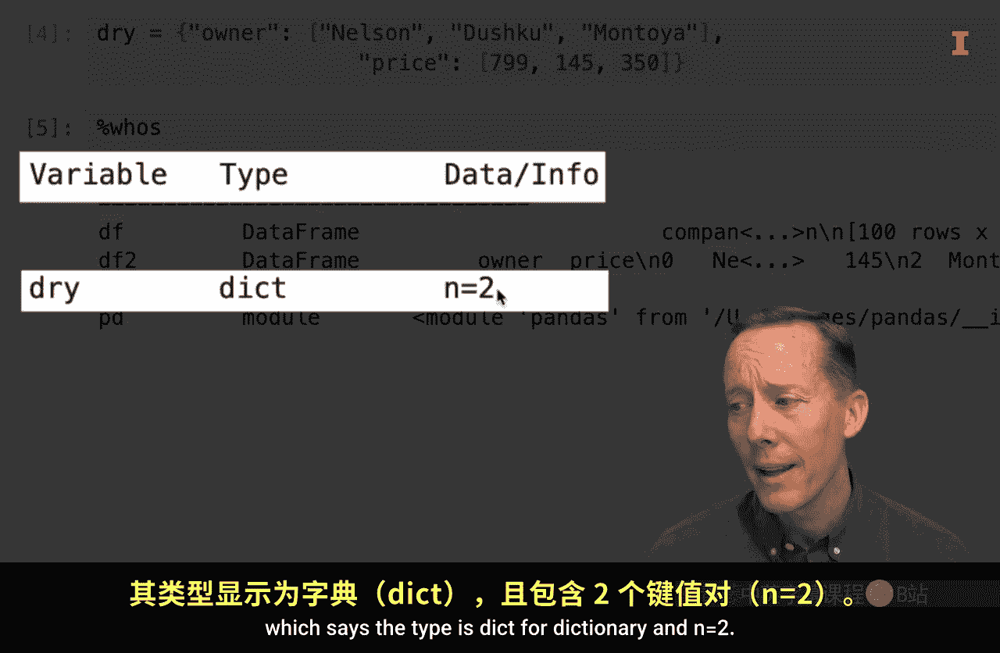
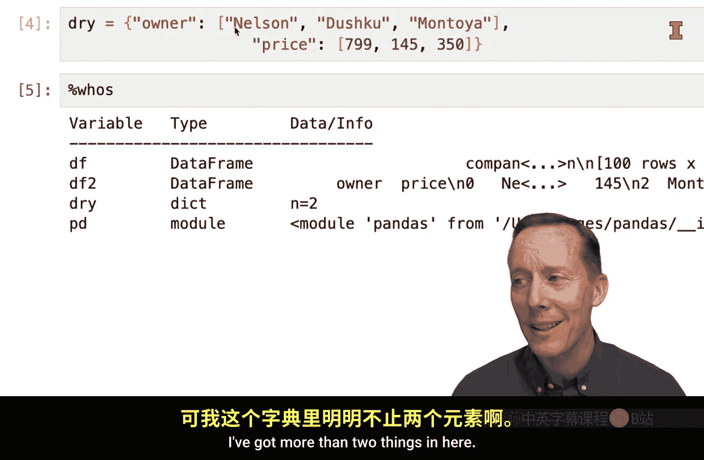
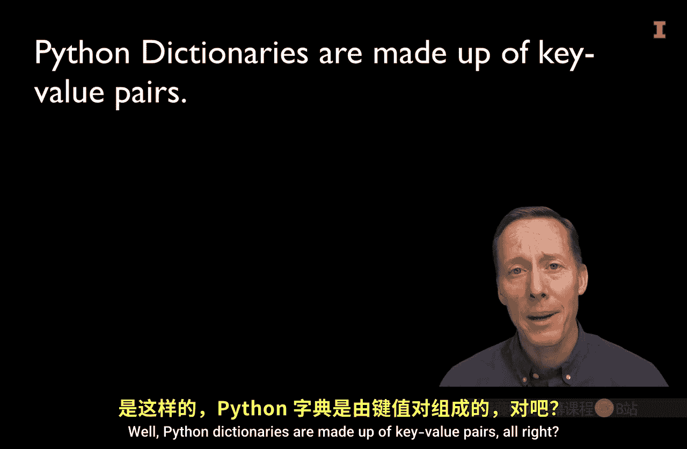
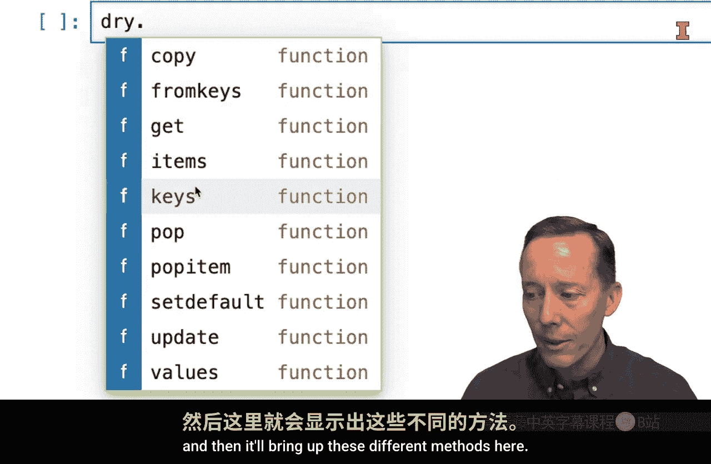
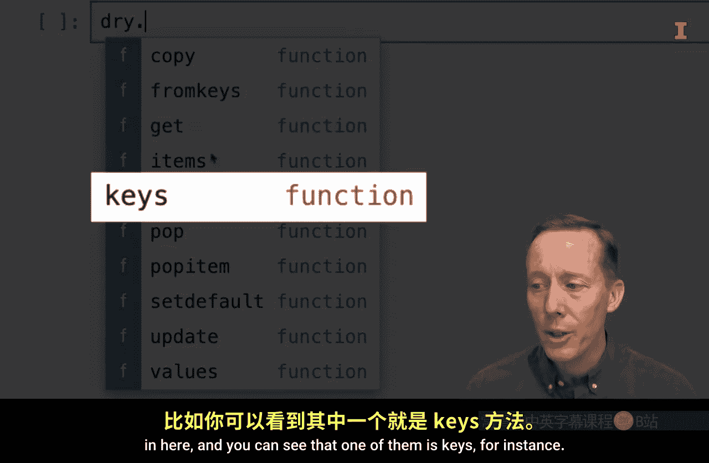
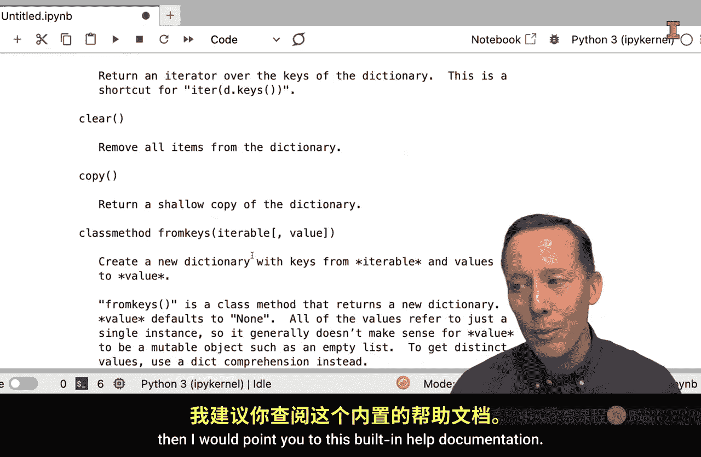

# 伊利诺伊大学【中英⚡商业分析｜Business Analytics Specialization】 p28 P28 07_关于Python字典的提问框架 -BV1z86nB9EGz_p28-

In this video， I will introduce you to Python Dictionaries。

 Python dictionaries are a type of foundational data structure that you can create in Python without using any other module。

And it's a data structure that you'll run into and use all the time when analyzing data with Python。

You'll get plenty of experience using dictionaries later on。In this video。

 I really just want to help you get a fill for what they are and how you can look up help documentation for using them。

 So let's look at a data frame that I've created in this Python environment in Jupiter labb right here。

 I've got DF2 and I've used the pandas data frame function。And then in between the parentheses。

 I've got a set of curly braces and information in there。

All that information between the curly braces， including the curly braces。

 is really a Python dictionary， so I'm going to copy that and create a new code cell。

And I'm going to create a new object dry， I'll call it。And paste that dictionary right there。

 And then I will go ahead and run it。All right， so now I have a Python dictionary and if you were to look in your variable Exper。

You can see that I've got this DRY， which says the type is diict for dictionary， and n is equal to2。

Now， let's talk about this n equals 2 to what I've got more than two things in here。

 So what two things is it referring to？ Well， Python dictionaries are made up of key value pairs。

 All right， key value pairs。 and you can see that I've got two rows here and on each row。

 I've got a name in quotation marks， and then a colon。

 and then I've got something else on the right side of the colon。 Okay， so I've got owner。

 and then some some values there， and then I've got price colon and then some values right there。

All right， so I've got two key value pairs。Now， one of the things that makes dictionaries unique and why they're called dictionaries is if I want to extract information about one of these key value pairs。

 I can do so by referring to the key name。So if I want to extract the values associated with owner。

 then the way I do that is I type out the dictionary name and then I use square brackets。

And then I type out the name of the key。 So this key that I want is owner。

 and then I can run that code cell， and you can see that I've got now just the values associated with them。

All right， so that's very much like a standard dictionary that you would use to look up a definition of a word。

 you look up the name of the word， and then you can see the definition of it。Alright。

 so most of the time what you'll be doing with Python dictionaries is you will be using them as arguments to a function or a panda's data frame method like when you rename columns of a data frame or as you saw above when we create a data frame but if you want to get more information about what you can do with Python dictionaries。

 then you can type out the dictionary name， So first you have to create one then type out the dictionary name and in this case I can access the list of methods or functions inherited by dictionaries by putting a period and then it'll bring out these different methods here。

 So there's about nine or so methods in here and you can see that one of them is keys， for instance。

 so。

I can run that and I can see the keys of this dictionary right here。Okay， so as before。

 this is an object that inherits functions， and so to look up information about one of those inherited functions or methods。

 I have to first create a dictionary and then I can look up what I can do with it。

Now there's another thing that you might find helpful。

 and that is you can use a help function on dictionaries in all caps。

 and this will provide extensive documentation about how to use dictionaries。 Okay。

 so if you really want to remember or learn more about how to use dictionaries。

 then I would point you to this built in help documentation。

Now you know what Python dictionaries are and how you can look up help on how to use them。

 you'll get plenty of practice using them later on。

