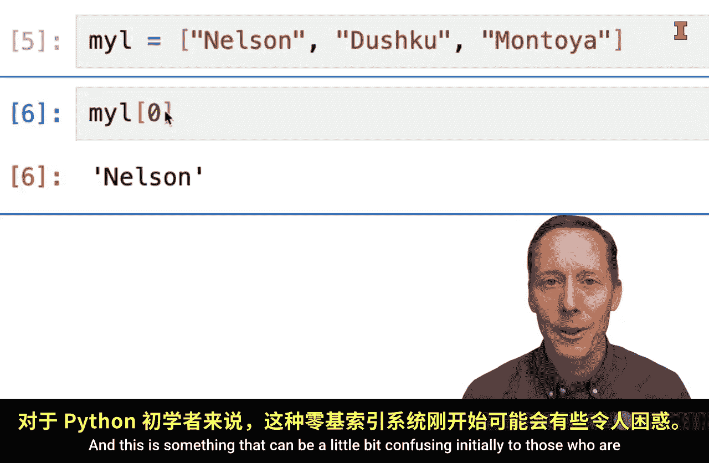
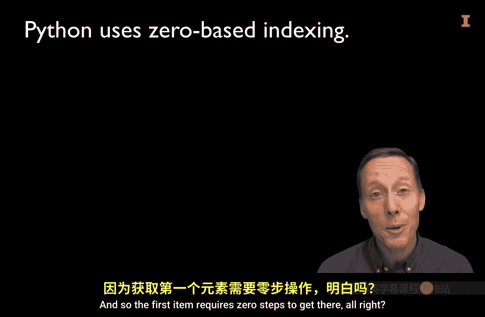
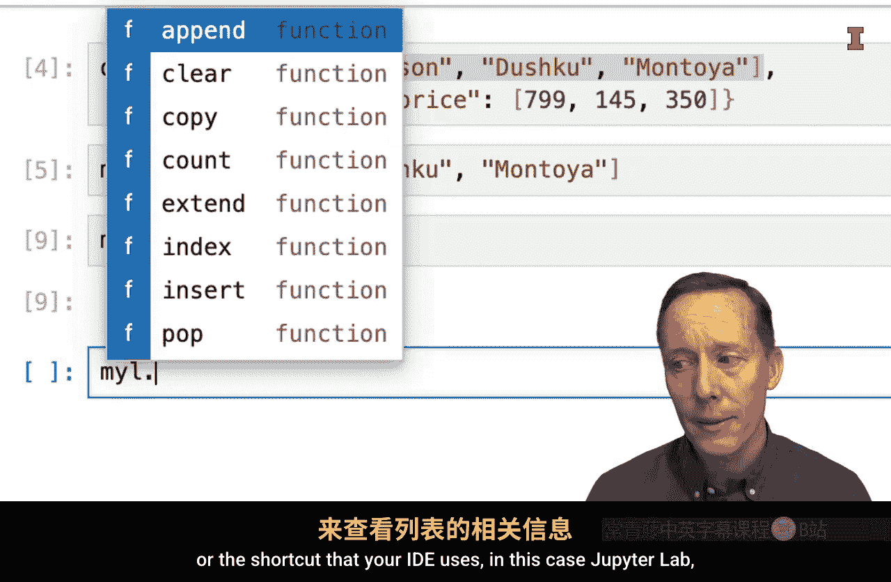
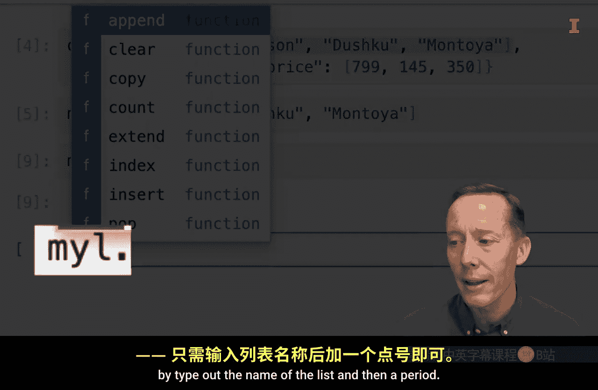
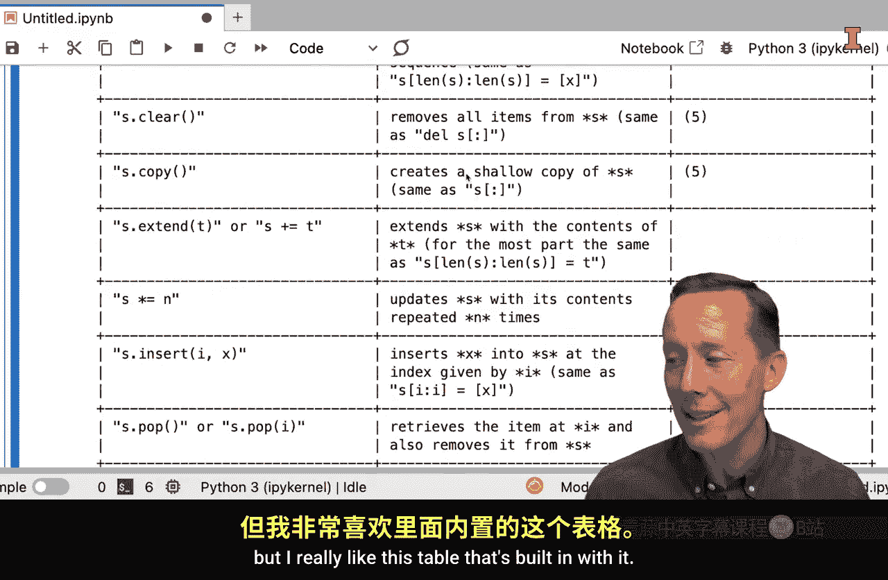

# 伊利诺伊大学【中英⚡商业分析｜Business Analytics Specialization】 p29 P29 08_关于Python列表的提问框架 -BV1z86nB9EGz_p29-

In this video， I'm going to introduce you to another foundational Python data structure。

 which is a Python list。 Now you'll see Python lists all the time。

 and in this video I really just want to focus on what they are。

 what makes them unique and how you can look up information about how to use them so how you can frame a question about using Python lists。

 So lists are a data structure that is native to Python。

Let's go ahead and look at a Python environment here in Jupiter Lab。

 and here I've got this dictionary dry and I've got two key value pairs。

And a list is what is included between two square brackets。 Okay。

 so I'm going copy that right there and create a new object， which I'll just call。

MYL from my list and set it equal to what I have in those square brackets。Now。

 one of the things that you'll often want to do with lists is extract specific items from a list。

 and the way you do that is by typing out the list name， and then in square brackets。

 you refer to the position of the item that you want。 Okay， so if I want the first item in here。

 Nelson， then what I need to do is use a0。 and then if I run that cell。

 you can see that it's returning just Nelson。And this is something that can be a little bit confusing initially to those who are getting started with Python is that it's a zero based index system。

 and so the first item requires zero steps to get there。

All right， whereas the third item， for instance， Montoya right there。

 we would refer to it using the number two。 It takes two steps from the first item to get there。

All right， so that's how you can pull out individual elements from a list if you want consecutive elements that are adjacent to each other。

Then you can do that by using a number for the first item and then a colon and then a number for the last item that you want。

 but the number of the last item is not included。 So if I want all three items then I need to use three because three is not included so I'm getting0。

1 and 2 I know it's a little confusing for one other example if I want just the first two items。

 then I do0 to2， but again two is not included， so it's really just pulling out0 and one。Okay。

 so you'll use lists all the time。And you'll want to refer to specific items in a list。

 That's the thing that you'll do most often。 But there are some methods or functions that are inherited by lists。

 So once you've created a list you can look up information about the list by using the directory function or the shortcut that your IDE uses in this case Jupyter lab I type out the name of the list and in a period and then it brings up the different methods associated with the list and if I want to learn more about a particular method。

 I can use the help function on it， or I can type out the method and then use the IDE's shortcut to accessing the help documentation。

 you can read more about those different methods and then as with dictionaries and other foundational data structures in Python you can use the help function and then type out in all caps。

 the name of the object， and it will bring up a bunch of information for how to work。

With that data structure， so what I just showed you， you can refer to。In here。

 as well as a variety of other things， as well， the different methods are associated with it。

 So this documentation is not as long as dictionaries。

 but I really like this table that's built in with it。 So now you know what Python lists are。

 A few basics about how to use them and how you can look up help documentation for using them。

