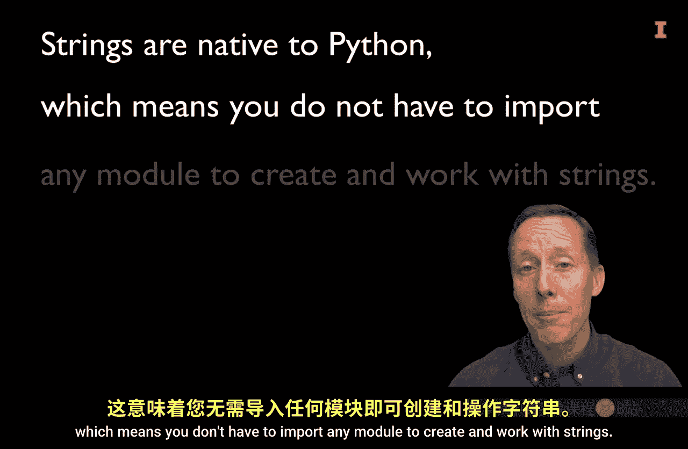
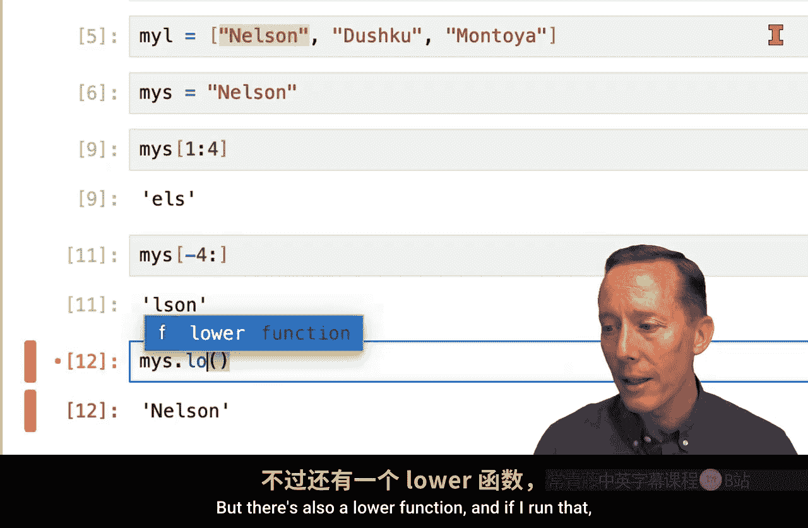
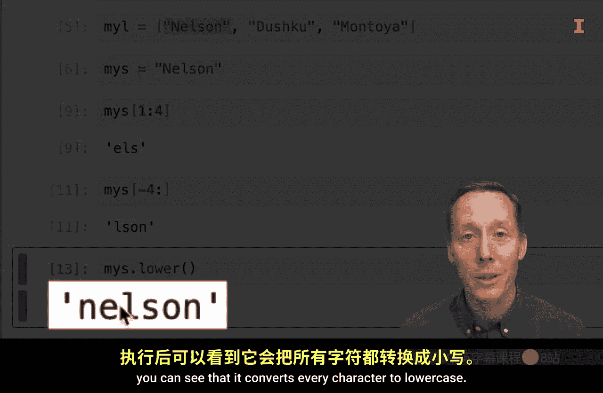
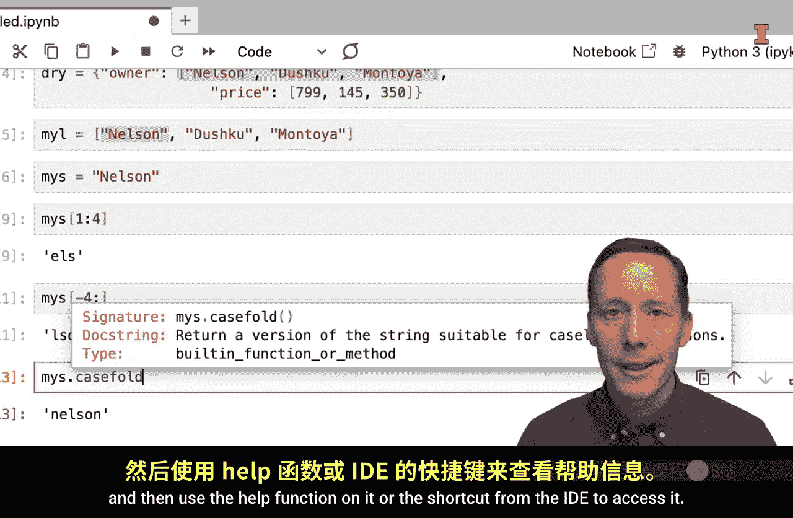
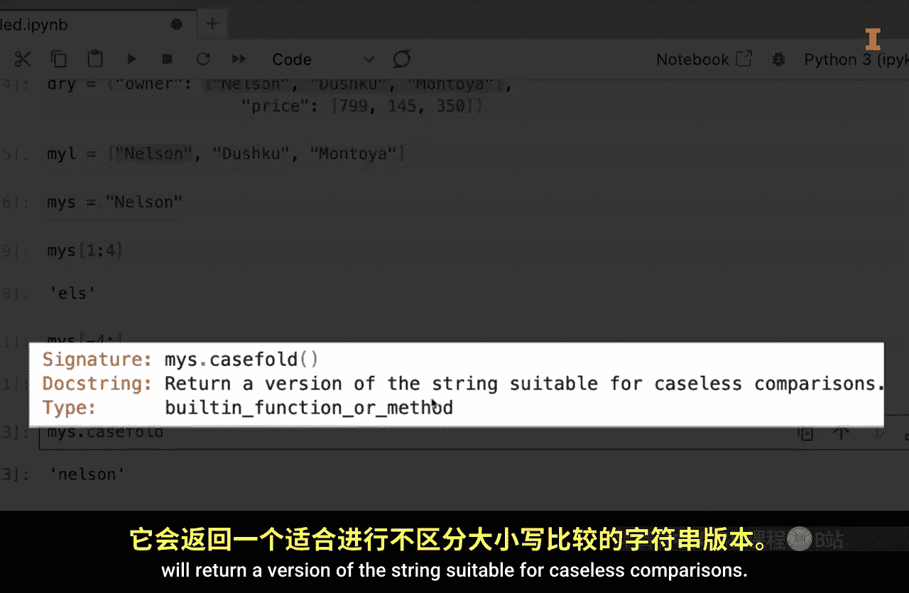
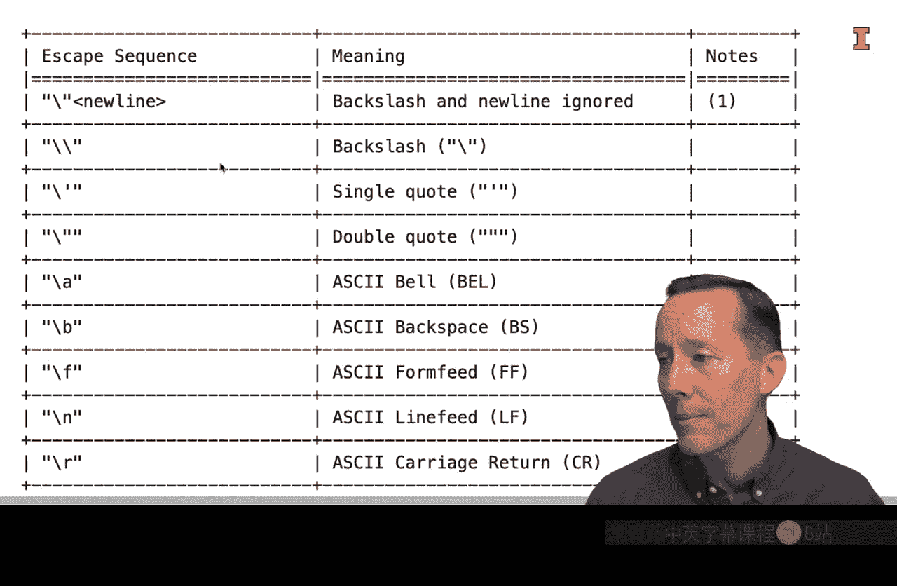
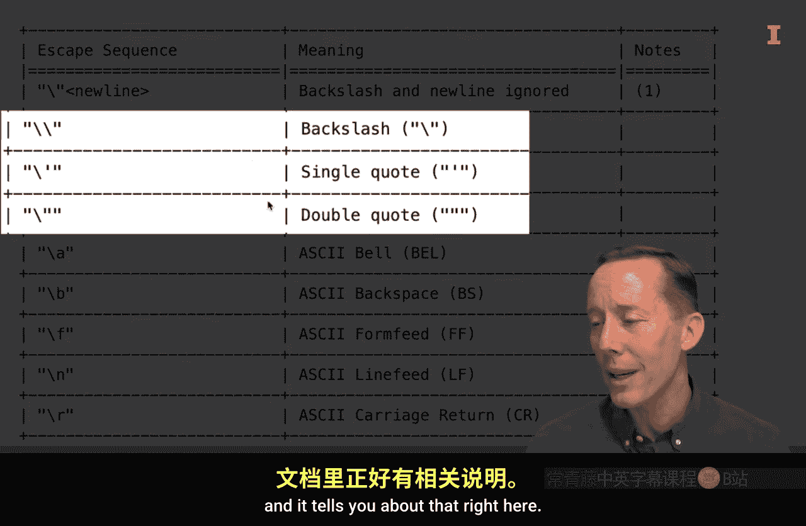
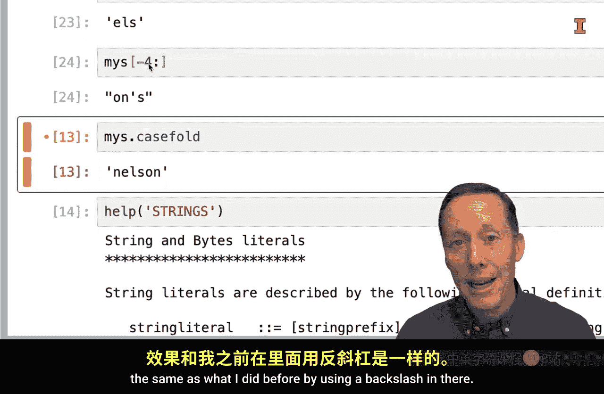

# 伊利诺伊大学【中英⚡商业分析｜Business Analytics Specialization】 p30 P30 09_Python字符串相关问题的构建 -BV1z86nB9EGz_p30-

In this video， I will introduce you to a very basic but very important foundational data structure in Python。

 which is a string。You will use strings in a lot of different ways。

 so in this video I want to help you get a feel for what they are and for how they work。

 and importantly for how you can frame a question about using strings by accessing the built in help documentation about them。

So first of all， let's start with the name string。 a stringst means characters that are strung together or put together。

 And you can create a string by putting characters together within either single or double quotation marks。

 Strings are native to Python， which means you don't have to import any module to create and work with strings。

Let's jump over to a Python environment and look at how strings work。

So I've got a lot of strings in this file right here。 Let's just take this string right here， Nelson。

And I'm going to create an object my S for my string instead it equal to Nelson within those quotation marks。

Okay， so once I've created the string， what can I do with it？Well， as with lists。

 I can refer to specific items in a string by typing out the name of the string and then using square brackets and then the index location number associated with the item that we want。

 And as with lists， strings have a0 based index。 So if I want the first character in this string here。

 then I need to use0。 If I run that cell， you can see it gives me the M。

 If I want the second item I use one takes one step to get to the second item。 All right。

If I want to extract specific elements that are adjacent to each other， then I can refer to。

 for instance， the second through the fourth items by using one through4。 So again。

 as with the lists， the last number is not included in the output here Now I should have pointed this out with list as well。

 but you can also refer to items in a string or list by starting at the end of it。

 So if I want the last item in this string， I can say minus1 and that gives me this last n right here。

And if I want adjacent items starting from the end， then I can use minus， let's say。

4 and then just a colon。 And that will give me the fourth to last item L。

 and then all the way to the end。Al right， so those are different ways to access specific items within the string Now there are other methods or functions that are inherited by strings and you can look those up by creating a string and then by using the directory function and the help function or the shortcuts that are available from the IDE。

So in this case in Jupiter Lab， I type out the name of the string in a period and it gives me a lot of different things that I can do with this string。

So let's just try this first one。 Oh， actually， let's， yeah， let's try the first one capitalize。

 And it's a function。 So I'll use the open and close parentheses and run that。

 And you can't really see anything because it was already capitalized。 that first letter was capital。

 but there's also a lower function。 and if I run that。

 you can see that it converts every character to lowercase。 So anyway。

 if you're looking at the different。

Functions available for strings and want to try one out。

 then you can simply type it out and then use the help function on it or the shortcut from the IDE to accessive so case fold。

 for instance， will return a version of the string suitable for caseless comparisons。

Anyway， so there's how you can access the built in help documentation。

 which you'll probably use a lot because there's so much to remember with all these different objects in Python。

Another thing you can do as with dictionaries and lists is you can use the help function on strings all uppercase。

 and when you run that you'll get a bunch of documentation about how strings work and scrolling down a ways in this help documentation。

 you can see some really useful information。

And one of the things that I want to highlight in here is how you can use quotation marks within a string。

 And it tells you about that right here。 So let's go back up here and。

Let's create another string， my S， but we'll surround it by single quotation marks。

Just find everything works the same。 Okay， so you can create a string using double or single quotation marks。

 It gets somewhat more complicated， though when you want to have something like Nellsons。

 if you want to use a quotation mark as an apostrophe。 All right， So if you run it like this。

 you'll get an error。 and this error actually tells you the reason why there's an unterminated string literal。

 It thinks that you finish the string right here and then don't have another quotation mark to start a new one。

So one thing you can do is use a back slash in front of that quotation mark to indicate that I don't want it to close the string。

 Now， if I run it， I can。Referred to specific items in the string， including that quotation mark。

 and it's not saying it's the end of the string。An alternative way of。

Of using double or single quotation marks is you can simply use the other version of the quotation marks。

 So if I want to surround all of this by double quotation marks and then just have a single quotation mark in there。

 then that will also work the same as what I did before by using a backslash in there。 anyway。

 that help documentation for strings can remind you of those things。

 So that's an introduction to Python strings。 you'll get plenty of practice using them later on At this point。

 hopefully you have a solid idea of what they are how to use them and how to look up information about how to use strings。

