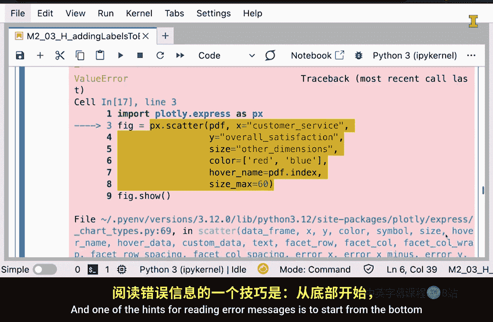

# 伊利诺伊大学【中英⚡商业分析｜Business Analytics Specialization】 p31 P31 10_行动答案 -BV1z86nB9EGz_p31-

Today I'm hiking along this beautiful trail near Bryce Point Overlook in southern Utah。

Hing this trail is all about taking action， as you can see by the winding curves。

 and I have to watch out for falling rocks， and I also want to take in the beautiful views and just let curiosity be my guide。

Similarly， when learning how to use Python for data analytics。You need to take action。

 And I want to talk about three specific ways that you can take action。

The first way is that you can consider carefully the responses that you get to the questions that you ask。

 especially those answers that come from AI。And what I mean by that is that you should consider how those responses fit into your current knowledge。

 They may reinforce your current understanding of how Python works， which is great。However。

 if you don't understand the response， then you should try to figure out how it does fit in with your understanding and then your understanding will grow。

The second way that you can take action from the responses that you get to your questions。

Is you can try little code experiments。So what I mean by that is you can create little snippets of code and run them and don't worry if the code doesn't work out。

In fact， I often learn more from code that doesn't work than from code that does work。

 It helps me remember better what I am working on。The third thing that you can do is to read the error messages Now。

 if you're like me， you may be used to not reading error messages because they look scary and you think。

 hey， that's the IT department's problem。But I want to encourage you to read those error messages。

And one of the hints for reading error messages is to start from the bottom and then work your way up to the top。

Because the most insightful part is usually at the bottom of the error message。

Now there will be some error messages that you don't completely understand， and if that's the case。

 then just copy and paste those into an AI tool and let that describe what the error message means。

So just as we talked about curiosity being the driver for those people who navigate this beautiful trail here。

 let curiosity be your guide when learning how to use Python for data analytics by considering thoughtfully the responses that you get。

 experimenting fearlessly with code， and embracing error messages as opportunities to learn and grow。

Now go out there and experiment and learn from the responses that you get from your Python code and like curiosityity be your guide。

 just as it is the guide for those who hike along this trail。

