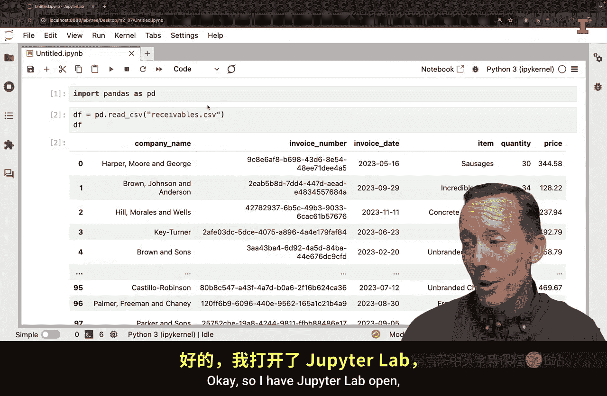
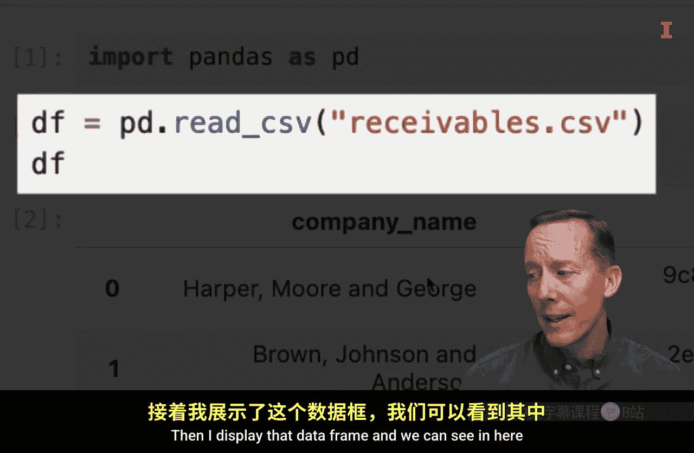
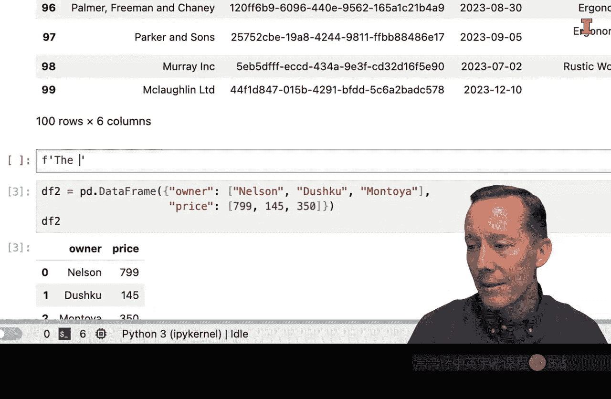
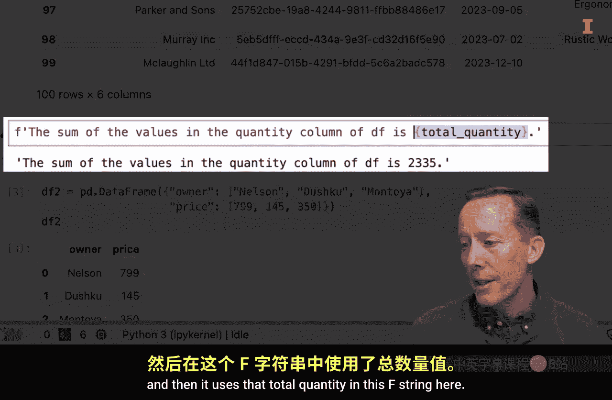
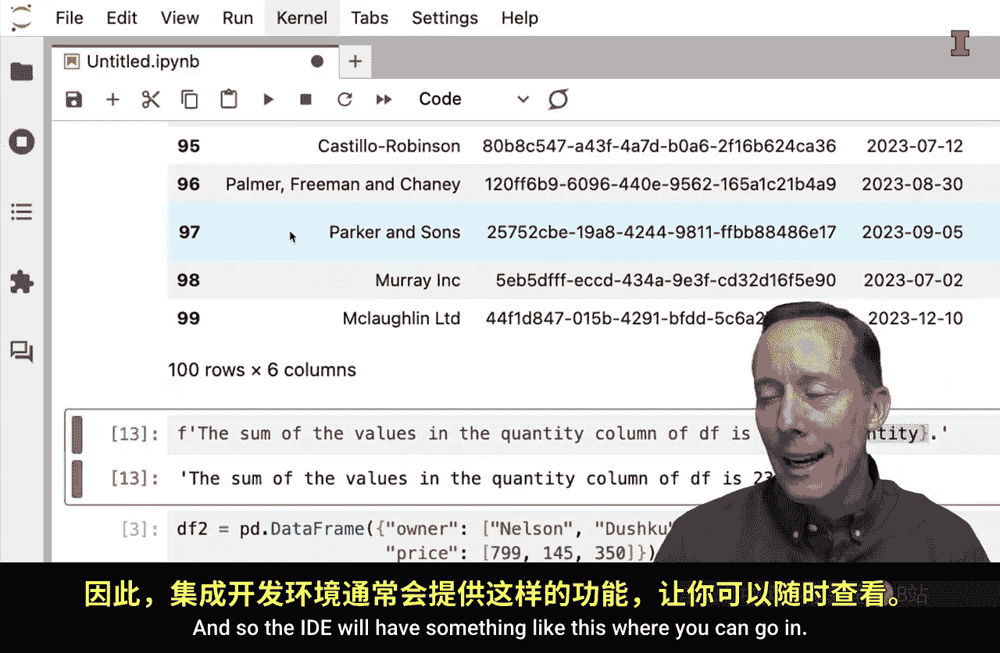
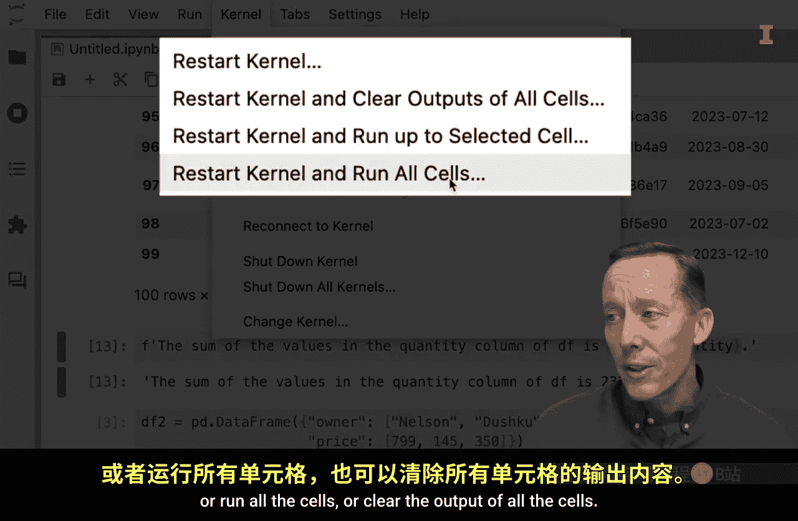
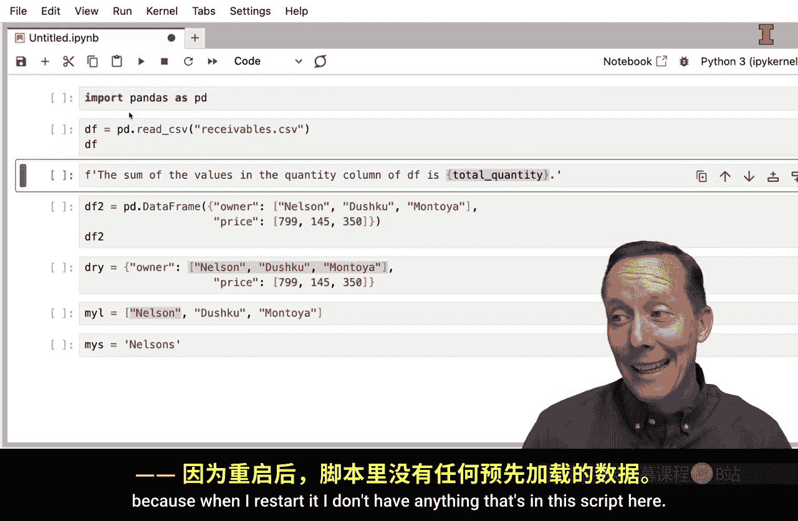
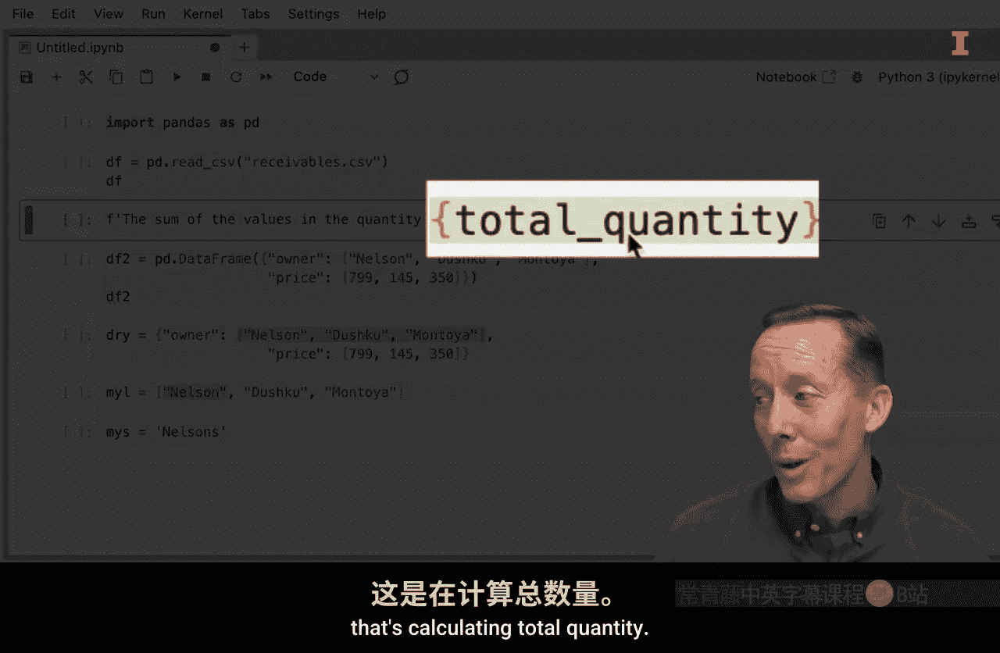
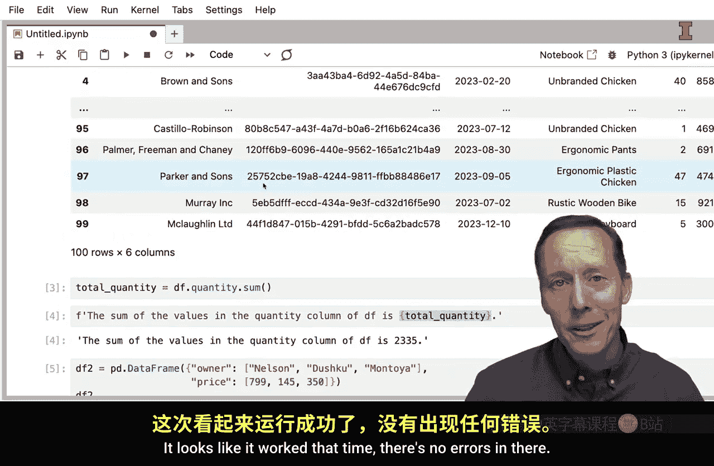
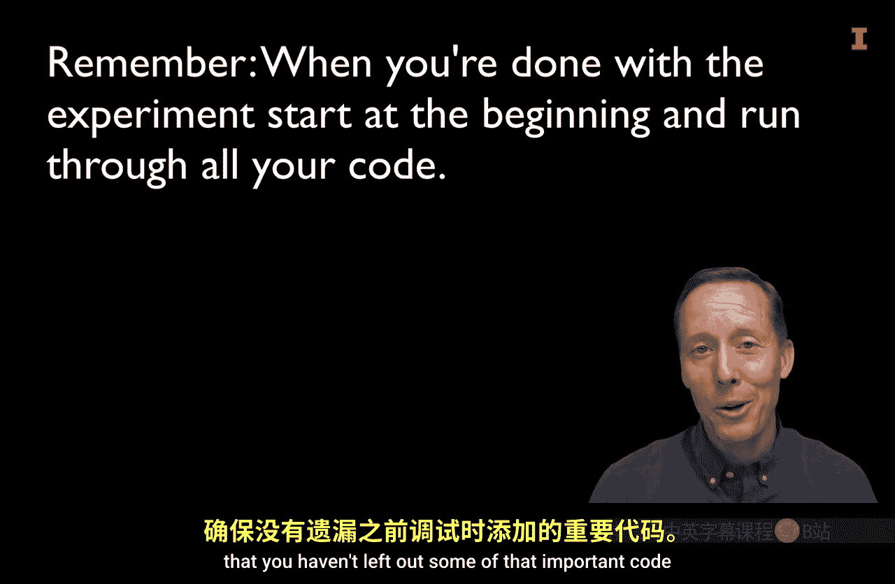

# 伊利诺伊大学【中英⚡商业分析｜Business Analytics Specialization】 p32 P32 11_通过运行代码实验来实践答案 -BV1z86nB9EGz_p32-

In this video， I want to highlight the importance of running little experiments with your code as a way to frame questions about what code does。

One of the great things about creating with code is that you can try out a ton of different types of code pretty quickly。

 and if it doesn't work， then you just try out something else。

 The only thing that you've lost is a little bit of time。Now， time is valuable， but in contrast。

 when you create a large physical structure like a home or a building。

Then you have to be very mindful of human lives that could be lost if your structure falls apart and collapses。

As well as the cost of material， which could be very expensive。

So I want to highlight two approaches that you can use for running little experiments with your code。

As well as some helpful tools that are found in most IDEs。

 especially when using Python in IY M B files。Okay。

 so I have Jupiter Lab open and in this environment。

 I have a code cell to import functions from the pandas module。

And then to read in data from a receivables comma separated values file and save it as a data frame object Df。

And then I display that data frame， and we can see in here that I've got a row for different items that are related to an invoice。

 and I've got this column quantity。

And then I've got some other things that I do in this file as well。

 So let's say I want to add up all of the values in the quantity column to see what the total is。

 but I'm not quite sure how to do that。But I know there is the sum function and a sum method。

So I want to think about which one to use。Okay， so the first approach that you can use for running little experiments with your code is to go to the console。

Most Ides have a console where you can type in temporary code that won't be added to your script right here In Jupipyter labb。

 the way you access that is you can go to the file menu and select new console for notebook。

 And that brings up this new window in the bottom down here。 Now， this window。

 the kernel or processing power from your computer is connected with what has already been run in this file right here。

 So， for instance， if I want to look at the quantity column。 And I know there's this sum method。

 and want to see if it works。 I can run that。 And I can see that sure enough。

 it added up the values in that quantity column。All right， so I can then say。Okay。

 I want to save that as。A variable total quantity。Okay。

 so I'll set total quantity equals to that number， and then I'll display total quantity。

And then run that and okay， it looks like it's working Okay。

 so the console is a great place where I can run little code experiments because it won't be intermingled with the existing code that I have and if it works out。

 then I can just go ahead and copy that and paste it in my file right here。

The second approach that I can use for running little experiments is to just add to my code and then make sure that I remove it later on so。

After I've run this， I can kind of do the same type of experiment。

But I'm doing it in a code cell here。 Total quantity looks like it works。 Okay， great。

 so I'm going to delete that。And then let's say I want to add in a cell where I can report the total quantity as a sentence。

Okay， so I added this new code cell that will report as a sentence the sum of the values in the quantity column of DF is。

 and then it uses that total quantity in this F string here anyway。

 it looks like everything is working great。

The thing that I want to highlight here， though， is that oftentimes when you run little experiments。

 you have to be mindful that you may have done something out of order。Okay。

 so what I did here worked because I had already ran through all this code。Now。

And to make sure that your code works before you hand it over as an assignment or to someone else。

The IDEs typically have a couple or more commands that allow you to rerun everything。

So one thing I could do is I could just select the cell and be like， okay。

 I want to double check to make sure it works。 I could go up here and then just restart at the beginning and go through it。

 but that and that you know， looks like it's working fine。

But the thing that I have to remember is that I ran that sum of the quantity column before I ran this。

 And sometimes when you go through larger files， you forget that you've done something like that。

And so the IDE will have something like this where you can go in and you can say， okay。

 restart kernel and either run up to the selected cell that I'm at。

Or run all the cells or clear the output of all the cells。 Okay。

 so if I clear the output of all the cells， then it just leaves me with the code here。

And as you look at this， you might be able to determine that， yeah。

 there's going to be an error because when I restart it。

 I don't have anything that's in this script here that's calculating total quantity。 Okay。

 so if I go in here and restart the kernel and run all cells。

 this is a very important thing to do before you hand a file over to someone else。

It looks like it's working fine， but then you get this error in here。

 So restarting and running is really important。 And when you see this， then you may remember， oh。

 yeah， I got to add in the code to calculate that total quantity。 And after I've done that。

 then I can go to kernel and restart and run all cells again。And make sure that it goes through。

And runs everything。 It looks like it worked that time。 There's no errors in there。

 So the two takeaways。 You can run experiments with your code by using the console or by adding to your code and then deleting it later。

But the caveat is to make sure that when you're done with the experiment to start at the beginning and run through so that you ensure that you haven't left out some of that important code that you experimented with before。

嗯。

