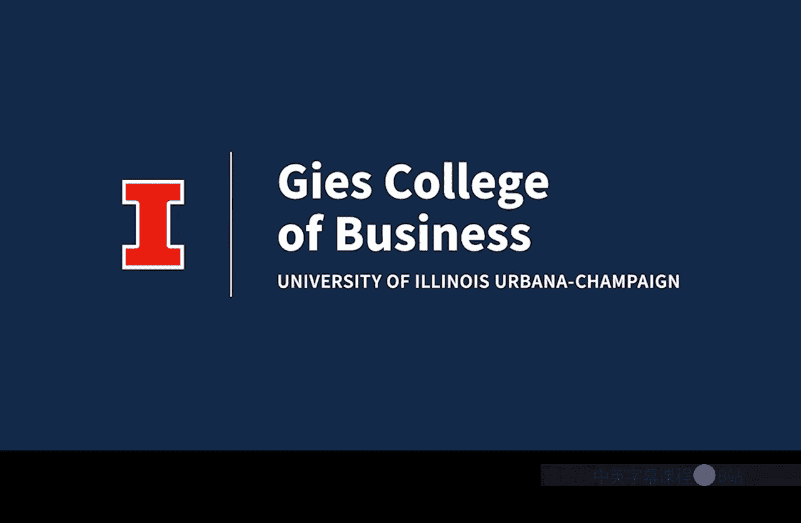

# 伊利诺伊大学【中英⚡商业分析｜Business Analytics Specialization】 p34 P34 13_第二模块-结论 -BV1z86nB9EGz_p34-

Yeah。As you can see， it's a bit of a moody day here at the Rabow Point outlook in southern Utah。

The clouds might limit the long rangerange views， but it allows us to focus on the details。

 much like how in this module， we focused on the details of what makes a good question。

 both for business and for learning Python for data analytics。Even with this dramatic sky。

 the path forward is clear because of the fundamentals we've covered。

This comprehensive module focused on the F of the fact framework， framing questions。

 which is crucial both for businesses and for programming contexts。In our digital age。

 while answers are readily available， the art of crafting effective questions is more important than ever。

Successful question framing requires understanding what to ask， who to ask， how to ask。

 and how to act on answers to your questions。The business portion demonstrated how well framed questions can transform vague inquiries into actionable insights。

For instance， rather than asking， how can we increase sales to a passing manager？

A more effective approach would be asking a specific targeted question about product features and customer behavior during dedicated meetings。

Similarly， in Python programming， precise question framing leads to more efficient problem solving。

 whether you're starting a new project， augmenting existing code or troubleshooting errors。

Much of this module focused on practical hands on guidance for accessing help through various means。

 including built in documentation， external sources and AI tools。

So even if parts of the landscape around us are a bit subdued today。

 the principles we've explored in this module are vibrant and clear。

We've learned that mastering Python and data analytics， like navigating any journey。

 comes not just from having the questions， but from effectively using the answers we find。

We can use the answers we find by thoughtfully considering the responses， especially from AI。

 fearlessly experimenting with code and learning from error messages。

Let's take the insights from this module， and the challenges and continue moving forward on our path to discovery。

