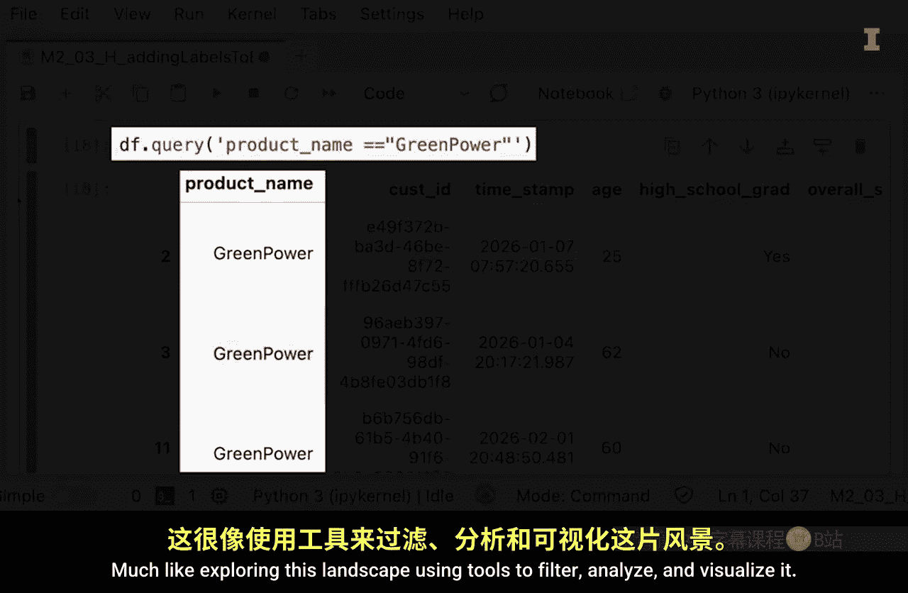

# 伊利诺伊大学【中英⚡商业分析｜Business Analytics Specialization】 p35 P35 03_第三模块简介 -BV1z86nB9EGz_p35-

Hello everyone， and welcome to the breathretaking Bryce Canyon Wilderness。As you can see。

 we're surrounded by a vast and complex landscape full of hidden beauty and valuable resources。

Much like the world of data we're about to explore。Imagine this wilderness as a giant mine。

 rich with valuable orar。 This would be great， right？

 The catch is that there's a significant amount of work that you must go through to convert the raw earth into useful orar。

😊，So how does this analogy relate to data analytics？Well。

 data is valuable for making informed business decisions。For instance。

 huge amounts of data are required for creating artificial intelligence tools like chat GT。However。

 before the data can be used to create these amazing tools， it has to be processed。

 which often takes a significant amount of work。For instance。

 a manufacturing company may want to create an artificial intelligent agent to help with predictive maintenance。

 quality control and supply chain optimization， using their vast amounts of historical data。

There may be sensor data stored in memory chips or SD cards。

Invoice data stored in PDF documents and emails， financial modeling data stored in spreadsheets and diagrams。

 and perhaps even wisdom that could be extracted from recorded meetings。

Before they could use that data， they would have to extract it and normalize it so that it can all be used to train the LLM or large language model。

Even if you are just trying to make some visualizations using data that is stored in historical files that all have the same data structure。

 there's going to be some effort that goes into preparing the data before you can turn it into a visualization。

The focus of this module is twofold。First， we want to explore the general characteristics that make data valuable。

Second， we will demonstrate how those principles apply to Pada's data frames。

 which are the most important data structure for data analysis。

Just as the beauty of Bryce Cany in wilderness is revealed through careful observation and processing。

The value of data is revealed through careful analysis。By the time you complete this module。

 you'll be equipped to explore panda's data frames using filters， conditional statements。

 summary statistics and simple visualizations， much like exploring this landscape。

 using tools to filter， analyze and visualize it。 So whether you're preparing the data or guiding the process。

 you'll gain the skills to transform raw information into meaningful insights。

Just as we're transforming our understanding of this landscape into appreciation。

