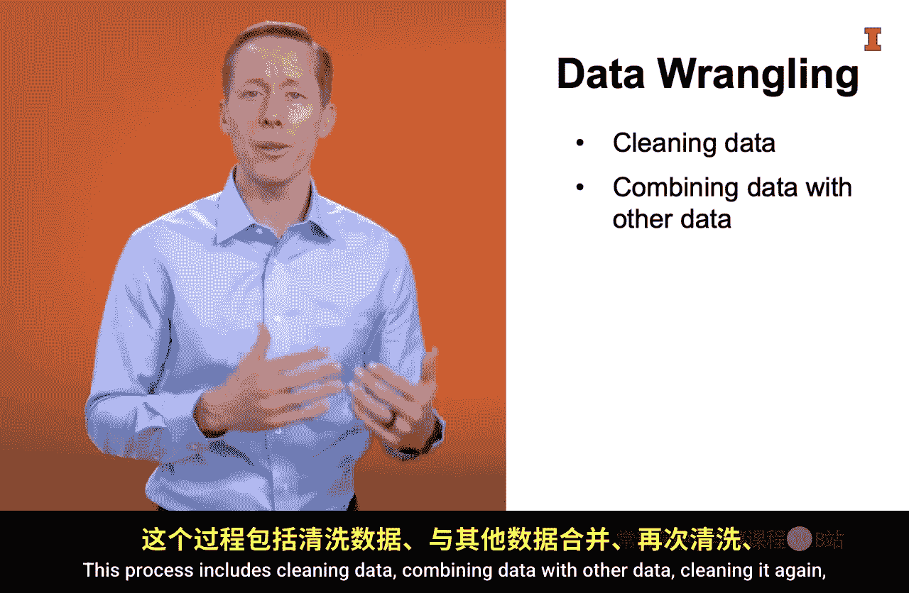

# 伊利诺伊大学【中英⚡商业分析｜Business Analytics Specialization】 p37 P37 02_数据组装 -BV1z86nB9EGz_p37-

In this lesson， you'll learn more details about assembling data。

 the second step in the fact framework。Assembling data is critical because it often has a direct impact on how effectively the question can be answered。

Interestingly， it often requires more time than the actual calculation of the results。

I asked Louise Guillimmo how much time he spends assembling the data versus analyzing the data。

 Here is his response。Yeah， the amount of time that I spend in data preparation is about 80% of 80% of the time where 20% is dedicated to actually doing calculations。

 obviously that can vary from time to time but the main problem is data quality。knowDa accuracy。

 making sure that it's correct， that it's shaped in the way that you need it to be able to do your analytics。

 ensuring。That you have everything that you need essentially that's really the key part once you have everything in the form that you need it。

 putting a model on top of it is very simple and if you're adept at interpreting those models。

 then you'll go quite far quite quickly。I think it's clear， at least from Luis's perspective。

 that assembling data takes a lot of time。Let's talk about why that's the case。

Assembling data typically involves several steps， finding data， extracting the data。

 transforming the data， and loading the data， or ETL。And data wrangling。

The importance of finding relevant data can't be overstated。

 data is often protected for safety and regulatory reasons， as well as to protect trade secrets。

Oftentimes， people don't know what data sets exist， even within their organization。

Or even if employees know that a data set exists， it may be hard to access due to security and privacy concerns。

For instance， it's unlikely that the HR department will share employee salary information with the marketing department。

Many companies now employ chief data officers or CDOs。In his book In Phomics。

 University of Illinois alum Doug Laney suggests that most chief data officers have been chartered with improving the efficiency and value generating capacity of their organization's information ecosystem。

That is， they've been asked to lead their organization in treating and leveraging information with the same discipline as its other more traditional assets。

Thus， CDOs should not only keep track of data that's available to employees of the organization。

 but they should also make sure that the right employees know how to find out what data is available。

 as well as how to get access to it。Data sources may include internal and external data。For instance。

 if you're a manager who's trying to find out the factors that caused a decrease in sales for various regions。

Then you'd probably want to make sure that you have information related to sales and location。

But that's not all。You'd also want to gather data about potential factors that could influence sales for each region。

Perhaps you'd want to find weather data and data related to the types of homes like single family homes。

 two family homes and number of rooms per home that are in each region。

There are thousands of publicly available data sets that could be considered。Governmental agencies。

 at least in the United States， make many data sets available to the public， including weather data。

 financial data for companies whose stocks are traded on US exchanges， census data。

 tax data and health data。You can browse thousands of datas on www。data。gov。

 There are many other interesting data sets available from many other websites as well。

If the question is important enough， you'll want to gather your own data。

Gathering your own data can be done in many ways。For instance。

 you could create a survey to gather your own data。

Or you can create a web crawler to gather data that is dispersed on multiple websites。

Or you can start measuring something that previously hadn't been measured。

Once you've identified a data set， you'll want to extract data from where it resides。

 transform it into a structure that meets your needs， and then load it into a data processing tool。

 This is frequently abbreviated as ETL for extract， transform and load。

This is important because data repository store data in a variety of formats and then return data to the user in a different variety of formats。

Typically， you'll want to transform the data to a table format so that you can perform the visualization or analysis。

However， other formats also exist such as G database format， if you wanted to analyze graph data。

 then you'd want to transform the data accordingly。

The most commonly known data repository is a relational database。

 which stores data in multiple tables。A structured query language or SQL is often used to extract the desired subset of data。

 which is then returned in a table format。 This is nice because the data is already in a table format。

 and it's ready to use。Here are some other ways in which data is stored and extracted。

If you're gathering data from websites， then you'll need to gather HTML or XM data。

 which has lots of tags to identify the different pieces of data。

You'll then have to extract the key pieces of information and then transform it to a table format。

Sometimes data is stored in a relational database but is accessed using an application programming interface or API。

 which has a structure like a website rather than a SQL query。

The data is often returned in JavaScript Object notation or JSON format。

This format is a series of embedded lists separated by curly braces， Cols and commas。

As with HTML and XML data， the key pieces of data would need to be converted into a table format before it can be analyzed。

Once the data is in a table format， you'll most likely need to then go through a data wrangling or data muunging process。

This process includes cleaning data， combining data with other data， cleaning it again。

 perhaps combining it again， and then cleaning it again， and then changing its shape。

While I realize that you probably don't appreciate many of these terms in this process right now。

 I hope you get the idea that it's not a straightforward linear process。

These steps associated with assembling data are often iterated during the data wrangling process。

 you may realize that some of the data you found has too many errors。

 So you may decide that you need to find a different data set， and then you start the process over。

The underlying point is that assembling the right data is so important。

 and it often requires a lot of work。

