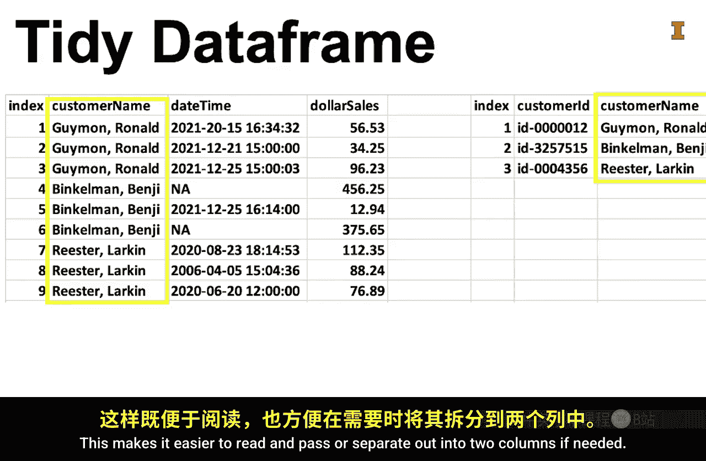

# 伊利诺伊大学【中英⚡商业分析｜Business Analytics Specialization】 p38 P38 03_整洁数据框的特性 -BV1z86nB9EGz_p38-

Yes。Data is one of the key ingredients in business analytics。

 If we have data that we want to analyze， oftentimes， the data must be tidiied up。

Let's continue on with this cooking analogy to illustrate what it means to have a tidy data frame。

 Have you ever noticed how in a cooking show， all the ingredients are nicely laid out， measured。

 placed in bowls， perhaps cut up。In my experience， the creation of a tidy cooking environment can actually take longer than the mixing of the ingredients in the cooking itself。

I also know from personal experience how easy it is to mix up ingredients if I don't have a tidy cooking environment。

 for example， I might use salt instead of sugar or cuummin instead of cinnamon in the case of snicker doodles or baking powder instead of baking soda。

Let's look at five elements of a tidy data frame。The first is that each row is an observation。

 and each column is a feature of that observation。While this is a simple idea。

 it's important to recognize that many spreadsheets violate this rule when formatting data for printing purposes。

Sometimes two tables are next to each other on the same page。If the data is part of the same table。

 then it needs to be stacked on top of each other。If the data is unrelated。

 then it needs to be broken into two separate tables。

The second element of a tidy data frame is that each row typically has a label that's known as an index。

 and index is a way to uniquely identify an observation。

 and the default value is often the row number。Sometimes an index is a label for each observation。

 like a timestamp or a company name。Sometimes an index is made up of multiple columns in the data。

 such as the combination of a timestamp and a company name。 This is known as a multi index。

The third element is that column names should have short but descriptive labels that do not include spaces or punctuation and are unique。

Code is easier to read and takes less time to create when the programmer doesn't have to include spaces and punctuation。

Default chart labels are also easier to read if the name is short。

Column names should follow a consistent naming convention。

Two of the most common naming conventions are camel case and snake case。

Sometimes one naming convention is used for data frames and one is used for column names so that it's easier to distinguish between the two when reading the code。

The fourth element， explicitly identifying missing values is especially important with numeric values。

 There is a big difference between missing values and 0。 For instance。

 consider how an average would be affected if you replaced missing values with zeros。Thus。

 you should replace missing measurements with NA instead of with zeros or by leaving them blank。

The fifth element of a tidy data frame is a consistent pattern within a column。 As an example。

 let's assume we have a column named customer name， which refers to a customer's first and last name。

 a tidy data frame will use the same pattern to record all customer names。

 such as Ronald Geman or Geman Ronald， or R period Geman。

 rather than a mixture of different patterns。 This makes it easier to read and parse or separate out into two columns if needed。

A tidy data frame also contains the same type of data for every observation within the column。 Well。

 what is data type？Data type refers to the way that data is encoded。

 which is different than how it's displayed。 For example， the binary version of the number 3 is 0，0。

0，0，0，1，1。The binary version of the character 3 is 0，0，11，0，011。

One way to think of this issue is the difference between the number three and the word3。

If you want to enter the number three so that it can be added to other numbers。

 then you don't spell it out with alphabetic characters like THREE， you enter the number three。

Creating a tidy data frame is like creating a tidy cooking environment。As you tidy up the data frame。

 you'll get to know to some extent the content of your data。Once you tidy up your data frame。

 then you can start digging deeper into understanding the actual content of the data。

