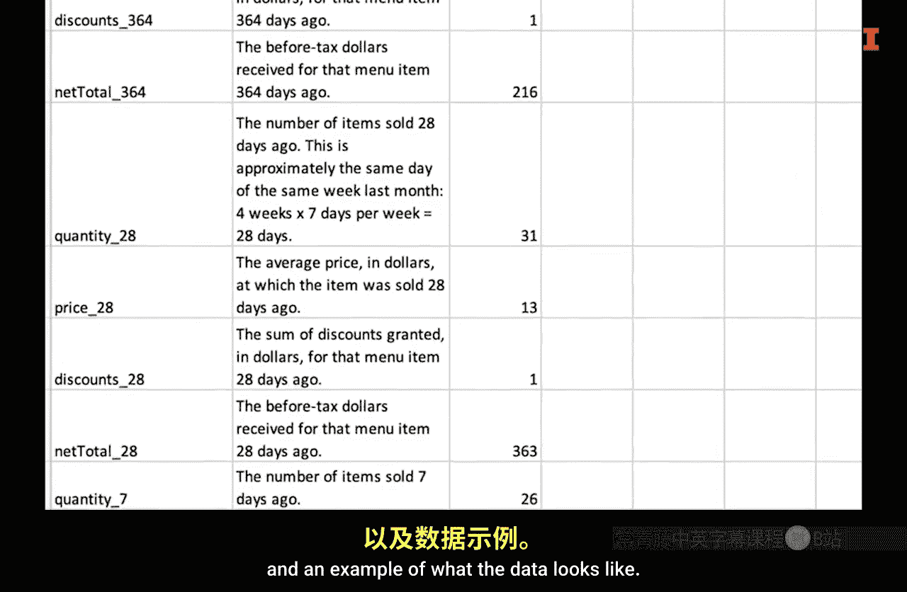
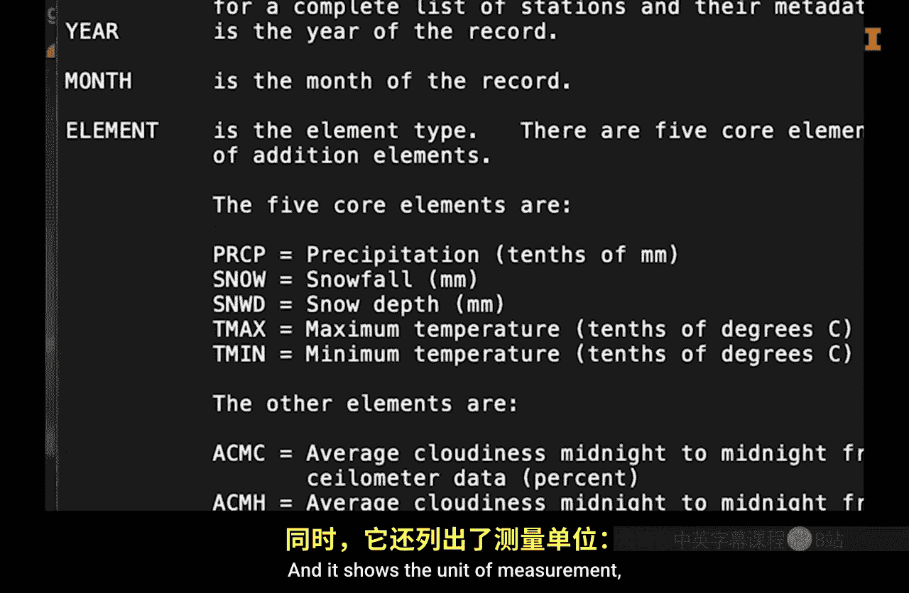

# 伊利诺伊大学【中英⚡商业分析｜Business Analytics Specialization】 p39 P39 04_数据字典 -BV1z86nB9EGz_p39-

Oftentimes， recipes use abbreviations to communicate the measurements。 For instance。

 T SP refers to teaspoon and TBSP refers to tablespoon。 Other abbreviations include C for cup。

 K G for kilogram M L for milliliilier。 Ozie for ounce and P T for pint。 I don't know about you。

 but there are times in my life when I've been unsure what each abbreviation means。

 When that happens， you can either do what you think is best and hope that you're making the right decision。

 or you can look up the meaning of the abbreviation to make sure that you're using the right measurement。

 I know from sad experience that it's usually worth taking a little more time to look up the abbreviation。

 so that I don't use a tablespoon of baking soda， for example， when it only calls for a teaspoon。

Similarly， abbreviations are often used in data analysis and it can be easy to misinterpret the abbreviations。

In the moment that you're coming up with abbreviations， it will probably make sense。

 but it doesn't take long to forget what those mean。 Even when you don't use abbreviations。

 the name may not be fully complete。 For example， you should never use time as a column name because it's unclear whether that refers to a second minute。

 hour， day， week， score of days， fortnight， eon， et cetera。

A great practice is to create what's known as a data dictionary。Ideally。

 a data dictionary has at least the following two characteristics。 First。

 a brief overview of the data。 That overview can include a description of where the data came from。

 how to access it and what each row represents and why it was gathered。

 I also try to include any other special information that may be necessary to refresh the data。

 such as where I can get a password or how I can get an authentication token。

If the data is available for a lot of others to use。

 then there may be instructions on how to cite the data。

The second characteristic of the data dictionary is that it should have a list of each column name。

 along with a full description of what that abbreviation means。The data type， for example， stringing。

 numeric date， et cetera。 and an example of what the data looks like。

 There may also be a column for notes indicating anything special about the data。 For instance。

 in some older data sets， I've seen 9，9，9，9 used to represent missing values rather than N A。

 That's especially important because it could easily be converted to numeric value rather than N A。

It's easy to overlook a data dictionary because it makes sense to the creators in the moment that it's being created。

 and people have more expedient work that they can focus on。

Other reasons why the data set doesn't have a data dictionary is because it wasn't intended to be used by others or even by the same person at a later date。

When data dictionaries are provided， they can come in different ways。

 One way that I often see them is in the form of a readme dot T X T or text file。

 It's a text file because it shouldn't need any special software to open it。Other times。

 if the data set is provided in a spreadsheet， then the data dictionary may be a separate tab within the same spreadsheet。

 or in other cases， such as with financial accounting data。

 since the definitions need to be standardized， there are websites with very large data dictionaries。

 As you know， line items in financial reports have specific meanings。

 The interpretation of those line items are described in the notes of the financial statements。 Thus。

 in that sense， notes to the financial statements could also be considered data dictionaries。

 However， they are much longer than what is normally provided and what you need to know for data analytic purposes。

XBRL has a taxonomy that is essentially a data dictionary， it provides labels， documentation。

 and lots of other information。You don't need to worry about this complicated data dictionary。

 I just want to point out that it has one。Government agencies are often very good about providing a data dictionary。

 Here's an example of a readme dot text file for weather data from the National。

 Oceanic and Atmospheric Administration of the US Department of Commerce or NOAA data set。

This data dictionary is much closer to the type of data dictionary that you should make。

 but it's even more complex than what you will most often need。 Here are some things to notice。First。

 it shows how to site the data。Second， it then shows instructions on how to download the data。

In Section 3， it shows the format of the files。 noticeice that it shows how each file has one month of data for one weather station。

 It then goes on to talk about the definitions for each of the variables or columns of data。

 Importantly， it shows that the numeric values for the five core elements are measurements。

 and it shows the unit of measurements， such as tens of a millimeter for precipitation versus millmeter for snow and tensive degrees for Celsius for the max and min temperatures。

The fourth characteristic is that it has a bunch of other information for those who are interested。

In short， data dictionaries are really important for keeping track of what information is in a data set。

