# 伊利诺伊大学【中英⚡商业分析｜Business Analytics Specialization】 p41 P41 06_使用筛选器探索数据框 -BV1z86nB9EGz_p41-

In this video， I want to demonstrate how you can explore and extract subsets of a pandas data frame。

 Now， this is important both for exploring the data to get to know what's in it。

 as well as for subsetting the data and manipulating it later on。 Now。

 with respect to exploring the data， one of the first things that I like to do when I read in a data set into a Python environment is to visually look at it。

 look at the rows and columns。 I get a really good feel for how the data is organized and what's contained in each of the cells。

With respect to subsetting and manipulating the data， this is also something that I will often do。

 For instance， I may get a data frame that has 30 columns in it。

 and I'm really interested in only four columns and maybe only a subset of the rows。

 And so I want to be able to reduce it down to those columns and rows that are most interesting to me。

So let's go over to a Python environment in Jupiter labb， since most of you are beginning here。

 I thought by watching me type things out， you'll get a feel for how Jupipyter Lab at least works and you can see how the built in help also functions。

So I've got the different sections in here that we're going to go through and the first thing that we're going to do is read in and prepare the data I'm going to type a B after selecting this top cell and it'll create a code cell below it。

So to read in the data， I'm going to import functions from the pandas data frame。

 So import pandas as P。Okay， and then I hit escape to remove those options， I hit enter。

 and now I'm going to read in the data and I'm going to read in salary data。

 So I'm going to call it Sd。 and that's going to be equal to the pandas one of the pandas functions and we're gonna use the read pickle function。

 Now， a pickle file is a file that has preserved certain data types and has compressed the data as well。

 And if I show you my file explorer I've got salary survey21 dot X Z。 that is the pickle file。

 Okay so I'm going type out quotation marks and then salary survey and you can see it's suggesting one of the data files in my working directory。

 that's the one I want。 I'll just hit enter to select that。

And then I will press control enter to run that。Okay， so it ran。

 so it imported the functions from the pandas module then read in the data。Now。

 once I've read in the data， one way that I can evaluate， at least in Jupiter La here。

 if I have read in the data is I can use this percent sign and then whose， All right。

 And this is called a magic command。

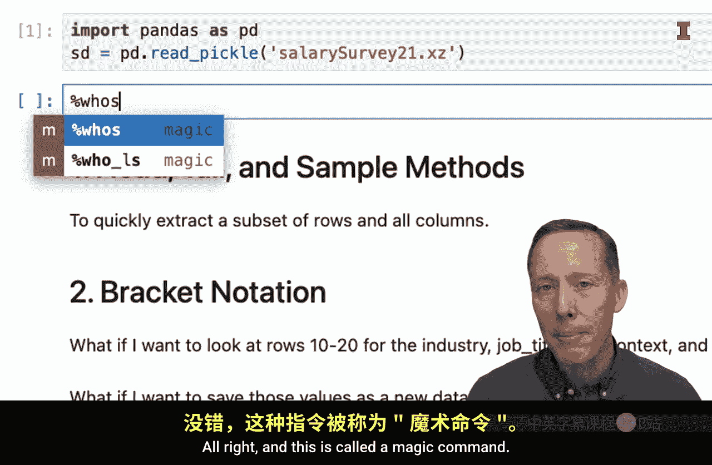

So if I push shift enter now to run that， it will show me the variables that I have。

 So I have the pandas module， and I have this S data frame。 It has 28135 rows and 18 columns。 Okay。

 so I've got it in here， but I would really like to explore it visually。

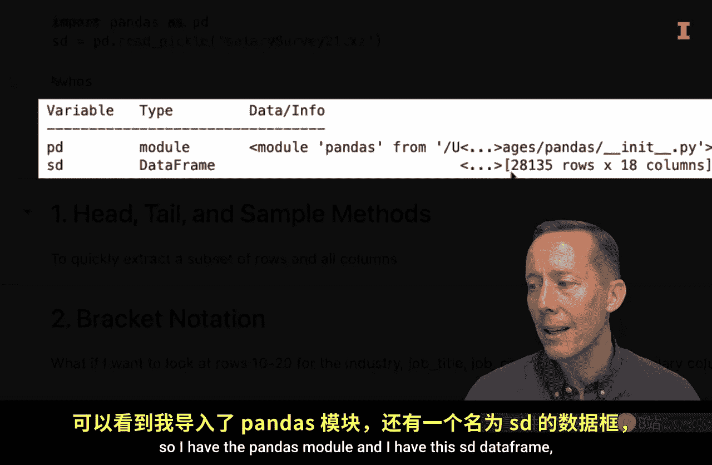

So let's talk about different ways that I can do that。

One of the things that I use most often is this head method Okay。

 so I'm going to create a new code cell below this cell here with the B。

 and I'll just type SD dot head and then open and close parentheses and then shift enter。

 run that and it will show me the first five rows for every column of this data set。Okay。

 so this is data that has come from a survey about how much people make。

 So that head1 is really useful。  similar to the head command。 I'll create another code cell here。

 There's a tail command。 So S D dot tail。

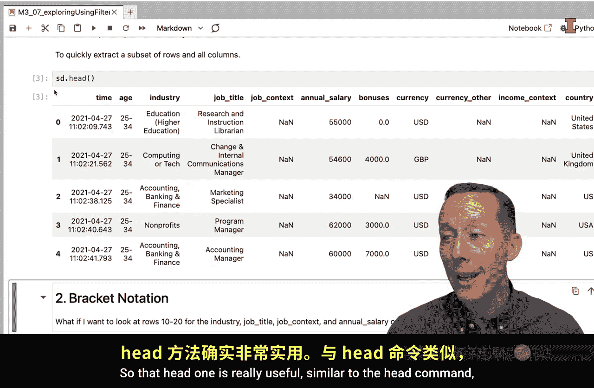

And it's a method。

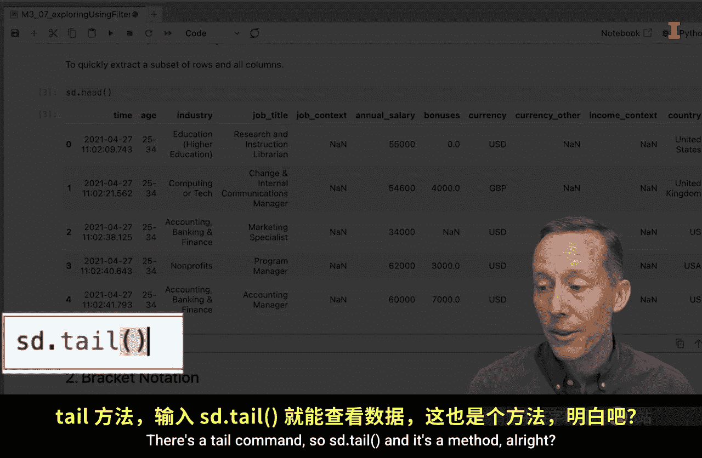

Alright， so a function that's inherited by Pada's data frames。

 and this is showing me the last five rows， and you can see by these row numbers here that I've got different rows。

Allright， and then there's also another command， which is sample。 So if I do S dot sample。

 that's again， a method。 it'll just randomly select one row。 So if I want five rows。

 I can enter a five in there and run it， and I've got five or 15 or 10 whatever the case may be。

 All right， what if I want to look at specific rows like rows 10 to 20 just for certain columns of my data frame。

 and then save those as a new data frame S underscore B。

 So let's start by just looking at those specific rows。 I can do that using bracket notation。 Okay。

 so with bracket notation， the way it works is we type out the data frame name。

 and then we add brackets。 And within these brackets， we can either indicate rows or columns。

 and I'm going to start by indicating rows， I'll put 10 colon21。 Now I want rows 10 to 20。

 I have to go up to 21 because it doesn't include this last number So that'll return just those rows。

 if I run it like that， you can see it gives。

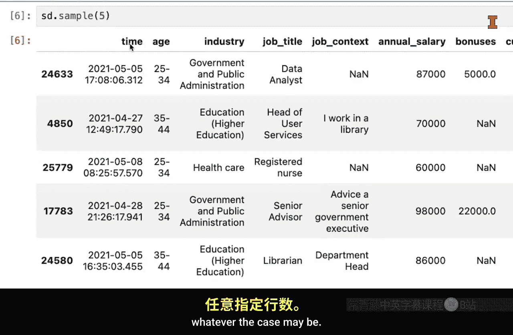

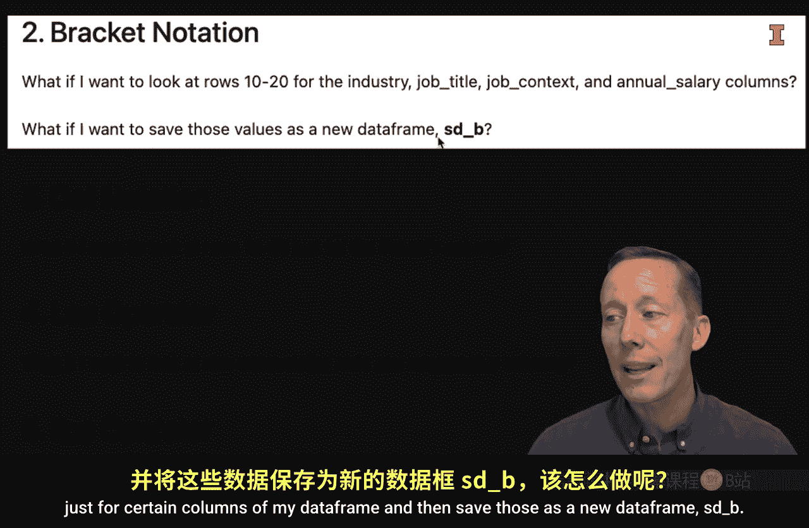

Me every column for rows 10 to 20。 but I can add on to here specific columns。 Okay。

 now to add on specific columns， I'll add another set of brackets。 and then within those brackets。

 I'll add a list。 And so I'm going to include in quotation marks the names of the columns that I want。

 So not job title。And I'll just go ahead and type out all these other column names。Okay。

 now I did it out of order， I was unintentional， but I'll do it anyway。

 and you can see that when I run this。

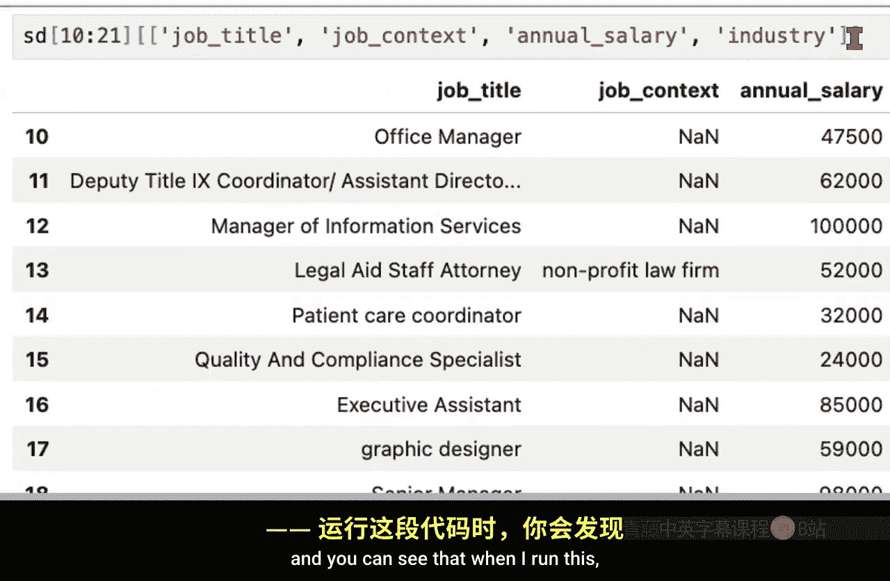

He returns the columns in the order that I've typed out here。 So I've got job title， job context。

 An salary and then industry， whereas in the original data， industry came before all of those。

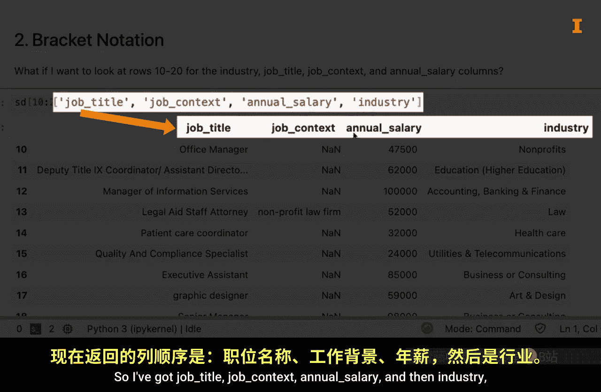

All right， so that allows me to not only select certain rows and columns。

 but also indicate the order of those columns。All right， and like I said， we can run this。

 I'm going to copy this cell。 I'm going to push， just highlight it。

 click outside that highlight push C， and then V。 and it'll create another cell here with that。

In there。 And I'm just going to put the rows at the end here just to show you that works and run it。

 And I get the exact same thing。 Okay， so this is bracket notation。

 And you'll see this used quite a bit。And you can even take this and save it as another data frame。

 So I'll copy this again and paste it。And now I want to save it as salary data。Using brackets。 Okay。

 so I'm going to set that equal to this SD underscore B。 And if I run that。

And now use this whose magic。

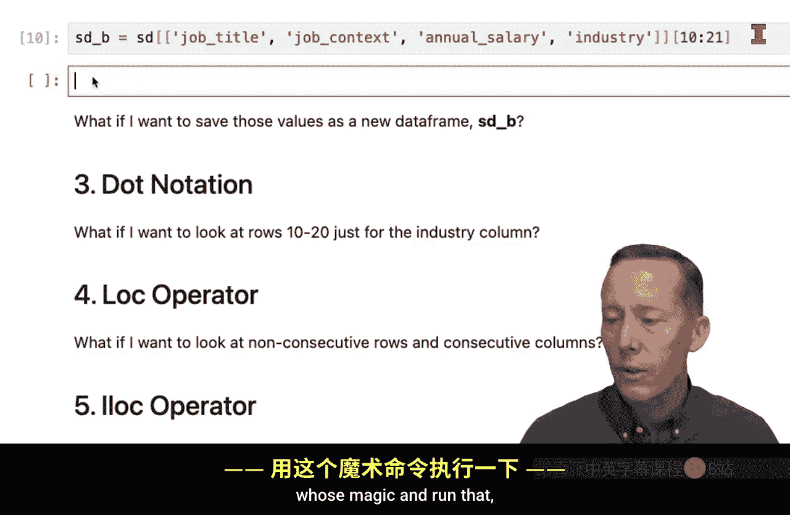

And run that， you can see that I have this new data frame。

 and it's only got 11 rows and four columns。

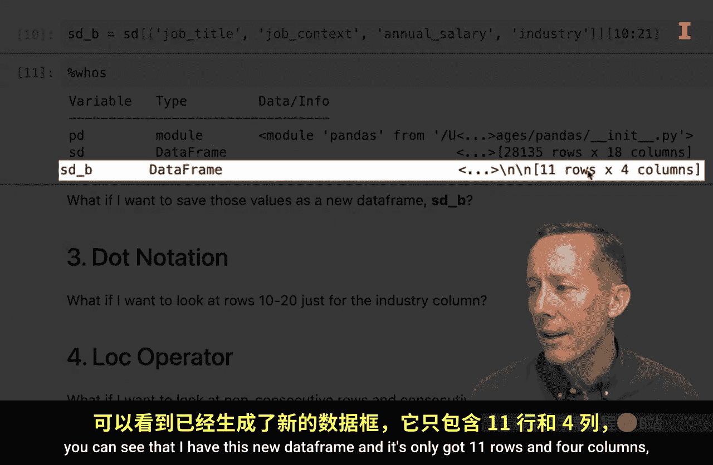

Okay， so anyway， that's how you can not just look at your data， but also save a subset of your data。

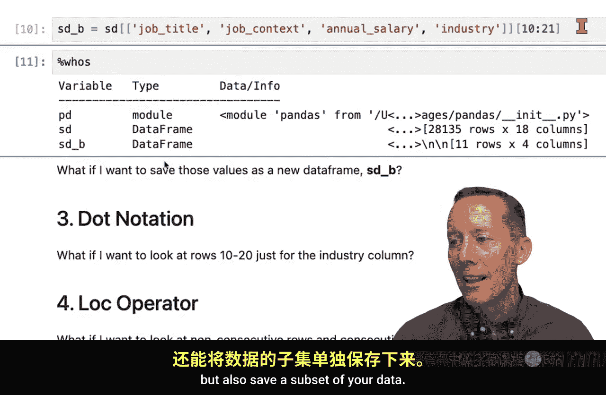

Allright， let's go on to dot notation。 What if I want to look at only rows 0 or rows 10 to 20 just for the industry column。

 Well， because I have tidy data frame names， I can use S and then period and then start typing out my column names and you can see that Ive got industry there and then if I want rows 10 to 20。

 I can use those same brackets like I did before。 and now I get those values just for the industry column。

 And again， it's rows 10 to 20。 let's go on to another way to filter the data。

 which is the lo operator。 So let's say I want to look at non consecutive rows and consecutive columns。

 Okay so to use the lo operator， I'm going to type out the data frame name and then dot Lo。

 now the first thing I do after typing out Lo because I'll put a comma in there on the left of the comma will'll put the rows that we want on the right will' put the columns。

 Now since I want non consecutivecut rows， I'm going create a list in here。

 So another set of square brackets。

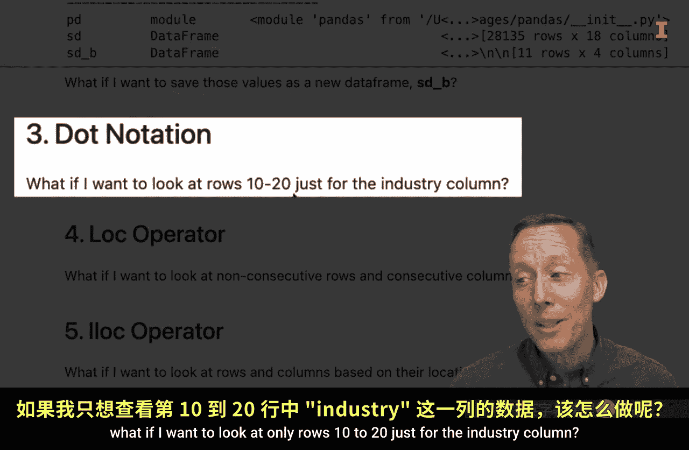

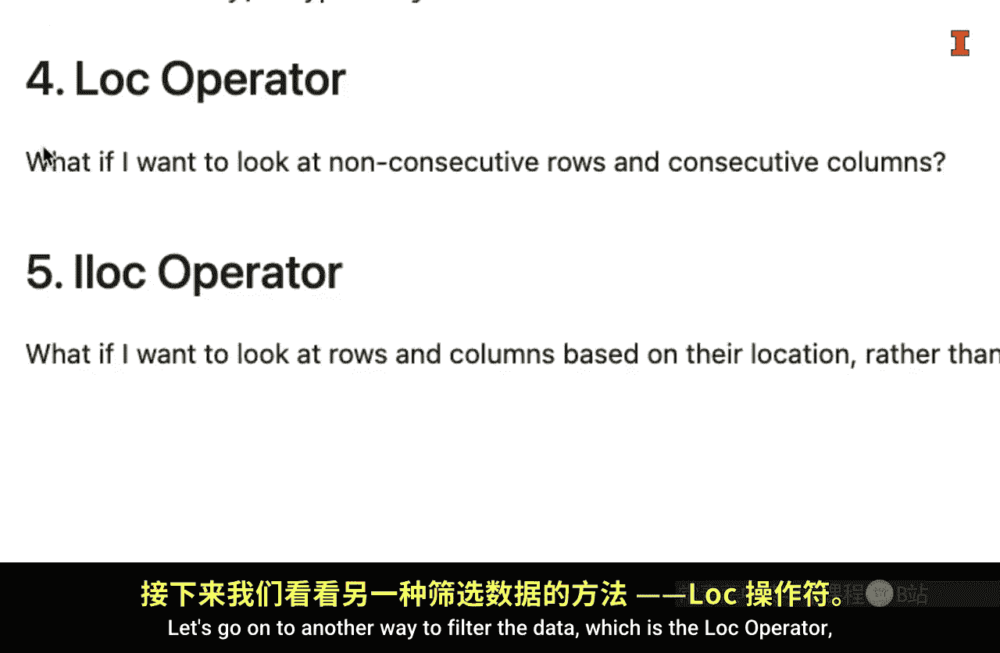

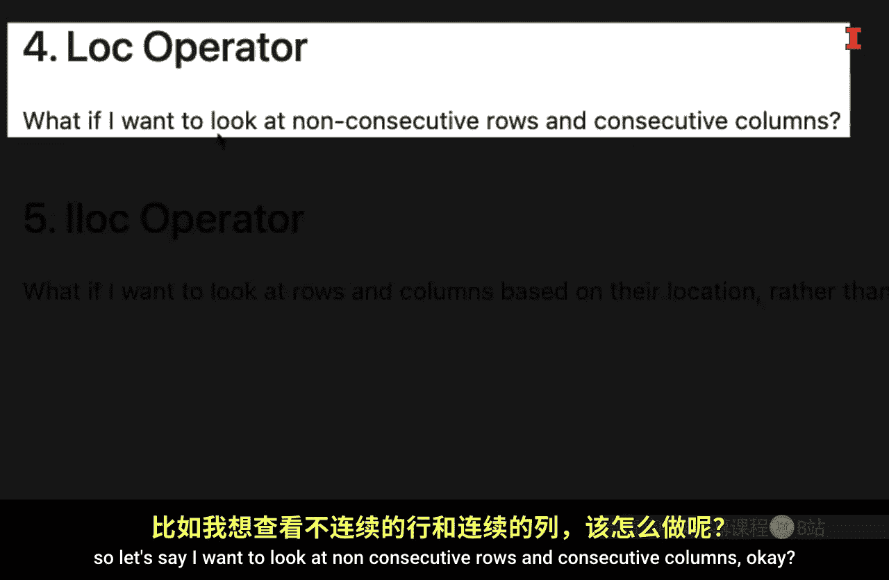

I'll put it four， comma 5 comma 7， Okay， so four and five are next to each other， but seven is not。

And then what if I want consecutive columns so I can type out industry。

And then rather than type out these other column names， So job title job context and annual salary。

Since the original data has these right next to each other。

I can separate these column names with a colon， and it'll grab these two columns。

 as well as everything in between them and return it to me。 All right。

 so you can see I've got rows 4，5，7 and all four of those columns。

 So you can do that with rows as well。 if I want rows 4 through 7。

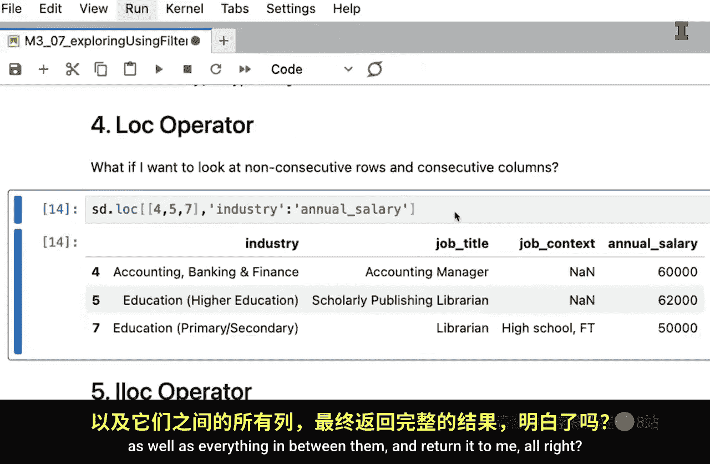

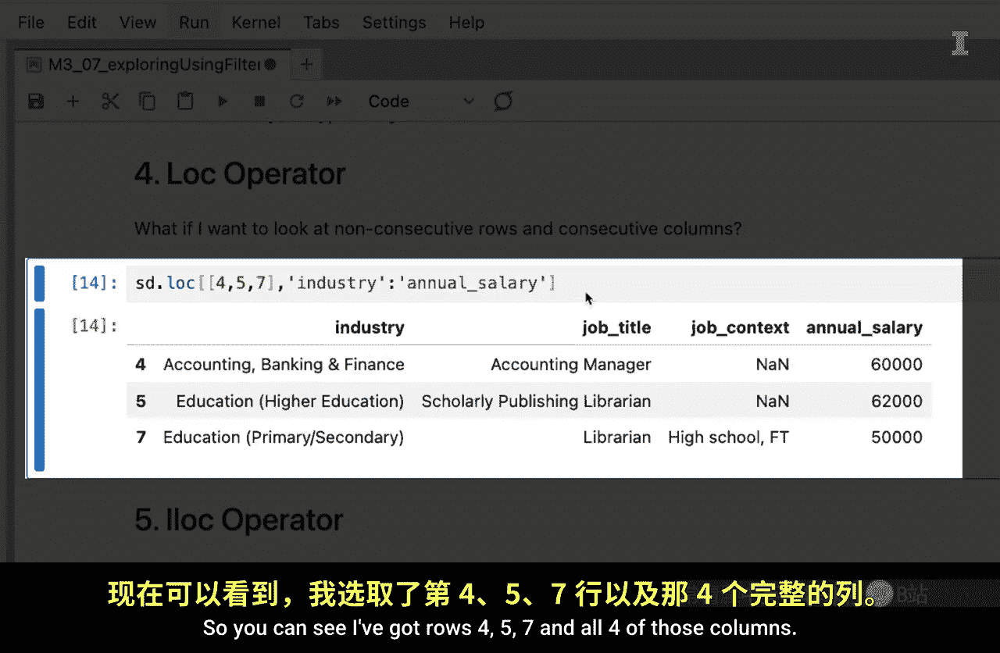

Then I can use that columnar now this is different because it's using the names。

 it's thinking of these row labels as names， not as positions。

 so that's why it is including the seven this time here。All right， rather than up to a6。All right。

 so anyway， the Lo operator is a really great 1。 I use this one probably the most。 All right。

 the final  one I want to show you is the I Lo operator， and this stands for index location。

 So if I want to look at rows and columns based on the the number of their location or their location rather than just their name。

😊，Alright， so it's going to be pretty similar to Lo。 So I'll type out the data frame name dot I Lo。

And now， if I want rows 4，5 and 7， again， I'll type out a list so I can do non consecutive rows and then a comma and after the comma。

 I'll put out my columns that I want going back to the original data up here。

 the industry and annual salary columns are in columns，0。 So we start with the first column is 0。

 and then one and then2。 So we take the second column 3，4，5。 So columns 2 through 5。

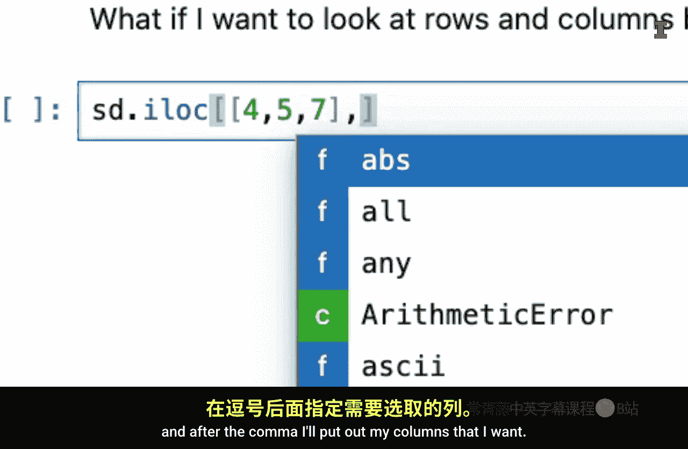

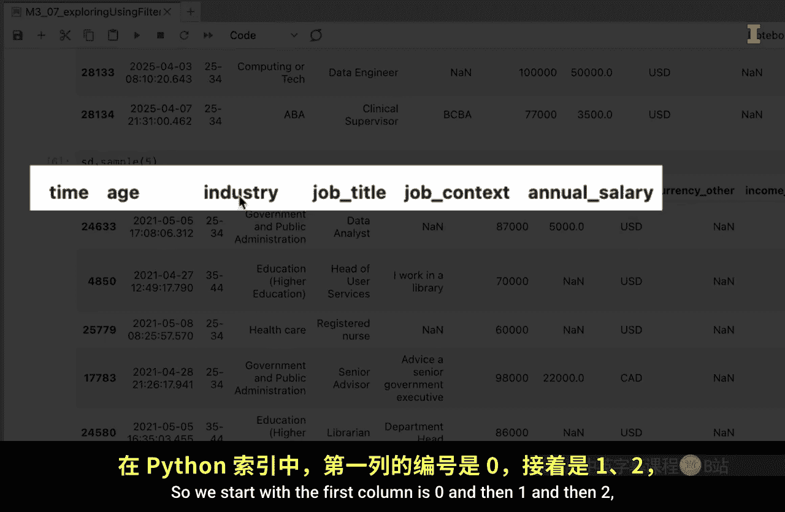

Okay， so I can。I can use。A colon like I did before。 anyway， it'll grab everything in between those。

 but watch what happens when I run this Now， because we're using index location。

 it's not going to include this last number in here。 if you're using that colon。

 So if I want the annual salary， I got to move that to6， and then it'll grab columns 2 through5。

 not including6。 All right， those are five different ways that you can filter panda's data frames based on just column names and row numbers。

 And later lessons we'll talk about how you can use conditional statements to extract rows and columns that meet specific conditions。

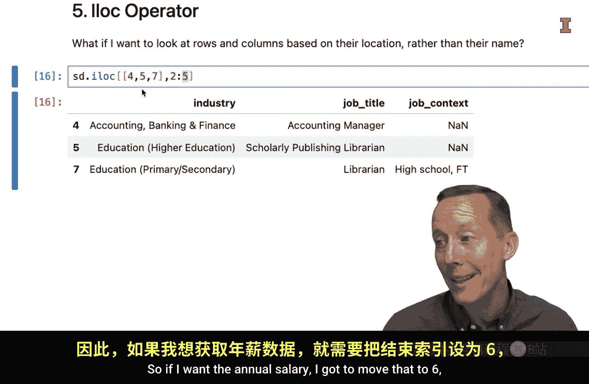

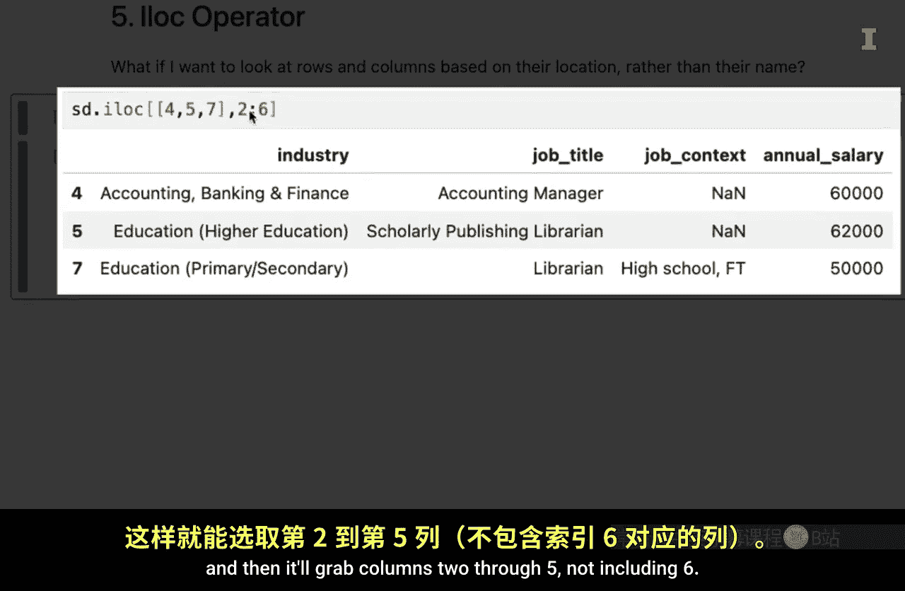

