# 伊利诺伊大学【中英⚡商业分析｜Business Analytics Specialization】 p42 P42 07_使用条件语句探索数据框 -BV1z86nB9EGz_p42-

The focus of this lesson is to build on what you have learned about filtering data frames and show you how you can filter data frames using conditional statements。

 and this will be really helpful so that you can reduce data frames down to rows that meet certain conditions。

So I'm going to jump over to a Python environment in Jupyter Lab。

 and I'm going to type out the code since most of you are just starting to learn how to use Python so you can at least get a feel for how I actually create the cells and run the cells in here。

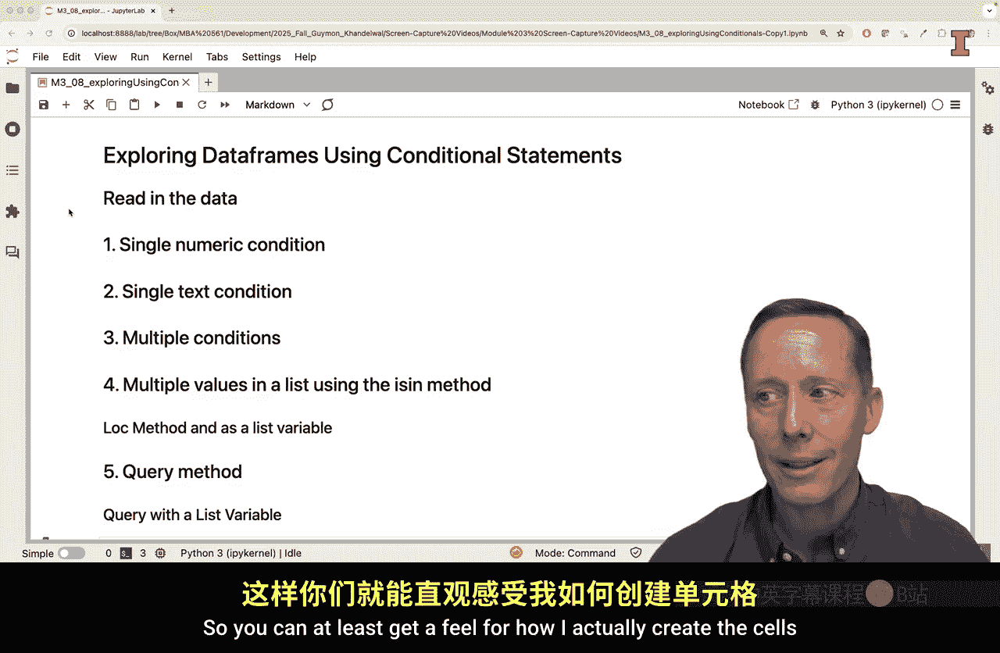

So the first thing we want to do is read in the data and then I'm going to show you six different approaches for using conditional statements。

 so I'm going to click on this read in the data cell。

 and I'm not going to double click on it but just click on like that and type a B to create a new code cell below it。

And then in here， I'm going to import functions。From the pandas data frame。

 and I'm going to run that cell。So that now I can go back into there and I can type out PD D do read。

 and it will tell me I've got this autocomplete enabled now because those functions are loaded into the memory here。

 So I'm going to read pickle。A pickle file is a special data file that compresses the data into much smaller size。

 and it also stores the format of the data so the data types。

And the data that I want that I have in here is salary survey data。

 and it's this one that ends with X z。And then I'm going to save it as a data frame S D case I'm going set S D equal to that。

 And then after I read it in， I want to display the first five rows， so I use the head method。

 go ahead and run that， and now I can get a quick overview of how this data is organized。

 and what we're going to do is we're going to be focusing on how we can reduce observations down to those that meet certain criteria for the annual salary and in the industry。

 a certain industry。Okay， so now I'm going to go to this first situation。

 the single numeric condition and type a B to add a new code cell below it。

 And let's say I want to look at only those rows for which the annual salary is greater than a million。

 and most of these are dollars， but you see I have some other currencies as well。

 but we want this number to be greater than a million。

So I'm going to start by typing out the data frame name and then use brackets and remember that a single set of brackets indicates the rows that we want。

Well， rather than typing out specific rows， I'm going to type out the data frame name again in then a period。

 and then the column that I want， which is annual salary。 And then I can use this greater than sign。

 and then I'll type out a million。Okay， and it's kind of annoying that I have to type out the name of the data frame again。

 but that's the way it is。 All right。 So if I run that， I get a subset of the data。

 if I scroll down a little bit， it tells me that there are 76 rows。

 I want to show you another way that you can make this simpler。

 So let me just go ahead and copy this cell， I push C and then V I'm looking at a copy of it。

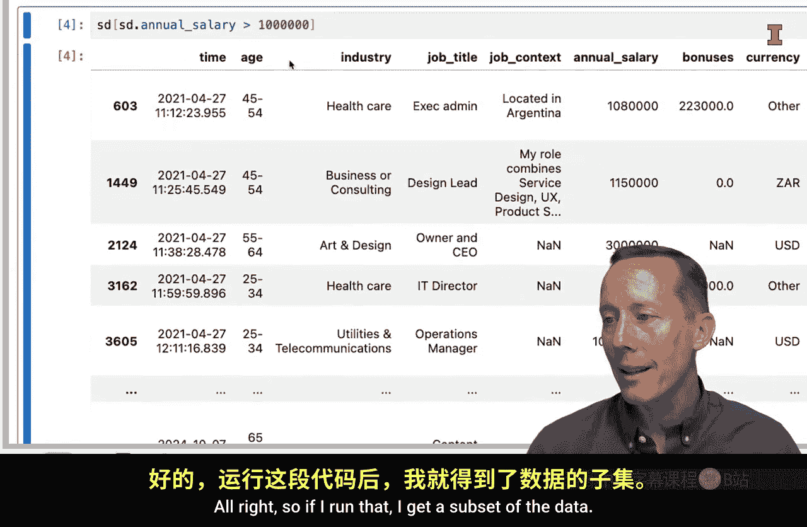

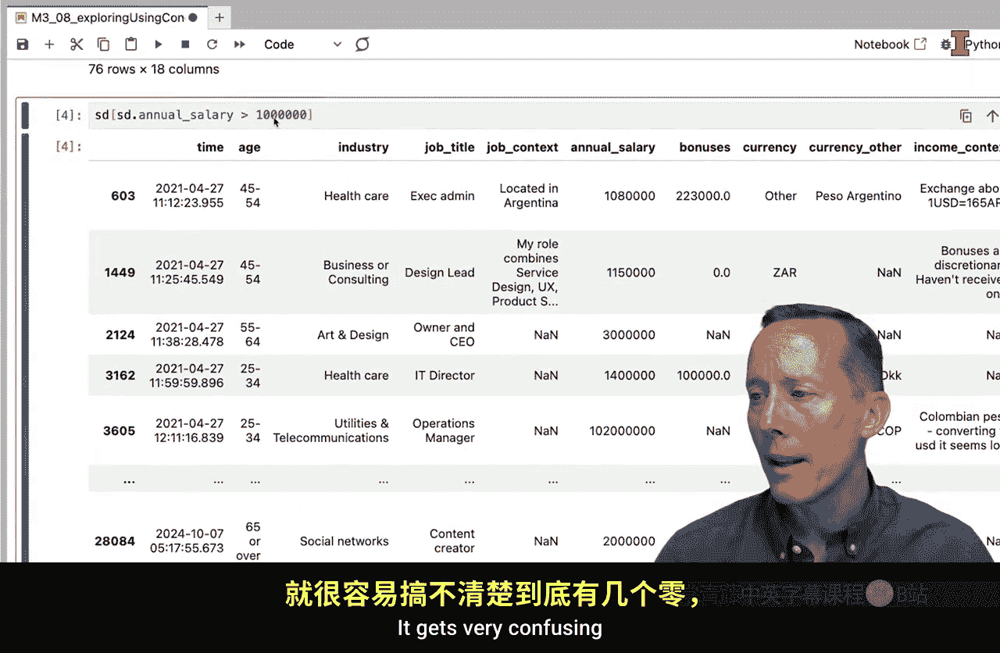

It gets very confusing when you can't add commas in here to help you identify how many zeros there are。

 if you try that， you'll get an error。But one thing that you can do is you can use a scientific notation。

 Okay， so we're going to say 1 E 6， meaning that there are  six zeros after the1。 And if I run that。

 I get the same 76 rows and 18 columns。 All right， so that can be really helpful。

 And then to show you that this works with not just bracket notation。

 but with like the the lo notation here， the Loke operator。 I'll type out S D dot Lo。

 and then brackets and then S do annual salary， greater than 1，1，2， well I'll just say 1 E 6。

 And then I need to add a comma in there， because I need to specify the columns that I want。

 And if I want all the columns， I can just leave that blank。 So if I run that。

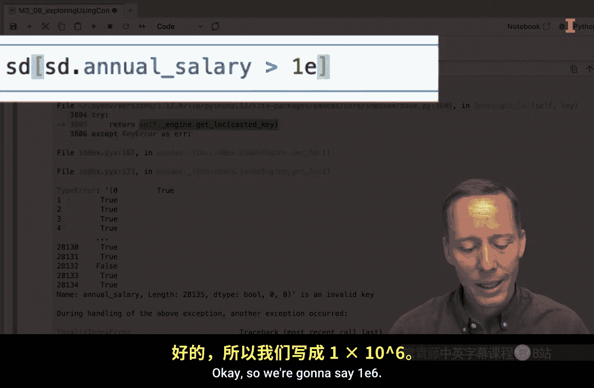

I get the same thing。Al right， so two different approaches。 But basically。

 that's how you can filter based on a conditional statement for one column， just one numeric value。

 What about a single text condition。So again， I'll add a new code cell below here。

 What if we want observations that are only in the art and design industry。

 So like this art and design。 So I'm going to use bracket notation and say S D。Dot industry。

And then we need to set that equal to。 Now I'm using two equal signs to indicate I want to evaluate if a value is equal to a specific。

Setting here。 so I'm going to type out art and design。So if I were to use one equal sign。

 I'd get an error because one equal sign means we're assigning a value to it。

 but we're not assigning we're just testing here so I can say equals had two equal signs art and design。

And if I run that， then it looks like there are 359 observations that meet that criteria and you can see that they all are in there。

What if I want observations that are not equal to art and design。

 I can add an exclamation point before that and then run it。

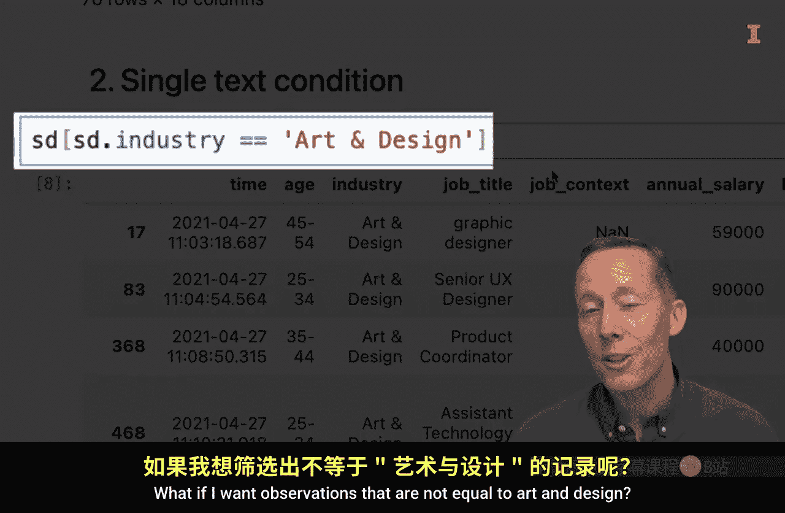

And now you should see that none of these are in the art and design industry。 All right。

 and then I'm going to copy this and paste it。 And just to show you that this works with the Lo operator as well。

 I can type out Lo。And I'm going to change this back to equals。

And if I want a specific set of columns here， then I'll add that comma and then the columns that I want。

 I'll say industry。And maybe job title。And then run that， I get the same 359 rows。

 but I only get two columns there。 This approach works with both bracket and notation。

 the Lo operator。And the other operators as well。All right， what if there are multiple conditions？

All right， so what if I want to identify rows for which the annual salary？Is greater than a million。

And。That are in the art and design industry。So what I would need to do is put an amper sand here rather than type out and。

And then type out S。t industry。Equal to art。And design。Now， this isn't going to work。 Okay。

 we get an error。 So what I need to do is put each of these tests and its own set of parentheses。

 Okay， so I'm going to highlight。Each test here and then push shift and then open parentheses。

 and it will add the close parentheesis as well。 So now if I run that。

 you can see that I really just have one observation here。

 And this is the owner and CEO of an art and design company whose annual salary is well over a million。

All right， well， let's copy and paste this。 I push C then V。

 What if I want to look at situations where the rows are either in the art and design industry or the annual salary is greater than a million Okay。

 so change that ampersand to an orura by using the pipe symbol that pipe symbol is on the backslash key。

 which is right above the enter key。Al right， so I have to push shift and then back slash and it gives me that pipe。

 Now， if I run that， I get a lot more observations。 In fact， I've got 434。

 and you'll be able to see that they're either in art and design。

 but they aren't necessarily over a million or they're not an art and design。

 but they are over a million。 All right， so we can add additional tests in here as well if we wanted。

😊，All right， what if I want to use that or idea without having to type out the same column over and over again？

Okay， so let's say， for instance， I want observations。For which the industry。

And then I'm going to put is in and then open and close parentheses。 And now I can add a list here。

 and I can say art and design。嗯。Healthca。Al right， so rather than having to say is in or is equal to art and design and parentheses。

 and the pipe symbol， and then type out S industry is equal to healthcare care。

 I can just use this in is in method。 And now you can see I've got health care and art in design like that。

 Okay， so that that is a really helpful one。 I'm going to copy that and come below here。

 and just show you that you can also。Use this。 this is in for columns of a data frame or a variable。

 so I'm going to take that out of there。And I'm going to just create a variable here。

 like my industries。You set that equal to the list。Okay。

 and then I'm going to take that my industries and put it in here。And then run it。

 And I get the same thing。 Okay， so the point is that we can refer to columns of a data frame or some other object。

 So I don't have to manually type this out。All right， let's go to the query method。

 This is my favorite way of filtering data。And I show you the other approaches because you'll see them a lot。

 But this one is the easiest to use。 So I'm going to create a new cell here。

I'm going to type out SD and then just use query and open and close parentheses。Now。

 I do have to use quotation marks。 It doesn't matter if it's single or double。

 but I'm going to put single quotation marks。 And if I want to identify rows for which the industry is equal to art and design again。

I can say industry。And then equals。 And then in double quotation marks， I'll use art and design。

 Okay， I'm using double quotation marks here because I'm using single quotation marks to indicate the beginning and end there。

 So it just needs to be the opposite。But isn't that nice that you don't have to type out the data frame name so I can run that and I get the results there？

And I'm going copy that and then paste it below here， and I can add in multiple conditions here。

 So I can say is in art and design and。

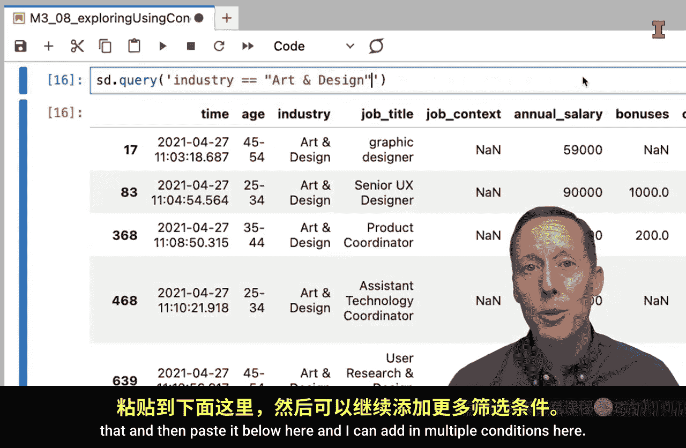

The annual salary。Is greater than a million， so I'll use 1 E6 again。

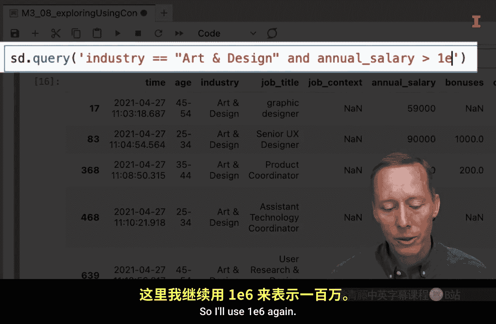

Okay， so I run that and I get just that single observation again。Al right， so again。

 super nice that we don't have to use the data frame name before each one or put open and close parentheses around these。

 and I can just use simple English here， so type out and。All right。

 and I could change that to orR if I wanted to change that to an or statement。

And remember how I have that my industry list above， I can also just use in my industries。

Change this back to end。And you can see I get an error。 So if I want to refer to a variable。

 I have to use the at sign。 Okay， so remember that variable I created before。 So now if I run it。

It will return observations that are either in the healthcare or art and design industry and the salary is greater than a million。

 Anyway， that query method is so much easier to read it's my favorite way of filtering data using conditional statements。

All right， the last thing I want to do is show you how you can take something like this。

 I'll copy that。And paste it below here。And oftentimes， after we perform a query like this。

 we want to sort it in a certain way。

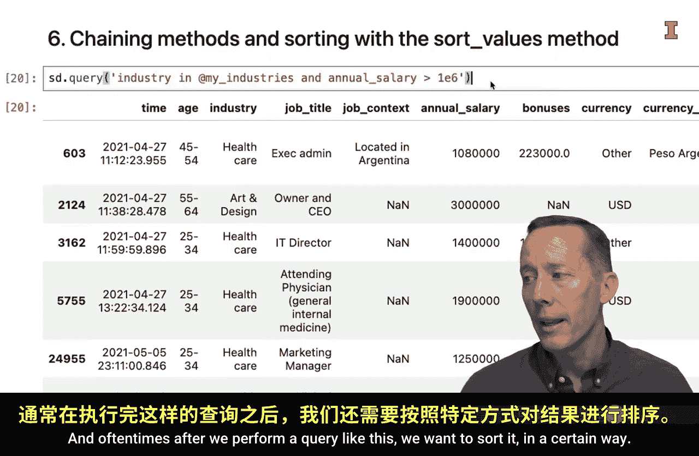

And so there is a method called sort to values。And first of all。

 I want to point out that notice that I don't have to create one data frame and then go to a new row and then use that new data frame and use the sort values on it。

 I can chain these methods together。 All right， and that becomes really powerful later on。 Anyway。

 the sort values is really nice。 So if I want to sort by the annual salary column。

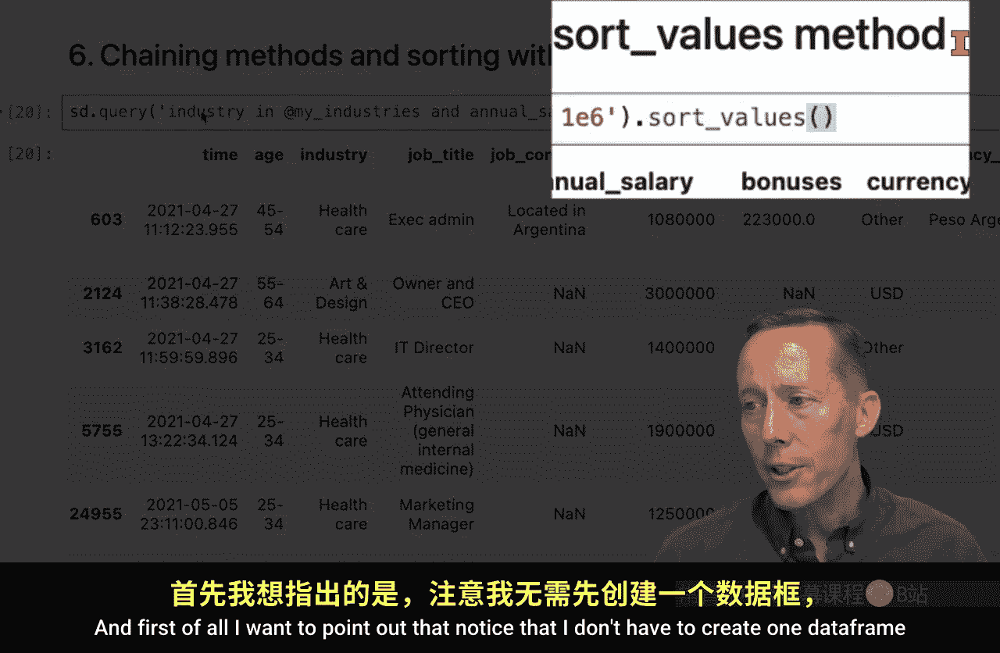

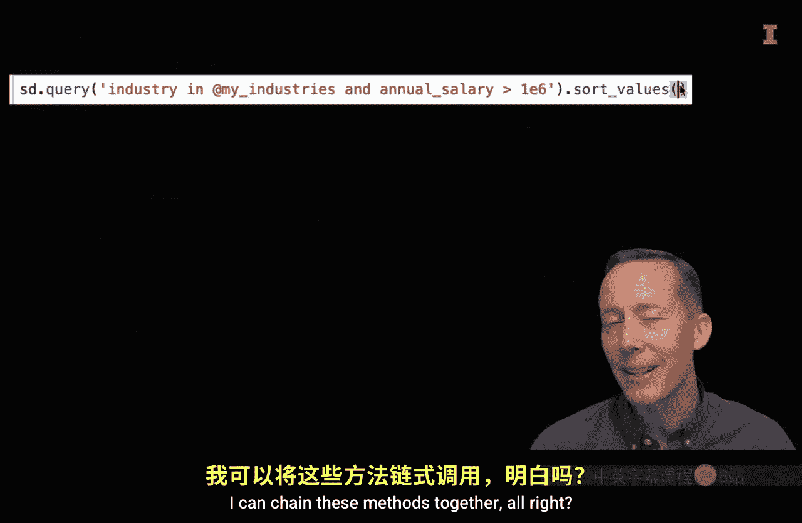

I have to put quotation marks around it and then run that and now you can see I've got that same set of data。

 but it's starting with the lowest annual salary and it's increasing， So it's an ascending order。

 if I want an descendending order I need to set the ascending equals parameter equal default faults and then run it and now I've got the highest annual salary up there。

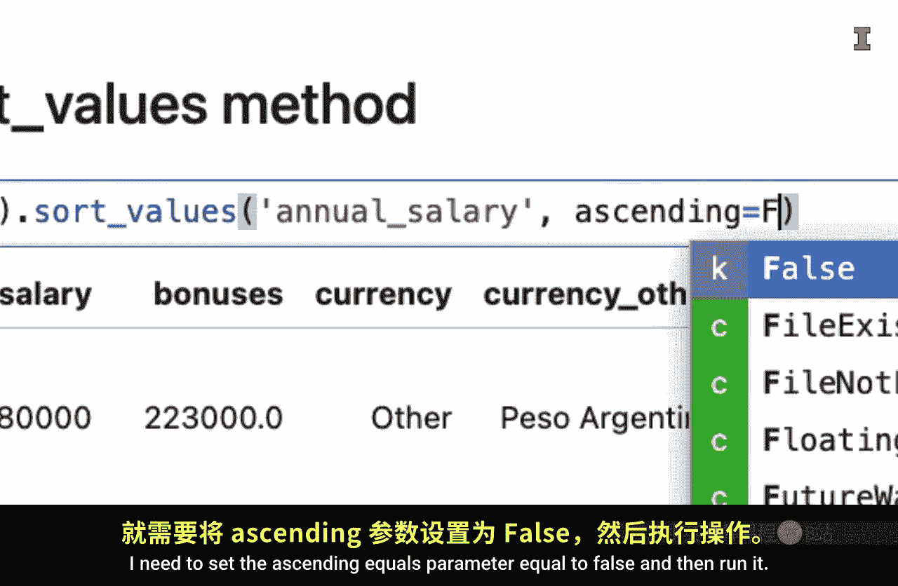

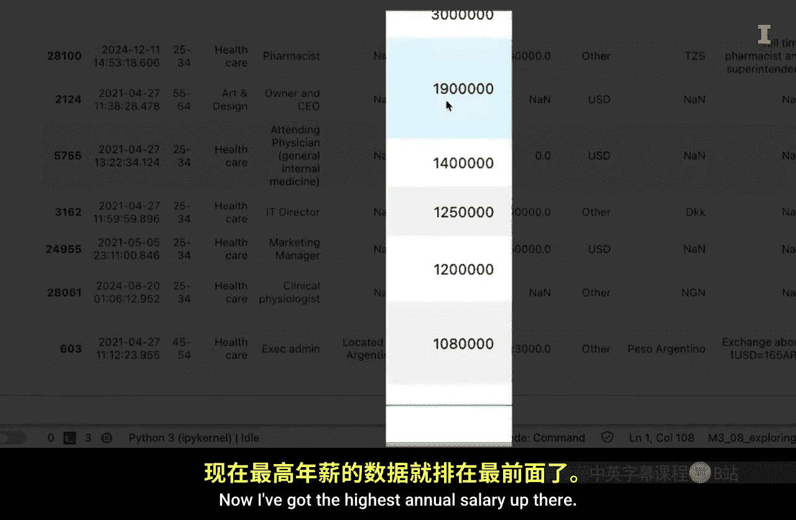

That sort values is a really useful method， something that you use a lot when you filter data and then look at the results after。

 so to summarize， we've learned about six different ways for including conditional statements to filter panda's data frames。

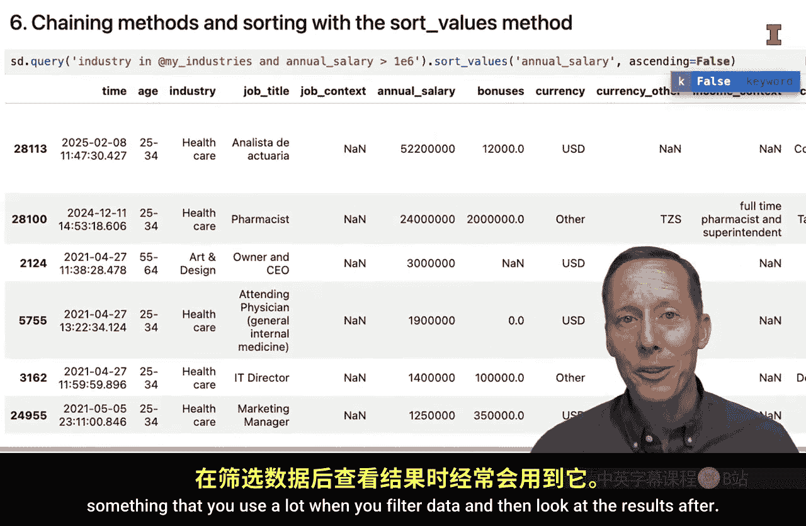

Remember， the comparison operators like the double equal sign and the Ampersand sign and the pipe symbol are somewhat unusual or maybe not as familiar If you're just getting started with Python。

 But that's how you can say equal to or。And or and then also there's that is in method All right。

 so these skills are crucial for being able to focus your analysis on certain parts of the data that are relevant to what you're trying to achieve。

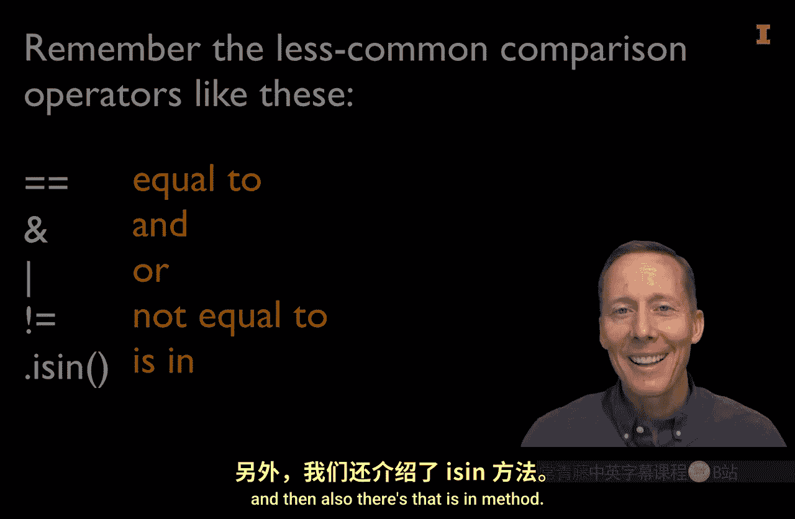

