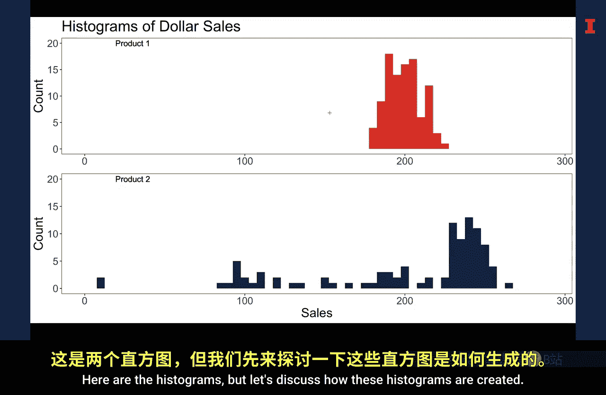
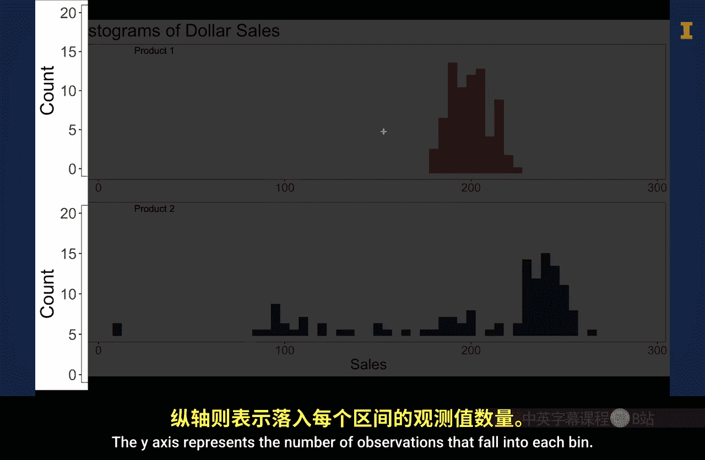
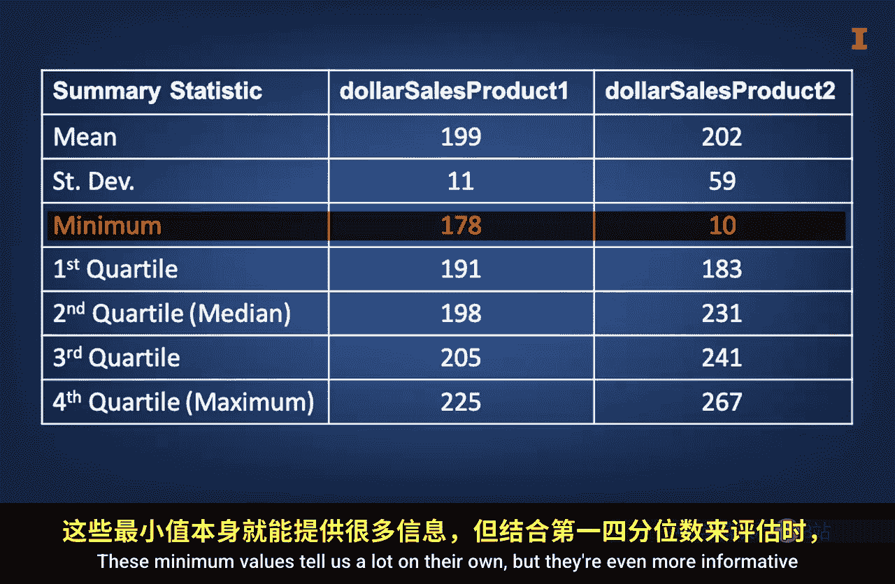
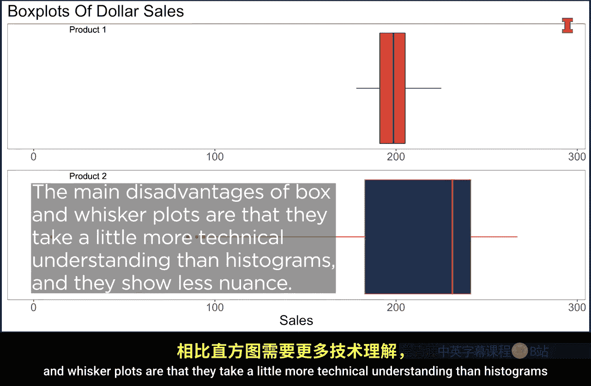

# 伊利诺伊大学【中英⚡商业分析｜Business Analytics Specialization】 p43 P43 08_汇总统计 -BV1z86nB9EGz_p43-

Yes。Having a tidy data frame is like having a clean and organized cooking environment。

 It's also important that you understand the makeup of the ingredients。For example。

 there are many types of sugar。 So when making snicker doodle cookies。

 it's important that you have the right type of sugar。

Regular white granulated sugar is often used to make snicker doodles。 In contrast to regular sugar。

 nib sugar is much more coarse heart and has more variation in its size and shape。

In contrast to both regular sugar and nib sugar， brown sugar is much darker and stickier。Similarly。

 theres a lot of variation in data。That variation is often useful。

 Understanding the variation helps to identify if data is useful for a particular business decision to get an idea of the data's basic makeup and then evaluate its use in a business decision。

Let's walk through an example。 Here is a fictitious business data for purchases made at an online store for two different products。

A quick visual inspection of the data frame suggests that this is a nice。

 tidy data set named sales data。You can see that there are two columns of data。

 The first column records the dollar sales for product 1。

 and the second column records the dollar sales for product 2。

 There are 100 transactions for each product。A quick visual inspection like this helps me get a general feel for the data。

It looks like there is a greater number of extreme values for product2 than for product1。However。

 this approach is very time consuming and not very efficient， even with just 100 observations。

For this reason， summary statistics and visualizations are often used to appraise the value of data and to look for patterns。

Summary statistics are also known as descriptive statistics。

 They reduce different characteristics for each column of data down to numbers that can be used to communicate the shape of the data。

Perhaps the most famous and often used summary statistic for communicating where data is located is the mean or average。

This is also known as a measure of central tendency。

You're probably familiar with how to calculate the average。 In layman's terms。

 the average is the value that results from adding up all of the observations and then dividing that sum by the number of observations。

This summary statistic is especially useful when you want to divide a whole number into smaller pieces that are all the same size。

With respect to the two purchase data sets， the mean number of dollars spent on purchases is $199 for product 1 and 202 for product 2。

 They have a similar central tendency， but that is only one characteristic of the data。

Another commonly used summary statistic is the standard deviation。

 which communicates how spread out or distributed the observations are around the mean。Conceptually。

 you can think of the standard deviation as the average distance of each data point from the mean。

A higher standard deviation indicates that the data is， on average。

 more spread out around the mean relative to a lower standard deviation。

With respect to the sales for the two different products。

 the standard deviation for the mean dollar spent is 11 for product 1 and 59 for product 2。

So even though the mean sales is approximately the same for the two products。

 we should expect there to be less variation in the dollar spent for product1 than for product 2。

Let's look at a histogram for each product to see if that's the case。Here are the histograms。

 but let's discuss how these histograms are created。

The X axis of a histogram represents the values that the sales values can take。In this case。

 it is divided into bins of five， such as from one to five， 6 to 10， 11 to 15， and so on。

The Y axis represents the number of observations that fall into each bin。

Let's take a look at this lowest bar for product 2。 It looks like it's the second bin from 10 to 15。

 and that it has a height of 2。If we check the data。

 we can verify that there are indeed two observations of 10 that fall into that range。

Making a comparison of these histograms shows that the bins for product 2 are spread out more on the X axis than they are for product1。

This confirms what is summarized in a comparison of the standard deviations。That there is。

 indeed much more variation in the observations for product 2 than for product 1。

These histograms are nice because they quickly communicate the nuance in the way that the data is distributed around the mean。

For instance， these histograms show that the distribution of dollar spent for product1 is much more symmetric than for product 2。

Specifically for product2， a bunch of observations are tightly grouped together around 240。

 and then a bunch of observations are spread out all below this cluster。

 including the two that are much lower than all the other observations。

So while histograms are useful to communicate these relationships， it's hard to put them into words。

For this reason， there is another set of summary statistics that is based on quantiles。

Quantiles are equally sized fractions of the data in which the data is grouped based on magnitude。

Quantiles are formed by ordering the data from smallest to largest， forming equally sized bins。

And then reporting the values at the beginning of each man。For instance。

 you can create percentiles by dividing the order data into 100 equally sized bins。

Deciiles are formed by dividing the data into 10 equally sized bins。

 and quartiles are formed by dividing the data into four equally sized bins。

When reporting quantile values， it's also common to report the minimum value to be more specific。

 let's look at the minimum and quartile values for the dollar spent for each product。For product1。

 the minimum value is 178。In contrast for product2， the minimum value is 10， which is much smaller。

These minimum values tell us a lot on their own， but they're even more informative when we evaluate them。

 along with the values for the first quartile。

For product1， the first quartile value is $191， which is $13 higher than the minimum value of 178。

In contrast， for product 2， the first quartile value 183。

 which is $173 higher than the minimum value of 10， so it has a much larger range than for product 1。

This tells us something about how spread out the data is at the low end of the distribution。

The second quartile values are 198 for product 1 and 231 for product 2。

 So to force or 50% of the data falls at or below these points and at or above these points。

Since the second quartile value for product 2 is larger than that of product1。

 while the first quartile value is lower for product 2 than for product 1。

 we should again expect there to be more variation in observations in the second quartile for product 2 compared to product1。

Let's pause briefly and talk a little more about the second quartile。

 because the second quartile splits the data in half。 It has a special name， which is median。

 The median is an alternative to the mean for measuring the central tendency。

One advantage that the median has over the mean is that it will not be influenced by extremely large or small values。

This implies that when the mean is equal to or similar to the median， as it is for product1。

 the data is likely to be symmetric。On the other hand。

 when the mean is less than the median as it is for product 2。

 then it suggests that there are either some extremely small values that are pulling the mean below the median or a greater proportion of observations on the low end or some of both。

Conversely， when the mean is larger than the median。

 then there could either be some extremely large values that are pulling the mean above the median or a greater proportion of observations on the high end。

The third quartile values are 205 for product 1 and 241 for product2。As you might guess。

 this indicates that  three/4s or 75 per cent of the observations fall at or below those values。

 and 25 per cent fall at or above those values。The range for this third quartile is a little narrower for product 1 than for product 2。

 Also， the range for product 2 is at a higher level of dollar spent。Finally。

 the fourth quartile values of 225 for product 1 and 267 for product 2 indicate that 100% of the observations fall at or below those values。

These values are also known as the maximum， or simply the max。

Given that the third quartile and maximum values for product2 are both larger than those for product1。

We should expect to see all of the observations in the fourth quartile for product2 being larger than those for product1。

Once again， the values for product 2 and the fourth quartile are also more spread out。

 Hopefully these quartile values make intuitive sense。 However。

 I do realize that it's a lot of information to compare。For this reason。

 another type of plot is often used to visually communicate these quartile values。

 as well as the ranges between them。These plots are called box and whisker plots。

 but are often referred to simply as box plots。Let's take a look at a box plot for product1。

 along with the histogram for product1， with all of the quartile values layered on top。

Notice that the box portion begins at the first quartile value and ends at the third quartile value。

 This is known as the inter quartile range。The median is represented by the line drawn through the middle。

The whisker on the left extends to the minimum value。

 while the whisker on the right extends to the maximum value。Thus。

 a box plot succinctly communicates the quartile values as well as the distance between those values。

You can easily see that the second and third quartiles are about the same size。In contrast。

 you can see that the first and fourth quartile values are larger。

Let's now take a look at a box and whisker plot for product2。

 along with the histogram for product2 with all of the quartile values layered on top。As you know。

 the distribution for product2 is not symmetric，Specifically。

 there's a very large range for the first quartile。

 which is illustrated by a long whisker or line on the left hand side。Now。

 you might also notice some stubble or dots。 The maximum size of the whiskers is typically 1。

5 times the intercorrtile range。 So any stubble indicates observations that are extremely far away from most of the rest of the data and could be referred to as outliers。

Just like comparing histograms for the first two products。

 comparing their box and whisker plots makes it clear that the distribution for product 2 is more spread out and less symmetric than that of product1。

The relative advantage of box and whisker plots is that they quickly communicate quartile values and ranges as well as outliers。

The main disadvantages of box and whisker plots are that they take a little more technical understanding than histograms。

 and they show less nuance。

This is not a comprehensive lesson on summary statistics。

 but this should be enough to help you describe a column of data sufficiently to know if it will be useful in your analysis。

