# 伊利诺伊大学【中英⚡商业分析｜Business Analytics Specialization】 p44 P44 09_用汇总统计量探索数据 -BV1z86nB9EGz_p44-

Let's talk about how we can explore pannda's data frames using summary statistics。

 which are also known as descriptive statistics Now。

 rather than filtering to specific rows of a data frame。

 summary statistics summarize what's in those columns of a data frame using single numbers such as the mean。

 which you might be familiar with， also known as the average。

 There are many other summary statistics like median minimum second quartile and so on。

 Now these summary statistics are really useful and sometimes they can be the key calculation when we talk about calculations in the fact framework。

However， most of the time these summary statistics are used to just get a feel for what's in the data。

 so I'm going to shift over to a Python environment in Jupyter lab。

 and we're going to read in data and then talk about how we can calculate groups of summary statistics as well as individual statistics for numeric columns and categorical columns。

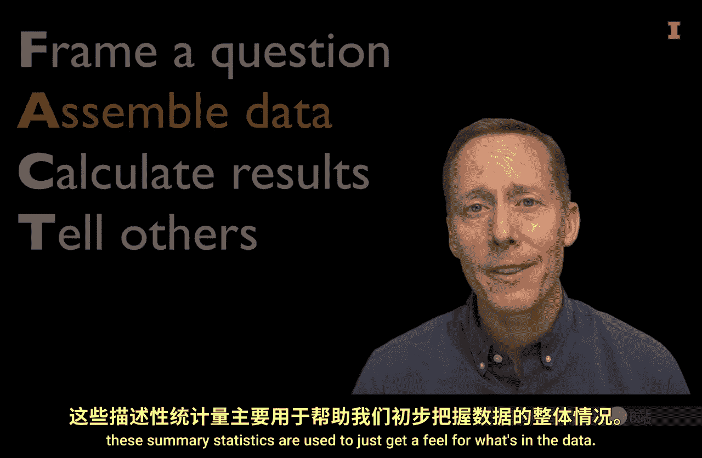

And I'm going to walk through these steps so you can see how I use Python in an interactive notebook environment so that you get a feel for how it works。

 So I'm going to go ahead and add a new code So below this by typing B。

And then I'll import functions from the pandas module。

I'm going to run that so that now I can easily look up functions for reading and data。

I'm going to use the read pickle function and read in this file。Salary survey 21 dot x Z。

I'm going to save that as a data frame named SD。And then I'm going to show the first 10 rows or sorry。

5 rows of that data frame using the head method。 So I'll go ahead and run all of this。Okay。

 so I have the salary survey data。And we're going to summarize some of the columns of data here using the summary statistics or descriptive statistics that are built into the pandas module。

All right， so I'll go ahead and talk about the describe method first。

 so I'll create a new code cell and I'll just go ahead and take that data frame and use the describe method and then run that。

And when I do that， let's take a look at what the results are。 All right。

 we've got three columns here。 It only did three of them。 It did time， annual salary and bonuses。

Okay， so time is this column right here， and this is a date time format column。

 and then the annual salary and bonuses columns， those are numeric formats。

So it really just took the three columns that are not object or character string columns。

 and for those columns， it gives me a variety of descriptive statistics。

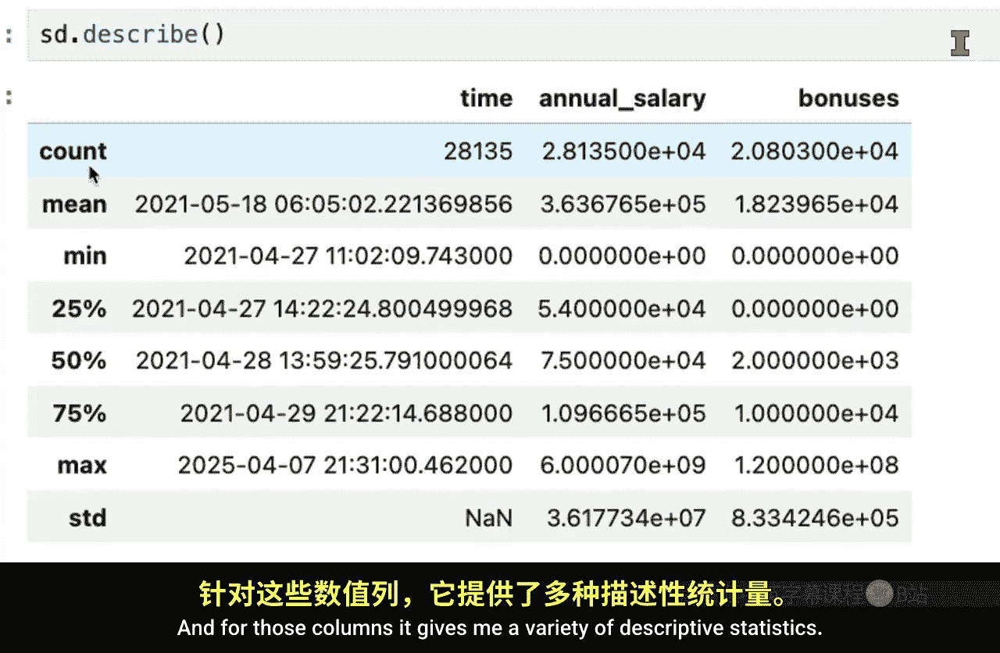

So I've got the count or the number of observations。

 and we can say that I've got some missing values in the bonuses column。I've got the mean or average。

 and then I've got quartile information。 So I've got the minimum value。

Then the 25th percentile or the first quartile， the 50th percentile or the median。

75th percentile or the third quartile。 and then the maximum value。And then last of all。

 I get the standard deviation， which is a measure of the variation in the data。

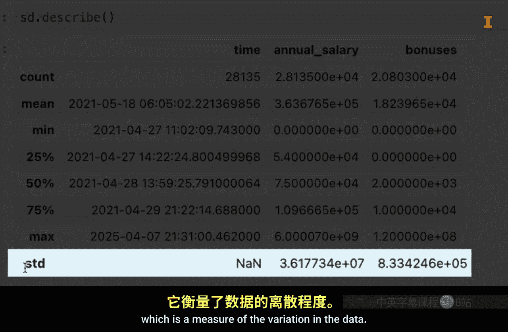

Now， what if we want to explore the other columns that are not numeric or date time。

 how can we do that？Well， let's create a new row here。

 and we're going to use the described method again。

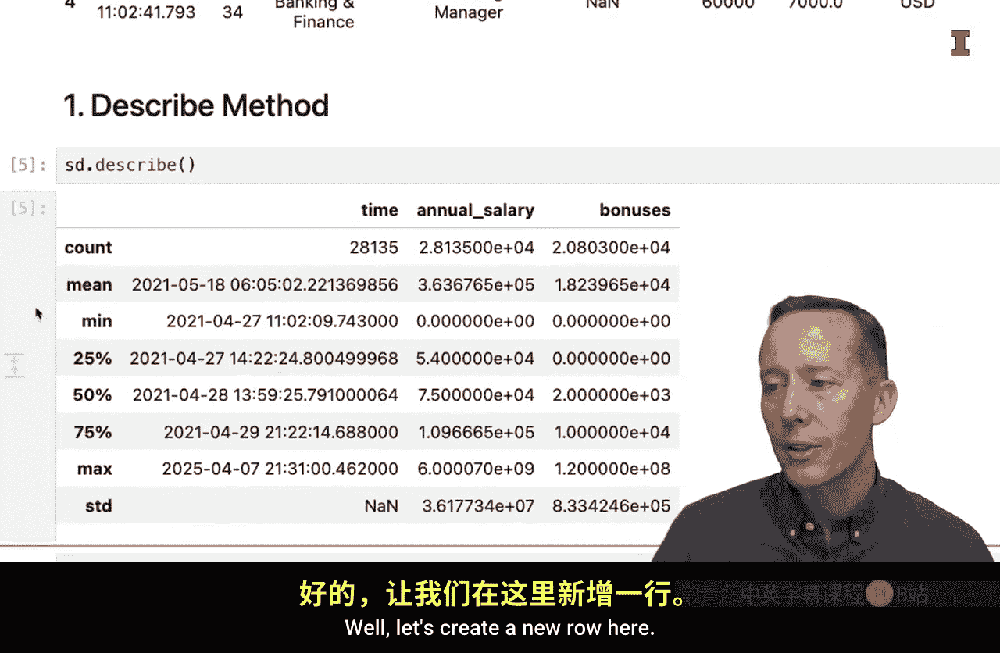

But we're going to refer to this include。Argument， and we're going to set that equal to object。 Okay。

 so object is the data type for non numeric types of columns。

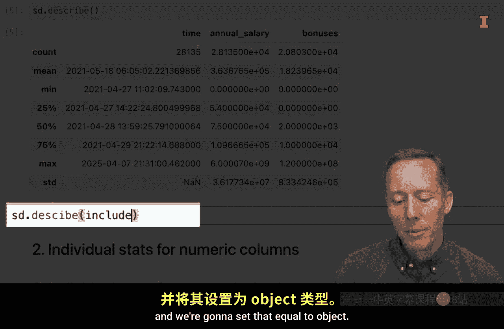

And I'm missing an R in here。O。So， I'll run this。And now you can see that I've got four descriptive statistics for each of the other columns in there。

 so I've got the count。 this allows me to see how many non missing values there are。

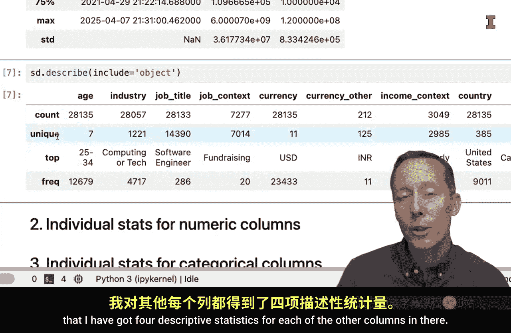

The number of unique values。 So for this age column， we've got seven different groups of ages。

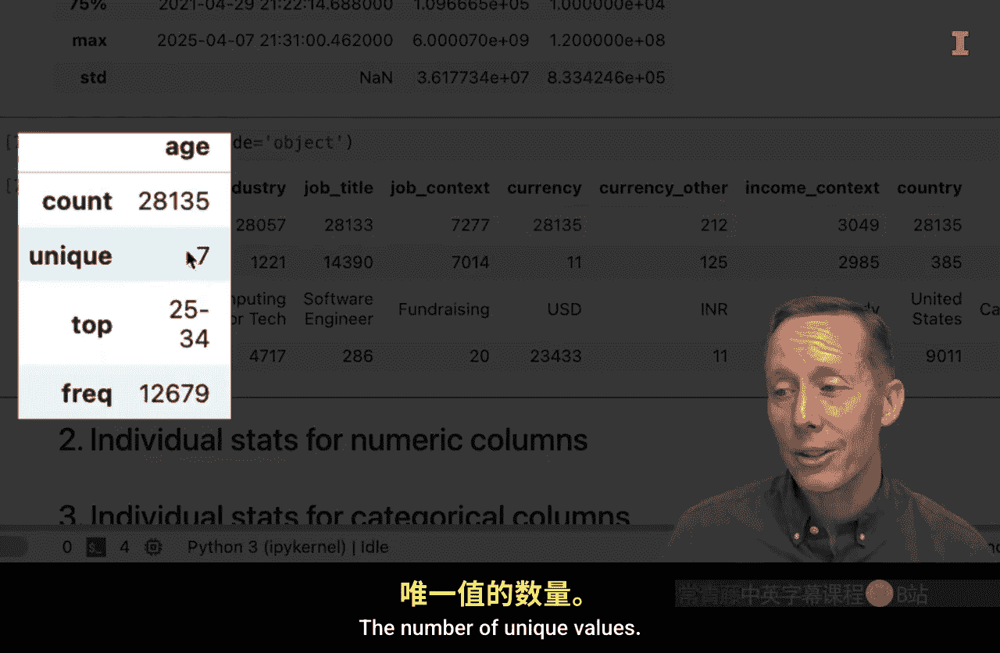

And then the top is the most frequently occurring value in that column。 So for age。

 we've got the most observations in the 25 to 34 category。 And how many observations do we have。

 Well， we've got 12679。 That's what this freak number is， the frequency。 All right。

 So in the industry column， I have some missing values here。 I've got a lot of unique observations。

 The one that occurs most often is computing or tech， And that shows up 4717 times。All right。

 so there's a lot there if you really want to show a lot of information。

 you can use that same describe method。And say include equals and then in quotation marks all and then this gets to be kind of overwhelming。

 but for smaller data sets， this might be helpful for you。

 and this will show me summary statistics for character string columns so you can see I've got the count unique top and freak as well as numer columns。

 So here's the mean all the way down to standard deviation。Okay。

 and it just doesn't show those if it doesn't pertain to that column there。Alright。

 so that can be really helpful and you can see it's super easy to calculate those descriptive statistics。

 But what if we want to calculate individual statistics。

 Let's first talk about how we can do that for numeric columns。And basically。

 there are built in methods or functions that are inherited by data frames that we can use。

 so I'll just highlight a few of those。So if we want to look at the annual salary column。

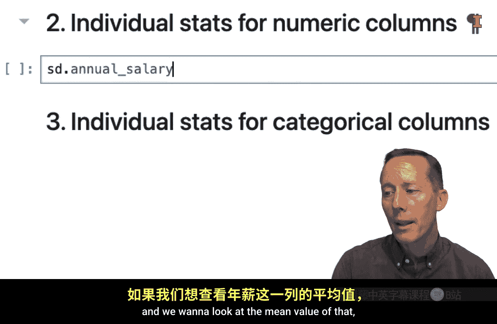

And we want to look at the mean value of that then we just type out the data frame name period。

 the column name period， and then mean run that and we get this 36，36，7，6。

 which we should see is the same that we have right here。

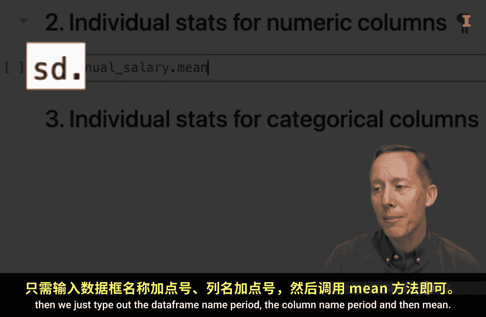

Okay， so that's one way that we can get individual numbers。And I'll change this to median。

 and you can see I've got the median。 I can change this to min to get the min value。Al right。

 so there's a lot of。Of these individual descriptive statistics that you can calculate。

 what if we want percentiles like this？Well， there is。A method called Quantile。

And this quantile method， you enter the percentage that you want。 So if I want 75th percentile type 。

75。And it will give me that 75th percentile。 same number that I have right here。Okay。

 what if I want multiple percentiles， Well， I just make a list of them。Allright。

 so I can if I want the 25th percentile and the 75th percentile。

 then I make a list run that and I get those two numbers and the great thing about this is you can do really extreme values like the first percentile or the 99th percentile。

And I get those numbers， and you can add a lot more in here。 It doesn't just have to be two。Now。

 while we're on this， let me introduce you to a really helpful function that I use not just for this。

 but for a lot of things， so whenever you want to create a sequence of numbers that have a specific interval between them。

 there's a really useful function in the NmpI module。Okay， so I'm going to import nupyy。

 this is for numeric calculations in Python。And we'll import it as NP。

And then I'm going to go in here and use the nuumpy a range。functionction。

And if I look up the help documentation on this， I can see that the way it works is I enter a stop。

 a start value， a stop value， and then the step。 So how wide do I want the increment to be between the start and the stop。

 So， for instance， if I start at 0 and go up to one。 and I want to go up by。Point1 or sorry。

 point1 like that。 You run that。 Then it gives me 0。1。2 all the way up to 09。

 So just like most other calculations in Python， it doesn't include this last number。

 So if I want to include it， need to go a little bit above that， and then it will include。

That that one there。Alright， so anyway， this is helpful because I could use this within the。

AQuantile function。To calculate。

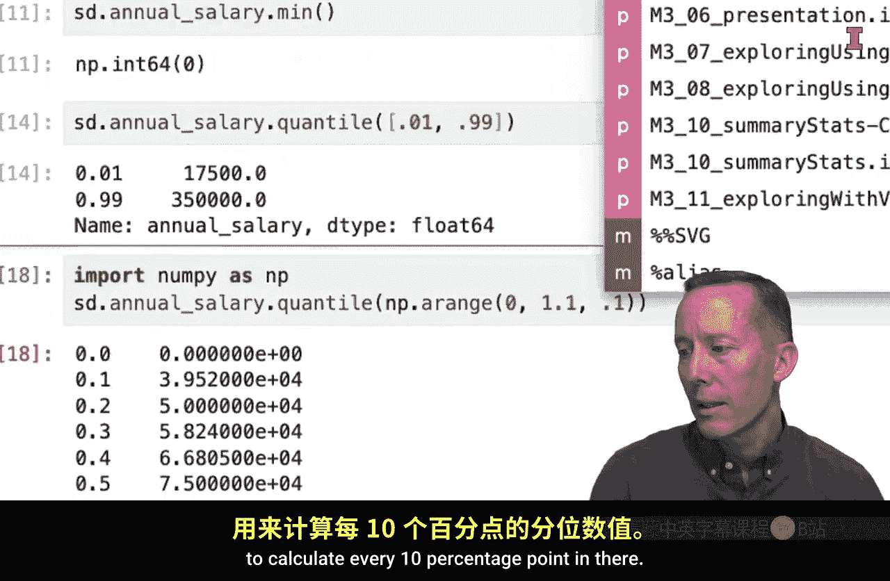

Every 10 percentage point in there。 All right， So the minimum value， the 10th percent or sorry。

 the 10% value， the 20% all the way up to the maximum value right here。

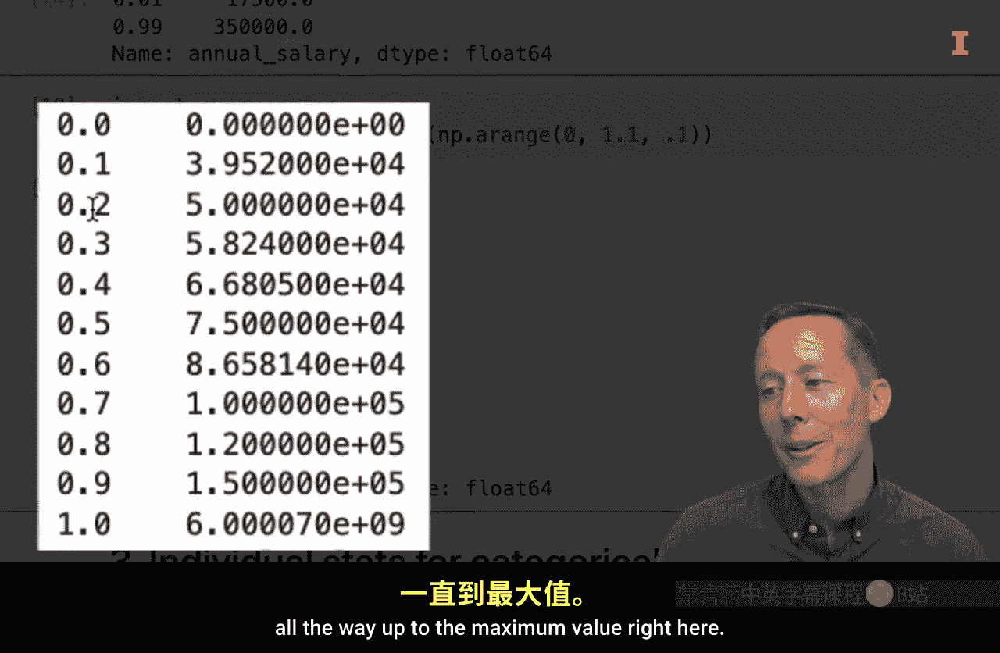

So nupi actually has a lot of other functions that you can use for calculating summary statistics。

All right， let's talk about how to calculate individual statistics for categorical columns。

And one of the things that we use a lot。Is just the count。

 So how many different unique values are there for the industry column。 Well， there's the N unique。

那谁。And I can see that there's 1，221 unique industries in here。Copy and paste that pressing C then V。

 If I want to see what those values are， I can use the unique method， and that will return。

All these values， except by default， it limits it to the first five and the last five or so。

 maybe it's 3。 And the rest are those dots there。 So if I really want to see all of them， I can。

 I just add copy and paste that again， I can use this two list method and run that。

 And now I get this big， long list here。Okay，Now this brings me to something that's really helpful in Jupiter lab。

 me see when I hover to the side of an output here that's really long。

 I get this kind of gray in area。 If I click that， what it will do is it will collapse it down to a smaller box that is scrollable。

 And this makes it so that I can still see everything if I want to。

 but I don't have to scroll as far to get from one piece of code to the next piece of code。 Okay。

 and then the last summary statistic for categorical columns that I want to show you is the value counts method。

 So let's go ahead and do S dot industry。And then we're going to use this value count method。 Okay。

 and what this does， maybe you can tell by looking at the results here。

But what this is doing is it is calculating the number of times that each of the values in the industry column show up。

And then it is sorting it in descending order。 So here's computing or tech。

 which shows up 4717 times。

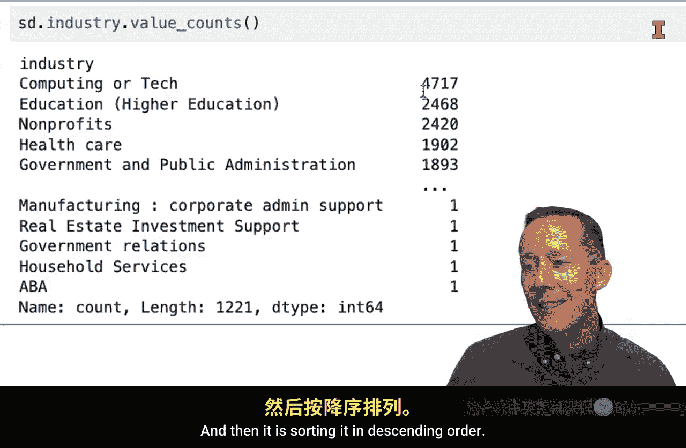

And then the second highest is education， higher education。

 which shows up 2468 times and all the way down to Aba and household services and some others that show up just one time。

 Okay， so that's the value counts method， which I use quite a bit for categorical columns。

 So in conclusion， you can see that it's really easy to calculate descriptive statistics using just the pandas module。

 And as I mentioned， the Ny module has a variety of others in it。

 And these descriptive statistics are incredibly useful。 Sometimes like I said。

 they may be your main calculation。 But most of the time they lead to additional questions and are used just for exploring data。

 When you pair these with exploratory visualizations。

 then that really helps you get a good feel for what's in your data。

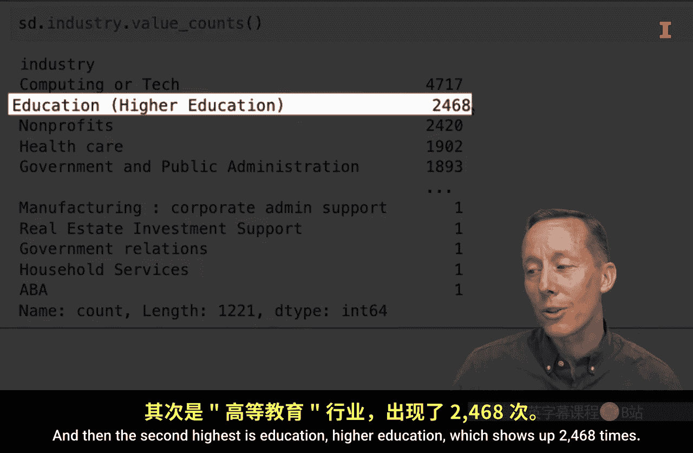

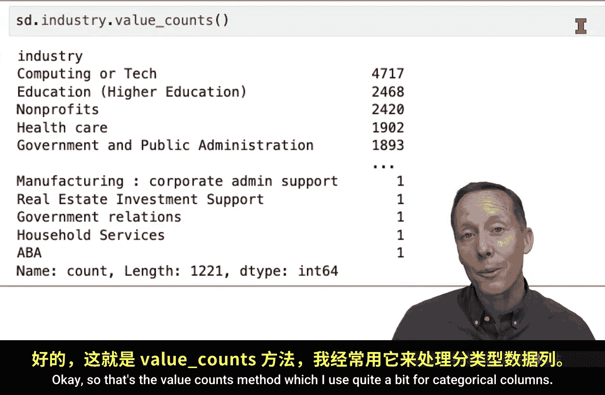

