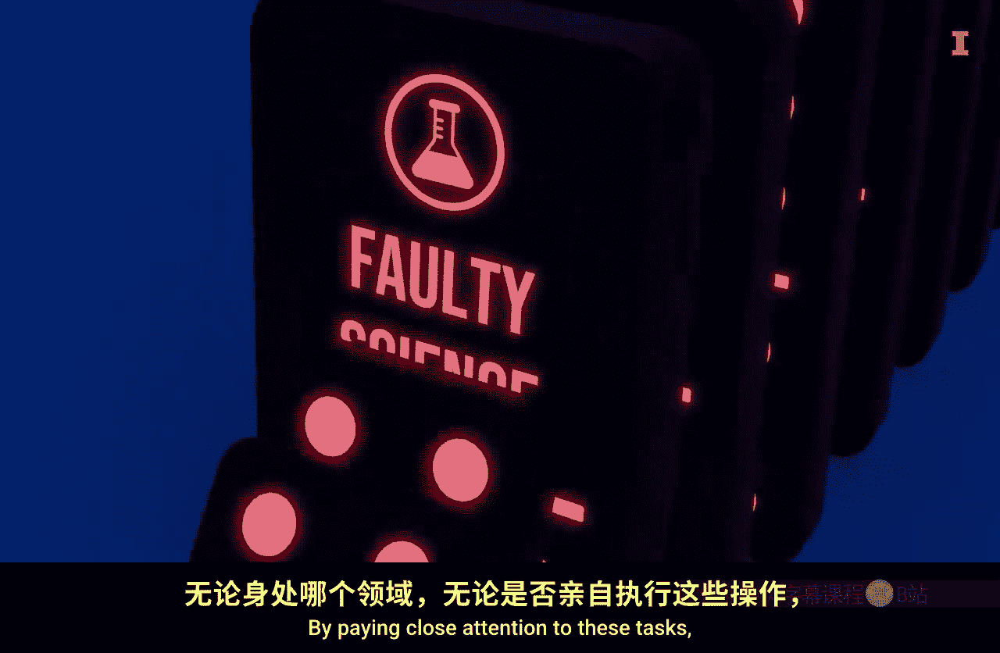
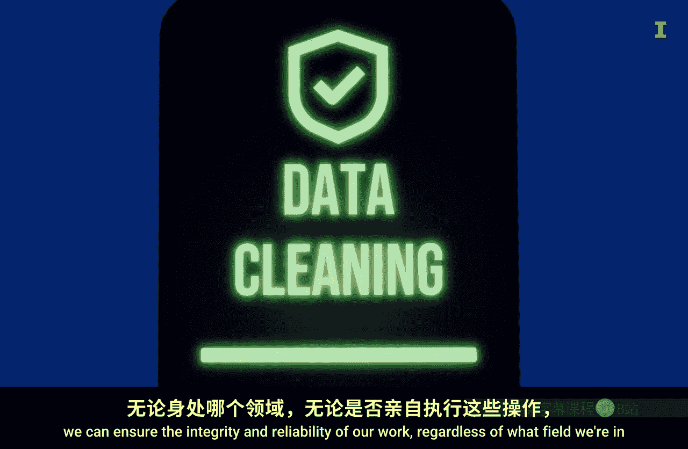
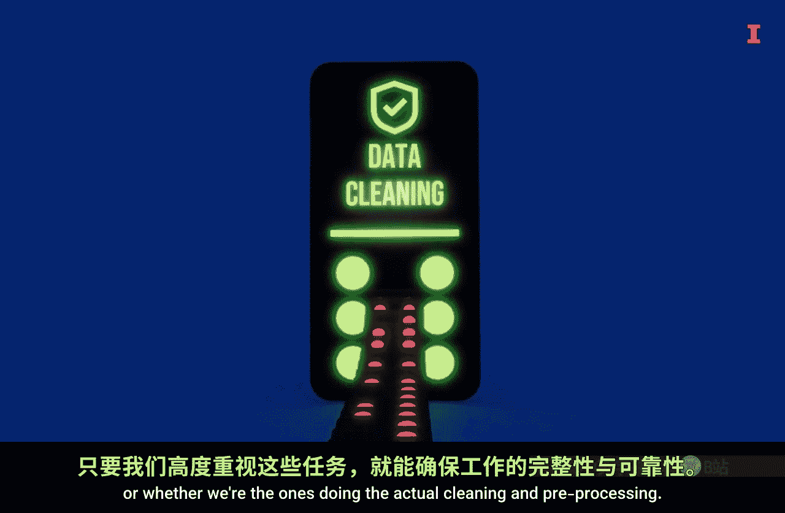
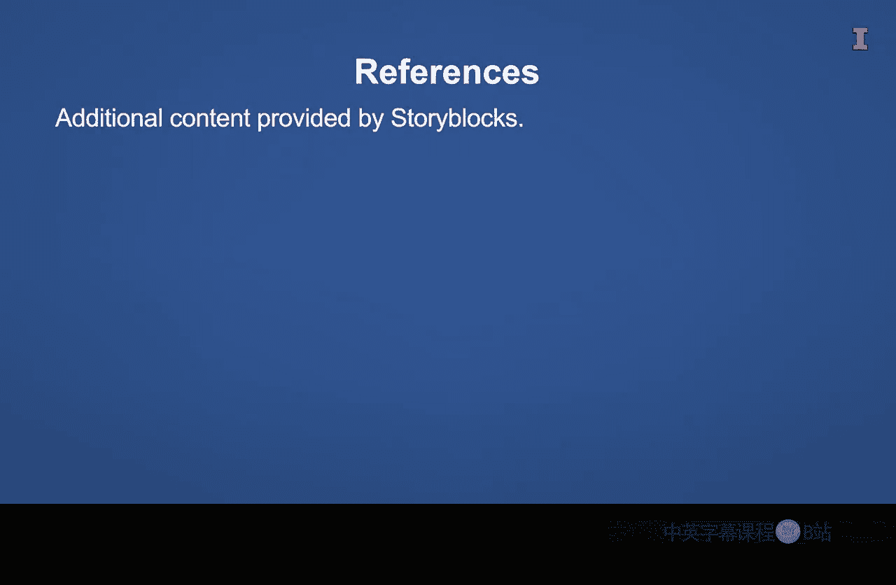

# 伊利诺伊大学【中英⚡商业分析｜Business Analytics Specialization】 p47 P47 03_第四模块介绍 -BV1z86nB9EGz_p47-

One of the things that I really enjoy is mountain biking。😊。

Part of the reason why I enjoy it so much is because of the beautiful scenery that I get to be immersed in while I'm writing。

As I ride， I often think about how nice it is that someone one has created the trails that I ride on。

I know that from first hand experience that if someone one does not create a trail。

 then it's likely that I wouldn't be able to ride a bike across mountains。

So what does my love for mountain biking have to do with data analytics？Well。

 before we can make use of data， it needs to be cleaned and pre processed。You see。

 just like trails need to be created and maintained so that they're safe and enjoyable。

 data needs to be cleaned and prepped to be useful for visualizations and other calculations。😊。

So in this module， we'll dive into the crucial tasks of data cleaning and pre processing。

To illustrate just how important these tasks are， let's look at three eye opening scenarios。First。

 imagine this。A political party is holding an election to choose their new leader。Votes are cast。

 counted， and a winner is announced。But wait， the next day。

 they realize there's been a major error when entering the votes into a spreadsheet。

 Someone one made a mistake， and the wrong person was declared the winner， Yikes。Fortunately。

 they caught and corrected the error quickly， announcing the true winner on Monday。

But can you imagine how devastating this must have been for the initial winner and their supporters？

Not to mention the embarrassment and frustration for the party itself。

If that error hadn't been caught， the consequences could have been pretty serious。

All because the data wasn't prepared correctly。Second scenario， consider this hypothetical story。

It's a scenario that could easily happen in the business world。Sarah。

 the lead analyst at Global Gadgets Incorporated， was pumped to present the Q4 sales report。

It projected a record breaking quarter， exciting stuff。But during her presentation。

 a sharp eyed VP noticed something fishy。The East Coast number seemed way too high。

After a frantic investigation， Sarah discovered the culprit。

 Their sales database had accidentally ingested a duplicate data file for the region。

 doubling the reported sales figures。Talk about painting an overly rosy picture。

This embarrassing revelation not only damaged Sarah's credibility。

 but forced the company to retract its projections。

Investor confidence took a hit and strategic decisions based on the flawed data had to be put on hold。

 all because of a simple data error that slipped through the cracks。

Our final scenario is a real life sobering reminder of how critical， clean。

 well organized code can be。A driver lost control of her car's throttle while exiting a freeway。

Due to problems in the code of the car's safety system， the driver was unable to slow down。

 and she eventually crashed into an embankment。The driver was seriously injured， and tragically。

 her passenger died。A software specialist spent over 20 months reviewing the source code of the car's critical systems。

His conclusion。The code was so complex that it was essentially untestable。

Any changes made to it were likely to introduce new bugs。

The takeaway here is clear Making your code readable and manageable isn't just about convenience。

 It can be a matter of life and death， especially when it's used to make critical decisions。

These three stories highlight why we need to be so careful when cleaning and pre processingcessing data。

 as well as when writing code。The impact of errors in data handling can be profound。

 affecting everything from political decisions to business strategies and even public safety。

As we continue through this module， keep in mind that data cleaning and pre processing aren't just boring chores。

 They're essential safeguards against mistakes that can have far reaching consequences。

By paying close attention to these tasks， we can ensure the integrity and reliability of our work。

 regardless of what field we're in or whether we're the ones doing the actual cleaning and pre processing。

Remember， good data hygiene， like a well maintained trail， isn't just about avoiding crashes。

 It's about building trust in our analyses and decisions。

So let's roll up our sleeves and dive into the world of clean， reliable data。

