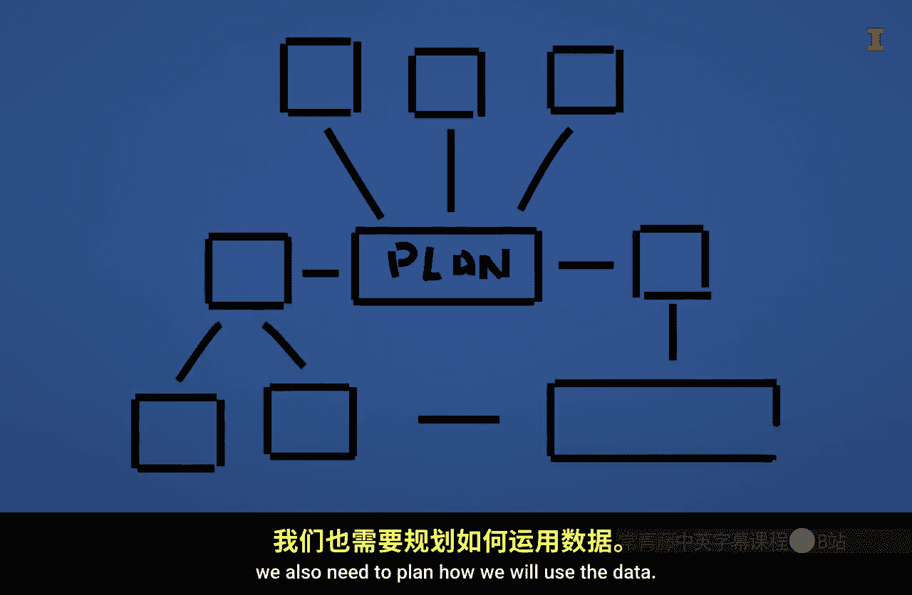

# 伊利诺伊大学【中英⚡商业分析｜Business Analytics Specialization】 p48 P48 01_数据清洗与预处理 -BV1z86nB9EGz_p48-

One way that we can classify data manipulation tasks is by dividing them into two categories。

 data cleaning tasks and data pre processing tasks。

To better understand the difference between these tasks， let's use a trail as an example。

Specifically， let's consider how preparing and clearing a trail differs from planning a hike or a bike ride。

Creating a trail is no small task。 The Corner Canyon Tra system， for example。

 has been under development for years。 Small tractors are often used to clear away brush and flattened dirt。

The trails must then be maintained by periodically removing large branches and rocks and by flattening the ruts。

It's also important to keep the trails free from garbage to preserve their usefulness and beauty。

For trails traversed by many hikers and bikers， cleaning tasks are often performed by large groups of people at regular intervals。

 like the beginning of the season and at fixed points throughout the season。Okay。

 so let's relate this trail creation and clearing example to the data cleaning process。

Just as we must put forth a lot of effort to create trails that can be hiked and biked。

 Sign effort is required to prepare and clean the data so that it can be used。Specifically。

 we want data that does not have duplicate rows and is free for missing values。

If we have date columns， we want to make sure that they're recorded consistently。

If there are columns with names in them， then we want to make sure that the names are recorded consistently as well。

We want numeric values to be stored as numeric data types and so on。This will result in nice， clean。

 tidy data。Now， let's switch back over to the trails。

 Once you have trails and you've made sure that they are clean and tidy。

 then you can map out a course。But that course will depend on a lot of things。 For one。

 if you're biking， then you'll use a different set of trails than if you're hiking。Specifically。

 you'll probably want to take advantage of the nice smooth downhill trails once you climb to the top。

If you're hiking， then you'll want to make sure that you are not using the downhill trails that bikers are using。

Signs along the way help remind people how to use the trails。

The weather conditions will also affect which trails you take and what you wear。Also。

 you'll want to make sure that you have enough water and food if you're going to be spending a lot of time on the trail。

Let's now connect the process of mapping out a hike or a bike ride to data pre processing。

Just as we need to plan how to use the trails， we also need to plan how we will use the data。

First， we'll want to know what data is available and consider if we need to join data from two or more data sets together。

Then we'll need to consider additional transformations that are needed based on what type of analysis we want to perform。

If we plan on creating a visualization， then we may want to convert the data to a long format。

In contrast， if we want to use a machine learning algorithm with the data。

 then we'll probably want it in a wide format。We may also want to normalize or standardize the data。

We may even want to create some additional columns of data based on calculations from existing columns。

I was able to interview biochemist Dr。 Tyler Stanafford， who consults with golf companies。

He uses data from a variety of sources which may be clean。

 but it still needs to be pre processed so that it can be used。

Let's listen to what he has to say about some of the data pre processing that happens in his field。

 Yeah， so my name is Tyler Stanford。 I am an associate professor of biomechanics at Utah Valley University。

 and I'm also an independent consultant for a few different golf companies where I work with them on education and kind of data analytics for their products。

Yeah in terms of how I kind of pool my data together and kind of clean it up。

 make sure it's accurate a lot of my hardware systems that then are tied into kind of the software backend kind of help merge all that together so whether it's a launch monitor data。

 motion capture data that's looking at body motion， forceplay data。

 even muscle activation data a lot of that gets kind of dumped into to one software that I use a lot where it's kind of nice there wherem if I'm syncing everything up nicely with cordors and sync boxes and hardware at least then I get all of the data push together where I know that it's timestamped and synced up and I'm getting everything together After that then I'm kind of doing a lot of stuff and the software is called visual 3D It's basically a software that allows me to visualize and do what I would call like a dumbdown version of coding。

 it's a lot of guUI interfaces where I can measure joint angles and go in and pickmes。

and minimums and kind of run calculations on the data that way and then basically export spreadsheets of data that allow me to go in and kind of compare and contrast some of these variables and so my process typically is collect the data a little bit of filtering technique that I do again inside of this visual 3D software and then pull out the data that's meaningful to me and some kind of Excel spreadsheet that then I can go run statistical analysis on yeah in terms of software that I think students in this field that would need to understand and that I wish I would have done 10 years ago when I was an education and actually have a student right now that is doing an internship with me and they said what are we going to do for the internship and I said you're gonna to learn Python because again even in just the organization of the data。

 we produce all these spreadsheets with these discrete data points and having to pull that data out by hand is just it's so tedious for them and so I see a real potential。

For them to understand something like Python or R to be able to organize that data really quickly and then make some decisions based on the data and what I typically do to inspire them to do that is I'll pull up job announcements in a field of like applied sport science or applied biomechanics and almost every single one of them has Python or R now listed and so they want their sports scientist to understand that material I was at a really cool baseball conference recently and got to meet with a couple of students。

I should say former students who just finished their degrees。

 both working for major League Bball teams， both of them with degrees in applieded sports science。

 where their whole thing was they just knew how to code in Python。

 they knew how to use it really well， but they also understand this science background。

 and so I think things like Python and are essential moving forward in this field。

You may have noticed that Doctor Stanafford talked a lot about merging。

 filtering and organizing data so that they can then do statistical analyses with it。

 This is what data pre processing is all about。It's also relevant that he mentioned the usefulness of tools like Python and R for helping with the pre processing。

Going back to our trail analogy， just as it's important to have good signs on trails。

 it's also important to have good comments in your code to remind yourself and others where you're at in the data pre processing steps。

Another aspect of data pre processing is the ability to save your data in a format that makes it easy to use in the analysis tool。

For instance， we can save the data in pickle files， parquet files。

 or some other structure that compresses the data and preserves the data type。

So data cleaning and data preproces are both really important。

Hopefully the trailil example helps you better understand why both types of data preparation tasks are required。

Also， if you haven't taken a break for a while， you might want to consider getting away from your computer and getting out on a trail。

 Maybe you'll find some additional insights。

