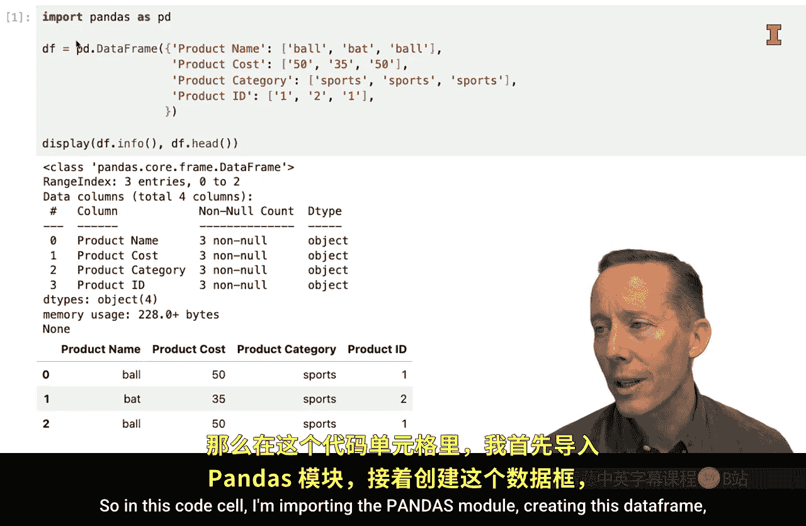
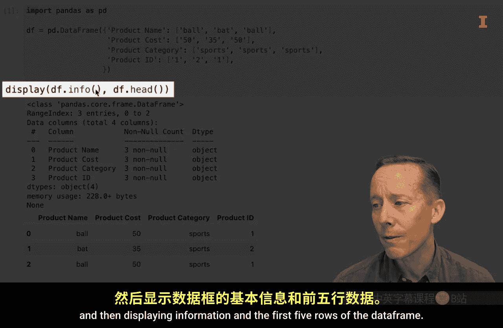
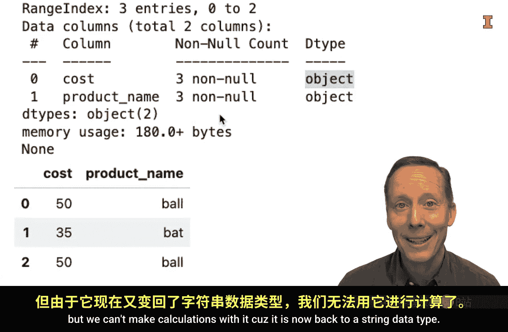

# 伊利诺伊大学【中英⚡商业分析｜Business Analytics Specialization】 p49 P49 02_数据框列的一般数据清洗任务 -BV1z86nB9EGz_p49-

In this video， I want to introduce you to some general data cleaning tasks that you will often use for columns of a data frame。

Now， what I'm going to demonstrate are things that you can easily look up。

 so you don't have to memorize these things。However。

 I hope that by introducing you to these things here。

 you'll be able to better recognize the simplicity and elegance of Python。 Now。

 I'm also going to type out the code so that you can get a better feel for how to create code and run code cells in Iy and B files。

Al right， so I have already created an Iy and B file， and rather than reading in data。

 I'm going to use a really small data frame that I create myself。 So in this code cell。

 I'm importing the pandas module， creating this data frame and then displaying information and the first five rows of the data frame。

This data frame is untidy in several ways， and we want to clean it up。Specifically。

 we're going to rename columns， remove columns， remove and relocate columns in one step。

 and then convert columns to the appropriate data type。So let's start by renaming the columns。

 As you can see， these column names have spaces in them， and we don't like that。

So one way that you can easily rename columns。Is you can use the columns attribute。

 So I'm going to take this data frame and type out dot columns and then set it equal to。

 And then I can just type out a list of the column names that I want。Okay， so in this situation。

 I want to rename every column。 So I'll just type out each of those column names as a list and display the column again。

 And you can see that I've effectively renamed the columns。 Now， oftentimes。

 you'll have data frame that have many column names。

 and you don't want to have to rename all of them。 So what if you want to rename just one or two or a subset of the columns that you have。

 Let me show you how you can do that。 In this example here。

 let's say that we want to change this first column name to product name。

 So one way that I can do that is。Type out D F and then set it equal to itself。

 But then I want to use the rename method。And then I'll type out columns equals。

And then we're basically going to use a dictionary。

 So I'm going to type out the name of the column that I want to rename in quotation mark， a colon。

 and then the new name of the column。And then I'll display the data frame again to verify that it worked。

 And sure enough， it worked。 I just renamed that individual column。

 If I wanted to rename more than one column， I could put a comment here and add another corresponding entry for the old column name and the new column name that I want。

 How about removing columns。 Well， you already know that you can remove columns by using either the bracket notation or the lo notation or Ilo method。

 But there's another method that's built into data frames。 And that is the drop method。

So let's say that I want to drop this category column because it's all the same。

 It's all spurs in here。So I'm going to set D F equal to Df dot drop。

And then I'm going to type out columns and set it equal to。

And if I want to drop more than one column I could， I just need to put it in a list here。

 In this case， I'll just。Add category。And then I'll run this and display the first five rows of the data frame。

And you can see that I no longer have that category name in here， right， that it's gone。All right。

 What about removing and relocating columns at the same time， Oftentimes。

 you want the columns to be organized in a different way。So I'll create a new code cell。

And a way that you can easily do this is to use this loke method。Okay。

 so I'm going type out Lo and then。A colon to indicate I want every row than a comma。

 And now I can just type out a list of the column names that I want。And let's say， for instance。

 that I want the cost column followed by the product name column。 And that's all。

 So's going to take out cost。And product name。And then I will display this。And there you go。

 You can see that I dropped that I D column and I reorganized or relocated these columns。 All right。

 now let's talk about how we can convert columns to the appropriate data type。 So this cost column。

 if we go back up and look at the information about it， we can see that。It was product cost。

 and it's an object data type， meaning it's a character string。

And so if we wanted to perform any calculations on it。 So， for instance。

If you have to cost do mean and run that。 I'm going to get an error。

 I go down to the bottom of the error， it says it can't convert this string to numeric value。

So I need to convert it to the appropriate data type。

So one function that pandas has that makes it really easy to convert character strings to a numeric data type is the two numeric function。

So the way I would use this is I would type out the different name and the column that I want to change。

 So cost。And that set it equal to PD D2 Newmer。And then type out the data frame and column name in there。

So I'll go ahead and run that。 And now I'll rerun this mean calculation。

 And now you can see that I get a mean value of 45。 So it worked。Now。

 there are some that you'll want to go the other direction and convert numeric columns to character string data types。

And so here's how you could do that。Okay， so I'm going to type out the data frame and column name that I want to change and then use the as type method on that。

And then I can indicate that I want a string by just typing out S R。 And now。

 if I run that and then actually， I'm going to display。Information in the head after running that。

 So now you can see that this cost column is once again an object data type。 It looks the same。

 but we can't make calculations with it because it is now back to a string data type。 All right。

 So these are just examples。 hopefully by viewing these examples。

 you get a better idea for how you can manipulate columns of a data frame and clean them up so that the data frame is nice and tidy。

