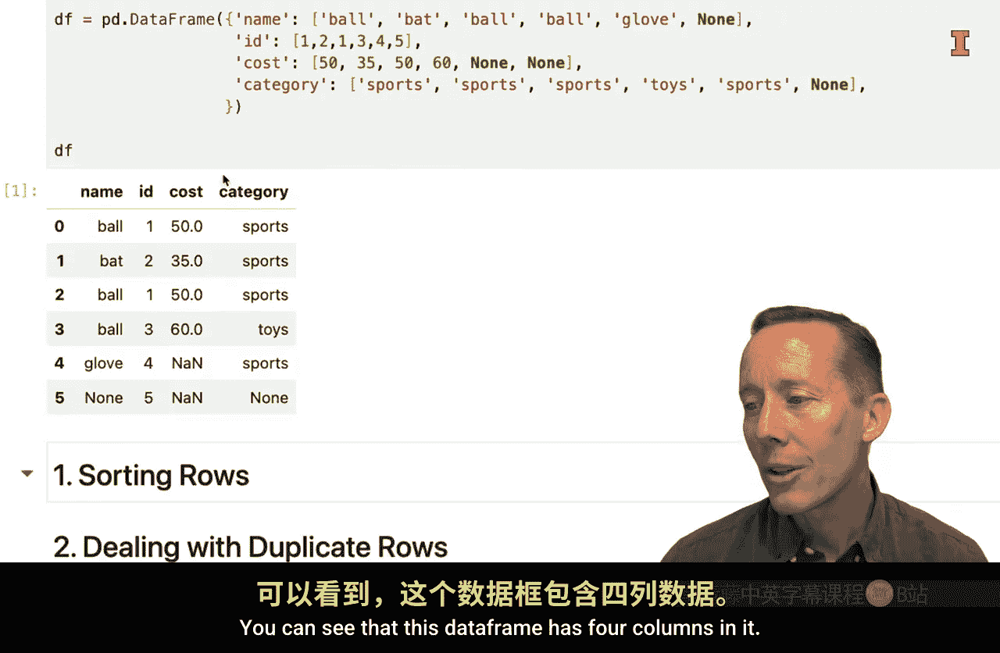
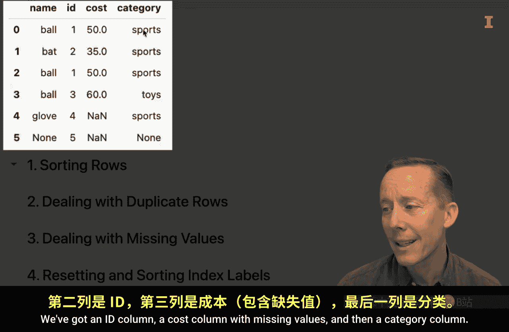
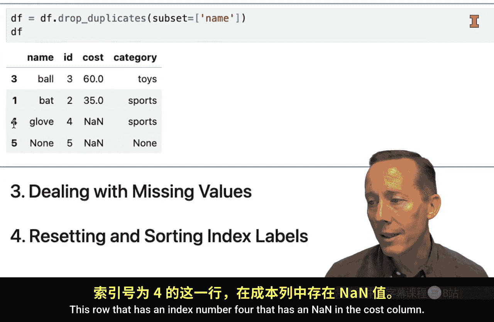
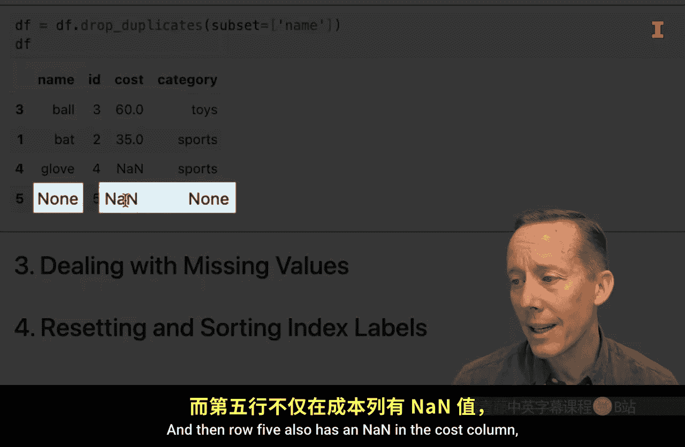
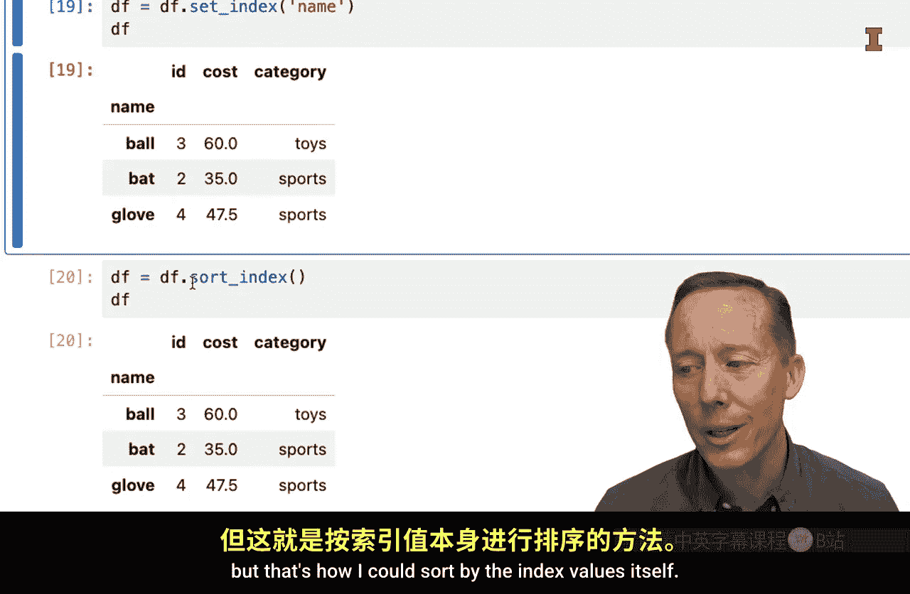

# 伊利诺伊大学【中英⚡商业分析｜Business Analytics Specialization】 p50 P50 03_数据框行的通用数据清洗任务 -BV1z86nB9EGz_p50-

In this video， I want to introduce you to some general data cleaning tasks for rows of a data frame。

Specifically， we're going to talk about how to sort rows， how to deal with duplicate values。

 how to deal with missing values， and then how you can reset the index label and sort by the index labels。

Now， again， I hope that by introducing you to the code here and watching me go through it。

You'll be able to better think in a pythonic way。 You'll be able to recognize how simple Python is。

 So let's go ahead and go over to this Jupiter environment。 And in here。

 I have already created a simple data frame that we can use to demonstrate these tasks。

You can see that this data frame has four columns in it。 We've got a product name。

 column or name that has some of the names replicated multiple times。 We've got an I D column。

 a cost column with missing values， and then a category column。

All right， so let's start by talking about how we can sort the rows of this data frame。

So I'm going to add a new code cell below here。 And there is a method called sort values。

And this method' is really easy to use。 If you simply enter in the name of the column that you want to sort by。

 So let's say I want to sort by the name column。 And I'll enter name， hit control， enter。

 And you can see that now I've got bald and bat glove and none in here。All right。

 What if I want to sort this in descendending order rather than ascending order。

 I can use the ascending argument and set it equal to false。Now。

 it starts with glove and goes down to none。 You have to remember that if you want to save the results of this。

 then we need to set it equal to itself， D F。Al right。

 And so now when I run it and display the data frame， we can see that it is sorted。

What if I want to sort by more than one column， I can easily do that。

 What I need to do is to create a list of the columns that I want to sort by。 So in this case。

 let's say I want to sort by name and then by I D。And then for this ascending argument。

 if I want to make name and ascending order， I D and descendending order， for instance。

I just need to make this a list as well。 And I'll say， ascending is true。

Which pertains to the first element or the first column in here and faults。

 which pertains to the second。 So now when I sort this。You can see that we've got balls， bat。

 glove and none， but the I D is in descending order。 So 3，1，1， and then starts over for bat。 Okay。

 so that's how you can sort rows。 pretty easy to use。

 Let's talk about how to deal with duplicate rows。 So， first of all。

 how do you identify whether your data frame has duplicate rows。Well。

 there is a duplicated method that you can use。 And if you just run it like that， Actually。

 I want to add open close parentheses， Run it like that。

 It returns a series that indicates whether or not each row is a duplicate。 So we can see that this。

Row number 2 has an index of two up here is a duplicate because it's exactly the same as the one above it。

Now， that could be useful， but usually we want to subset the data。

 So if I want to save the duplicated data， maybe I'll save it as a data frame named dupe。

Then what I need to do is。Subset the data using bracket notation or the id lo method or something。

 So I'm going have。Run that and then return the name of that data frame or the entries in the data frame。

 And you can see that it's just this one data frame。 Okay。

 so that's how you can extract the duplicates if you want the duplicate values。

 And notice that it's not。Both duplicate values， it's only the ones after the first one。

 So the first one is not a duplicate， It's whatever comes after it。

 at least in the way that it's sorted currently。 Typically， though。

 we will want to drop the duplicate values So we can do that by saying， hey。

 I want to set it equal to itself。 And then I'm going to use the drop duplicates method。Okay。

 and if I run it like that， you can see that it no longer has the second entry for this ball 1。

50 sports row here。 That is gone。 It was row number 2。 You can also say， hey。

 I just want to subset it if there are duplicates just based on a subset of the column。

 So there's an argument subset。 and we can set that equal to， for instance， name。

So if I run it like this， we can see that I've got two balls in here currently。

 And now when I run it， it's going to get rid of the second column because it had the same name。

 It wasn't duplicated in every column， but just in that column。All right。

 so this is a really easy way to deal with duplicate values and remove them or just focus on them。

All right。 How about missing values， You can see that this data frame has two rows that have missing values in here。

 This row that has an index number 4 that has an N A N in the cost column。

 And then row 5 also has an N A N in the cost column。

 and then its missing values in the category and name columns as well。

Okay， so we're going to use the drop N method。And I'm not going to save the results here。

 but if I run that， you can see that what we're left with is just rows 3 and1。

 because the drop in a method is going to remove any row that has an missing value in any column。

All right， So if you want to indicate， hey， I might want to keep some rows if they have missing values in some columns。

 but not in others。 So let's say， for instance， that I only want to drop rows if they have a missing value in the name and category column。

 So once again， I can use the subset argument instead set it equal to。

The columns that I want to remove。 So I run it like that。 Now。

 I still have this glove column because it does not have a missing value in both the name and category columns。

 Now， that's one way of dealing with missing values。 Sometimes。

 though we will want to fill in missing values。 Let We save this as D F and rerun it。

And the split it。Alright， so I want to fill in missing values in this cost column。

 So I can do that by using the fill N A method。And then what I can do in here is I can create a dictionary and refer to the column each column individually and how I want to fill it in。

 So for this cost column， I want to fill it in， let's say， with the mean value。

 which is a common way to deal with missing values。

 I'll fill it in with the mean value of this column itself。 So I'm going make it a colons。

 What's a key value pair。 then type out D F dot cost dot mean。

Then I'll run it and display the data frame。 And now you can see that this last row has this mean value of 47。

5。 So filling in missing values is important if you don't have a large collection of data and every observation is valuable。

Whereas you may want to drop rows if you've got tons of data。

 or there's just so many missing values that it's not going to be interesting。

 It's not going to really add value。Anyway， so that's how you can deal with missing values。

 All right， let's go to this last topic here， which is resetting and sorting index labels。 Now。

 you've noticed that I've got these index rows that get all mixed up after I do sorting or maybe when I combine data sets。

So something that you have to frequently do， At least I find myself frequently doing this is。

After Ive done the manipulations， I want those row indices to start at 0 and go up to the number of observations that I have。

 So I can simply use the reset index。Method。 Now， before I set it equal to the data frame itself。

 if I run that。Look at what it does。 It， It does reset the index here。

 but then it preserves the index that it had before and saves it as a new column named index。

And a lot of times， I don't want that。 So I'm going to use the drop equals。True argument in there。

 And then I'm going to save it like that， and then display it。

And now you can see that it did reset the index and didn't preserve or keep that original index that it had。

 All right， now， sometimes for like plotting purposes or a variety of other things。

 you'll want to set the index equal to one of these columns right here。So we can easily do that。

 So let's set this data frame equal to itself。 And Then we're going to use the set index。Method。

 and let's say I want the values in this name column to be the labels for the index here。

 so I can set it equal to name the name of the column and run that。

 And you can see that I now have name emboled because it is the index value for this data frame。

 And then if I want to sort by。The values in index column。I can use the DF dot sort index method。

And then I'll display that。And I guess you can't really see that it changed at all because it was already sorted。

 but that's how I could sort by the index values itself。

 So this isn't an exhaustive list of ways that you can manipulate rows of a data frame。 But again。

 hopefully you can start to get a feel for some of the things you can do。

 and really how easy it is to use the methods that are available for pandas data frame for cleaning up the data frame itself。

