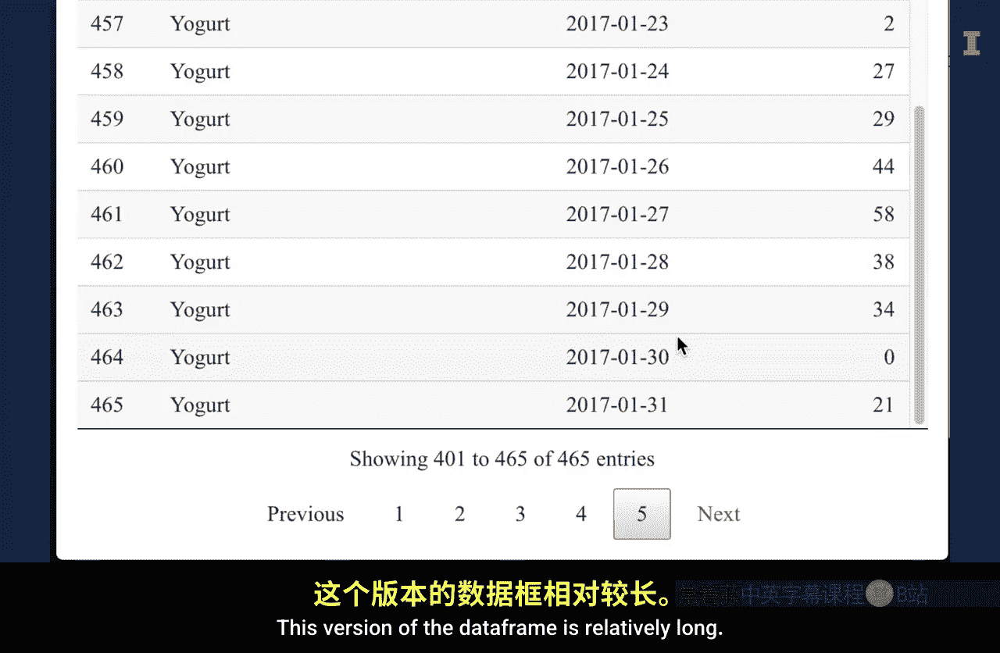
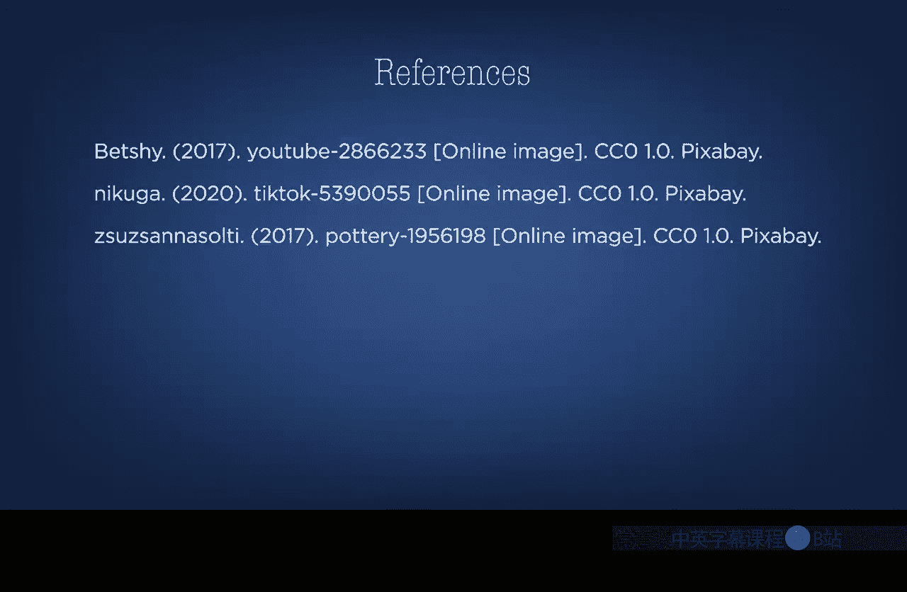

# 伊利诺伊大学【中英⚡商业分析｜Business Analytics Specialization】 p53 P53 06_数据框形状：宽格式与长格式 -BV1z86nB9EGz_p53-

Yes。In this lesson， we'll discuss the length and width of the data。

 Let's liken this topic to the way videos are recorded using smartphones。Based on my observation。

 it used to be the case that most people preferred holding the smartphone horizontally when taking videos because they planned on viewing the video on YouTube with a TV or a computer monitor。

 which is wider than it is long。More recently， people often prefer to hold their smartphone vertically when recording videos because they plan on posting the video to social media platforms like Instagram and TikTok that are often viewed using smartphones。

And smartphones are usually held so that the screen is longer than it is wide。Consequently。

 the aspect ratio that people choose to use when they record videos is often influenced by the viewing platform for which the video is intended。

In a similar manner， when it comes to business analytics。

 the length and width of the data depends on the tool that you plan to use to analyze it。

What does the length and width of the data mean？Because every row of a tidy data frame represents an observation。

 the length of a data frame refers to the number of observations it has。

Because each column of a tidy data frame represents a unique characteristic of the observation。

 the width refers to the number of columns。Thus， when we talk about a long data frame。

 we are referring to a data frame that has many rows。 In contrast。

 when we talk about a wide data frame， we're referring to a data frame that has many columns。

Business alytic tools typically make it pretty easy to pivot the data from a wide format to a long format and vice versa。

Let's look at an example in which each row of data represents a line item。

 one column lists the name of the line item， and then each of the other 31 columns represent the sales quantity for that line item for a specific day of the month in January。

If we have 15 line items and 31 days of sales， then this data frame is relatively wide and not very long。

We can pivot that data frame to create one in which each row represents a different date for each line item and the only additional column represents the total sales for that line item on that day。

If we have 15 line items and 31 days of sales for the month of January。

 then this data frame can have up to 465 rows and only three columns。

 So this version of the data frame is relatively long。

How you intend to analyze the data decides its length and width。Typically。

 visualization software and dashboards rely on long data formats。

 while algorithms and tables intended for human consumption often rely on wide data formats。

So in conclusion， as you assemble data for calculations。

 the first step is to tidy up the data by filling in missing values and making sure that the format of the data in every column is consistent。

Once you have a tidy data frame， you should pre process the data so that it's in a format that's suitable for the question that you have framed。

One element of data pre processing is making sure that the data is aggregated at the level that is consistent with the question。

Another element of data preprocess is to pivot the data to the length and width that will best fit the analytic tools that you plan on using。

