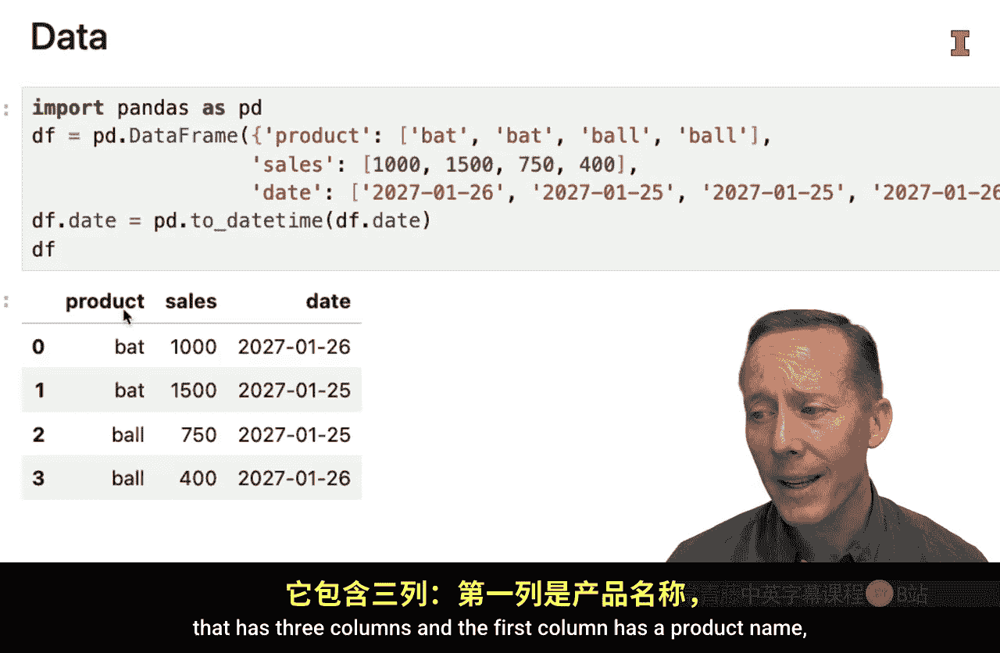
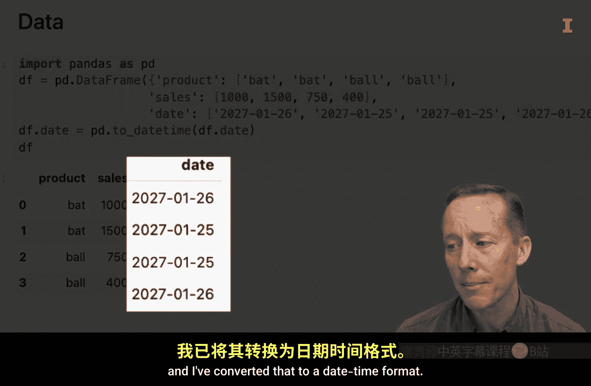
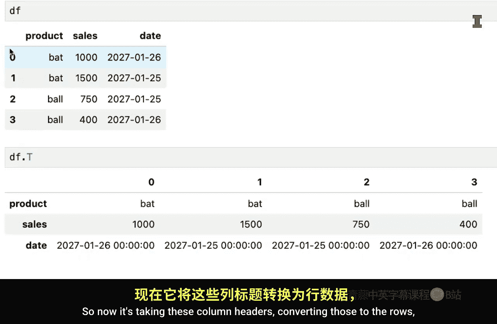

# 伊利诺伊大学【中英⚡商业分析｜Business Analytics Specialization】 p54 P54 07_更改数据框的形状 -BV1z86nB9EGz_p54-

Let's talk about how to reshape data that is stored in a pandas data frame。

 meaning how can I go from a wide to a long data frame or along to a wide data frame or transpose the data frame？

In this video， I'll demonstrate three methods that are pretty easy to use for dealing with these situations。

So I'm going to refer to a simple data frame here。That has three columns。

And the first column has a product name。 So we've got two rows that have bat。

 two rows that have ball。 Then I have another column that has the value of sales。

And then a third column， that is a date column。 And I've converted that to a date time format。

 So this format is often very useful。

But there may be situations when we want to report the data that is easier for humans to read。

 and perhaps we want to report the data in a way such that there is a separate column for each date and a separate row for each product。

So that's called pivoting from long to wide。And we can easily do that by using the pandas pivot method。

Now， if you're like me when you're using these methods it's going to be easy to forget what these arguments are。

 So as you type them out， just make sure to refer to the help documentation and it should be easy to remember what's going on here。

But what I'm doing here is I'm saying， hey， I want to put the date values as the column headers。

 and then I want the row values to be based on the product names in the product column。

And then the values in the cells that this matrix will create will be the values from the sales column。

 Now if I had more columns， it would just get rid of those columns。 So if I run that。

 you can see that I've got now the index for this new data frame is the values of the product。

 I've only got two there， even though the original data frame had four。

And then I've got the dates as the columns and then the sales value that fall into the appropriate product and date intersection there。

 So for ball， I've got 7，50 for January 25，400 for January 26， and for bat。

 I've got 1500 for January 25。And then 1000 for January 26。

 so you can see it doesn't matter the order that the data appears here。

 it will reorder it so that it fits nicely into what you've indicated。All right。

 so that's going from long to wide， pretty easy。 What if I want to take this and go back to the original structure here from wide to long。

Long meaning it has。Probably more rows， but fewer columns。 In this simple example。

 you can't really see that it's longer or wider。 But when there's lots of columns of data。

 then you'd be able to see that easier。 Well when we go from wide to long。

 we're going to use the melt method。And importantly， we need to reset the index。

 Let me actually remove that first and then just run this。And what I'm doing is I'm saying， hey。

 I want to indicate the row value or the I D using the values in this product column。 Now。

 if I try to do that， I'm going to get an error because it says， hey， you don't have。

A column named product。Because it's my index。 And so that's why I need to。

Reset the index when I do that， as you may recall， resetting the index will take this product index。

 convert it to a column， and then just create a new index of 0 and one here。So let's run that。

 And when I get this， I get that same structure， it looks a little bit different because the order is different。

 So I've got ballald then bat than balld and bat for the two different dates there。

 But I essentially get the same data frame just in a long format and a different order。 Okay。

 but pretty easy to go from wide to long and long to wide back and forth。

 There are a few things that you may have to。Beware of， though， as you're doing that。

Then the last situation is just transposing data。 So let's take this DFW data frame。 It's actually。

 I didn't save this as DFW。 So DFW is still this right here。

And let's transpose it and see what that does。 So we transpose it。

 What it does is it took the column names and converted those to index labels。

 and it took the index labels and converted those to column names。

 And if I transpose the original data， DFT， which looks like this right here。Actually， let me。

 let me just。Print Df right there。So now it's taking these column headers。

 converting those to the rows and these row or index labels， converting those to the columns。

 So that's the transpose method really easy to use。 You're going to need to reshape data quite a bit。

 I suspect， as you deal with various plotting and analysis methods that you will face。 Okay。

 have fun reshaping panda's data frames with these methods。

