# 伊利诺伊大学【中英⚡商业分析｜Business Analytics Specialization】 p55 P55 08_合并数据框 -BV1z86nB9EGz_p55-

In this video， I'm going to demonstrate how to combine data from two different panda's data frames。

And I'll talk about when you would want to use these different approaches for combining the data。

So in this Jupiter lab environment， I've created a simple data frame that has three columns and six rows。

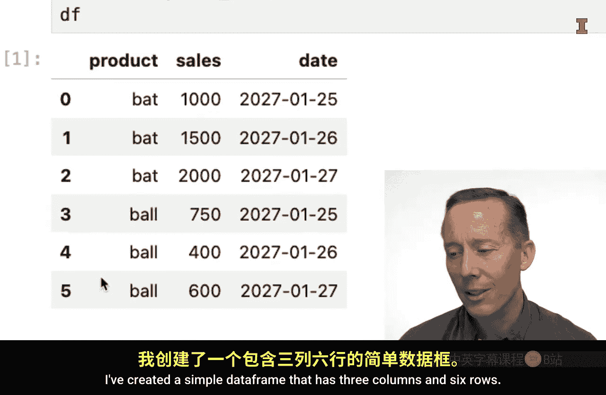

The first three rows report the product name， which are all bat。

And then the sales and a monetary value and the dates。 So we've got three different dates here。

The last three rows a similar information， but for a different product ball。

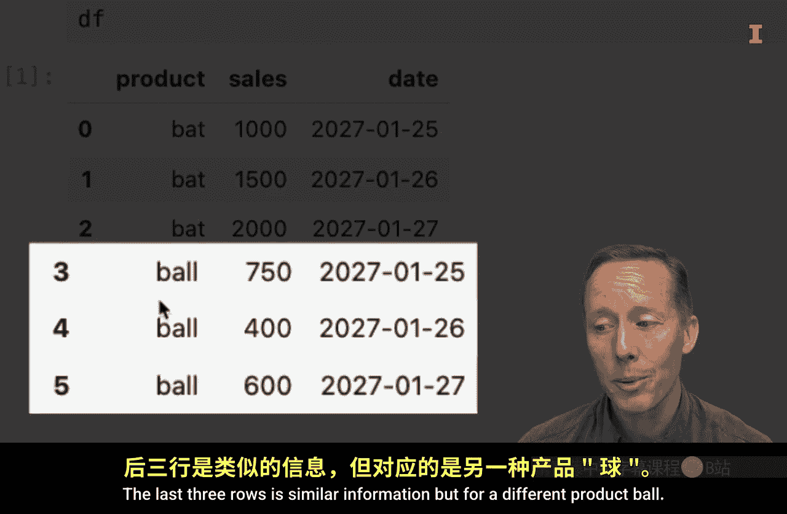

Now， because we want to demonstrate how to combine data。

 I'm going to divide this data frame up into two other data frames， DF bat and DF ball。

 and DF Ba just contains the observations about bats。

 and DF ball contains observations just about the balls。

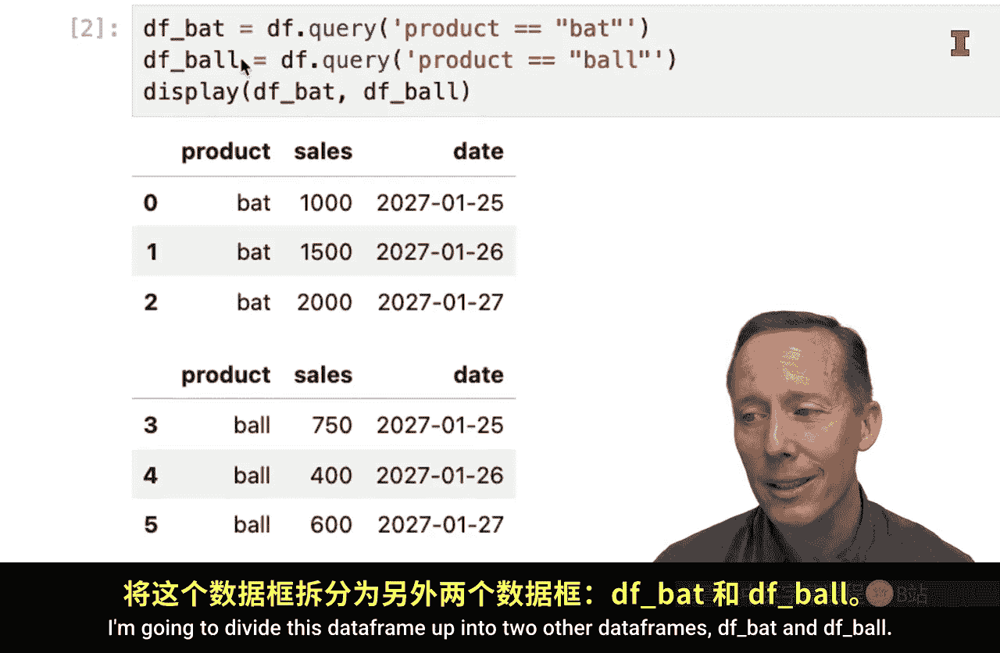

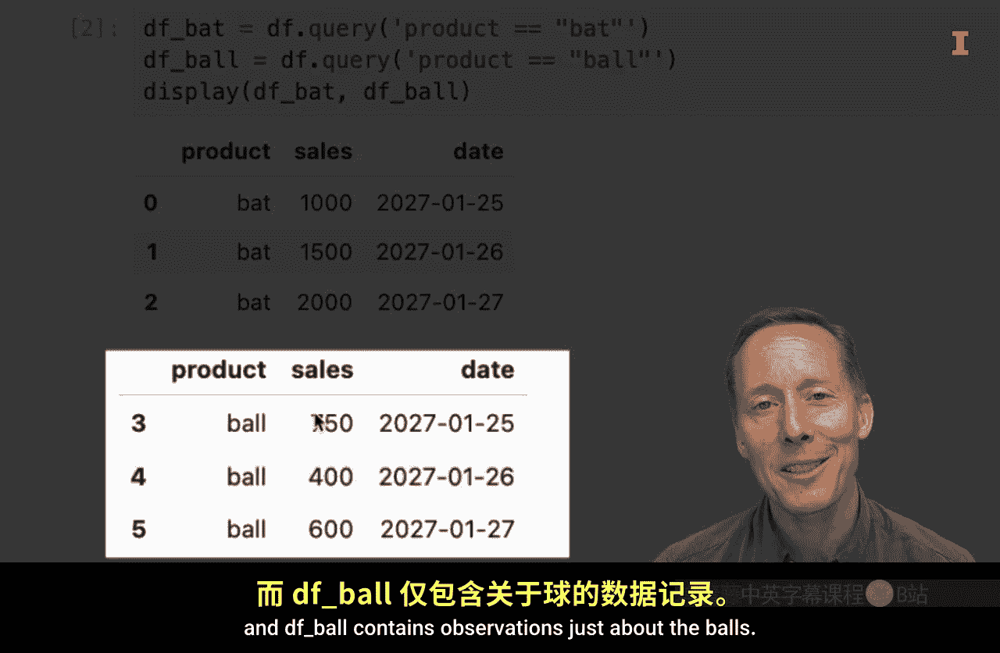

All right。So the first scenario for combining data is when you want to combine rows of data together。

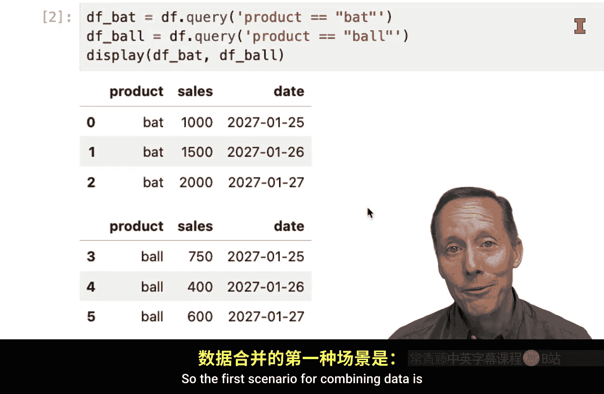

So if you ever have a situation where you've got existing data and then you've got new data that's in the exact same format and you want to analyze both of those together。

 Then you'll want to stack rows on top of each other。

 And this is really easy to do using the pandas Kca function。So we'll simply type out PDd。concat。

And then within the parentheses， we can create a list of the data frames that we want to stack on top of each other。

And so you can see that I've got two here。 You could easily add in a third， fourth， and so on。

Then I'll save this as D F underscore C R for a combined rows。

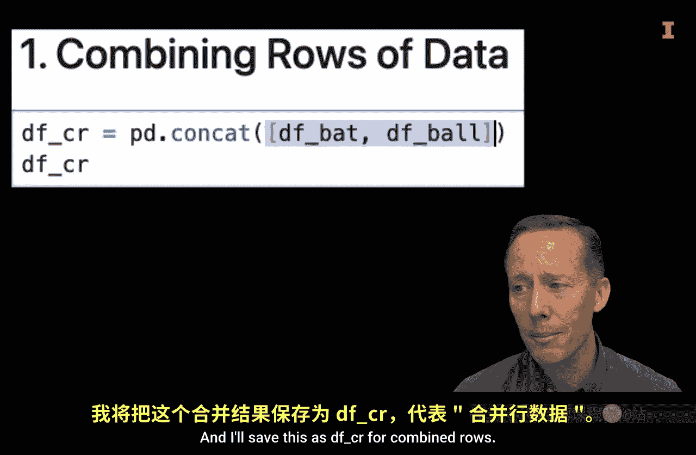

I'll run that and you can see that this looks just like the original data frame， okay。

 which is great。 So pretty straightforward。

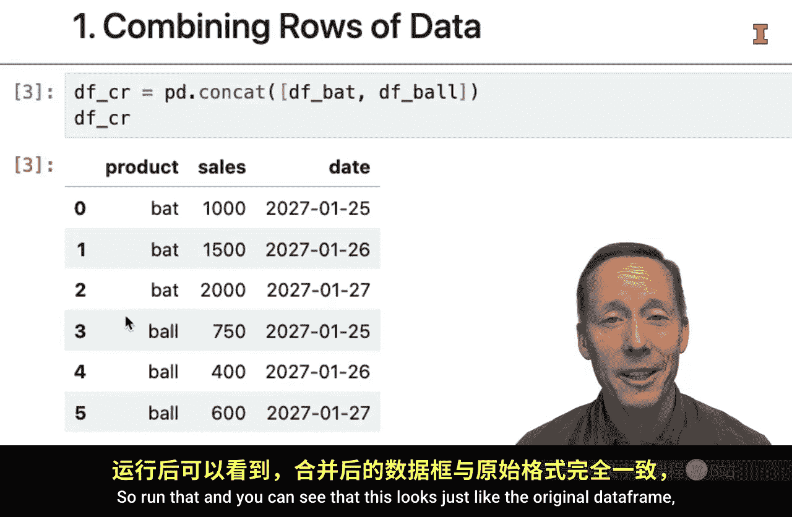

the second scenario is when you want to combine columns of data。

And I find this to be really useful when I for instance。

 will make a prediction using each observation and the features about that observation。

 and then I want to add those predictions on as a new column to that data frame。

 then I want to just combine rows on there。Okay， so you'll see that the way we do this is just the same as combining rows。

 except that we're setting the axis equal to one。

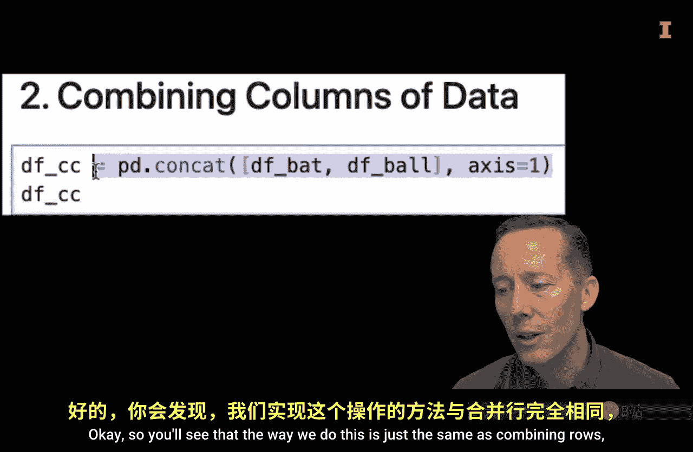

However。Let's look at the result when I do that， you can see that I've got actually a lot of missing values and duplicate column names。

And we don't want either of those things。The reason why this happens is because by default。

 when you combine columns together using the pandas conca function。

 it will combine them based on the index label。So， to prevent this from happening。

You want to make sure that your data frames have the same index labels。

 So I'm going to go back up to where I divide the data frame and use the reset index function。

He said， drop it equal to true。

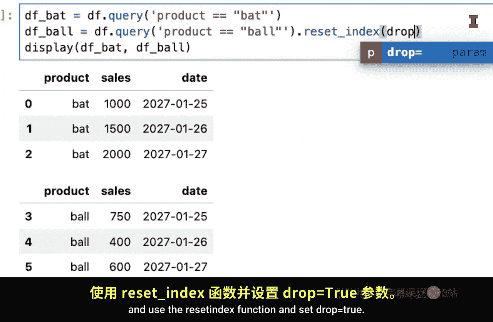

Okay， so now both of these are 012，012。 and now if I go back and combine these columns of data。

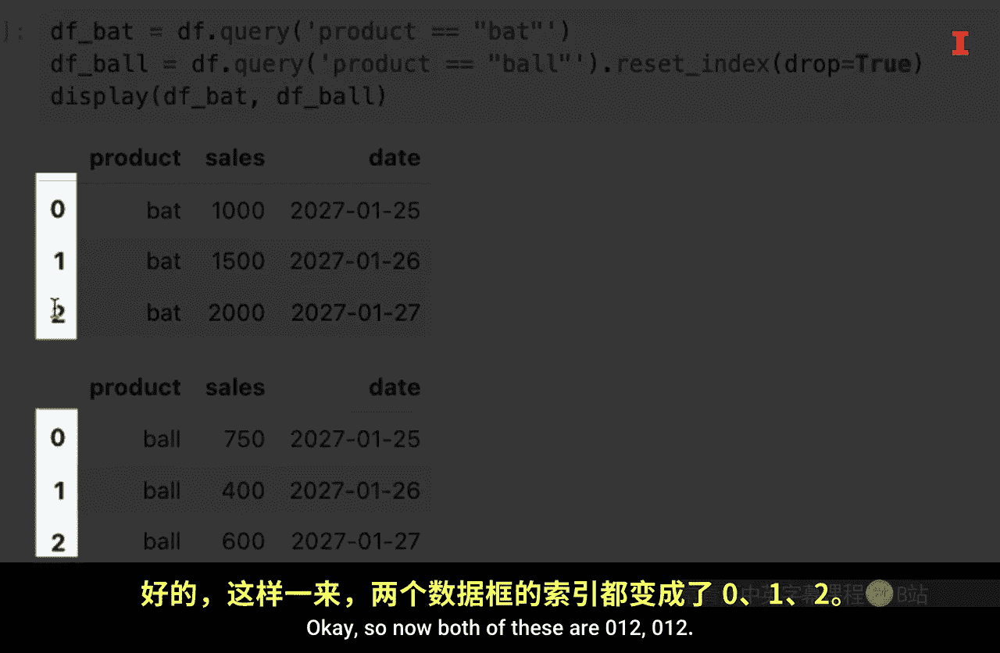

This is more what I would have wanted by just stacking columns next to each other。

 Just be aware of that index label situation there。

And then let me go back a little because this also influences what happens when we combine rows of data。

 So if you're combining two data frames that have。Duplicate index labels by default。

 Padas is not going to replace those。

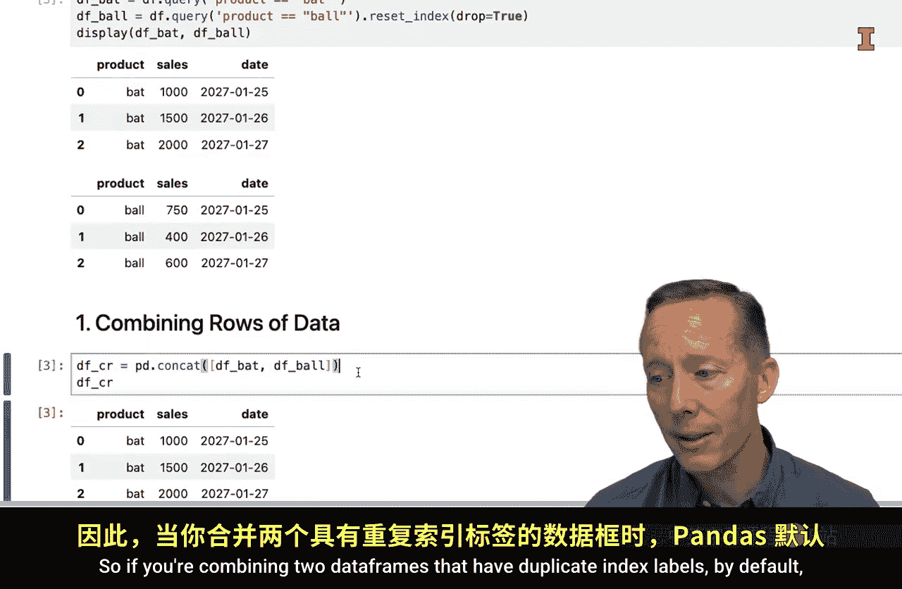

But you will see problems when you try to refer， for instance， to row 0。

 because it'll refer to two rows。 and it won't know which one。

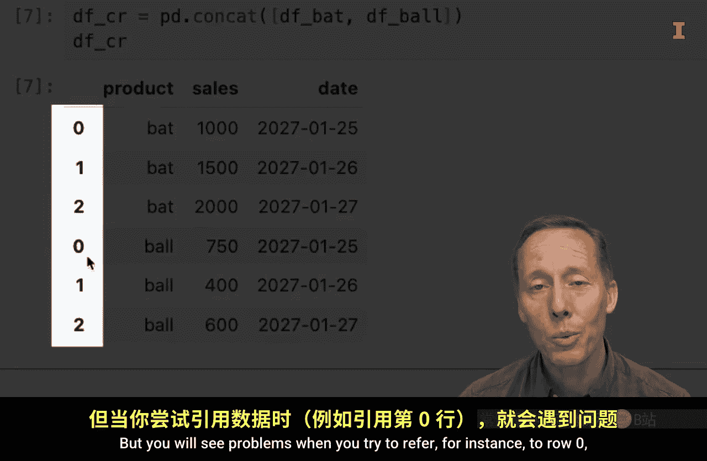

So one thing that I often will do is I'll use the ignore index parameter and set that equal to true。

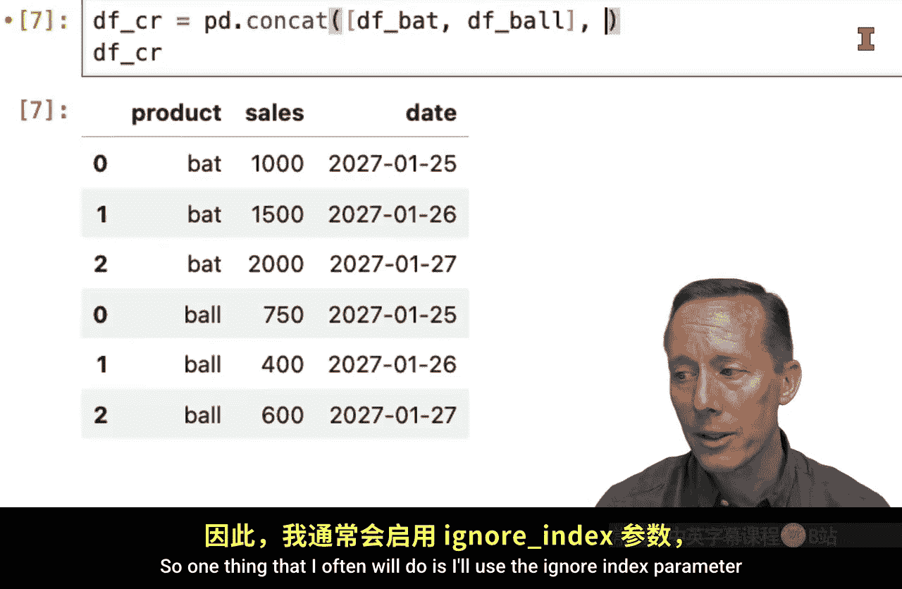

And now you can see that it converts the index labels to0 up to1 minus the number of rows that you have。

 it ignores these original index values。

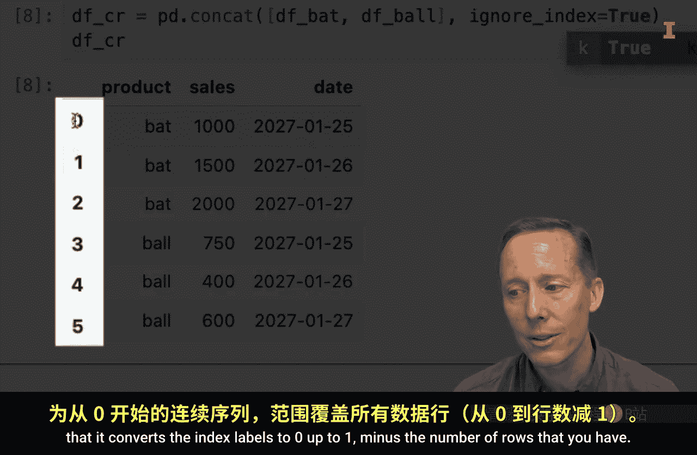

Okay， so that's how you can use the Kcat function。 Let's talk about merging rows and columns of data。

 So I'm going to create a new data frame here， D F units。And this is a really small data frame。

 It has three columns， three rows。 and I've got a row for bat， a row for， and then two rows for ball。

I've got the number of units rather than the sales in a monetary figures， the number of units sold。

 and then three different dates here。 Two of these dates for the first two rows。

Exist in our original data， but this last row does not have a date that exists in the original data。

 And actually， let's look at the original data right here。 You can see I've got January 25， 26，27。

 and then again， those same dates。 Okay， so that one doesn't exist。Now。

 the reason why this is worth highlighting to you is because this is a scenario that comes up quite a bit。

 You may want to add columns from one data frame， perhaps its' weather values to your sales data Okay。

 in this case， it's units that we're adding to it。 and we want to add units as a new column。

So this is where the merge function comes into play。 When we don't have rows that line up nicely。

 then we can simply use the pandas merge function。And you can see that the way it works is we referred to our two data frames。

 DF and DF units。And then how we want to join the data together。In this case， I'll say left。

 and I'll demonstrate that in a minute。 And then the columns that we want to match them on。

 In this case， it's the product and the date column。 Okay， so I want to basically say， hey。

 I to take this 60 units right here and add it to January 25 for the bat right here。 Okay。

 so I can't just say bat because I've got multiple bats there。

 So I have to say the product and the date。 So when I do that。

 you can see that I've got the same original six rows of data。 But for two of those rows。

 I've got the number of units in there。 The rest is missing。 All right， And so let's go back to this。

 how a left join means I'm going to keep every observation in this first data frame。

 That's considered the left one。And I won't keep observations in the right data frame or the second one if they don't have a match with the left data frame。

I can reverse that by using the how equals right。 And now I'm keeping every observation in the D F units data frame。

 and I'm only adding data from the D F data frame， if it matches。

Both the product and date in the DF units data frame。

 So you can see I've got a missing value there because it didn't match anything in the DF data frame。

How about an outer。Merge an outer merge will keep everything in both data frames。

 So there's the observation in the DF units data frame that didn't have a match。

 And then we've got the other six original observations in the D F data frame。All right。

 and it's just filling in missing values if it doesn't have a match。

And then the last one is the inner。Join or inter mergege。

 and this will only keep observations from both data frames if they match。 Okay。

 so it's only keeping January 25 for Baten ball because both of those are found in both data frames。

Okay， so it's pretty easy to use these functions to combine data together。 One word of caution。

 though， it's really important that you think ahead of time about how the combined data frame should look。

 And then after you perform the merge or the stack。

 the concatenation that you evaluate it to make sure that you've got the rows and columns that you would expect。

 Otherwise， you'll see a lot of problems。 And let me just show you one of those。

 Let's say I forgot to indicate that。I need to match on both product and date。If I were to run this。

 I'll go back to left， join。You can see that I've got nine observations。

And these are not really great observations because I've got the 60 units that is being added to all three dates for the bat and the 400 units it is added to all three dates for the ball。

And then I've got this 500 from the January 1 observation that is also being added to all three units for the ball。

 And then I've got these two columns in here， date X and date Y， so。It'll lead to problems。 And so。

 again， just as a final word of warning， make sure that you think ahead of time about what your data should look like in the combined data frame and then make sure that after you do that combination。

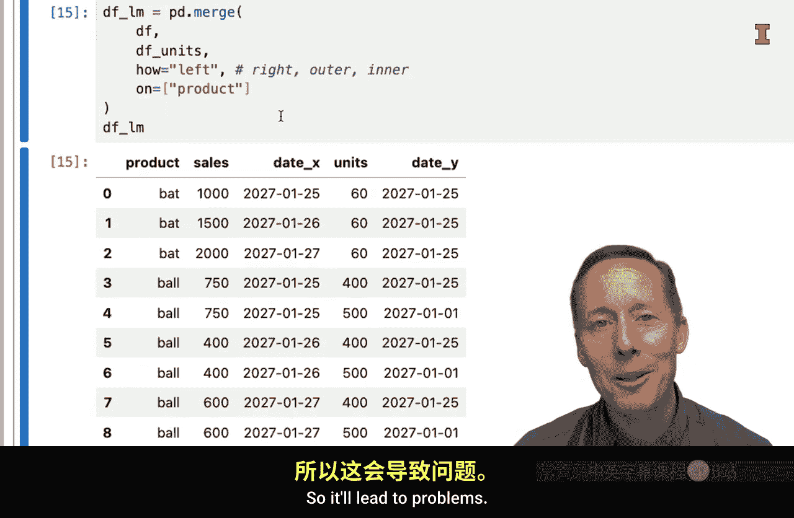

It looks like what you think it should look like。All right， with that。

 have fun joining data together。

