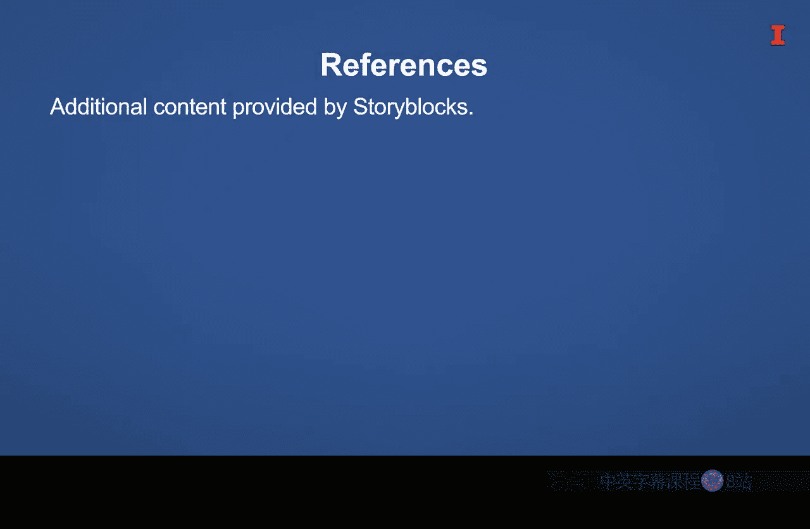

# 伊利诺伊大学【中英⚡商业分析｜Business Analytics Specialization】 p58 P58 11_第4模块-结论 -BV1z86nB9EGz_p58-

So we've covered a lot in this module about data cleaning and pre processing。

It might seem tedious at times， but trust me， it's essential。

Think of it like preparing for a hike or a bike ride on a trail like those in Corner Canyon。

Before you even hit the trail， you check to make sure the trail is even usable， right？

Data cleaning is like that trail inspection。 It's about removing the obstacles， the missing values。

 the duplicate entries， the inconsistencies。 So your analysis doesn't get a flat tire half way through。

Those obstacles slow you down and could potentially cause a crash。Then once you get to the trail。

 you should have a plan for how to get to your destination。

This includes following signs and making course corrections as you go。

Data preprocess is like mapping out your route。We decide what's the best way for the data to be arranged so we can answer our questions and gain insights。

Now， remember those three scenarios we talked about at the very beginning。

 the ones related to the political party miscounting votes。

 the lead analyst duplicating data and the complex code in the car safety system。

Imagine if those involve trails。What if the trail map had a wrong turn， marked。

 sending hikers into dangerous terrain。Or what if a trail was marked as easy。

 but it had been incorrectly classified and was actually extremely difficult。

 leading to unprepared hikers getting lost。That's why cleaning and pre processing are so important。

 They're not just about making the data look pretty。

 They're essential to ensuring the accuracy of your analyses。

By having a rigorous approach to data cleaning and pre processing。

 you can make sure your insights are clear， concise and， above all， trustworthy。

So next time you're getting ready to jump into a data set， remember to prepare the data correctly。

 do your data cleaning and pre processing。 Make sure your data is ready for the journey so you can avoid those wrong turns and make sure that you can reach your destination。

Now get out there and make some great findings。

