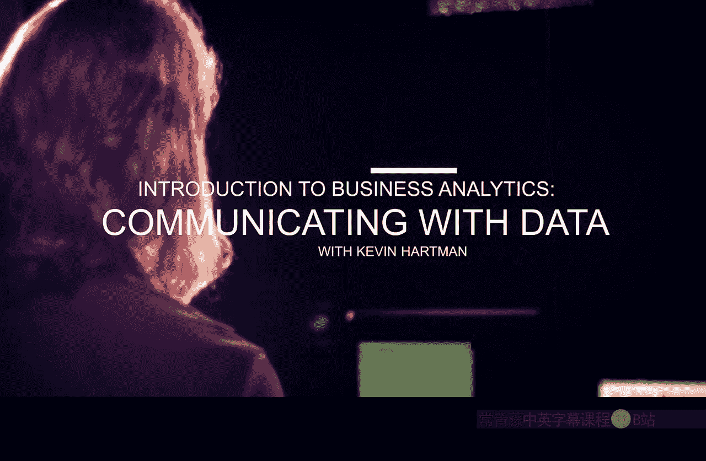
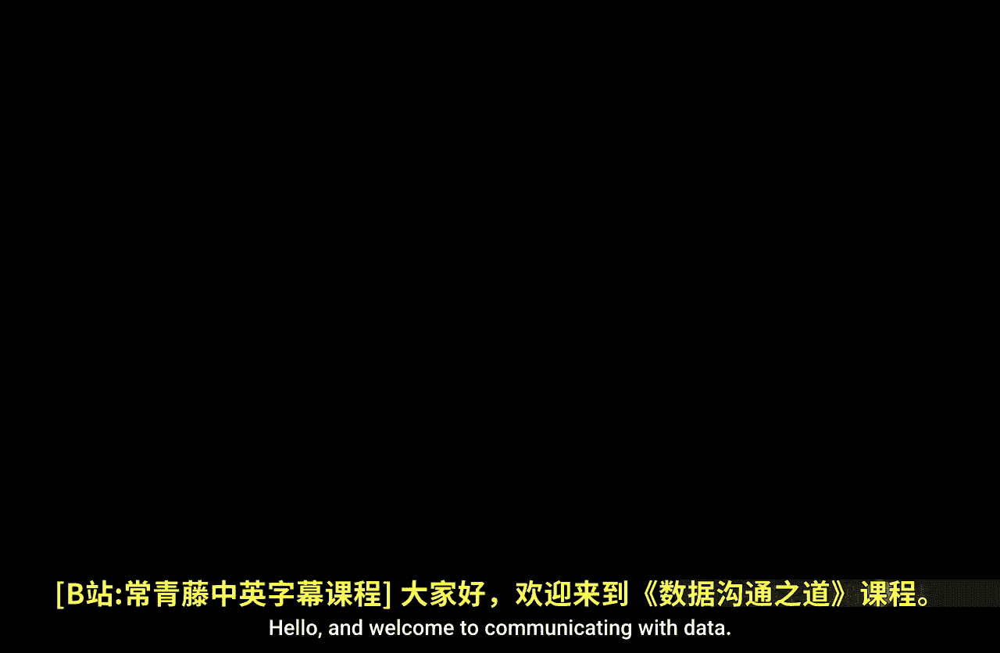
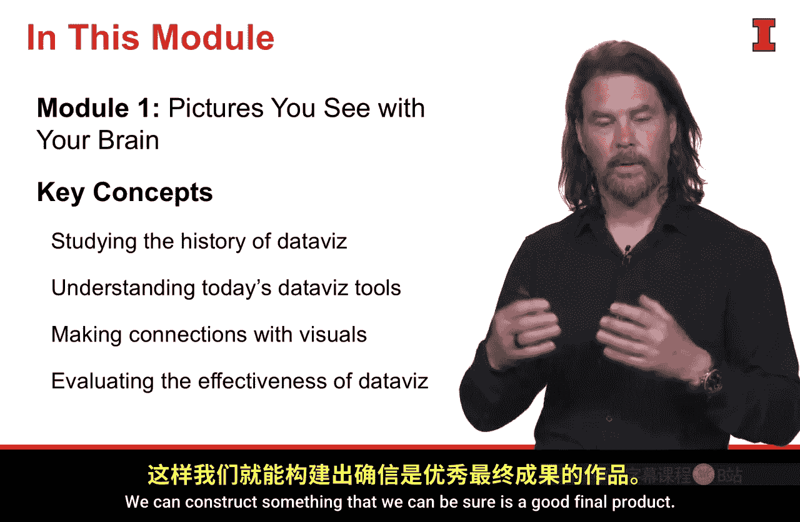
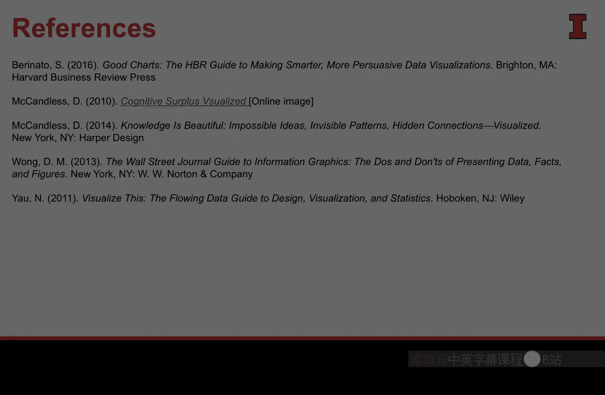

# 伊利诺伊大学【中英⚡商业分析｜Business Analytics Specialization】 p61 P61 01_商业分析导论：用数据沟通 -BV1z86nB9EGz_p61-

Hello and welcome to communicatingmunicating with data， I am Kevin Hartman。

 I am head of analyticslytics at Google and I will be your instructor for this course。

 I am super pleased to be here data visualization and the practice of communicating with data is something that I feel very passionate about。

And we are going to take a very long view of this practice。

 we are not simply going to focus on creating beautiful images。

 we're going to talk about the entire process from beginning to end and how you develop data visualization and how you effectively communicate with data we have broken this course into a number of different modules for of them and the first one we're going to give some background the way the brain actually works we're going to look at the history of data visualization。

 we're going to set the context for us as data Viz artists in what this practice really is and how we can be effective in the production of data visualizations。

In the second module， we're going to take a long， good look at the entire process of data collection。

 story， development， goal， identification， all the component parts that are very important to completing a final Data Vis that allows us to effectively communicate our insight through visuals。

In the third module， we're going to start looking at images and visuals that communicate meaning and insight。

 we're going to find those patterns that you'll be looking for in data we'll show you techniques and tips and how to identify them and then finally in the fourth module we will well end by bringing our data visualizations from a state of being good and communicating some insight too great and with full attention to detail in a great number of techniques that will get us there at the end of this。

 we will know the full process of a communication journey from conceptualizing what we want to talk about to actually on our feet presenting that data visualization in an effective way。

There are a few resources that we're going to use in this course。

 one of them is this book Good Charts by Scott Baronatto。

This book gives great insight into the process you go through in creating data visualization。

Like this course， it does take a very long view of of that practice and there are several really important concepts that we're going to pull from this work another resource that we'll be using is Donna Wong's guide to information graphics Donna Wong has put a great deal of effort into the guidelines and the real deep attention required to create data visualization。

 how you take something that is good and okay and might communicate some insight and use tips and techniques to present great graphics。

 leveraging preattentive attributes， using color and font appropriately。

 all the real detail that we need when we are presenting our visualizations in primetime。

Those will be the primary resources that we'll use a couple others that I would recommend any work by David Mcans。

 David Mcans will play a large role in this course， as we'll reference him quite a bit。

 any of the books that he's produced Information is beautiful。

 knowledgege is beautiful will serve to inspire us in the creation of data visualization so I would recommend any of his works to do just that and then a final recommended Resource is the book by Nathan you calledVisualize this now Nathan you and the Flowing Data Gus。

Do a great job in creating。A based case studies and lessons for creating visualization。

 so their site is packed with information， but this resource that they produced coupled with that site provides great insight into how you can tactically create visualization using tools and primarily the tool that they'll utilize as our。

Two required resources for the course， two that I'd recommend that will make you round out really your understanding and your experience here。

Now， before we dive in， I want to provide a bit of a centering thought so that you know the context that we'll be approaching data visualization from。

You have probably heard this quote sometime along the way。

 that from Michelangelo stating that for every block of stone， there is a statue inside of it。

 it is a sculptor's job to just chip away what is not required until that statue is revealed。Well。

 the practice of creating data visualization and communicating effectively with data is much the same way。

 the only difference being that this is our blockest stone。

There is so much information that we will be collecting that is unnecessary。

 Its our job to find the things that are vital， that are required the guides。

 the rules that we'll talk about in this course will help direct you there。

But this is not intended to be a simple practice。 and indeed， it's not。

 And I think this quote from David Mcans actually addresses that well。

 David McCnis has done a number of things and， and， in his experience。

The act of visualizing data is the hardest thing he's had to do。

And part of that is because or for the reason that there are so many elements that go into a data visualization。

Now， in this course， we will spend time on all of them again。

 we are not looking at the pretty picture and this is not a class that will teach you how to produce pretty pictures。

 We're going to talk about all the context and all the element around a data visualization to ensure that you are are building your visual on solid ground that you are communicating that visual correctly and that you are ultimately producing something that allows you to effectively communicate with data to your stakeholders。

 Now， David McCs has produced a number of visuals and some of them that are tremendously beautiful and insightful。

 one of the ones that I like the most is the example here where he's used contrast to show the amount of time。

Spent by Americans every year watching television and then conversely as he introduces contrast。

 the amount of time required to create a wonderful resource like Wikipedia really does put into stark contrast how we spend our time as a country。

 Now， a visualization like this includes a lot of the elements that I will be talking about in teaching you how to employ as well。

 One of the things that is also important in a habit that we just don't do enough is the idea of sketching and this graphic actually comes from a sketchbook that David Mcchans carries around and jot down ideas in。

 This is something that we all should be doing。 it is the way the masters of this trade actually operate。

And it will make us more creative， make us more efficient， save time。

 and ultimately produce a better outcome。In this first module。

 there are a number of things that we will talk about。

 but the primary concepts will be a review of the history of Dataz。

 We're going to look at 7000 years。Of man's experience， humankind's experience。

 expressing themselves through data。 And there are several things that we can learn from that experience。

 We're going to take a look at the tools that are used today， a very dynamic and changing market。

 And， and I will give you a way to actually evaluate that market and kind of think in terms of the tools that are laid out there。

We will talk about how the audience that you will be addressing actually is interpreting physically the visuals that you're putting in front of them。

 understanding how their minds work will help you construct visuals that work in the way that they want those visuals to work。

And then finally， we're going to look at a framework that will allow us to answer the question what makes good data visualization。

By understanding that kind of framework and that definition of good。

 we can build toward that definition， we can construct something that we can be sure is a good final product。

