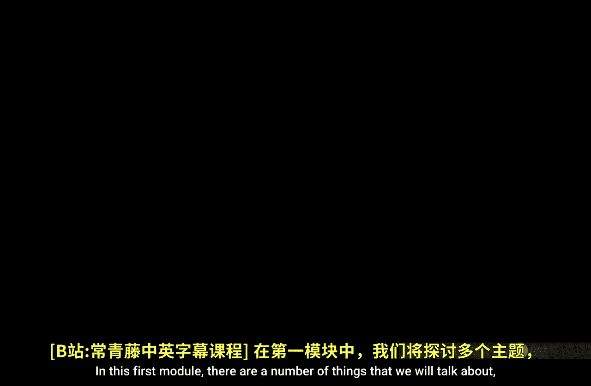
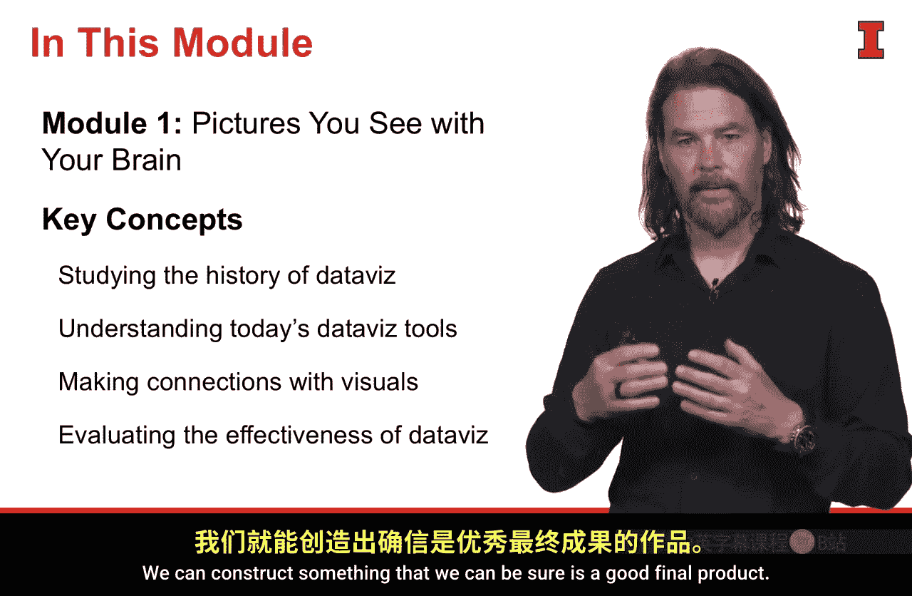

# 伊利诺伊大学【中英⚡商业分析｜Business Analytics Specialization】 p62 P62 02_第1模块概述 -BV1z86nB9EGz_p62-

In this first module， there are a number of things that we will talk about。

 but the primary concepts will be a review of the history of Data Vis。

 We're going to look at 7000 years。

Of man's experience， humankind's experience expressing themselves through data。

 And there are several things that we can learn from that experience。

 We're going to take a look at the tools that are used today， a very dynamic and changing market。

 And and I will give you a way to actually evaluate that market and kind of think in terms of the tools that are laid out there。

We will talk about how the audience that you will be addressing actually is interpreting physically the visuals that you're putting in front of them。

 understanding how their minds work will help you construct visuals that work in the way that they want those visuals to work。

And then finally， we're going to look at a framework that will allow us to answer the question。

 what makes good data visualization？By understanding that kind of framework and that definition of good。

 we can build toward that definition， we can construct something that we can be sure is a good final product。

