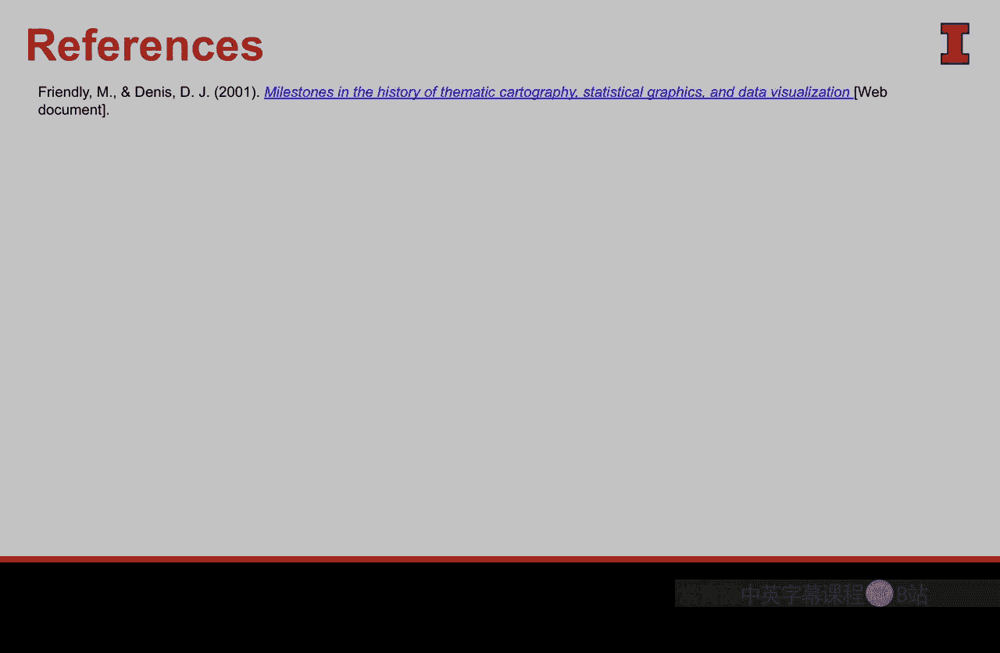

# 伊利诺伊大学【中英⚡商业分析｜Business Analytics Specialization】 p63 P63 03_数据可视化历史研究 -BV1z86nB9EGz_p63-

So studying the history of data visualization， let's trace that long rich history of humans using data to communicate。

 What we'll see is this discipline kind of evolving over time。

 adding capability confronting a lot of issues that will look very familiar to us today。

 and in the end， really emerging as this perfect blend of art and science。

 So this long rich history of humans using data to communicate。

Can really be traced back to nearly the beginning of time in human existence and can best be categorized around eight different epics let me talk about each of them at each of them there was some inflection point that kind of moves us from one point in this history onto another in this first epic what we would call E1。

 the early maps and diagrams phase this is pre1600 and what we're seeing here are humans using data in this case maps to make sense of the world around them in displaying that visually allowing us to share information between each other to record and measure things that are in our everyday lives and around us。

 this is becoming a critical part of who we are our social interactions as well as our understanding of the world around us in the next epic we move in。

to the 1600s， this epic of measurement and theory， we're actually seeing the capability of measurement grow as we start to make more sense of the world around us in case in fact。

 and as a great example here， Christopher Schchooner's visual shows us actually humans developing tools to record data in this case。

 spots on the sun and then translating that into a visual form that communicates the story of those sunspots。

 other great examples， really important examples follow in this epic as well。

 and then we move into a third epic of where artists who are familiar with communicating with data begin to explore new visual forms。

 creative forms of communicating data， using what today we know to be preatttentive attributes to get insights in very quickly to their audience。

 including color and shading and others。And then in the fourth epic in this。

 what we would call the beginnings of modern graphics。

 we began to see real true data visualization take root and we are introduced by William Playfair to the pie chart。

 something that is still a very important part of any data visualization today， the bar chart。

 the line chart， these visual forms start to take root in this epic that will stay with us now and well into the future out of that epic we move into what we would call the golden age of data analytics。

 and in this phase the first half or the second half rather of of the 19th century。

We are actually seeing artists collect data and then use visualization to best communicate that data。

 some great examples include John Snow's epidemiological study of cholera in London and the Broad Street well。

 understanding through his visual that that actually an understanding that changed the way people perceived this disease not as Airborne。

 but rather Waterborne Florence Nightingale provides a great example here using visuals to really drive home the need for greater sanitary conditions among the British Army and Charles Booth's example of using color to demonstrate poverty in London。

 grabbing the really emotional sense of that issue。

 also in this epic we are blessed with probably the greatest data visualization of all time。

So much packed into this visual， this visual telling the story of Napoleon's march to Moscow and then return return back there is there are the number of soldier lives lost collected in this data。

 there is temperature， there is distance， there are so many things going on in this beautiful visual。

 and it serves still today as probably the greatest visual ever created。

 that communicates insight and communicates a story graphically。We do， though， in the s。

 begin to get a little over our skis just because we can create graphics。

 we seem to be in love with creating graphics， and so there are several examples of things becoming a little too complicated overwrought or graphics being brought on top of graphics that do start to obscure much of the meaning that the artists intend。

And then there's the backlash and we move in the sixth epic into what we will call the modern dark ages of data analytics arise from the academic quarters in revolt for where data visualization has grown to say we need more accuracy。

 we need more controls we need a standardized language。

 limiting creativity forake of accuracy and we are inner to what we know today as a scourge of clip art。

 these individual icons all representing certain certain data that are standardized and communicated。

And frankly， threatened to knock the path of data visualization off of its creative tracks。

But we do see a few redeeming introductions during this period as well。

 One is the famous Henry Beck map of the London Underground。

 which beautifully and simplistically describes a very complex system， but even more importantly。

 it does not do it with perfect accuracy， is sort of a revolt against this academic backlash to say that images can be important and can serve a purpose without specificity without exacting accuracy。

And then we're also in this epic introduced to the computer， the Mark1 at Harvard。

 the first computer ever created the size of a living room which actually ironically hold held less capability than what we hold in our hand today with a mobile phone。

 but all the same this starts to introduce new abilities for data visualization and data communication artists to create new graphics and we take advantage of that as we move into the seventh epic。

 the rebirth of data analytics。Here， computers begin to play a bigger role。

 We can bring in more data。 We can do it more sophisticatedly。

 We can add different elements that we didn't have before。And as we hone these skills。

 we move into the final epic， the epic that we still sit in today。

 what we would call high definition data analytics。

 where visuals are now almost always created by computers or some application that takes vast amounts of information leverages all the things that we've learned in our past about data visualization in the communication with data to create visuals that are effective。

 efficient and tremendously powerful。So those are the eight epics。

 the way we would trace the history of data visualization。

 understanding this is important because those eight distinct epics trace a very rich and a very long history that humans have had with communicating with data it also shows how we've evolved from simple hand painted notes in maps into place where we are today with tremendous power to generate maps。

 in fact， now the tools have actually even surpassed our creativity。

 which the tools were always so limiting for humans as they sought to communicate with data。

 now we can do just about anything we can think of we have confronted along this long rich history things like data scarcity。

 the issue of human politics， data misuse and of course， as I mentioned。

 the scourge of Kilp art to arrive at what。is today， in my estimation， the most pure。

 the most beautiful blend of art and science that we will find。

 this idea of communicating through visuals and using data to create visualizations。

