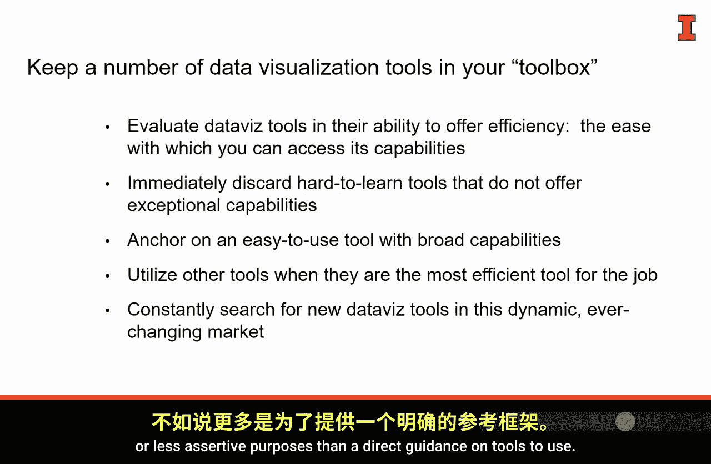

# 伊利诺伊大学【中英⚡商业分析｜Business Analytics Specialization】 p64 P64 04_理解当今的数据可视化工具 -BV1z86nB9EGz_p64-

Okay， understanding today's Data Viz tools。 Let's take a look at this rapidly changing。

 very dynamic market of data visualization tools。 and it really helps us here to grab hold of a couple elements of this market so that we can make sense of it。

The two important dimensions that I use when I think about the data visualization tool market。

Is evaluating them in terms of their ease of use。How easy is it for me to learn this tool。

 how quickly can I access the things that I need to do with it， how efficiently can I use it？

And the capability， is this a tool that has very broad capability， it does a whole bunch of stuff。

 or is it something that is more focused， and I'll just use when I need a specific task done。

When you use those two dimensions， the， the data visualization tool market， as it is。

 kind of lays out well across a two by  two。 And you find these different quadrants of。

 of like tools， right。And so let's take a look at each of these quadrants。

 when we look at those tools that are really limited in their capability。

 but yet very easy to use what you find are a number of tools that can do one- off jobs or specific tasks very well for you and very rapidly。

 the tools that you have up here。Those are the things that you should keep in your toolbox。

 things that have that kind of one off capability that will serve you whenever you need them， right。

On the other side of that ledger in the upper right quadrant。

 we have the tools that are both powerful and easy to use now these tools。

 it makes sense to settle on one or a couple to become really the foundation of most of your data visualization work。

 make this your goto tool it will do just about everything that you need。

 and it's easy to use so the graphics that you produce will be done efficiently tableau is a perfect tool up in this quadrant。

 easy to use wellknow many many people in the data visualization community accessing and using this and contributing to this tool it really does become table stakes for most data visualization artists right so use a tool that's up in this quadrant as that thing that you go to your go to tool that you're using 75% of the time right？

In the lower right quadrant， we find these tools that are tremendously powerful。

 but a little more awkward， a little more difficult to learn that power that they have comes at the price of being easy to use。

 and that doesn't mean that you should turn away from these In fact， these tools can be very。

 very important for you in your communication journey as you are analyzing data as you are finding visuals and patterns inside of the information that you've collected。

 One of the tools that I love the most is R。 It is an open source tool， it is free。

 there are thousands of people contributing to our community with help files and new capabilities and packages and scripts for this tool if you had to learn just one tool in this lower right。

 my money is on R Now there are several other tools that can serve many of the purposes。

 but I have never found one that I feel works as effectively as R Now I'm going to leave out one quadrant and that。

The lower left， any tool that is really hard to use。And doesn't have great capability。

 I would flush from your toolbox immediately。 there isn't any reason to spend time with a tool like that。

So that's the data visualization market at a high level。

 the specific tools that I've called out are probably frankly less important than us putting a mental framework around that market。

 and the way that I recommend we think about it is evaluating them on their ease of use and the access they provide to capability。

 either broad or more focused， anything again that is hard to learn but and doesn't have exceptional capability for you。

 shrug that tool side because you can quickly replace it in this growing dynamic market。

The tool that you should use most frequently， that tool that's going to become the anchor for your data visualization will be a tool that you find in the upper right。

 easy to use， great capability， the tools in the upper left of that quadrant。

 lower right of that quadrant you're going to want to use sporadically just to fit your needs and to serve specific tasks that you have。

Now， the trick for us in this market is to remain ever vigilant。

 There are new tools being added every single day， and this market is shifting and changing so rapidly as our experience with data does as well。

That it's almost impossible to stay on top of it。 In fact。

 this snapshot is really there for more or lesserative purposes than a direct guidance on tools to use。

 so as a data communication artist。

Challenge yourself to saymersed in this market， be aware of the tools that are coming in。

 have those tools that you know and use and love， but always be open to the new ones。

