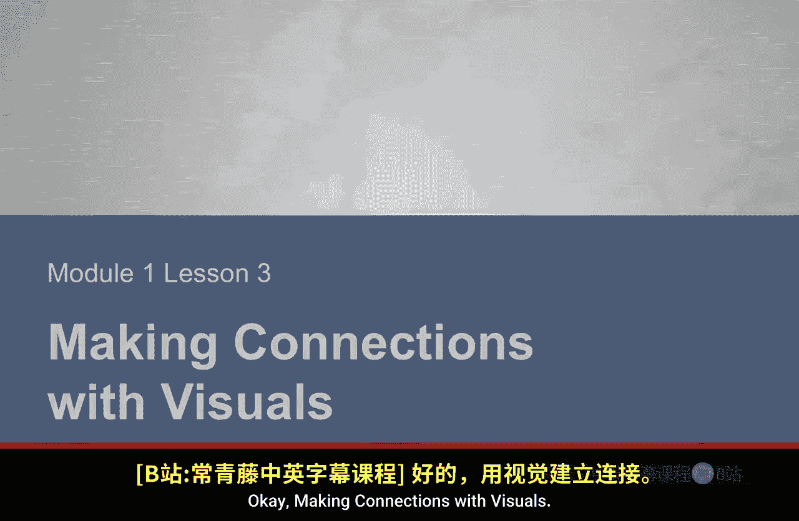
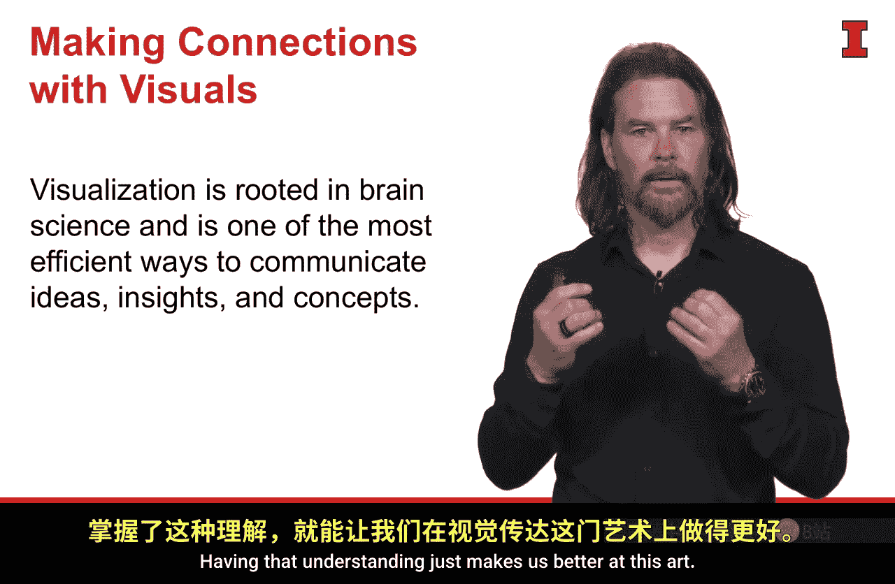
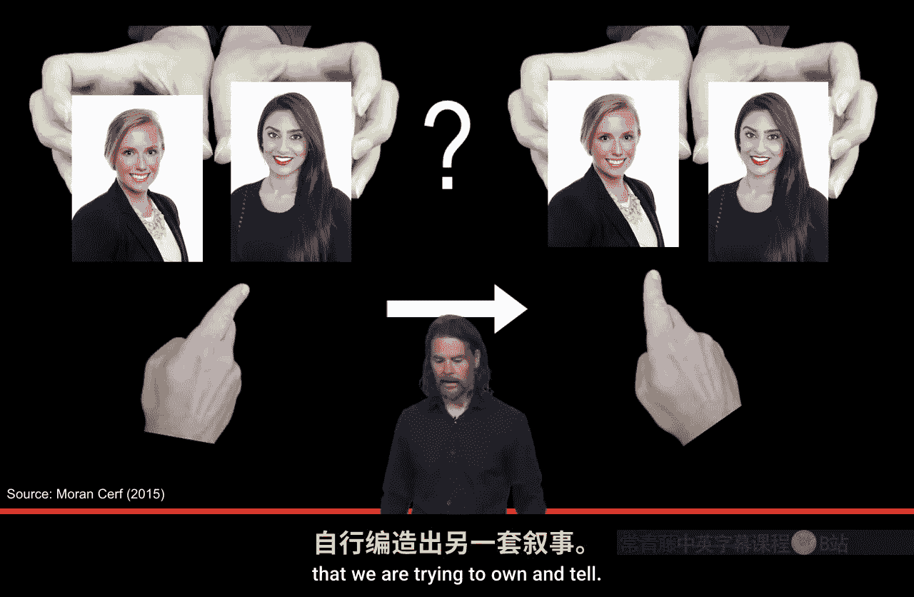
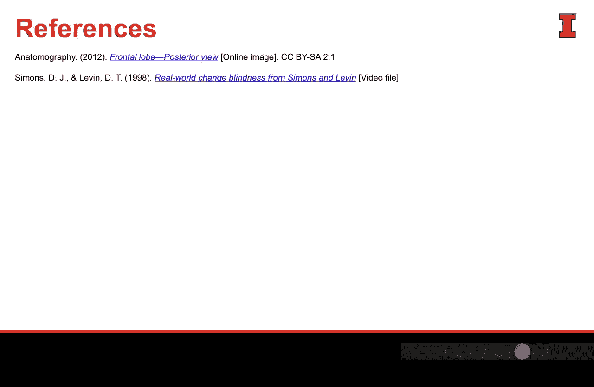

# 伊利诺伊大学【中英⚡商业分析｜Business Analytics Specialization】 p65 P65 05_讲座1-3-通过视觉建立联系 -BV1z86nB9EGz_p65-

Okay， making connections with visuals， let's take a bit of a step back and let's actually understand how humans。

 our audience。Process visuals right by understanding that and understanding what is going on inside of their minds as they are seeing the visuals that we're putting forward helps us better position our messages use the use the things that we will call preattentive attributes to connect with our audience more quickly and having that understanding just makes us better at this art so where I want to start is this idea of visual perceptions and our eyes are fantastic tools but really when we are seeing things。

 we are perceiving them in our mind it's not our eye working。

 it's our mind working and so when we are creating images that we are seeking to use as a communication visual to our audience we should think in terms of how that visual will register in their minds and the mind is a very confusing and complicated。

Place a couple studies that illustrate this well， the famous door study。By S and Levine。

Two researchers are experimenting and one researcher goes and finds a subject in the park。

 gives them a map， asks them directions to a place and this subject then is engaged in the map。

 you are as a human we are using our full frontal cortex when you are interpreting maps。

 this is the most complicated part of our brain， and while this is going on and this subject is working to make sense of the map and where they are today and communicating all of this out to the researcher。

A group of men come through with a door and separate the subject from the researcher。

 the first researcher then jumps behind the door and the second researcher pops out and almost every time。

This subject doesn't even notice that now they are talking to another person。

 they just continue on with the directions on where to go， this is because that prefrontal cortex。

 when it is fired， it can overload us and we can miss the simplest of things。

But that's not the only issue that we will be up against as we are trying to communicate with data。

A study by Mor Surf is one that punctuates just how challenging this really can be。

Mren had a researcher sit with a subject， showed the subject two pictures of people of the opposite sex。

 said，  which person do you find more attractive the subject than chose one？

And then the researcher hands them the picture of the person they had chosen and said why explain to me why you chose that person now in this case。

 you are pulling on the lower， more reactive， the fight or flight part of the brain that makes that quick decision on who you find more attractive。

 not really even understanding why you've done it， it is all instinctual and emotional。

But when you are asked then to communicate and explain why you've done that。

 now this prefrontal cortex again is being fired and working hard to put words to something that has come from a part of our brain which has no capacity for language。

 it is a very difficult task for the subject。But that was actually not the purpose of this experiment at all。

 in fact， the researcher was not a researcher at all。

 but rather a magician and every fourth card or so through a sleight of hand。

 they would hand the subject， the card of the person they had not chosen。

 still the subject nearly every time continued on and came up with this overwrought explanation for why they had chosen。

The person that they actually hadn't chosen in the first place。

 if we as an audience don't understand the flow of a story or understand all the data that is being interpreted or brought to us。

 we will make up things to fill the gaps。 This is the danger that we're up against as we are communicating with data。

 either confusing our subjects， our audience and getting them to think too much which could。

 in some of the extreme cases， lead them to make their own narratives up for the story that we are trying to own and tell you know。

 the brain， as I said， is a complicated thing， we understand how the left lobe and the right lobe works and we think about that quite a bit。

But we don't frequently enough think of the lower brain and the frontal brain and how we as data communication artists need to work our way around that prefrontal cortex。

 leaving it silent and calm and hitting our audience with messages and visuals that strike at the lower brain。

 the very emotional part of their cognitive understanding。You know， we as humans。

 we are designed to pick up differences， differences in shapes， certainly differences in colors。

 and as we construct data visualizations， we have a whole host of different what we would call pre preattentive attributes。

That we can use in our visuals to communicate points to draw attention。

 to really get at that lower part of the brain， and that seems very simple for us to use those visuals。

 those techniques， but if that's the case， right， why do we still create visuals like this as Baronnato pointed out in his work or this。

 or for God's sakes this and if you're creating data visualizations like this。

 you're probably beyond help， but I would argue that the reason we put visualizations together like this with our understanding of shading and enclosure and size and all those things。

 is because we don't understand the full rules we don't understand the guidelines that need to go into creating a data visualization and communicating with data。

The purpose of this course is to help you do that。So。

Understanding how the brain works will help us create better data visualization and when we're doing this。

 we need to begin with the design in mind and our message in mind。

 we need to keep that front front and center， whatever we're trying to communicate design around that message。

 We need to really think through the way our audience will interpret the things that we're putting in front of them and the story that we're trying to communicate the visuals we use and again。

 our objective there is to keep that prefrontal cortex as still and quiet as possible。

 We actually don't want our audience thinking much。

 we want to make a message that is so easy for them to understand and interpret that they don't need to spend cycles and fire up their prefrontal cortex to fill in blanks of their own or divert attention away from the message that we have。

Preintentive attributes can certainly help and we'll learn those certainly in the course as we talk further。

But the most important thing for us to understand is that this creating great data visualization and being an effective communicator with data is not a sense of just using color well or shading or any of these attributes。

 they are simply a piece of what is a very large and complicated approach to pulling messages from data and then communicating them effectively in ways that land squarely with an audience。

 the purpose of this course will help us understand that full process。

 whole that full communication journey。

