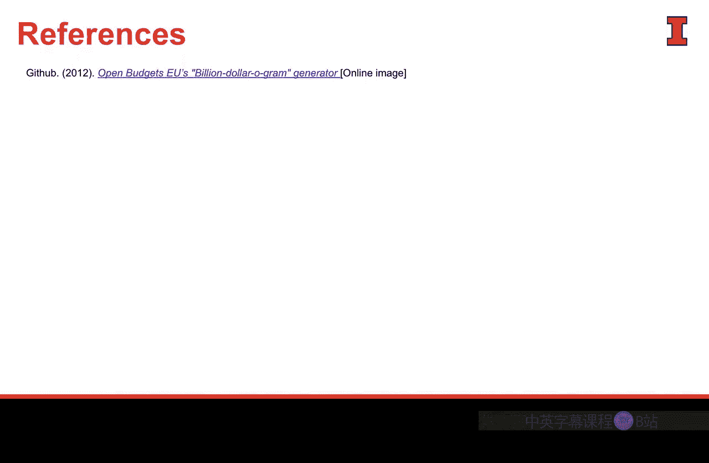

# 伊利诺伊大学【中英⚡商业分析｜Business Analytics Specialization】 p66 P66 06_第1-4讲 评估数据可视化的有效性 -BV1z86nB9EGz_p66-

Alright， evaluating the effectiveness of datavisz。 Let's take a look at what makes for good data visualization。

 And we're going do this by looking at some， some very good visuals。

And then actually exploring a definition and a framework that we can use to help us answer that question。

 like what is good， right？Here are some of my favorite。 This is。

 this is a beautiful visualization that David Mcans produced that he calls the the billion dollar program gram。

 And so David basically。😊，Motivated by the fact that the term billion dollars gets tossed around a lot。

 he wanted to see what is the relative impact or size of various expenditures that are in that billion dollar range he scraped data from a number of sources put them into this graphic and size each of the spend according to their relative relative size and so it reveals some things that are very interesting and we'll talk more about this visual later in the class another one that I love was this exploration of the impact of the measles vaccination and so what you're looking at is the occurrences of measles in every single state in the United States from about 1928 all the way into the 2000s。

Where the darker the color indicates the more occurrence of that disease。

And you can clearly see what happens in the mid-1960s when that measles vaccination is introduced。

 how the number of cases occurrences of that disease falls dramatically and this visualization does a wonderful job of doing that not every visual needs to be computer generated either we're in the midst of this kind of rage that's called photobiz where visualization is done with real worldorld objects and that can be done very effectively。

 and this is one visual that I love and I think communicates very well。

 you're looking at an ice cube that represents the 1。

83 million square miles of the polar ice cap in 2008 and a four years later。

 the impact of the warming environment that on the ice cap， I think a beautiful visual。

That does this well and really adheres to all the rules that we will talk about in just a moment。

So what does make these visuals so good， what are the things。

 the elements that they communicate so well， and that others which aren't nearly as effective miss out on。

Well that idea has been bandied around quite a bit and I think the framework that I feel best communicates those ideas of what makes for good data visualization is really captured here。

 there are four elements， four elements that when all four come together you have the ability to communicate effectively。

 you have created a successful data visualization， those four elements are information， this is data。

 this is the data that we are collecting， data that is accurate and deep and robust。

 the better that source of data is the better our data visualization will be if we don't use data as the basis here。

 we are no longer creating a data visualization， we're creating something completely different。

But data is a clear important element of communicating with data The next is a goal this is the functional purpose of the data we've collected。

 this is an objective that we are working toward that willll focus our story focus the data we collect and really give us a pinpoint purpose without that goal our data become somewhat meaningless and rderless right and even if our story is great and we've got great data if there's nothing that we're trying to obtain or achieve with it。

 then we don't really have a successful data visualization any longer we've got something completely different。

Knitting these two together is the story。 The story is what takes data and moves that toward a purpose right directs toward that objective。

 It is the connective tissue between data and an objective and this is where we are using a narrative to guide our audience without that story。

 we are just throwing facts even if we have a solid objective we're throwing nothing more than figures at an audience where we have very little opportunity to connect。

But even having those three things are not enough， this is where the idea of visual form comes in。

 the data we've used， the objective goal that we have。

 the story that we've used and knit those things together。

 those have to take a visual form to effectively communicate with our audience。 Otherwise。

 you are left with the report of text and bullet points that runs the risk of boring our audience。

 distracting our audience。Visuals become， as we've seen。

 the most powerful way for us to communicate with an audience。

 and in this case we are using this visual to achieve a goal that is built out of data and stitch together with a narrative and a story。

So this framework really does bring all of those things to life and it's important for a number of reasons。

 one is because it does give us this clear answer and understanding to the question。

 what makes a good data visualization or what makes visualization good。

 which can be somewhat elusive， I think this framework gives us a good handle on that answer。

It also it goes beyond just evaluating the pretty picture and goes into all the elements of the creative process。

 which is important because it forces you as an author to then make sure that each element is solid and good because without each one。

 the entire visualization and communication falls apart。Finally。This framework communicates well。

 the idea that these things all form one harmonious message and they all come together as pieces that fit into into your data visualization so for that reason。

 I think this framework that has been explored is the right way for us to think about what makes for good data visualization and how we will evaluate the process of communicating with data going forward in this class。

So that is module1 in this module we talked about a number of things we trace the history of data visualization to give us that long view into how humans relationship with data and communication。

 we looked at the data visualization tools of today and came up with a good framework on how we can evaluate those tools we talked about the way our audience will interpret the visuals that we put in front of them and so we now have an understanding of the brain workings and can use those to our advantage as we seek to communicate with data。

 then finally in this last lesson we saw a framework that will allow us to evaluate the effectiveness of data is effectively giving us that definition of what is a good data visualization。

 what are the things that we need to think about in terms of elements when we are putting together a data vi and seeking to communicate with data。

