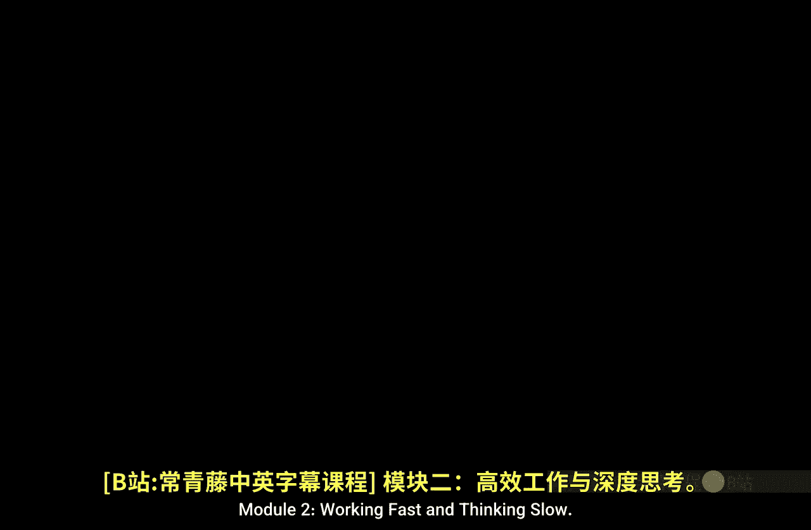
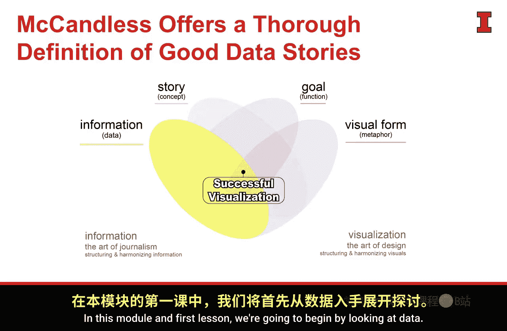

# 伊利诺伊大学【中英⚡商业分析｜Business Analytics Specialization】 p67 P67 01_模块2 概述 -BV1z86nB9EGz_p67-

Module 2， working fast and thinking slow， a couple concepts we're going to introduce in this module we will be talking about the unbelievable growth of data。

 willll evaluate the different methods that we as analysts have to collecting that data accessing it。

We will talk in terms of focusing our communication journey。

 particularly around an objective or a goal that we might have。

 we will talk about planning the data story that really that connective tissue between the data that we've collected and then the goal that we have。

 and then we're going to introduce a company named Bellabe that we will be using as a bit of a case study throughout the lecture videos and kind of returning to them as an example as we introduce new concepts。

We are working， of course， through this framework， which has all the elements of a good。

 successful data visualization。And in this module， in first lesson。

 we're going to begin by looking at data。

