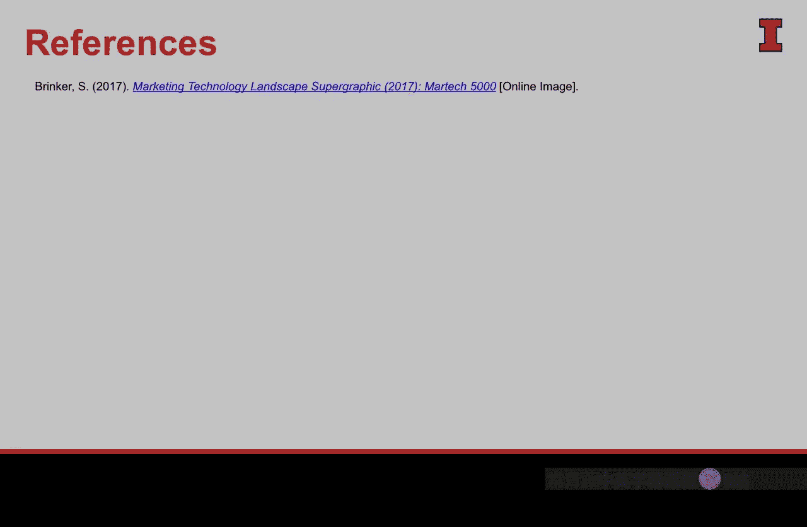

# 伊利诺伊大学【中英⚡商业分析｜Business Analytics Specialization】 p68 P68 02_第2-1讲 数据增长的理解 -BV1z86nB9EGz_p68-

All right， understanding the growth of data， we are truly living through the greatest expansion of data that the world has ever seen。

 and what this has created is an environment where it has never been more important for us to understand how to effectively communicate with data in the last two years alone。

😊，We have seen 90% of the world's data。Come to be， it's truly remarkable。

The explosion of data all around us and sometimes we lose context for how much data that really。

 really is， and to that end， I put together this data of visualization based on an idea concept from David McCs。

What you're looking at is a comparison of daily data creation and what you'll see is that the extraordinary amount of data being generated every day。

 this digital data that we can move， that we can access that we can analyze and make stories from。

So I basically took data from a number of sources and then dropped them into this graphic sizing the boxes to the relative size。

 and it gives us really I think good relative insight into how much data is being created as well as a point of comparison to some offline data that will show us just how much is being produced。

 so here you go。So every single day in the world， there are 4。

5 billion Facebook likes 4 billion YouTube videos watch 3 and a half billion Google searches on and on。

 all of these things for marketers in particular， tremendously rich and valuable sources of information。

 allowing us to know what consumers like what they don't like what they want。

 these data that are being generated are providing more insight than we've ever had before in the history of marketing and say really the history of the world。

But how much data really is this that brown box that I haven't revealed yet， Well。

 that is the number of cups of coffee。Consumed every single day。

 you can literally consume coffee and purchase coffee anywhere in the world。

The rest of this stuff is all generated by the 40% or so of the world that is digitally enabled and is online。

That little blue box there in the lower right。Well。

 those were the number of votes cast in the last presidential election。

 so that's done once every four years， everything else is happening every single day really does give you a sense of how much information and data is being generated。

 useful， valuable， insightful data from which we can tell great stories， right？

And as a result of this， the industries and companies that use and work with this data have also seen a similar path of growth。

 this is marked very well in an analysis done by Scott Brinker where in 2011。

 Scott put together this infographic which became viral and made its way around the data community。

Where Scott basically took the logos of all the companies operating in this very new and nascent marketing technology space and categorized them。

 so for the first time you got to see well， these are all the companies in this data space。

 working with this data that's being generated， making sense of it， processing it。

 doing something that allows them to make a viable business endeavor。That was in 2011。

 this was so popular that Scott decided to go back the next year and then the next and then the next and continue to revise this number and what he found was pretty surprising In 2011 there were 150 companies by 2012。

 350 by 2014，12000 companies working in this data space by 2015 in 2016 that number had jumped to 3500 the one that was produced in 2016 showed 5000 companies and the most recent in 2018 graphic that Scott generated shows nearly 7。

000 companies now working in the marketing technology space utilizing this data that is being created truly there is never been a time where understanding that data and knowing how to communicate with that data has ever been as important as it is today。

But even with all these numbers， this might not be the most important number that I want to share and that number may be this one。

 a simple one， but one with great meaning。1%。And this comes from a recent McKenzie study。

Which found that the amount of change that technology will introduce into our personal and professional lives。

 we have but experienced 1%。Of that disruption， we have not even begun。

 So with all the numbers and data that we have generated and can work with now。

 we are at the very beginning of this journey。 Tru。

 if there's ever a time to understand how to use data to communicate。

 now is the time to start to learn these tasks and these skills。So as I said。

 communicating with data it's never been more important。

 we are living in the midst of an enormous data explosion， and extraordinary amounts of this data。

 as we've seen， is being generated every single day， useful， rich。

 vital information that can tell great， great stories， new companies。

 new industries are springing out of this data because it is just so valuable and so so rich。

And yet we have only seen the very， very beginning。Of the revolution that we're living through。

 This is going to continue on， and we will see much greater change over time。

