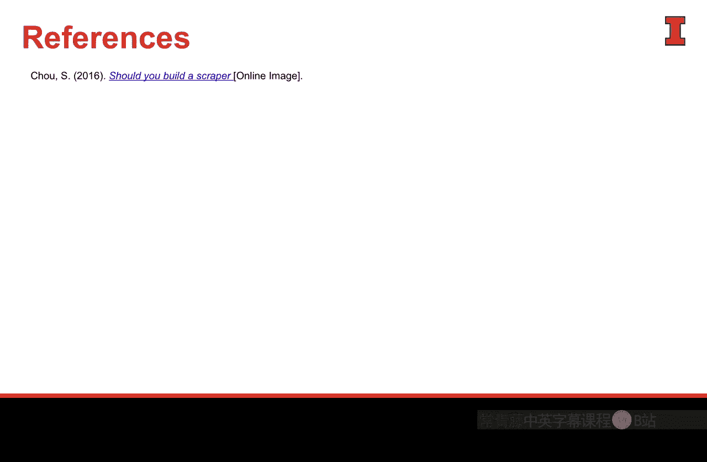

# 伊利诺伊大学【中英⚡商业分析｜Business Analytics Specialization】 p69 P69 03_第二讲 第二部分 数据访问方法的评估 -BV1z86nB9EGz_p69-

Alright， evaluating the methods of data access。 So we've talked about the importance of data in our data communication story right we've talked about the explosion and growth of data so what are the ways we can access that data。

 Let's look at a few of them and kind of give each of them a little bit of an evaluation There really are three primary ways that we as analysts will access the data that we'll use。

In our data communication story。We'll call those bulk downloads APIs。

 which is application programming interfaces and then web scraping let's look at each of them individually bulk downloads is the idea that someone。

 a data owner has provided a place for you as an analyst to go and collect that data。

 these are very controlled releases of data， some of these I would even think of as your internal company data。

 someone is the owner of that data you are accessing it for analysis purposes that is what I would classify as a bulk download just as sure as any kind of third party。

Download site so these bulk download areas are typically data tables that are accessed through some graphical user interface。

 a GuUI， right which is built for the purpose of giving you that data。

 the people who are owning own this data。Want you to have it。

 and they set up a bridge for you to get to that data。

These are gives the data owner the ability to determine what they give out and what they don't right to hold back the sensitive information。

 it also gives the data owner the ability to provide limits to how much of the data you can get and to differentiate access based on who you as someone who've declared a through a log on who you are what data you get and what data you don't it is the easiest way to access data bar none right a good example of this is the census data here in the US。

And what what they've constructed a site called American Factfiner。

 where you can go to American factfiner， this great GoI and very simply and easily access all of。

Or most of the US censuses data， at least the data that they want you to get access to Now these things don't always look great。

 IMDB has what I would call a bulk download source as well。 It's a little bit hidden。

 a little harder to find。But all the same， they have set up a place for you to go access data as an individual。

We live in an era of such plentiful data。That we really need to do little more than sign up for a newsletter to get tremendous amounts of information interesting。

 vital data sets sent our way， Kaggle does this weekly。

 we'll send you a list of interesting new data databases that you can access through a prescribed dedicated access link that is again。

 this idea of bulk downloads。A second way that we can access data is what we call API's application programming interfaces truly the idea of an API is to let a computer talk to a computer it is a machine to machine connection doing this accessing and building an API connection for yourself would require some understanding of scripting language a set of commands for you to use there are tokens and keys that kind of access security again。

 the design is meant to be machine to machine and taken care of all automatically while you can as in as an analyst build your own API access tool to go out and tap this data。

 typically data that we want to have access to would be better found through a bulk download but APIs can work this is an example of some of that scripting。

 this is the API for Google Maps。Really。Rather than going out and writing your own API。

 you can utilize sites that are really fancy user friendly mockups of APIs let me show you an example。

 Tweet Bier is one of those and Tweet Bier will give you great access and insight into Twitter data and basically what tweetweet binder is is an API connection to the Twitter API。

That takes in through a nice graphical interface， some information that then pops into their API query goes off。

 pings， the Twitter API， grabs data， brings it back， all cleaned up for you。So in this case。

 it's kind of cheating right because you're using an API。

 but you're accessing it through someone else's GoUI， that would be in my estimation。

 while not as effective as finding a bulk download source。

 it is still a better alternative to writing your own API scripts that take a little more time and a little more expertise。

A third way that we can access data is through this practice that's called webs scraping Now in the early days of the web。

 this was the black hat access to data。 this is the kind of sneaky way to go about and get whatever data you need it's frankly kind of fallen out of practice and that's because we live again with so much information around us in so many organizations and data owners willing to give you that data。

 there's very little reason for you to go out and scrape data that you're not intended to have。

 In fact， an analysis an interesting one was done that by Sophie Cho who put together this sort of thought matrix to say through a decision tree。

 whether you should or should not build a webs scraper and almost every single path you went down said don't build a web scraper why would you scrape this data。

And there really are a number of good reasons why you would not the data， if you need to scrape data。

From an HTML web page or any source。That's only because it hasn't been packaged for you to collect。

 which means that unlike through an API or a bulk download site。

 that data owner really probably doesn't want you to have that data， if they did。

 they would make it available right there are usually copyrights and other licensing issues that govern much of that data and it can be while at times a very easy case of simply just copying and pasting。

Data from an HTML page。Can require pretty sophisticated。

Python programming or other language use to go out and grab data that you want。 And again。

 data that probably was never intended for you to get anyways。

So those are the three ways that we as analysts can access all this great data that's being created again。

 in my opinion， the bulk download area and site is the one that should form the vast majority of the data that we are using in our analysis。

 either publicly available data that we access through that means or our own company internal data that we access through that means APIs can in some cases work well in web scraping is something that I think as an analyst we' better just to leave behind。

