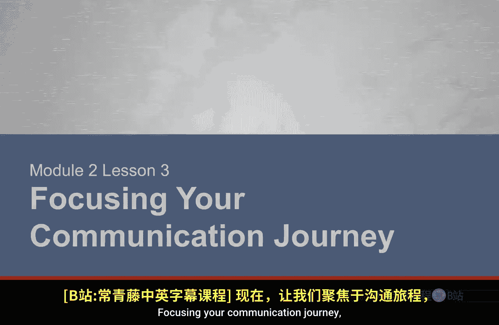
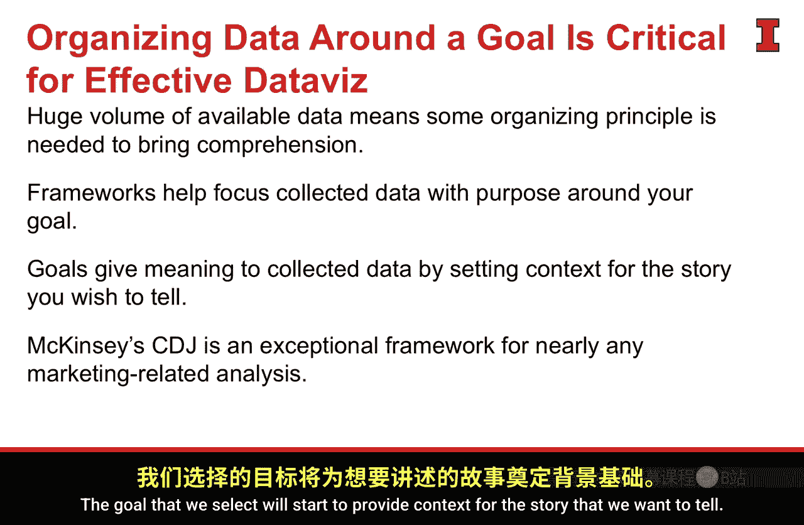

# 伊利诺伊大学【中英⚡商业分析｜Business Analytics Specialization】 p70 P70 04_第2-3讲 聚焦你的沟通之旅 -BV1z86nB9EGz_p70-

Focusing your communication journey， let's talk a little bit now about establishing a goal。

For your communication journey， for your ultimate data visualization。

 and what that goal will do is allow you to to。Again， be focused in the data that you're collecting。

 it'll give purpose to that narrative， the story that you're building that's going to connect the data to that objective and goal and ultimately save you loads of time and make you much more efficient as an analyst this goal as we saw came as a crucial element of the framework we're using to evaluate a good and successful data visualization。

Now， there are a number， a whole host of goals that and objectives that you could have as an analyst。

 if you are working as a business analyst，I would argue that really there are five broad objectives that any company has and these five objectives I would also argue are what we would call Ni。

 M E CE， mutually exclusive， collectively exhaustive each one is distinct from the other and taken together they comprise the entire universe of goals that we would want now they are pretty high level but when you boil all the business objectives in the world down to just five you need to stay a little high level。

The thing I love about these objectives， building awareness， inluencing consideration。

 improving sales process， repositioning the brand or growing loyalty。

Is that they can be really easily distinguished， and that is through a simple question。

 ask yourself this question。Do consumers recall and recognize my brand if they don't。

 to the extent that you want， well， you have an issue with building awareness。

 you should make an objective of your company to build better awareness and on and on。

 you can do this for each of those five objectives。

Those five objectives then will serve as the focal point of any analysis that we're pulling together。

We'll also want to focus on a single one because any company in the world could probably look at these five and say yeah。

 I would like to get better right， probably very few companies in the world have any of these completely licked to the point that they think I don't need to even worry about that。

But。When we are putting together a data story and a narrative and trying to stay focused。

 we would want to choose just a singular one， doesn't mean that the others aren't relevant。

 it just means that we are focusing on a single。Now， because we have this goal。

 we still need to make sense of the data that we're collecting， again， all this vast。

 rich data that we've pulled in and in that way， a framework。

 some kind of organizing philosophy will go a long way when I am working in marketing data or toward a business objective and I'm looking at a consumer。

The framework that I love is what we call the Consumer Dec journey。

 This comes out of some research from McKinsie， which really sought to revise and revitalize the old marketing funnel。

 this funnel idea was that， you consumers start with all these companies and they whittle their way down to the one that they finally choose before they make a purchase。

 what we've learned now with the advent of digital and the way that consumers have access to so much information。

There's a much more fluid process。 And in fact， looking at it from the consumer's perspective。

 that idea of the funnel is really rejected to more of a looped process that we call the consumer decision journey。

 This consumer decision journey starts with some kind of trigger。

 There's something that says to a consumer you need a product。 you grow out of the shoes you have。

 you break a computer that you own。 your car breaks down whatever it is。

 something has happened that now it' put you into market to buy a new product。

 you will enter through a number of phases。 The first phase is the consider phase。

 This is where you are looking at what McKenzsey terms， the initial consideration set。

 There are a number of brands that pop to mind immediately。 If I'm looking for new sneakers。

 I think Addidas I think Nike， I think maybe Puma， some others some of those come immediately to mind。

 It doesn't mean I'm going to buy any of those。This means that they have the greatest awareness and they are in my initial consideration set。

I then as a consumer enter into what we would call the evaluation phase and in this case I start evaluating brands against each other and new brands frankly can come in things that I hadn't thought of before so I am now working through an enormous set or a growing and contracting set of brands as I learn new information through the evaluation phase。

 I finally then do arrive at one and make a purchase。

 I am then in what McKinsey calls the post purchaseurase experience。

 do I like this did it live up to my expectations， the product that I that I purchased。嗯。

And if it has and fits the needs and becomes a product that I do indeed love。

 the objective of the brand is to get me as a consumer into what's called the loyalty loop。

 the next time that I have that need， I no longer go through the consideration or evaluation phases。

 I just go right to the source and buy that product again， I am now an advocate for that brand。

This framework works beautifully， it works in any purchase decision。

 as large as a house or an automobile down to a pack of gum， you're still going through these phases。

 you might do them more quickly with something that is less of an investment for you。

 but it does work very well to explain the way that consumers think about the purchase decision。Now。

 the way this fits back with our goals is that you can literally take those five questions that I introduced each one aligned to a goal and layer them into this consumer decision journey if I indeed do do not find that consumers recall or recognize my brand and I need to build awareness。

 I need to get to them during that consideration phase。

 If I'm finding that the products that I produce actually don't fit the needs of the consumers that I'm advertising to well I have to evaluate or I have to improve my position in their evaluation。

 I need to influence consideration there a little better on and on。

 you can see that each one then lines up and it points me to a direction of the consumer journey that I will focus on given whatever goal I find most relevant。

These things together。Focus not only the data that we're collecting。

 but also the analysis that we're going to do and ultimately the story that we will tell as we focus in on a singular goal that then ties to a very discrete and distinct point of the consumer decision journey。

So this practice is really crucial for effective data visualization and communicating with data because we are surrounded with so much data。

 we need some sort of organizing framework to make sense of it。

And we need some sort of focus just to keep us from going off track the high volume of data that is around us means that we need these things in place。

 those frameworks really can help us make sense a very complicated data stories and data collection processes to categorize them and get them into a spot that we can ultimately tell a story from。

 they also the goal that we select will start to provide context for the story that we want to tell。

 and as I said， the consumer decision journey from McKenzie。

 I've always found to be an exceptional framework for anything that is marketing or really business related。

 anything that involves a consumer it becomes my goto framework to organize that objective and point me in the right direction for my analysis。

