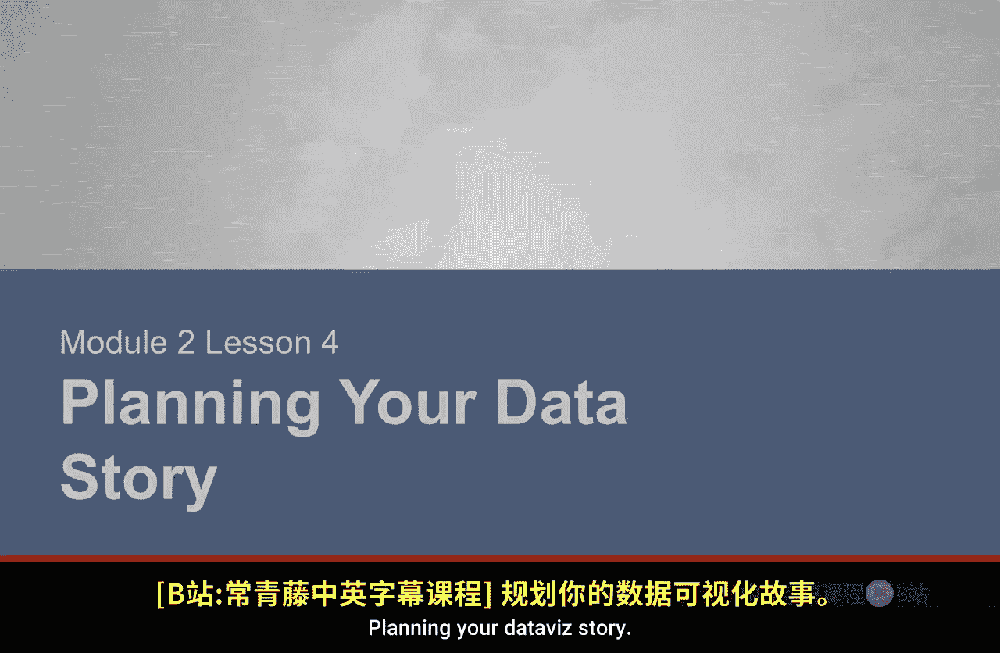
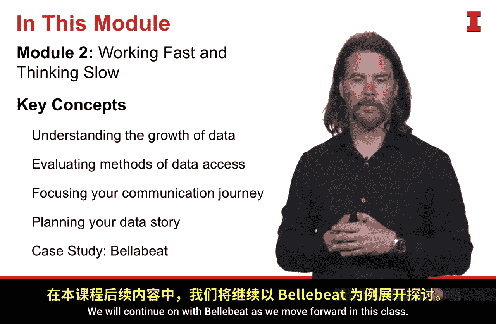

# 伊利诺伊大学【中英⚡商业分析｜Business Analytics Specialization】 p71 P71 05_第2-4讲 规划你的数据故事 -BV1z86nB9EGz_p71-

Planning your data Viz story。 So let' let's talk about how we develop that connective tissue between the information。

 the data we've collected and the objective that we're working against。

 This is our story right and this this story we know is a vital part of creating a successful visualization and does just that it really does become that connective tissue between our our data and our goal。

 Now， organization。Is of utmost importance here， we need in the story we tell to be organized so that we can communicate effectively to our audience and lead them through a narrative efficiently and effectively to that end。

 I want to introduce you to Bara Minto Barbara Minto is a Mackenenzie consultant who developed a brilliant set of concepts that she called the Mento pyramid principle。

And this principle basically said that any statement that is made needs to be supported by facts and the statement must be a perfect summarization of those facts。

 she had a couple other rules， the first one is that the most important that a statement we make must be a good summarization of the elements that we're using below it to support that statement。

Those elements， the facts that we're using to support that statement must all be similar in some way。

 a like group， right we want apples here， not apples and oranges。

And then the ordering of the facts as we display them should be something that is unsurprising to our audience。

 either we either order them in time of occurrence， from earliest to latest。

 from biggest to smallest， something that will make sense to them。Now， I used this term before。

 but this is where the idea of mey， mutually exclusive， collectively exhaustive comes from。

And as Mento pushes us here。The facts that we are using on a single line should be mey。

 They should be mutually exclusive from one another as well as collectively exhaustive when we have that。

 we know we have a robust wellorganized story。 This is the way we should think about organizing the story we're telling and not in a single pyramid。

 you can use as many as you want， depending on how many chapters you have or points you have in your story。

 but this kind of organization can be very important。

 what it can also do is really lead us as we begin to plan for how we want to collect data and use data。

And in that way， if we don't have a statement yet or a set of facts。

 we can change that statement to an objective that we state in we phrase that in terms of a statement right so the objective that we talked about just in the previous lesson becomes that objective that we're after we don't have facts yet。

 but we do have hypotheses we do have key questions so we can start to think about what those are in place those together。

 this will help us if if we can articulate these questions correctly and ensure that this whole thing is mey it will help us develop a robust and solid story again。

 we will want to apply the same rules that we would to a finished statement and finished story to our planning process。

 this will point us in the right direction and move us toward the right story that we ultimately want to produce。

Each of those key questions， the hypotheses that we developed。

 we will want to support with some kind of data and in this way then we can develop a plan to go out and collect information。

 collect data to prove or disprove a hypothesis， answer the key question that we've developed and then ultimately roll up to some statement and these things all fit together nicely in a well organized story。

That's complicated， so let me try to show you an example and to do this I want to introduce a company named Bellabby。

 this is a real company， but we're going to use them illustratively here。

What Ba Beat produces is high tech very beautifully designed instruments。

 primarily for women who are pregnant， what you're seeing here is the device called the She。

 which allows a pregnant woman to hear her baby's heartbeat。

 it can also be turned around and send music to the child。

They have a couple other well designeded products as well， one on the left here called the leafaf。

 which is an activity tracker that looks more like a piece of jewelry， it's a beautiful piece。

 and then on the right is something that's called balancealance， which is a Bluetooth enabled scale。

 all of these products are well designed and incorporate great technology。

 but most of them are not known for sure。Beabby， whether you're talking about leaf， balance or shell。

 are facing an awareness problem， consumers， particularly women caring children。

 do not know of their existence why these products would probably fit many of the needs that they want。

 they just don't know about it。So we can construct based on that objective。

This design in the Men pyramid scheme。At the very top。

 we put that objective of building awareness and we're doing this in the form of a statement right to increase sales which is the ultimate output and objective of Bellabbeep。

 they first must must grow awareness so there we have captured our goal。

 growing awareness in a statement now underneath that we start to look at some key questions that will help us help us determine the plan or the approach that Bellabbe should take to growing awareness and to ensure that we have a mey set of questions。

 one of the things I like to do。Is to begin one question with the word what？

The second with the word how， the third， with the word why， if I can answer a what。

 how and why question about the statement I've made。

 I know that I have a certainly mutually exclusive set of questions that I'm after。

 but also a very robust and complete view of that statement。

So in this case I will say what is the level of awareness for Bellevbe today。

 certainly an important thing to know， I will want to know how has the awareness for Bellevbe changed over time。

 I will want to know as a why why is awareness critical to Bellabbe's product adoption just to prove out that right and then under each one you can see I can articulate a data source that will help me answer that question in this way I have formed a visual outline。

For the communication journey that I am about to set on using data that I know will answer a question that I know will support an ultimate goal and objective。

 You can see how all these things from story storywise would fit together very well。

 So that minto idea really does offer an excellent way for us to organize data stories。

 it ensures that the statements that we make are all supported by facts。

 it introduces this concept of mutually exclusivity and things being taken together collectively exhaustive。

 ensuring that we are communicating sound ideas。 the guidelines provide excellent structure for any story。

 organize clear and concise。 and this will also ensure that the approach we take in collecting data and the analysis that we do will be sound。

 as this becomes the plan that we begin with in this module， we looked at a number of things。

 we took a look at。This explosive growth of data really seeing that there is no better time than now to understand how to communicate effectively with data。

 we looked at methods for evaluating we evaluated methods of accessing data。

 how do we get our hands on as analysts， the data， what are the right paths and avenues。

 what are the wrong ones。We looked at an approach to focusing our communication journey through the use of a goal and an objective。

And then we looked at through the Mento pyramid principle。

 this idea of how we can start to plan our data story and layout in visual form a good outline we used again。

 the case study for of Bellab Bea to really illustrate those concepts and we will continue on with Bellabbe as we move forward in this class。

