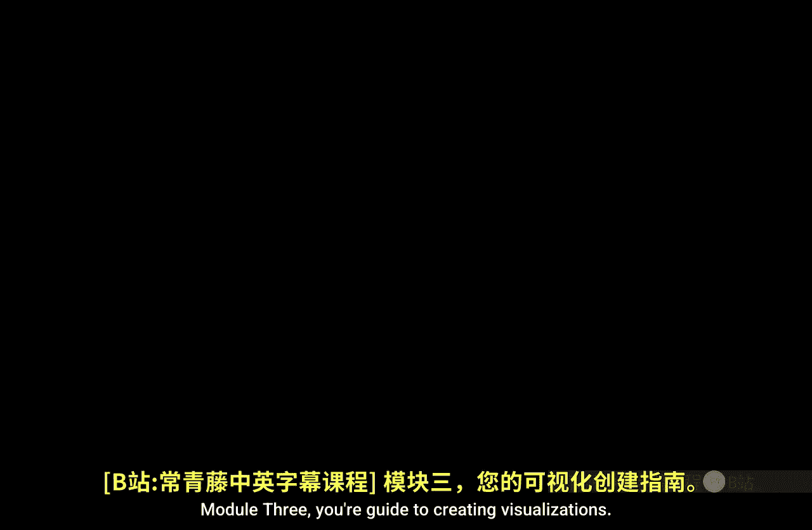
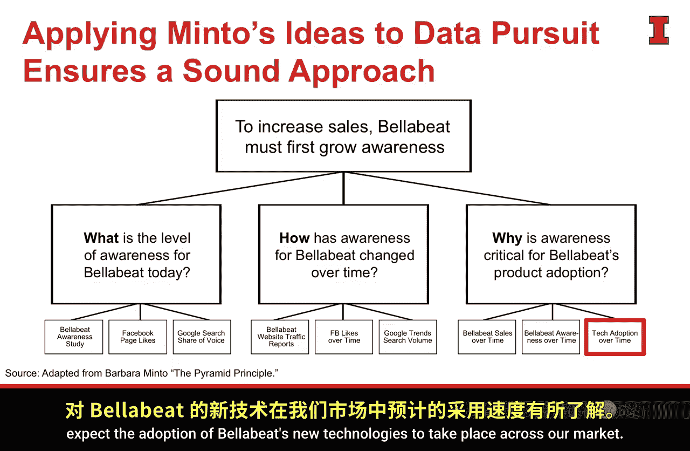
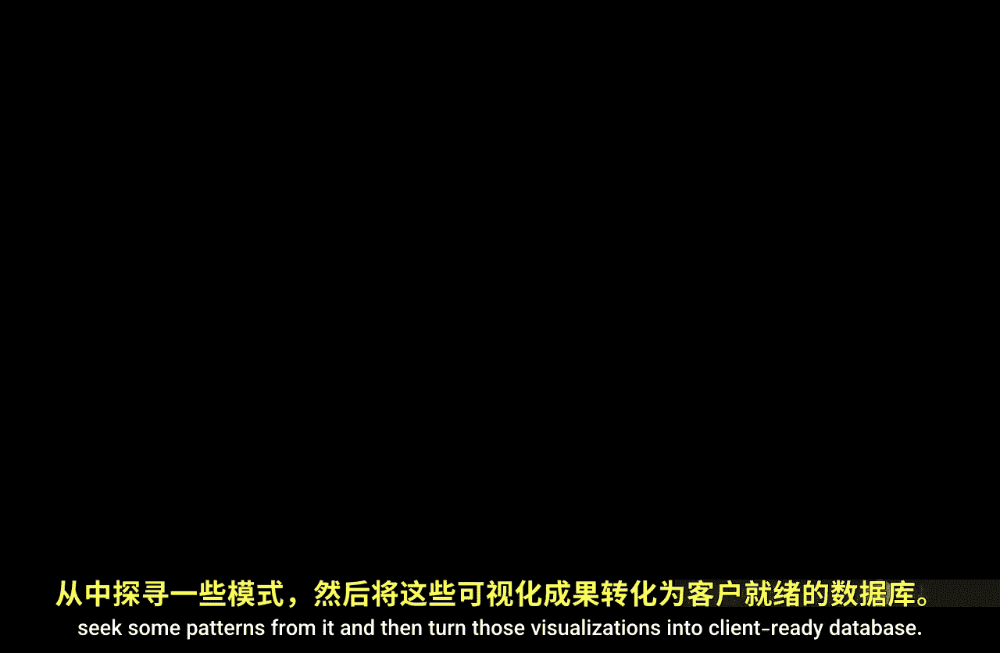

# 伊利诺伊大学【中英⚡商业分析｜Business Analytics Specialization】 p72 P72 01_模块3概述 -BV1z86nB9EGz_p72-

Module3， your guide to creating visualizations。 So now we have moved through many elements of the framework we're using to define good data visualization。

 and in this module， we're going to really focus in on the visual form。

To do so， we'll talk about a few key concepts， we'll talk about finding patterns in data。

 we'll talk about being planful in the way that you approach the creation of your data visualization。

We'll talk about having the understanding of the components of visual form， what is good visual form。

 we'll introduce a framework that will do that， then we'll talk about creating inviting data visualization。

 data Viz， we'll give you a definition there。In this module again。

 we're using this framework which has guided us along the way and shown us the elements of a successful data visualization。

In the next lesson， first lesson of this module， we will be focused in on the visual form。

 actually from here on out， we're going to focus on the visual form。

Remembering our Bellevby case study， we have constructed an outline for a story。

 right we identified an objective。 We found some key questions that we know are mey and pretty robust and complete。

For each of those key questions， we've identified a data source that will help us answer that。

 Now we are going to focus in on this last piece of data， tech adoption over time。

 which will help us in our case study， answer the question。

 why is awareness critical to Bellevbe's product adoption through this data and through the analysis we hope to show that adoption over time of technologies have led to success for those technologies and maybe even give us a sense for how quickly we should expect the adoption of Bellevbet's new technologies to take place across across our market we have also found data that's where we are and as we move through this module we'll start to analyze this data。

 seek some patterns from it and then turn those visualizations into client readyy database biz。

