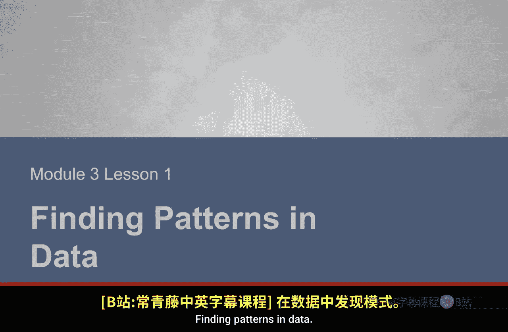
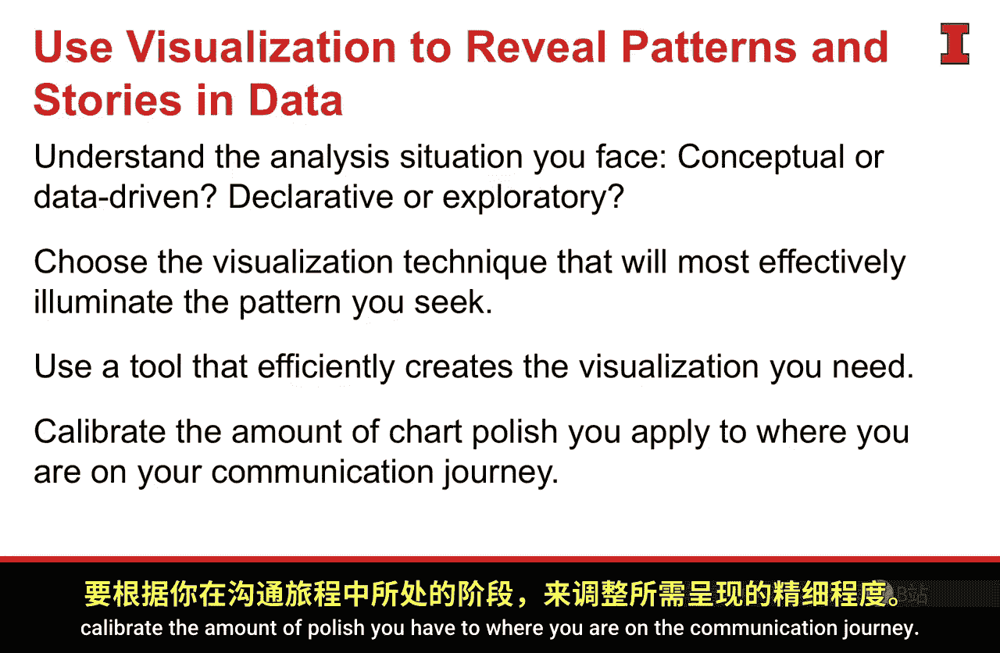

# 伊利诺伊大学【中英⚡商业分析｜Business Analytics Specialization】 p73 P73 02_第3-1讲 数据中的模式 -BV1z86nB9EGz_p73-

Finding patterns and data now that we have data， we want to start to identify the stories that we see and the best way to do that is to visualize that data and see what patterns jump out。

 There will be things that come to us through visualization that we wouldn't be able to see when the data is in tabular form。

 but before we dive in。Let's get an understanding of the different types of charts that we will create and a framework is laid out very well by Baroninato。

 and he asks a couple very important questions to assess where you are on your communication journey and then what sort of chart you should use and the two questions are。

Are you at a point where you are conceptual or data driven， do you have data or not？

And then the second is， are you at a point， a stage where you can be declarative with a message。

 you have something that you want to tell and communicate。

 or are you still exploring and looking for that data depending on how you answer those two questions determines where you are on your journey and therefore the kind of effort that you need to put in and the type of chart that you need to create。

So those two questions then translate well into this two by two and at each phase。

There is a different type of chart that you will be creating if you are declarative but yet conceptual。

 so you are trying to tell the story through not data， but through concept。

 you are creating what Bonnato would call idea illustration。 idea generation is conceptual。

 still exploratory， still trying to figure out how we put a concept visually in front of an audience。

 visual discovery is where we are being exploratory with a data set so we're looking into that data。

 trying to find our story and everyday data is what I might call client ready data is a declarative statement based on data。

 We have a story we want to tell。 We want to get that in front of a client and audience。

At each of those phases， there's a different type of chart we'll create conceptual declarative is something that we want to put forward。

 so we do need to put some effort into creating a conceptual chart like that conceptual exploratory。

 We don't really know what's going to stick。 This is in a room with your teammates brainstorming and drawing ideas on a whiteboard。

 The things that are more important for us in this course are on the right side of this framework。

 This is where we are being data- drivenri and we will really be talking about two different phases。

We are either in exploratory mode， we have data we don't know what the story is yet。

Or we are in declarative mode with our data。 We have our story set。

 We want to communicate that story， and that's going to have great implications on the amount of time that we spend polishing our data biz。

Where we are today。Is simply looking for patterns， so there is no need to polish these visuals。

 What we're going to create is work product is for our eyes only。

 It is allowing us to test the hypotheses that we have or answer the questions that we've asked looking for patterns。

And when we do that， there are five different type of patterns。That we will be looking for。

 We will look for change， either change over time and a trend or sudden change。

 We will look for clustering， a collection of data points that are similar to one another and yet different from others。

 We will look for relativity， how two different data points relate to one another。

Ranking what is best， what is worst， what is at the top of the scale。

 what's the lowest at the scale and in everything in between， and then correlation between datas。

 how does one set of data influence or impact another。

 Those are the patterns we should be seeking because each of them reveal a story。Now。

 when we are looking for those patterns， there are certain visual techniques that will reveal them。

For instance， if we're looking at change over time， a line graph is a fine way to identify that。

A pie chart might be great at depicting relativity， it is not going to reveal forest change。

Putting a data set that we have into a pie chart will not tell us or answer any question that we have relative to change。

 It's important for us as an analyst to identify the techniques that we'll use to answer the questions that we have and ensure that they are in alignment there。

These categories of change and this idea that certain visual forms fit with each discrete category is not unique to having data。

 this works on conceptual ideas as well， when we are dealing with conceptual ideas。

 you know we're looking for either a description， a classification， structure evaluation。

 some process， and for each of those different conceptual ideas。There is a visual form that works。

 and then a number of others that wouldn't for that particular conceptual form。 again。

 for an analyst， if we are revealing or trying to declare conceptual ideas。

Ensuring that we're using the right visual technique。

 the right visual mnemonic to make that point is important。So let's see this idea come to life。

 we'll use the Bellabbe case study that we've been tracing， again。

 we're at a point where we have data and we're able to start to assess the adoption of technologies over time as we seek to answer the question of why awareness is important for Bellabbe。

If we were to take this data and throw it into a visualization， one of the things。

 one of the visual technique that we may use that would work well would be a line chart we know from the previous conversation that that aligns。

That line chart would show adoption over time， and from this point we can start to pick out the interesting stories that will either answer our key question or allow us to know that we need to go back to the drawing board。

Now to do this at this point， one tool that I find useful is R I talked about R before。

 but R does a great job of moving an enormous amount of data。In visualizing it really efficiently。

 you can create box of time series plots or relationship plots， histograms。

 box plots even using the power of our and the community of developers。

 you can find scripts and new packages like G pairs you see described here that do things that other programs are not able to in this case。

 do tremendous correlation across a wide variety of data in one single visual so that you as an analyst know where your story is and where it is not these things are important to us because the most effective and efficient way for us to get at data and get at data stories is to visualize that data and start to see these patterns to do that。

 we do need to understand where we are we need to understand if we're dealing in conceptual matters or datadrin matters。

 we need to know are we in a state of declaring a story。

Were still exploring the answers to those questions dictate which type of chart we use the visual technique that we apply to seek either to reveal or ultimately to communicate that pattern needs to fit with that pattern and so as an analyst getting familiar with the techniques that you can use and when to apply them appropriately is important。

The tool that we choose should provide the visual technique very efficiently at this point。

 efficiency is very important。 We don't want to fumble around with a hard to use tool to get at the visualization we want to create。

 learn those tools that do work for you quickly so that you can move on to the next phase of your evaluation and your analysis and then finally importantly。

 calibrate the amount of polish you have to where you are on the communication journey when we are exploratory with a data set it doesn't matter if the visual looks great yet。

 we're not going to show that visual to our clients to our stakeholders it's for our eyes only。

Once we start to migrate into what Baronnato calls everyday data is or client ready data is。

 we do start to apply that polish， utilizing preattentive attributes。

 doing the things that are going to make that message stick quickly。

 but at this point it's not relevant， not necessary， and it would only serve to slow us down。

