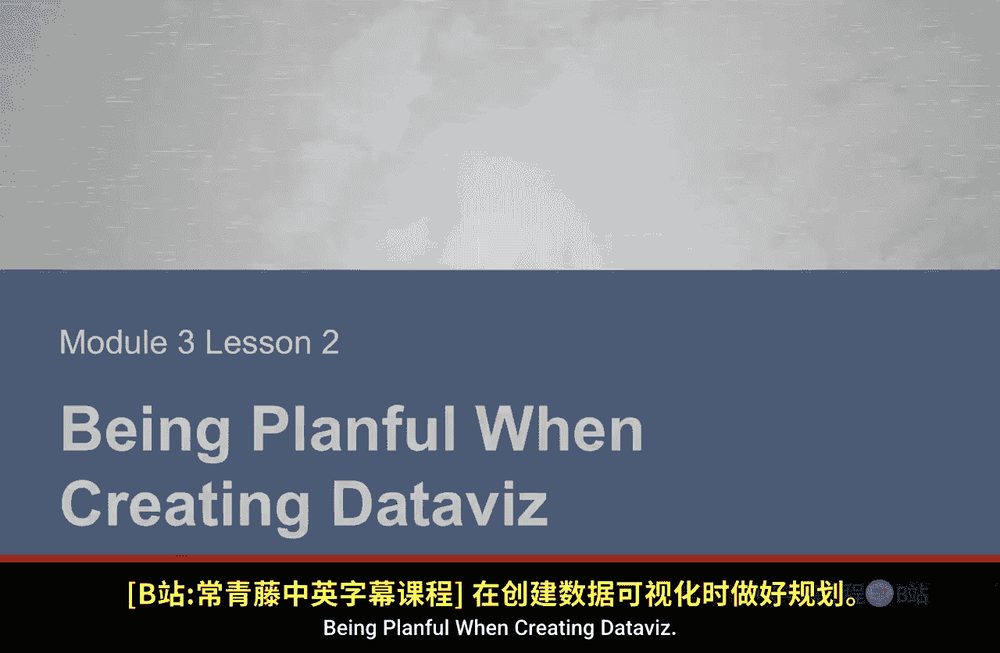
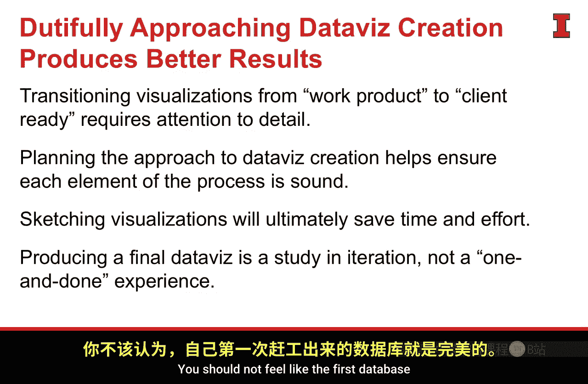

# 伊利诺伊大学【中英⚡商业分析｜Business Analytics Specialization】 p74 P74 03_创建数据可视化的计划性 -BV1z86nB9EGz_p74-

Being planful when creating data isz。 So now we're starting to migrate into this everyday Datavisz or this client Read Datavisz。

 and when we do this， our approach is going to change。

 we do need to start putting more attention to detail。

 We need to apply more polish to this visualization because this is what we're going to put in front of our stakeholders。

 So the kind of effort is going to be notched up a little bit on on this visual。Again。

 we are moving from a point of visual discovery to everyday Data biz， and Baronnato lays out。

 I think， a very solid plan on how we might approach that transition。

What he says is that if he had an hour to spend creating an everyday database bi。

 he would break it up in this way， he would have five minutes of prep where he would actually create the mental。

 physical white space that he would need to work appropriately。

 he would then talk and listen for 15 minutes， so gaining further context。

 understanding who the audience is that he is presenting to and and and informing him informing the ideas that he'll need to achieve with that everyday data is。

The second two third of the time are spent actually on the imagery and creating the visual half of that time。

 20 minutes。Is spent actually drafting。By hand， kind of an old world traditional concept。

 but in this case works very well。 Prototyping and improving then is the final one。

 So that that first five minutes really is used just to clear your head and get yourself ready for work。

 the talking and listening， the following 15 minutes。

The purpose there is to get understanding of what it is you need to achieve。

 you've got this great insight， you think you've got a good story， validate that。

 work with your colleagues to ensure that it is on Mark that it is on path。Once you have that。

 start then towards the actual development。The sketching piece is a bit of a lost start。

 and I think too often we take this idea that we have and we rush into our applications and start using our computer to generate graphics。

 Well， if we just took a moment，And with pen and paper visualized some ideas。

 we would no longer be limited by our understanding of of the package， the application。

 or the limitations of the application itself we could just design where we're reliant only on our creativity。

 this is something that the great data visualization artist do David McCs certainly does。

 I shared this image earlier where he with pen and paper。

 drafts every data visualization that he creates。It's a good practice。

 it's a good habit to build and will make you more efficient and ultimately better at communicating with data。

After that is done。20 minutes， the final one third of this hour is spent prototyping and improving the visual。

 The idea here being that the first visual you create shouldn't feel like the last visual。

 it is a starting point。You can begin then in your application to improve it over time and there are techniques that you can apply to make it incrementally better as you go that is important too often we feel like we're putting all this effort into a final data Viz。

 we should think of it more as a fluid process and iterative process indeed。

So being planful at this point is important， and as we transition from this work product output into client ready Data。

 this requires more attention to detail。Planning our approach out and being dutiful about that really does ensure that each element of that process is sound and will build ultimately to a great data visualization。

Sketching， pin to paper is a underrepresented art that should be something that you build as a habit of your own。

 will save you time， willll save you effort ultimately。

 and most importantly will allow you to open up your creativity as you think about the way that you might effectively visualize the data and the data story that you want to tell。

Finally。Producing that final data is， it is a study and iteration。

 it is not a one and done experience， you should not feel like the first data is that you're going to crank out is the right one。

Put out a data Viz， work with it， apply apply some some of the tools that we'll talk about later on in the course to make it better and better and really treat it like a living。

 breathing， iterative data visualization。

