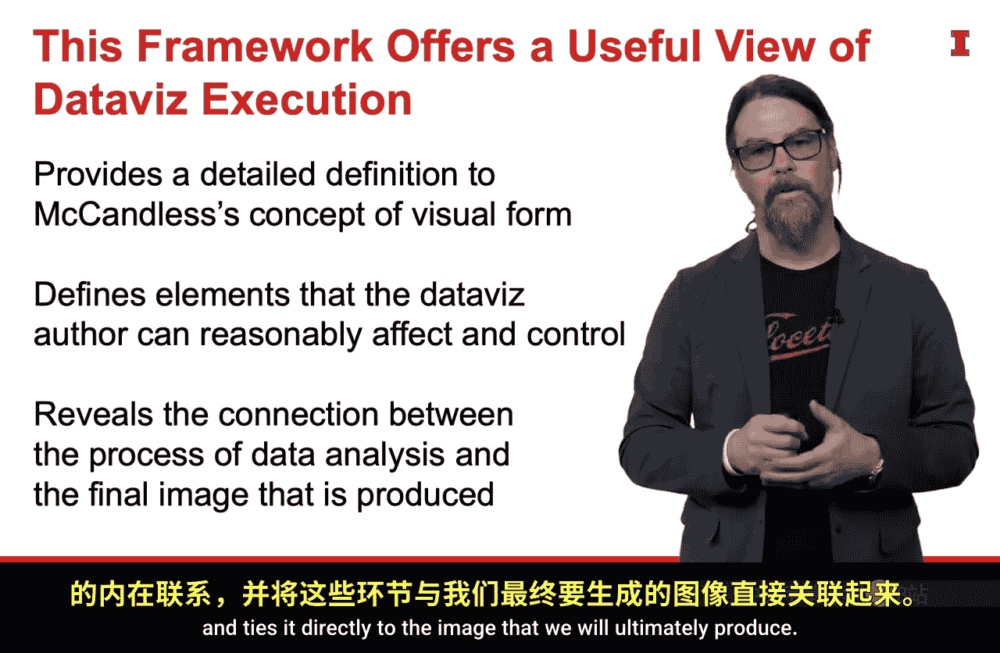

# 伊利诺伊大学【中英⚡商业分析｜Business Analytics Specialization】 p75 P75 04_第三讲 第三部分 视觉形式的构成要素 -BV1z86nB9EGz_p75-

Understanding the components of visual form up until to this point。

 we've been using a framework that has displayed to us all the different elements。

That need to go into a data visualization for it to be successful。

But we really haven't delve too far into what good visual form really means or really used any kind of definition of that。

 That's what we're going to talk about。Right now。So here is this framework that we've been using。

 again， every single element vitally important， the visualization only works if they are all present and all successful。

This idea of the visual form， the actual picture that we're creating as we communicate with our audience is very important。

 but to this point we don't really know what makes for good visual form and what doesn't。

 so I hope to provide a little bit of a definition there。

And as we think about what makes good visual form， there's really a three part framework that helps us answer that question。

Good visual form has three different elements。 It has very clear meaning， right。

 It has sophisticated use of contrast。And it has refined execution。

Clear meeting clearly communicates the intended insight。

 that insight that we have worked so hard to pull out of our data。

Sophisticated use of contrast draws our audience's attention to the elements of that chart that we want them to see and keeps them away from those distracting elements that we don't want them to spend much time on。

And finally， this idea of refined execution puts a lot of polish on the visual。

 it gives great attention to detail and it also serves to keep our audience focused on what is important and not to be distracted by those elements that aren't as important on our page。

This framework is important for a number of reasons and I like how it ties back to the original five step Mcchans framework on visual form。

ItIt does that tie very directly， right we are taking this element of McCans's framework。

 that being visual form， and we are defining what makes for good visual form inside of that framework。

It also then reveals that connection between the process of data analysis。Data collection。

 setting a goal， all those important elements that we've been talking to up until this point and ties it directly to the image that we will ultimately produce。

