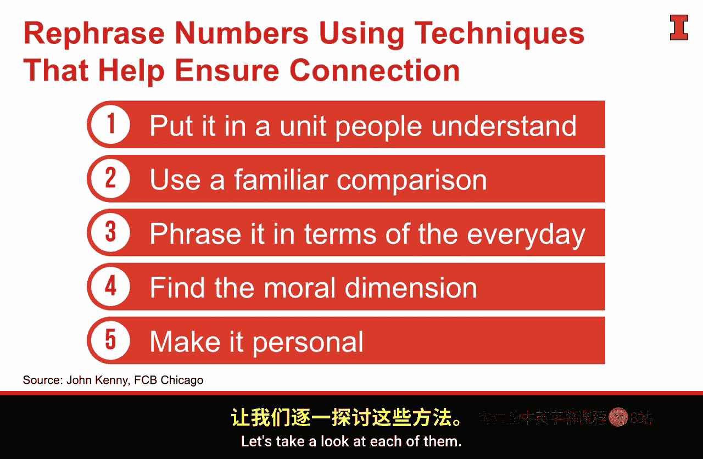
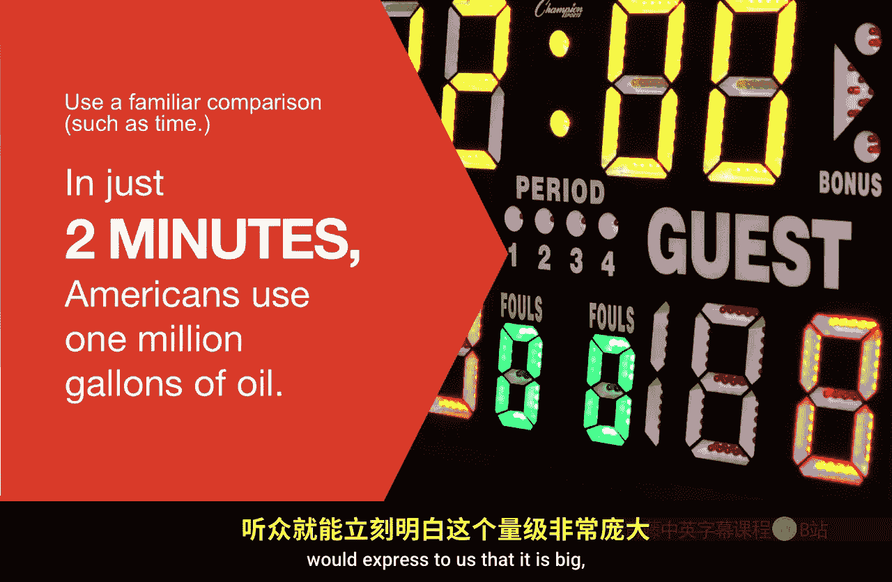
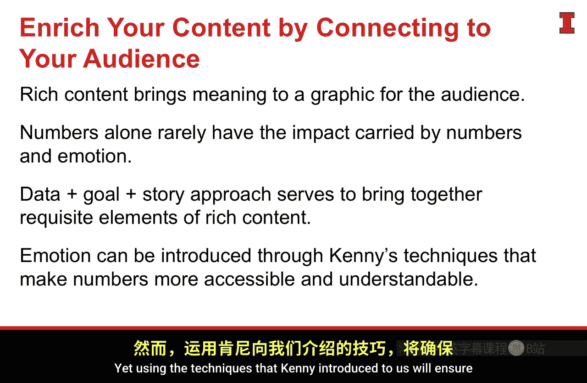

# 伊利诺伊大学【中英⚡商业分析｜Business Analytics Specialization】 p76 P76 05_第三讲第四讲 通过连接丰富内容 -BV1z86nB9EGz_p76-

In riching content through connection。 So let's take a look at how we bring rich content or ensure rich content to our data story and our data visualization。

 Much of this， as we said， will be covered in our process of collecting data。

 moving towards an objective， building a story。 like if we're doing all of that correct。

 then we will have a very good opportunity。To present rich content。

 but there are some things that we can keep in mind that will help us ensure the richness of the visuals that we're presenting。

These are all， as we know， elements of good visual form using the framework that Donna Wong has provided。

 and we are focusing here on developing rich content the importance of this I think was really summed up well。

By Anne Sullivan， with this famous quote， the best。

 the most beautiful things in the world cannot be seen nor even touched， but just felt in the heart。

 We should keep this quote in mind as we are presenting our data story because throwing facts and just figures at an audience。

 will not make an emotional connection with them。 It will not have the kind of impact that we want our story to have。

So we can do that though， by developing rich content。And the way that we phrase numbers here。

Will be important and help us determine and help determine whether we're making that rich。

 emotional connection with our audience or not。 Let's take an example。Here's a figure。

US consumes 7 billion7117500000 barrels of crude oil annually。 This is purely fact。

 It seems like a great amount of oil， but really， we don't have any context here。 We just don't know。

The reality is that this idea of millions and billions。

 these are foreign concepts to most people throwing out that figure will tend to just go right over their head。

 Sure it seems big， but we don't really have any emotional connection to hang on to。For this reason。

 John Kenny， my friend and head planner at FB in Chicago developed these five different ways to frame or position numbers to ensure that you are making an emotional connection to ensure that we are using rich content。

 these techniques will get you there。 Let's take a look at each of them。

The first is putting your unit， your number in some unit that people understand。

 so in this case we've taken that idea of 7。1 billion barrels of crude oil and we've rephrased it in this way。

 Americans use enough oil each day to make 36 billion plastic water bottles now we're using billion here as well。

 but we've tied to an item。That consumers understand， no doubt as you are watching this video。

 you probably have a water bottle near you to imagine 36 billion of those puts that into immediate context and is very understandable。

Another technique is to use a familiar comparison like distance each day Americans use enough oil for 39 trips to the sun and back。

 we see the sun every day， at least every good day and to know how far away that is we might not understand it in miles。

 but we do see that it is a long ways away， to think that we as a country。

Use enough oil to make 39 round trips is an enormous amount of oil that is putting it in much better context held on to the comparison that we understand the distance to the sun。

 Another type of familiar distance familiar comparison can be in time。 In just two minutes。

 American use1 million gallons of oil。 Again， we don't really understand millions and billions。

 but we know it's big， And we know that two minutes is a time frame that we can put we can understand and put context around。

 So to say that we use a million of anything in two minutes would express to us that it is big because that that familiar comparison of time makes sense to the audience。

We can phrase this this number in the terms of the everyday。

 Americans use 48 times more oil than water every day。

 We don't necessarily see the oil we're burning。 We know when we ride our cars we're using oil。

 We know when we heat our homes we're using oil， but we don't actually see that happening。

 we see the water we're drinking。 We see the water we're putting on our yards。

 we understand the use of water to know that nearly 50 times more oil is consumed。

 then the water that we see consumed， that is saying something and that for an audience puts that number in in the terms of the everyday。

Another approach， one that can be sort of high risk high reward is the idea to find the moral dimension in this case。

 we've phrased at 7。1 billion in this way。In less than four decades the world's finite oil supply will be gone forever。

 that can have a very emotional connection， it can also be very polarizing this technique。

 so you have to practice this appropriately and understand where your audience is coming from so that you don't run the risk of offending or disassociating or turning your audience off yet this can be a very strong and effective technique in phrasing numbers in an emotional sense。

Finally， we can make those numbers personal。 In this case， an example would play out in this way。

 In a year， a typical American family uses 70 barrels of oil。 This is what it means to me，70 barrels。

 I don't really understand how much that is， but I know these barrels are large。

 I've seen photos of them。 I seen I've seen them on television。

To say that I and my family will use 70 of them seems like a lot of consumption。

 much more than I would have expected from myself。 I have just taken this number 7。

2 billion and I've made it personal。 I brought it down to the personal level so that I understand directly my impact。

Using one of those five techniques when we are talking about numbers。

 making those numbers that we're throwing around more relatable， more impactful。

 will help ensure that we are indeed using rich content and making an emotional connection when we're talking to our audience this emotional connection is important for us。

 because we are attempting to either influence our audience or connect with our audience through a recommendation we have whatever it is we're trying to do to achieve an objective。

 so making that connection is indeed important。 In fact。

 it brings meaning to the graphic that we're displaying numbers alone rarely do this and they rarely carry the impact and the emotion that we want using those two things together numbers plus emotion will have far greater impact on our audience。

The process we've gone through of collecting data， identifying a goal， putting together a story。

 this approach will help ensure that we are building rich content into our story for sure。

 if we have deep robust data， if we have a clear goal， if we've got a good story。

 much of the elements are there。Yet using the techniques that Kenny introduced to us will ensure that we're making the best use of emotion and accessibility when presenting these numbers。

