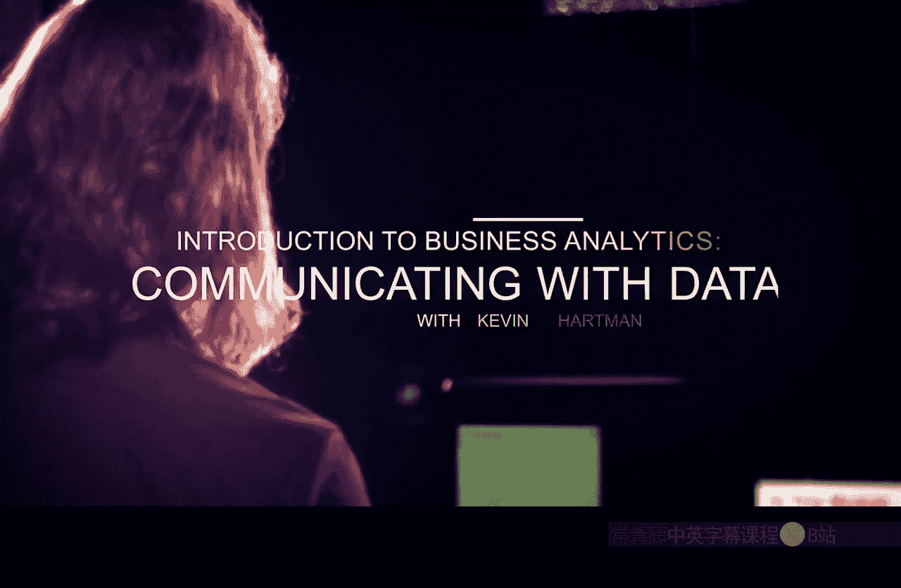
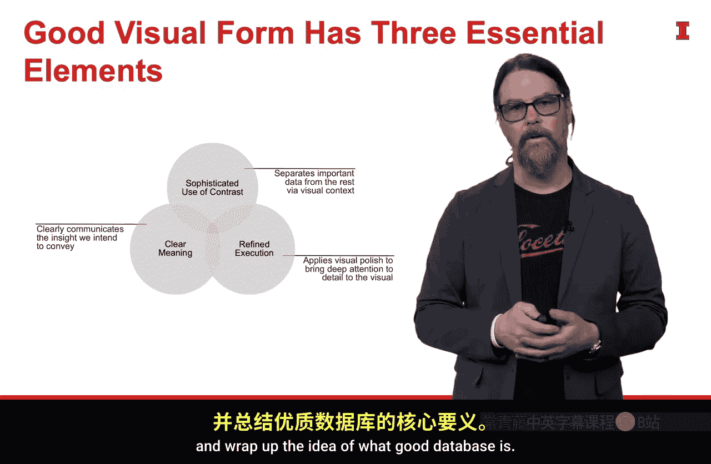

# 伊利诺伊大学【中英⚡商业分析｜Business Analytics Specialization】 p77 P77 01_第4模块概述 -BV1z86nB9EGz_p77-

。

Module 4 getting your story across a number of important concepts that we're going to talk about here in this module。

 one is this idea of enriching content through contrast and using contrast in a way that draws our audience's attention to those elements that we want them to see and away from those distracting elements that we don't want our audience dwelling on。

We'll also talk about bringing sophistication to charts through some great guidelines from Donna Wong that really applies a great deal of visual polish and takes our visual from good to great and helps us more efficiently communicate with our audience。

We will take a really pretty awful chart and improve it so we're going to get hands on and sort of walk through the process of applying all of these different guidelines and frameworks that we've been talking about。

And finally， we will be on our feet and present Data Viz。

 we have a process that will help us ensure that that's done in an impactful way that connects with our audience and does that。

 does that in a way that they will understand， and we can get our meaning certainly across。All right。

 just to root us in some of the concepts we've been talking about we have this Mcans framework which says here are the four elements of good data visualization。

 we spent a great deal of time talking about how we collect information， build a story。

 identify a goal， put all those things together， and then put it into a visual form that communicates the problem that we ran into what that framework is that it didn't go very deep into what good visual form was right and this is important because in our process we have been doing the visual discovery and finding the patterns in our data。

 we are now at a point where Baronatto would call everyday data is we might call client ready Data bi where we want to present them with a visual that immediately communicates the insights that we've found。

To do that， we need some idea of what good visual form is。

 and that's where this framework comes into play。It's the idea of having clear meaning。

 the idea of featuring a sophisticated use of contrast。

 and then finally the idea of featuring refined execution in our visual。

 we talked about clear meaning already， we're going to move into now the final two elements of this three prong framework and wrap up the idea of what good Data bi is。

