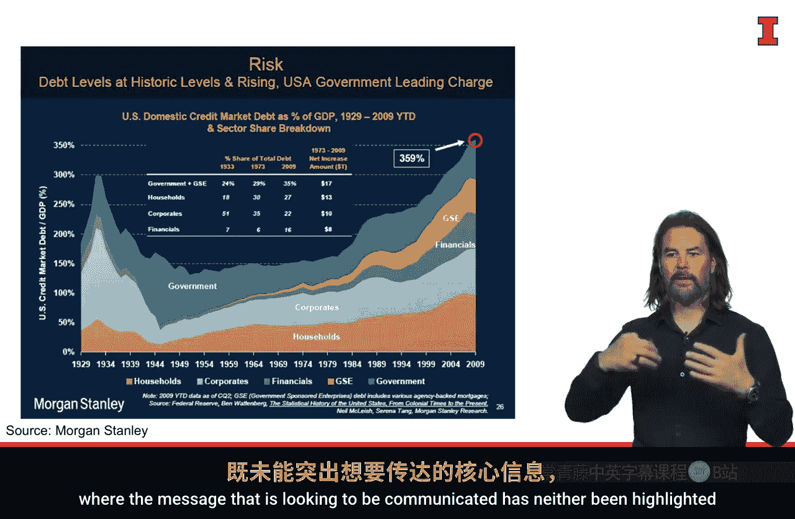
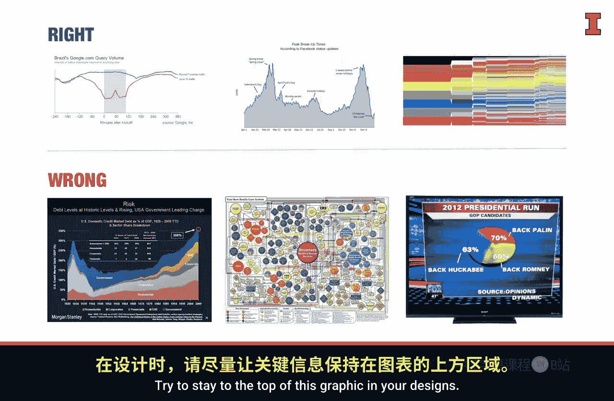
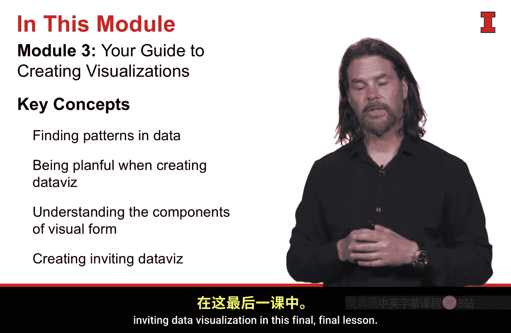

# 伊利诺伊大学【中英⚡商业分析｜Business Analytics Specialization】 p78 P78 02_第4-1讲 制作吸引人的数据可视化 -BV1z86nB9EGz_p78-

Creating inviting datavisz。 Let's start to look at the components of visual form that Donna Wong has laid out for us。

 again， remembering that there are three of them。 I want to now focus on inviting visualization。

 there are three different rules。That a inviting visualization really does conform to。

And those three rules are presented here， and inviting visualization will highlight a message。

 it will eliminate distractions， it will use visual cues to help lead the audience through the insight。

And it will finally use contrast， either size or color to capture the reader's attention and really direct them into the importance parts of that data visualization。

 let's look at each of them now， highlighting your message and eliminating distractions。

 Here's an example from Google that I think does that very well。

 you're looking at a very clean and simple graph。 This is the Google。

com query volume in Brazil on a normal Tuesday， which is demonstrated there on the graph in blue。

 and then on June 15。June 15 happened to be the day that Brazil was beginning the World Cup and so starting from four hours before the kickoff of that match through the match and beyond。

 you can see the difference in query volume on that day。

 in fact at kickoff query volume on June 15 has fallen off dramatically。

 everyone puts their phones away， they watch the match at halftime the query spike back up as everyone pulls their electronic devices back out and then it goes away again until the match is over and then it resumes normal traffic you can see very clear it's highlighted what you should be looking at。

 this is a graph that does communicate very effectively。Here is one that does not。

There's so much going on on this graph from Morgan Stanley。

 you have a area chart with a number of different colors。 you have a table inside that chart。

 you've got a number with a box and a circle and an arrow text there's so much going on here to overwhelm the reader mean this is clearly a case where the message that is looking to be communicated has neither been highlighted nor has clutter been eliminated in this case we're looking at some a graphic that does this correctly there on the left side of the screen a graphic that doesn't do that on the right and I think the distinction is pretty clear。

 Let's look at the second rule using visual cues to help lead your audience through your insight。

 heres a great example of that happening with Facebook data and looking at status changes and where status changes have occurred that are interesting。

 you can see direct labeling that points。

those things out points out the idea， the areas of the graphic that we should be looking at and will really deliver that message very cleanly and crisply。

 I know as someone looking at this graph where I should look and importantly what I should be looking to see and what I should take away from those instances。

Here's a case where this is done all wrong。 Here is an illustration of the healthcare system。

 it's enormously cluttered， there is nothing here that would as a viewer of this infographic allow me to navigate it to know what kind of insight I should be looking for there are no visual cues to help me consume or interpret this visual。

 So there again， something on the left that we should all be aspiring for toward a graphic on the right that we should not design。

Final rule， use in contrast， either size or color to capture our readers attention。

 here is a beautiful use of actually both size and color by Cola。

 And before even explaining this with with the very little。Text on this page。

 you can probably figure out what this is。 This is the the typical colors included in a Cayola box from when the company launched。

In 1903。Through to today， and you can see just how many more colors are included in that box。

 a very visual and beautiful representation there。Here's a case of that rule not being followed first off。

 using nothing but primary colors in a pie chart is not an advisable approach there is too much contrast here frankly and more importantly the size of the pie is so consistent and close that there's not enough size contrast to use this visual technique this is a case where the visual technique chosen does not fit to what the story really is finally whenever we put together a pie chart we should make sure that our slices add up to 100%。

So again， cases where this was done well， this use of contrast and a case where it was not done well at all。

 you can build these rules into your practice into your habit by just by paying attention to them thinking and evaluating every graphic that you create along these lines。

 have I highlighted my message， have I eliminated distractions。

 am I using visual cues am I guiding my audience through my insight and then am I using contrast am I doing that well？

Again， a set of correct uses of those rules and a set of incorrect uses。

Try to stay to the top of this graphic in your designs。

Let's see this then come to life in our Bellevbe case study so we have visualized data using a line graph and we see patterns from here there are a number of different things that we could do with this data and we might want to sketch those things out as we talked about to see which visual form really makes the most sense。

We could very easily introduce some contrast just by using color in this graph。

And cleaning it up a little bit with the removal of some clutter。

 a visual like this does give a story， but it is a broad story and probably not the one that we necessarily want to tell。

That's why this offering from Sity。com。Does capture all the meaning that we want to express and does it in a much cleaner crispISPR way。

 This is clearly the clutter has been removed from this graphic and moving forward。

 we would want to take a visual like this to really tell the story that we want to tell。

 eliminating the parts of the data that don't play into that story or don't have any bearing on the outcome。

So in this module， we've done a lot of things we've covered a lot of ground。

 we have talked about our ability to find patterns and data and to align the type of visual technique we are using to the pattern we are seeking and to be cognizant of the type of chart that we want to create we talked about being planful when creating database and that is specifically client ready or everyday database as we're moving to a place where we have a story we want to tell。

 we want to put a lot of attention to detail there and being planful in our approach helps us do that。

We talked about understanding the concept of visual form， the components of visual form。

 what does make good visual form， and we've arrived at the Donna Wong framework to say there are three different essential elements。

 and then we explored that first element of creating inviting data visualization in this final lesson。

