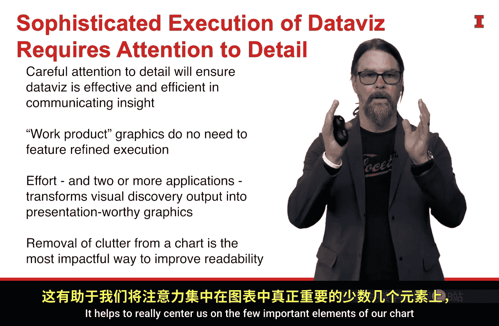
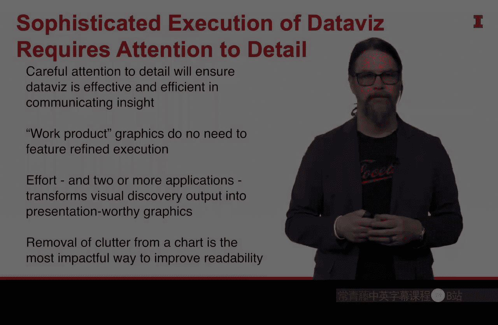

# 伊利诺伊大学【中英⚡商业分析｜Business Analytics Specialization】 p79 P79 03_第4-2讲-为图表增添精致感 -BV1z86nB9EGz_p79-

Bringing sophistication to charts， we're going to talk about how the careful attention to detail will ensure database is effective and efficient in communicating our insight。

 we're going to really look deeper at Donna Wong's guidelines because she has put together a tremendous point of view on that sort of visual polish in this import。

Remembering again， we are looking at the three elements of visual form that really answer for us what does good visual form do。

 we have talked about clear meaning and sophisticated use of contrast we're now on to the third element。

 which is refined execution。When we are building charts that are in our discovery mode and we're trying to find insights。

 our is a fantastic tool for that。 Our works very quickly and efficiently chugs through tons and tons of data。

😊，And it can present those patterns that will help us find the stories。

But in no way should we present a chart like the one you're seeing here that comes directly from our two clients there's two little polish applied here。

 even if the story is clear to us， an audience who has not been engaged in the data collection and all the analysis that we've done will look at this and see nothing。

 see nothing but a jagged line， So we need to apply some polish to make this。

 as Baronnato would call everyday data bi or， as I might call client ready data visualization and our can still be play an important role in that process。

 but it's typically to create visuals that look a little more like this。

 So what you're looking at are cycle higher journeys taken in London。

 This is when people are renting bikes from the city and using them to move across the city。诶。

The darker the line means the more travel through that route that part of this graphic came from R。

 that was a simple output from R R has the kind of power and the different packages to do that sort of really sophisticated analysis。

Once that output is collected， though， we then move it into a second。Platform。

 a separate separate program to clean it up and add some other elements that that make it a little more easy to understand in this case。

We have added a map of London and placed that underneath the R output of the cycle higher journeys。

That now gives us context to where these journeys are actually happening before they just would have looked like a collection of squiggly lines。

We've also added a subtitle， we've added a proper title。

 we've added some more information to this visual so that it does communicate a little more effectively。

These elements， though， are certainly things that we learn over time。 Look， Donna Wong said it best。

 She said， we don't start out writing editorials。 We start by learning the alphabet。

 We should take the same approach as we think about applying some of these guidelines because the guidelines that Donna W talks about that truly do separate good visuals from great visuals。

 are complex are there are many of them， some of them will certainly fly right in the face of habits that you have been building for your entire career in the way that you create charts。

 but I'm here to tell you that if you do adopt the practices that Donna Wong talks about。

 you will be you will be creating great data visuals。 Every single thing that Donna talks about。

Is helping to improve the legibility of the charts we create from the idea of font choice to the way that we present font on present text on a page from those ideas of direct labeling that we talked about before the idea of creating very unadorned line charts。

 not using data markers or never， ever creating a dotted line。

 just using different elements of color to bring contrast and striving for clean lines with clear signals in our visuals。

 these are the things that Donna talks about。As I've said， her list is long。

 some of it may feel a little wonky at first as you try to apply them。

But the more we can build the habits that Donna talks about， the better our graphics will be。

 and that is the power of this refined execution and the polish that we can place on our visuals。

A coupleup of things to think about then。Sophisticated execution of Data Viz really does require great attention to detail。

 this careful attention to detail will ensure that our Data Viz is effective and efficient in communicating to our insight。

 which is exactly what we want as we don't want our audience having to think too much about the visual that we're placing in front of them。

These work product graphics， these visuals that we're using to just discover the patterns in our data and really find those stories。

 they don't have to have refined execution。 Look， these things are for our eyes only at this point。

 we just want to create them as quickly and efficiently as we can so that we can get to that story after that we'll bring effort and often two or more applications to transform those visuals into something that is presentation worthyy what Baronatto again would call everyday data is what we would call client ready data is something that we could trot out to an audience and use to confidently communicate some kind of insight。

Most importantly of the guidelines that Donna Wong has given us is this idea of just removing clutter from a chart。

 it's the most impactful way that we can improve readability。

 removing that clutter keeps elements that will distract our audience from our main point away。

 it helps to really center us on the few important elements of our chart that we want to communicate。

 and in that way clearly communicate the insights to our audience。

