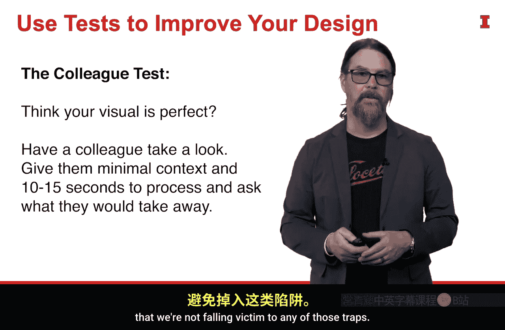

# 伊利诺伊大学【中英⚡商业分析｜Business Analytics Specialization】 p80 P80 04_第4-3讲 提高图表可读性 -BV1z86nB9EGz_p80-

Improving chart legibility。 And we're going to take all these great ideas that we've been talking about here in the last couple。

 last couple lessons。And apply them to really an awful chart and see if through the power of W's guidelines and the other kind of guidelines that we've been discussing。

 we can improve its legibility so we're going to go back to our Bellabbe case study。

 the experience there we have created a chart that is for all intents and purposes really ugly right this might be just a chart that comes out of R or Excel or some package that we've been using for analysis to help us find some kind of story。

Now， hopefully， after we've done that， we've done a little bit of sketching， right。

 We've drawn out some various ideas on how we might communicate that data more effectively。

 And now we've started， to create them and iterate them。

We could start by adding important elements like a headline， right。

 We could introduce some color changes。 Some of this stuff would go quite a ways in improving the legibility of this chart。

But still， there's too much even in this improved form that does not conform to what Donna Wong would want to see。

 and this， I think， will really illustrate how Donna's insights can take this from a pretty good chart that's certainly better than where we started。

Just something that is truly great and， and communicates more efficiently。

So if we were to apply some of Donna Wong's feedback， we might come up with something like this。

 that singularity created。 And and so it's the same data you're looking at。

 but they've eliminated a lot of the distracting data taken that out。

 They've added a more effective subtitle。And done a number of other things to kind of clean up that graphic。

 but still we're probably not to the point that Donna would want to see。

And if we go deep into the guidelines， Donna Wong has identified。

We would probably wind up with a chart that looks more like this。

And let me show you kind of walk you through some of the things that we've done now to go from that chart that was really bad to something that was better to something that now truly is free of clutter and communicates much more efficiently。

We have added a headline that in plain English says to our audience， here's what you're looking at。

It keeps them from having to wonder about what we're seeing， it's not cute。

 there's no jargon up there， it's just straightforward and it answers that question emphatically。

We've added a more detailed subtitle that gives away the insight。

 So now our audience knows not only what they're looking at。

 but they also know what they should think， or at least that idea is being planted in their mind。

We have moved the axis label from the right side of the chart where it doesn't really belong over to the left side。

 we have printed it in a way that is horizontal， the way that people write and people should expect to read。

 and that becomes very clear。We have used axis labels in a way that sets a year cadence that someone would understand this is every 20 years。

 no reason for us to print every single year of that axis and as long as it's in a consistent cadence。

 then it won't cause any confusion for our audience。

 we have also importantly then labeled what that axis is。And this does a couple things for us。

  clearly， anyone could look at this and surmise that those are years down there。

 but really what we are trying to communicate is the first year that this technology became commercially available。

 why not say that Why not put that on the chart because otherwise we would expect our audience to sort of divine that or we would have to explain it as such。

 and without it being written， our audience would forget it as soon as soon as they had heard it。

There are a couple tests that you can apply to really advance your data visualizations and help you make charts that are much better that do and include things like direct labeling and annotations to make them much more effective。

Those tests are presented here， One is called the Spartan test。

 the idea of the Spartan test is that we would take every single element on our chart and start to remove them one by one and after we remove them C does my chart change in meaning if it doesn't if that element didn't have much impact on the meaning we should leave it off entirely and we can go through that process inter interrogating every single element of our chart to make sure that we're only including things that are important and communicate some kind of meaning on the chart。

Second test is something that we call a peak test。We can print out our visual。Flip it over。

 F down on a desk for a while。 Leave it there for a bit， and then flip it back。

 and we can see where our eye is drawn。 And wherever our eye goes on that page is most likely where our audience's eye will be drawn。

 Is that where you want them to look。 If not， rethink your use of contrast that draws attention to the elements that you really want them to see。

 rather than where they are。 If your eyes， though， in this peak test。

 go to exactly where you want them to be， you're probably in a good place。

The third test and probably the most important test。Is this idea called the colleague test？

Now here we take our visual and we walk it down the hall to someone we work with who has had no exposure to the data we've been collecting or the client problem we've been trying to solve。

 and we show them our visual and we ask them plainly， what does it say？Now。

 if that colleague who has not had the benefit of any of the background， any of the context。

 any of the understanding that we've been working then can tell us the story that we want to hear from that visual than we're in a good place。

 but more often than not there are some elements that we're just not seeing because we've been too immersed in the data or we've taken too much for granted。

 and so this test can really help us ensure that we're not falling victim to any of those traps。

