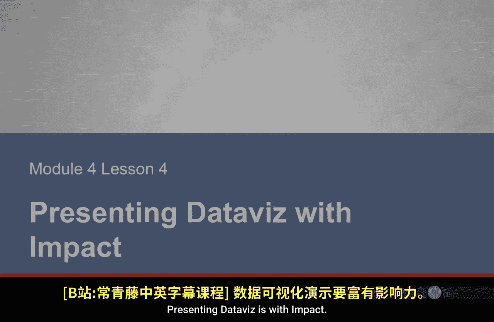
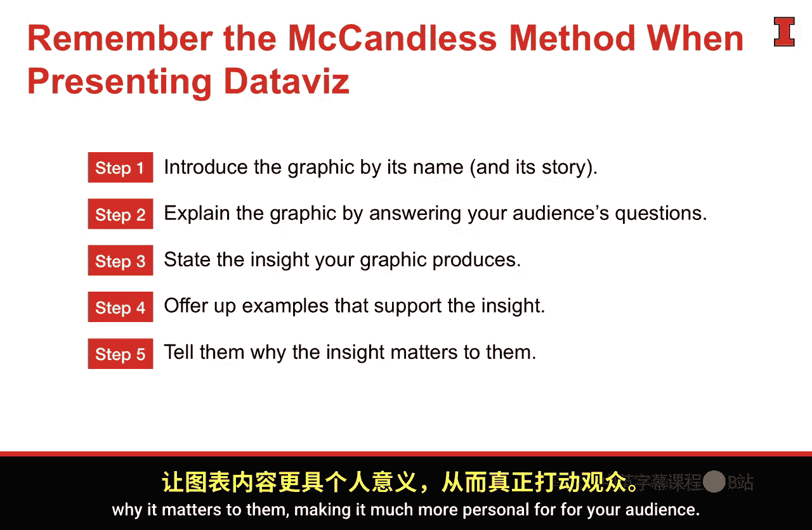
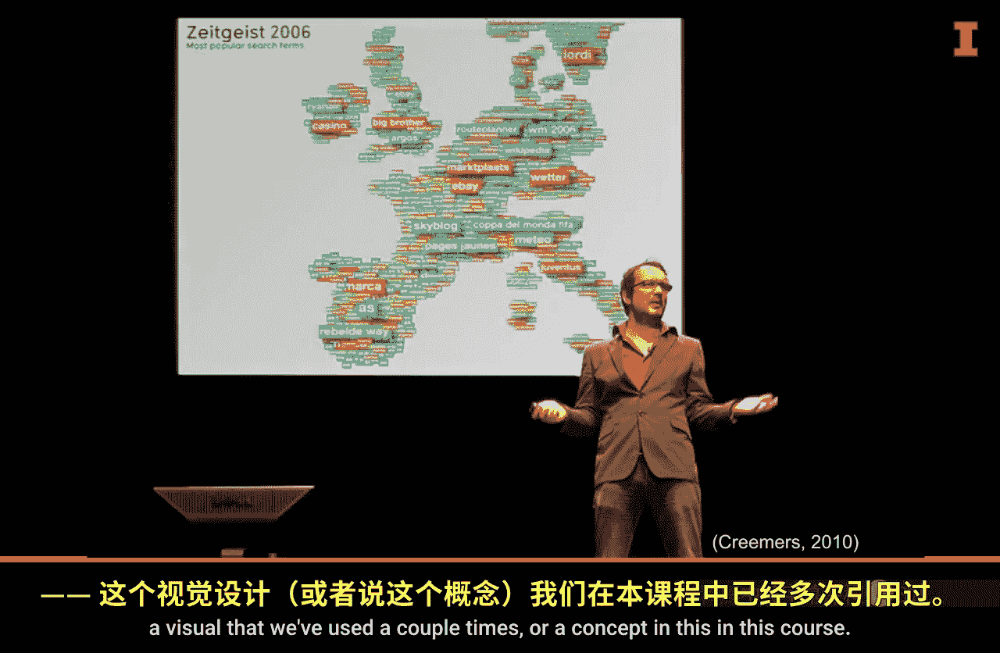
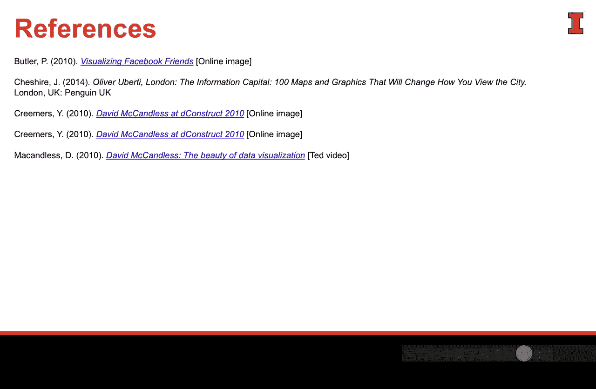

# 伊利诺伊大学【中英⚡商业分析｜Business Analytics Specialization】 p81 P81 05_第4-4讲 有影响力的可视化数据展示 -BV1z86nB9EGz_p81-

Presenting Data Viz with impact， we've come to the final step in our communication journey。

 we have done all the data collection and we've identified our objective。

 We've stitched together a story。 We have patterns that we found in our visualizations。

 and we put all sorts of polish on them so that they are client ready。

The last bit now is for us to stand on our feet and present that visualization out and communicate it effectively to our audience。

 there is a process that can help us here， it's something that I call the McCans method named after David McCans in the way he's presented his data visualization。

There are five easy steps to this。 The first step is introducing the graphic by name。

Giving it a story， if it has one， allowing your audience to focus on that graphic as the point of their attention rather than you。

Second step is to explain the graphic by answering the questions your audience will have。

 take the questions that will immediately pop into their mind right off the table。

 address them proactively， you gain a lot of perspective as you present the visual more and more you'll see what kind of questions pop up。

 ensure that those are the questions that you address immediately， proactively。

The third step is stating the insight from your graphic， give the story away。

 Tell them what they will feel or what they will see before youve provided the substantiation。

 giving that up front then sets your audience in a mode of substantiating。

 looking to support the work that you're doing。 You do that next by giving examples。

I for the longest time had those two steps reversed。

 I would build this great story through my insights and my facts and then give the great reveal what I hadn't realized was that I had lost much of my audience along that story。

 reversed those two。Give your insight first， then provide the substantiation。 Finally。

 you can bring this graphic home by telling them why it's important why it matters to them。

 making it much more personal for your audience。 you can see this demonstrated time and time again by David Mcans I think the best illustration that I saw was a TEed talk of his where he was presenting what he calls the billion clickogram a visual that we've used a couple times or a concept in in this course。

 Here's the way McCs did that。 This is the actual narrative that he used in presenting that visual and you can see clearly each of these steps utilized effectively。

 he begins by giving the graphic the name。 Now the audience understands what it is。

 It has some kind of association with the graphic。 And now their attention is on the graphic not on David McCs。

 He next goes in and。

away where he got the data source from， the data from， what the different colors mean。

 what the different sizes mean， we know that in our understanding of preatttive attributes。

 these are things that are going to jump right off the screen at the audience。

 Give them the answer to what those changes are。If you start into your story when your audience still has questions。

 they will not be there with you。 They will be thinking about the questions that they're hoping to get answered。

 ensure that your audience stays with you by answering those questions right away。

 The next thing that McCs does is he gives away the insight。

 He says this is why I am showing this to you。 This is what you will see in the data。

 right He is now established for them in their minds a statement of fact that they want to substantiate it's human nature for them now to seek justification for that。

He then goes into a couple examples that clearly illustrate and substantiate that insight。

 Now if he had flipped these again， he could have told a masterful story。

 but the audience either would have gotten lost on where he was going or might have not understood how everything related together。

 by giving the insight first and then filing with substantiation。

 you've done that in a way that your audience will better receive。Finally。

MCs takes this graphic and makes it much more personal for them。

 tells them why this is important to them bringing the whole thing to a close。

 You can do this method on any graphic at all。 here here's a graphic that I showed earlier。

 this is the way that I would use the fivestep process to explain it。

 This is the number of cases of measles in the United States from 1928 to to 2002 now you as the audience know what this is right go in and answer the questions。

 What does the color mean， these are things that you would be interested in knowing because that's going to pop right off the screen for you。

 then I tell you what it says， then I go in and show you cases that substantiate that right before finally talking about why this is important Another graphic that I showed earlier in the class as well。

 Here's how you would apply that in the fivestep process。

 This is a graphic of Google co query volume in the in Brazil。 you not know what this is。

 I take away the questions。 what does the blue line mean。 What。The the red line mean。

 what does the gray mean right these are things that you know your audience will want to know。

 take those away， give them the insight， follow up with examples。

 end it close the presentation by saying this is why this is important or what this means to you。

Those five steps will really help you take a graphic and ensure your audience understands it。

 it would be such a shame to put so much effort into the polish and visual that we are creating and the story that we want to tell and then lose your audience in those last five yards。

 right？Ensure that they are with you that they understand what you're communicating by following this mechanical method when you are presenting your graphics。

It's important for us to understand that this style。

 the way that we do stand on our feet and present these visuals that last five yards of our communication journey are very important。

 we run the risk of losing our audience and losing all the work that we've done to that point if we can't do this effectively。

 The questions that will pop into our audience's minds when they see our visual。

 will serve to distract them or keep them from us as we are moving through the narrative。

 ensure that you take those questions off the table and particularly off their minds by giving them the answers right away。

 The insight should proceed the substantiating facts， give the insight away。

 tell them this is what you will feel。 hear the reasons why and build the case afterwards。

 not the other way around， don't feel like you need to lead your audience through this story that there is a great reveal for dramatic sake。

 you run the risk of losing them。And that is a very real and great risk。 Finally。

 this mechanical method， this fivestep approach will ensure that you are presenting data is the right way。

 build that into your practice， build that habit do it on graphics that you see all over the place if you can do it on a graphic that you're not so close to and haven't been working on。

 then you can clearly apply this method and clearly communicate to work that is your own that you have put effort into So in this module。

 we've talked about a lot of things right we've talked about how we can ensure enrich content through emotional connection。

 we talked about the need to bring sophistication to our charts and how we do that We talked about improving legibility by by great attention to detail as Wong is introduced and then finally here at the end that final step in our communication journey we have displayed the right way。

 the fivestep mechanical method。In presenting and communicating verbally data visualization。

