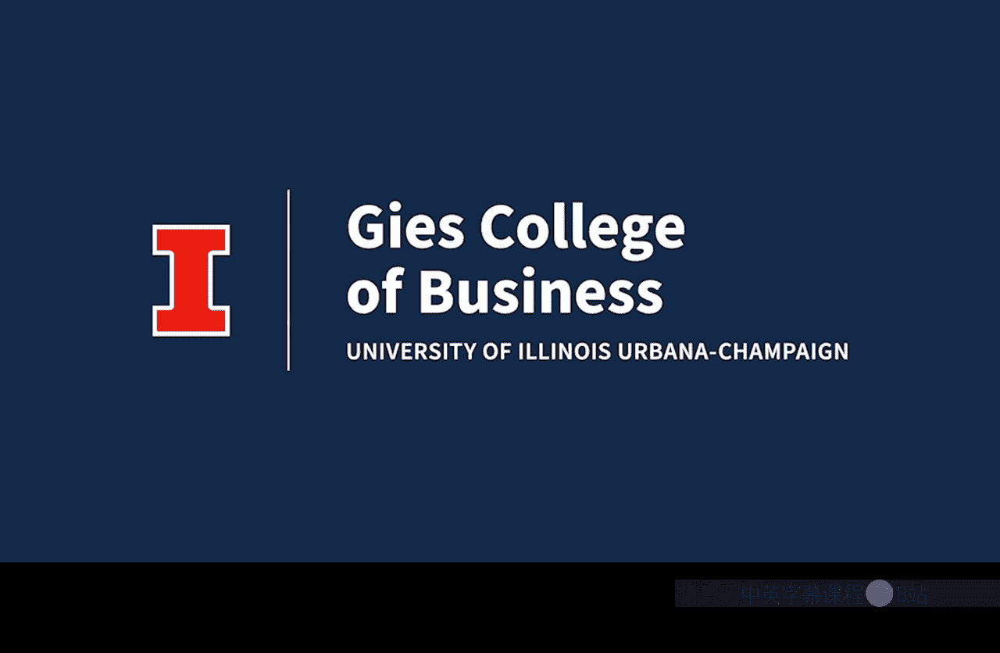

# 伊利诺伊大学【中英⚡商业分析｜Business Analytics Specialization】 p84 P84 03_关于金门多萨教授 -BV1z86nB9EGz_p84-

Hi， I'm Kim Mendoza， and I'm thrilled to share a little bit about myself with you Before stepping into the classroom。

 I gained invaluable insights as an auditor at Pricewater House Coopers。

 Those years sharpened my understanding of accounting and finance。😊，While I was an auditor。

 I encountered many unanswered questions that I wanted to investigate。

 So I decided to pursue my doctorate at the University of Washington。

 That journey shaped my approach to teaching and research and helped me land a job here at the University of Illinois at Urbana Champaign。

 I've taught a variety of courses from financial accounting to data analytics and have developed lots of data analytics。

 teaching content over the years that I'm excited to share with my students。

 Geese College of Business is a leader in Data Analytics。

 It is the home of the Deloitte Foundation Center for Business Analytic。

 a place where universities from around the world turn to for business analytics， teaching material。

😊，Outside of the classroom， I enjoy playing music。 I play guitar and piano and ukulele。

 I also have fun with my three kids。 We love exploring this campus On the weekends。

 we often find ourselves at the University Arboretum， the Aina Union or the Bellll tower。

 It's fun to watch my kids play and discover the beauty of this University。

 I'm so happy you decided to make geese College of Business， a part of your educational journey。

 And I'm excited to be your instructor during your time with the University of Illinois。😊。

