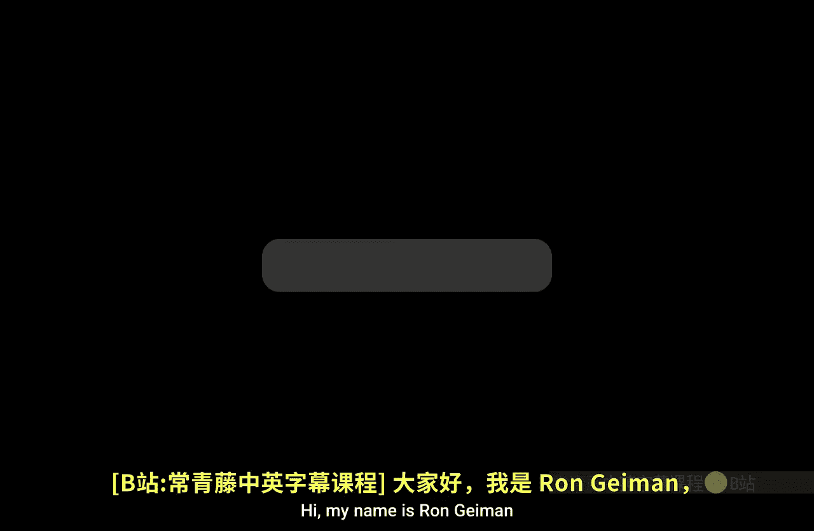
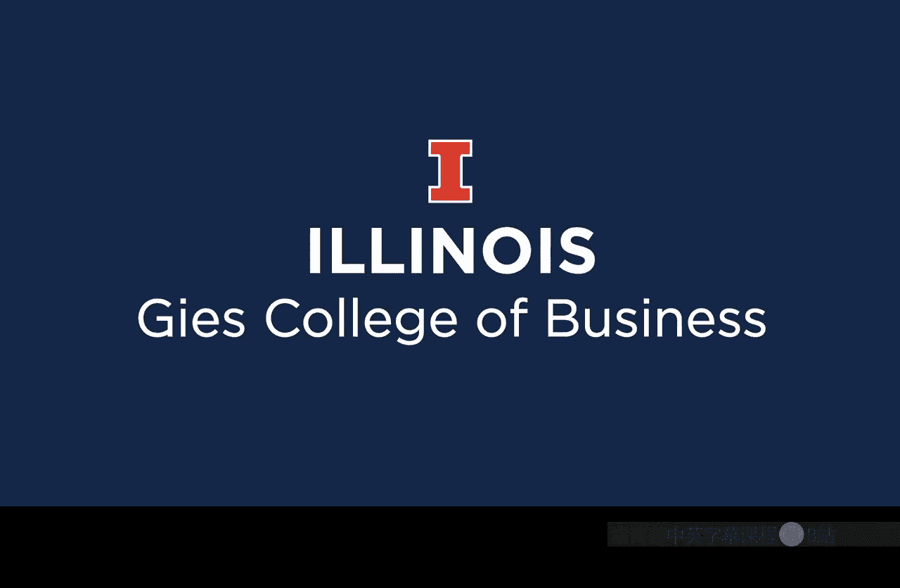

# 伊利诺伊大学【中英⚡商业分析｜Business Analytics Specialization】 p85 P85 04_关于罗纳德·盖蒙教授 -BV1z86nB9EGz_p85-

Hi， my name is Ron Guyman， and I'm on the faculty here in the School of Accountancy at the Geese College of Business。

I have accounting degrees from Brigham Young University and the University of Iowa。

My professional experience has been a mixture of academics and practice。In academics。

 my teaching and research has focused on management， accounting and data analytics。In practice。

 I've worked as a data scientist。There's a little bit about my professional experience。

Let me tell you a little bit now about my personal life。All right， well here I am。

 I'm at the top of a goblin here in goblin Valley， I love it up here。The hike is really fun。

 it's also a majestic view， you see panoramic landscapes。

And I love being able to be out here as a young man。

 I was able to come and hike and camp in this area。Now at this stage in life。

 I spend a lot of time doing a job I love but not being outside as much。

 so I get to bring my children down here sometimes and watch them run and hike around， I love it。

My wife and I a few years ago had a chance to run a race down here。

We ran clear out and around some of the area here my favorite part of the race was ending here in what's called the valley of the Hooos at the very end we ran up some stairs and finished where we could see all the goblins。

It's one of my favorite races I've ever run。I'm here at Arches National Park。

 admiring these tremendously large arches。Behind me。

 we have a couple of arches that look like a bridge。When I think of bridges， I think of teachers。

Why do I think of teachers when I think of bridges？

While one of the greatest teachers I've ever known of。

 Thomas Monson used to talk about the importance of building bridges for others to cross。😊。

He once shared a poem called the bridge builder in which an old man is traveling。

 and he gets to a giant chasm at the bottom of this chasm is a river。Now。

 this old man has a lot of experience and is able to find his way across the river and to the other side of the chasm。

Once he gets across， he stops to build a bridge。Another traveler passing by asks him。

 why are you building a bridge if you've already crossed？

The old man replies that he's not building the bridge for himself。

 He's building the bridge for others so that when they have to cross。

 they'll have an easier go at it。I'm grateful for the opportunity to be a teacher。

 and I aspire to be a good bridge builder。 I hope you， too， as a result of your education。

 Take time to build bridges for others。😊，So I hope that gives you a better idea of who I am。

 I'm grateful to be working at the Geese College of Business and I hope you enjoy the course。

