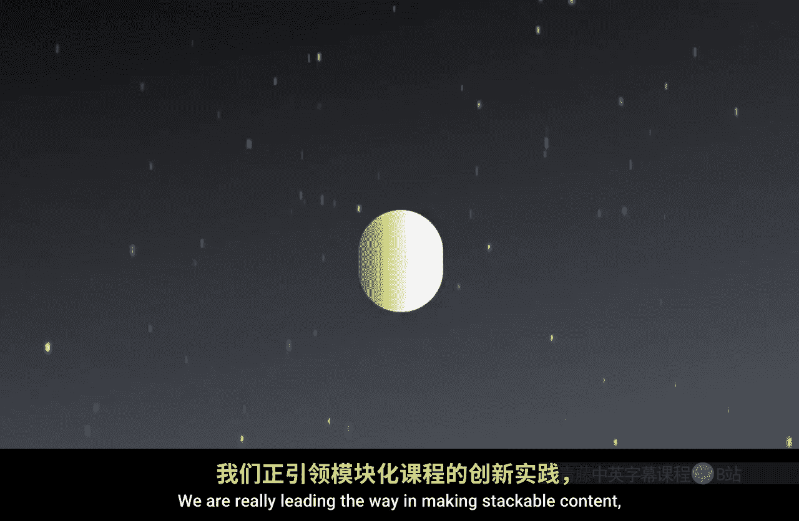
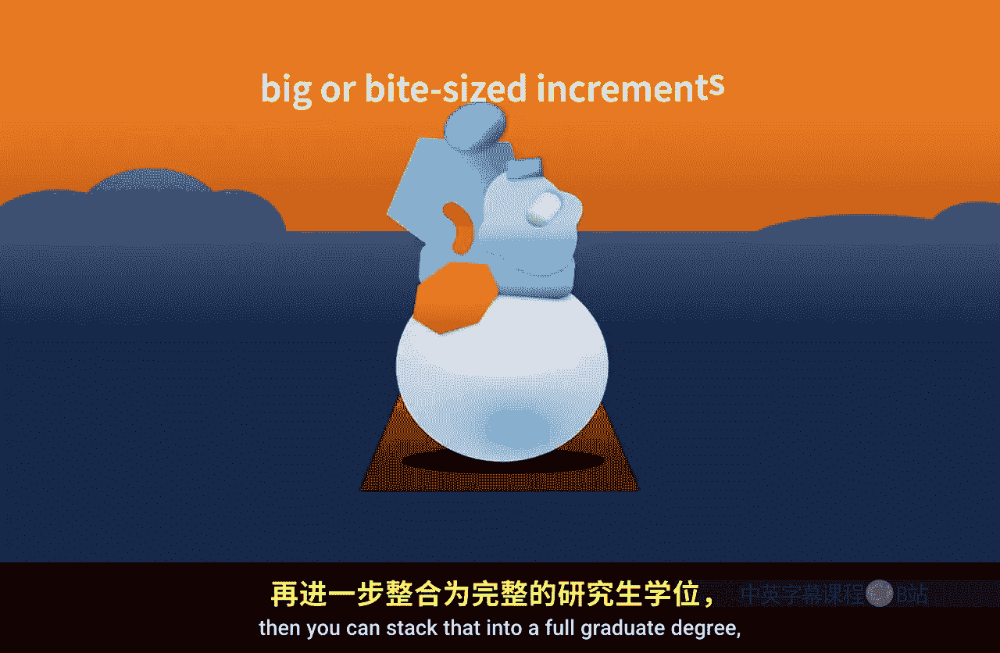

# 伊利诺伊大学【中英⚡商业分析｜Business Analytics Specialization】 p86 P86 07_盖斯社区的影响 -BV1z86nB9EGz_p86-

This is a great time to be part of the geese College of Business community we are innovating in ways no other business school can match。

 we're being recognized on a national and international level for that success and our students and alumni are living proof of the excellence in education that geese delivers。

I truly believe our geese brand and the impact we're making has never been stronger。

 we're carving out a real leadership role among our peers we are doing amazing things in online graduate education。

 we're rethinking the way business education should be delivered and we're breaking down as many financial and geographic barriers as we possibly can。

We're reaching thousands of learners who may not have otherwise had the opportunity or ability to earn a graduate degree or certificate or learn a new skill。

By expanding access， we have created what I believe is unmapped diversity in experience culture。

 demographics， gender， race and ethnicity， we are growing our alumni network faster and broader than any other program with an alumni base that spans the world and spans industries。

One of the most exciting things happening is the way we are expanding our content Not everyone wants or needs a full degree anymore。

 or maybe they do but they're not sure if they're quite ready to dive in we're really leading the way in making stackable content which creates so many opportunities for learners from all backgrounds experience levels and varying goals you can take just one class then you can stack that into a specialization then you can stack that into a full graduate degree all without having to repeat courses that you've already taken It's all part of our commitment to make education accessible and achievable for all who desire it and are committed to pursuing it that's why geese College of Business all about and that's why I'm so proud to call at home I hope you can see your potential here and consider joining our community of learners Schs and leaders。

